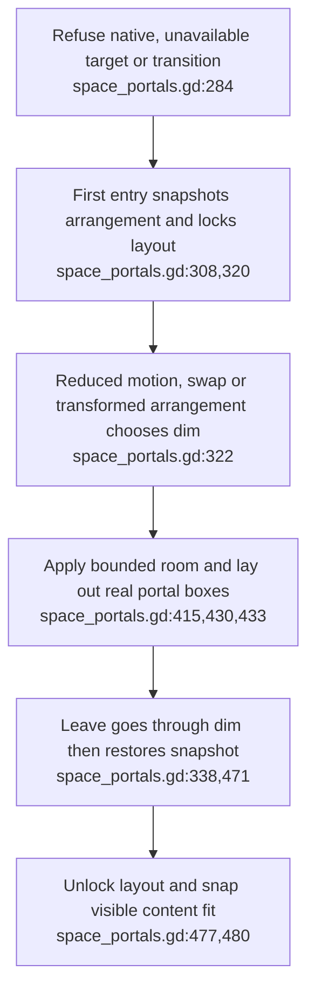
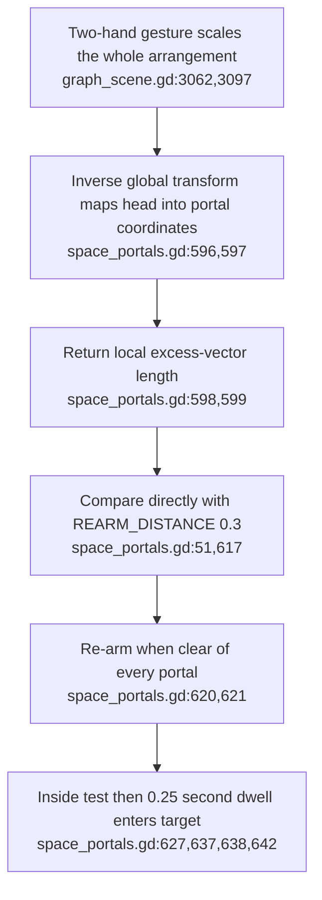
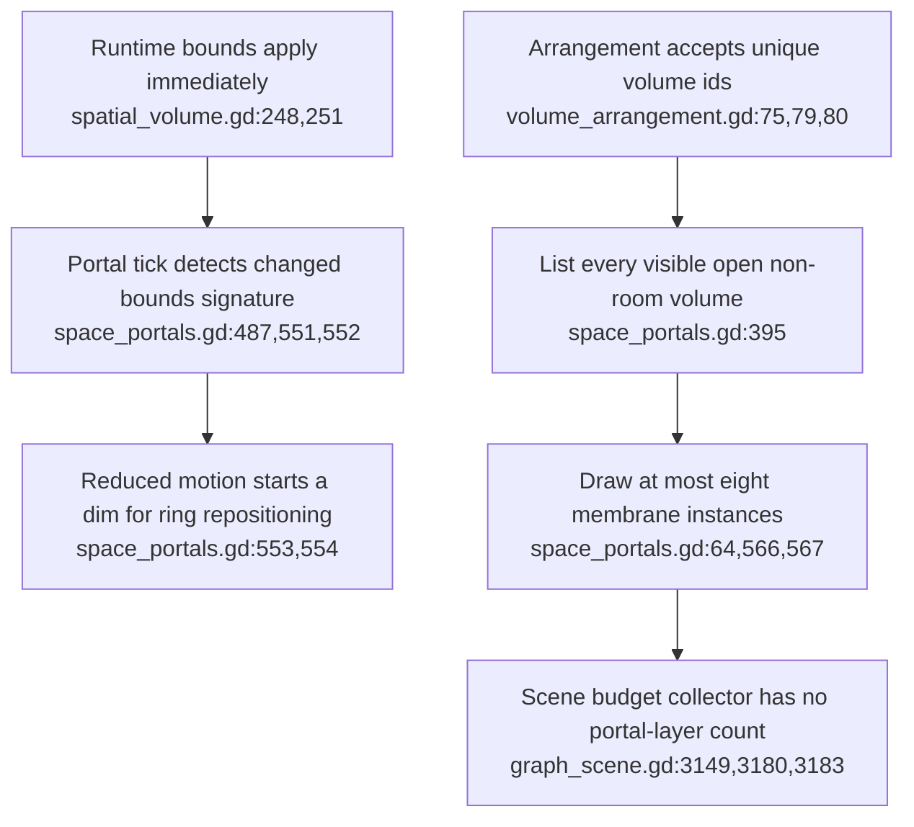

## For developers

The [portal audit](../../estate-review/2026-10-31-portals-and-federation.md) records 41 existing logic tests and seven adversarial/control cases on isolated Godot 4.6.1. Those runs remain historical. The [grab and portal refresh](../../estate-review/2026-11-01-xr-grab-boundaries.md) checks the current source delta; seven native scene tests and headset acceptance remain outside the portal fixture.

## For the business

Entering a volume changes the local viewing arrangement. It grants no remote-data permission. State restoration works in the tested cases; physical-distance hysteresis and the scope of comfort promises need correction.

## VC-47.1 Entry snapshots the arrangement and chooses a transition

**What it shows.** Enter/swap/leave and exact restoration have passing logic tests. **Why it is this way.** The room is a bounded-volume layout state, with a saved ring arrangement; it is not a native immersive mode or a remote room admission.

## VC-47.2 World points become local distances before a metre-labelled threshold

**What it shows.** Half scale re-arms at a physical 0.2 m gap; double scale remains disarmed at 0.4 m. Unit-scale controls pass. **Why it is this way.** Distance is measured in local units after inverse scaling, making the physical threshold 0.3 times the arrangement scale.

**Tension:** The documented re-arm distance is in metres, while the implementation compares a local-coordinate length (`space_portals.gd:599,617`).

## VC-47.3 Resize detection and membrane capacity have explicit boundaries

**What it shows.** The API probe changes bounds before the dim begins; nine admitted portal boxes get eight membranes. **Why it is this way.** Detection follows mutation, and the documented eight-portal capacity is enforced only for membrane instances. The present scene has three volumes; the ninth-box case tests an extension boundary.

**Debt:** Portal membranes and fade meshes are absent from the scene's explicit draw-call sum; primitive totals are measured separately (`graph_scene.gd:3180,3181`).
