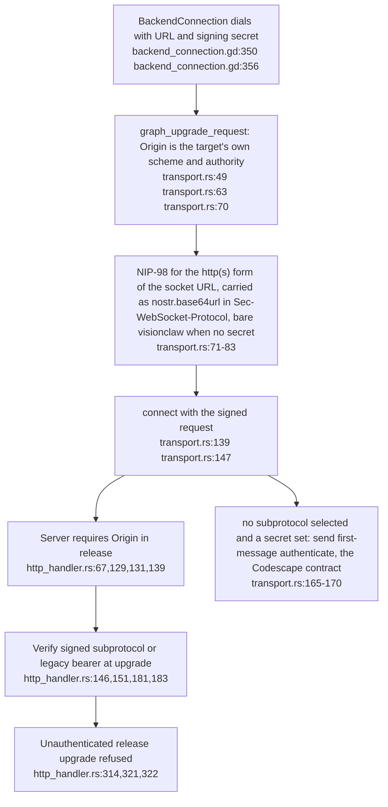
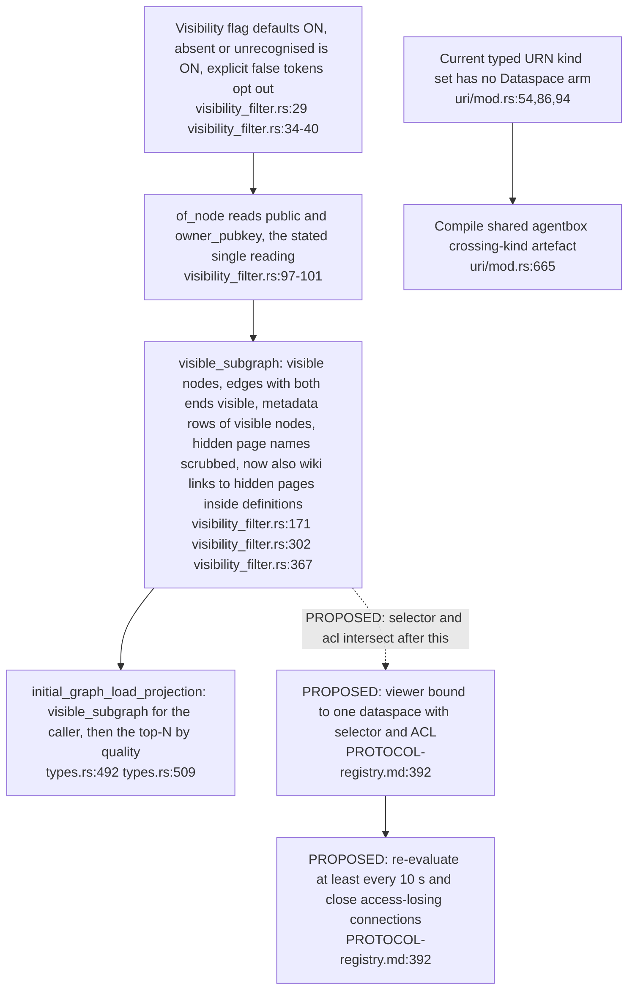
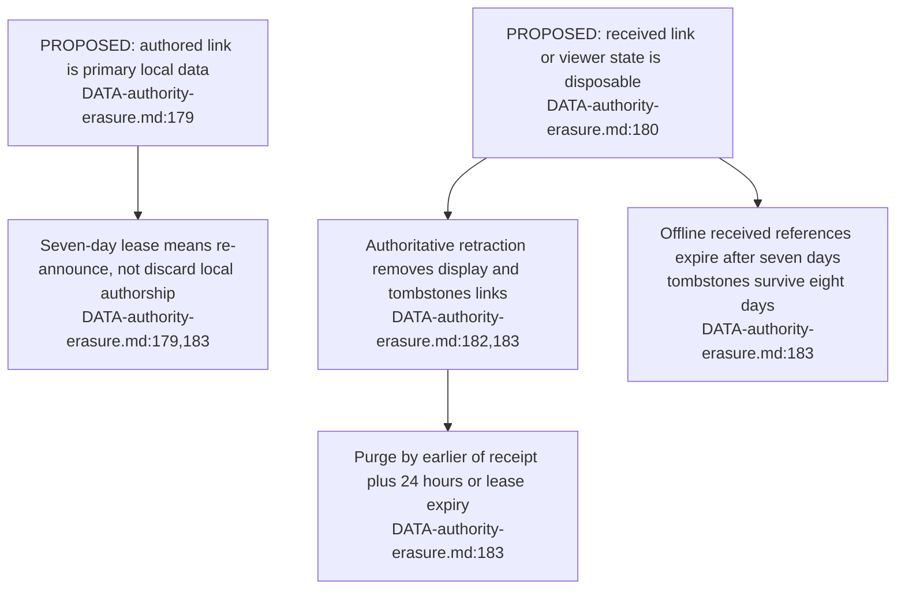

## For developers

The [audit](../../estate-review/2026-10-31-portals-and-federation.md) traces current upgrade and identifier code against ADR-2161. Proposed nodes below are requirements, not implemented services; no live federation session was run.

## For the business

Local portals and concurrent graph connections do not provide cross-node data sharing. Federation still needs authenticated release connections, declared projections, permission checks, replay protection and erasure handling.

## VC-48.1 The XR client now signs the release upgrade, with a first-message fallback for Codescape

**What it shows.** The upgrade-phase mismatch the earlier stamp recorded is closed: a configured identity now signs the HTTP upgrade itself, and the post-upgrade text message survives only for a server that selects no subprotocol. **Why it is this way.** One signed carrier for browsers and the headset (`transport.rs:48`); dataspace viewers must still bind one dataspace, which nothing implements.
**Open (risk):** The native client writes its own `Origin` from the target URL (`transport.rs:63`), so the release Origin gate (`http_handler.rs:139`) separates browsers only; the signed carrier is the actual boundary for non-browser peers.

## VC-48.2 One visibility projection, still narrower than a dataspace contract

**What it shows.** Owner/public filtering is now one function shared by REST reads and `/wss`; the identifier bridge still refuses a dataspace kind. **Why it is this way.** ADR-060 Phase 4 unified the gate; the earlier comment-versus-parser drift (OFF vs ON) is gone, `types.rs:184` now says default ON.
**Debt (parallel):** the demo director still re-reads the `public` key itself (`agent_demo_director.rs:500-504`), although `visibility_filter.rs:98-100` calls `of_node` the only reading on every wire path. The two copies agree today. `public_subgraph` was the other copy and now goes through `of_node` (`corpus_history.rs:140`, `corpus_history.rs:144`).

## VC-48.3 Proposed reference lifetimes distinguish authored data from received copies

**What it shows.** The design has distinct ownership and expiry rules; the current resolver has no 410/tombstone implementation. **Why it is this way.** A received reference is reconstructible, while an authored assertion is primary data. This diagram records the proposal without asserting that its deadlines run today.
**Open (risk):** graph shares are a durable copy of the creator's view, private nodes included, and no per-user erasure path reaches them (`DATA-authority-erasure.md:114-115`, `DATA-authority-erasure.md:129-131`). A federated render-only rule that forbids durable copies (`DATA-authority-erasure.md:182`) would need shares carved out or covered.
