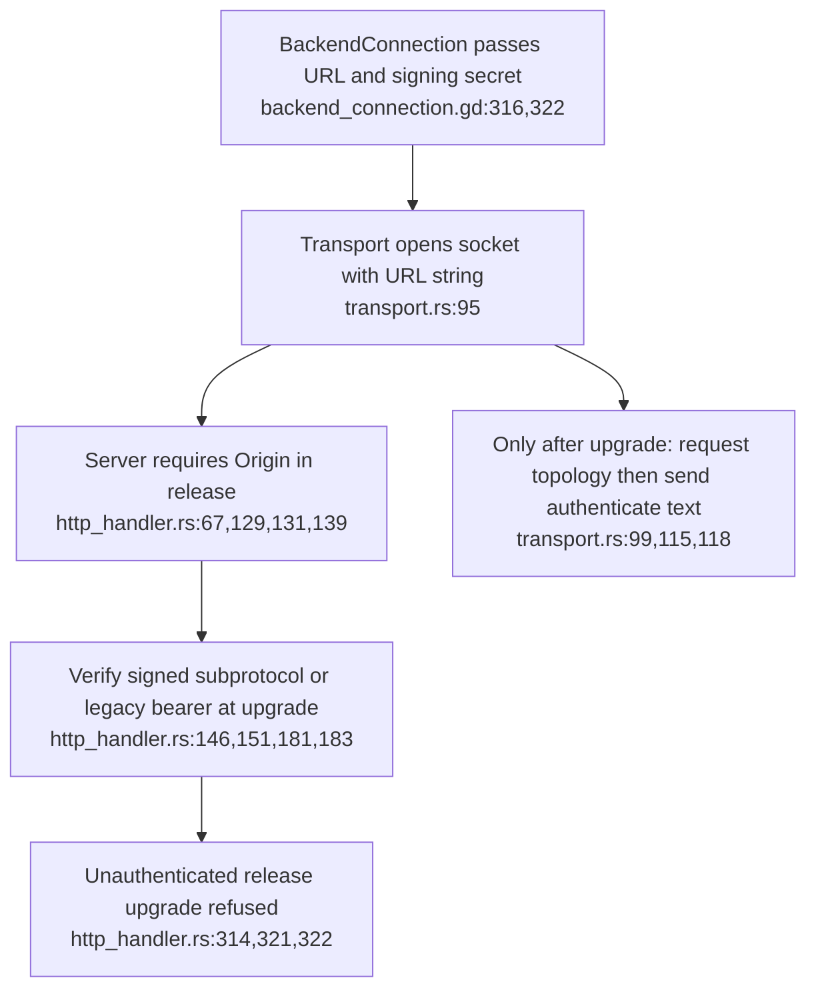
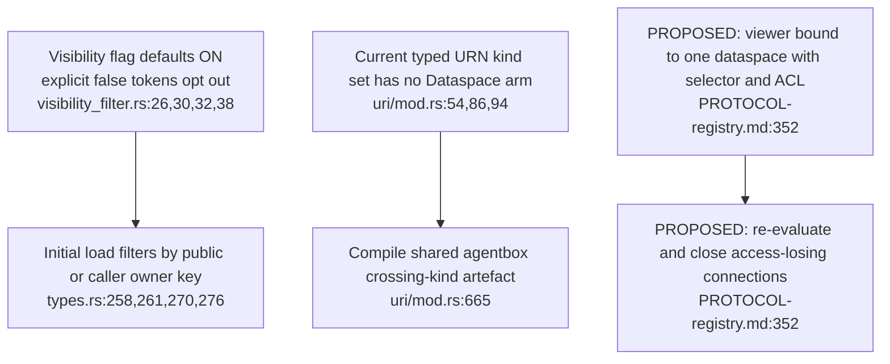

## For developers

The [audit](../../estate-review/2026-10-31-portals-and-federation.md) traces current upgrade and identifier code against ADR-2161. Proposed nodes below are requirements, not implemented services; no live federation session was run.

## For the business

Local portals and concurrent graph connections do not provide cross-node data sharing. Federation still needs authenticated release connections, declared projections, permission checks, replay protection and erasure handling.

## VC-48.1 Current XR authentication occurs after the release upgrade gates

**What it shows.** A secret used for the post-upgrade text message cannot satisfy earlier release Origin and authentication checks. **Why it is this way.** The client and server implement different handshake phases. This source trace does not test a deployed proxy or permissive development mode.

**Tension:** ADR-2161's Origin prerequisite also needs upgrade-time authentication alignment (`transport.rs:95,115`).

## VC-48.2 Existing visibility and identifiers are narrower than a dataspace contract

**What it shows.** Eighteen production visibility tests pass; the actual bridge refuses the proposed dataspace kind. Neither result proves the proposed connection mode. **Why it is this way.** Existing owner/public filtering and closed identifier translation predate dataspace selectors, ACLs and revocation.

## VC-48.3 Proposed reference lifetimes distinguish authored data from received copies

**What it shows.** The design has distinct ownership and expiry rules; the current resolver has no 410/tombstone implementation. **Why it is this way.** A received reference is reconstructible, while an authored assertion is primary data. This diagram records the proposal without asserting that its deadlines run today.
