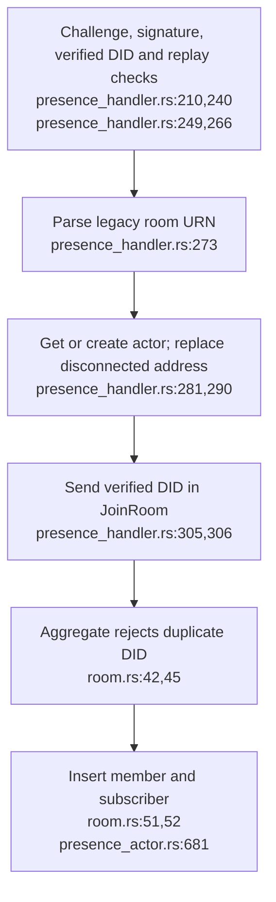
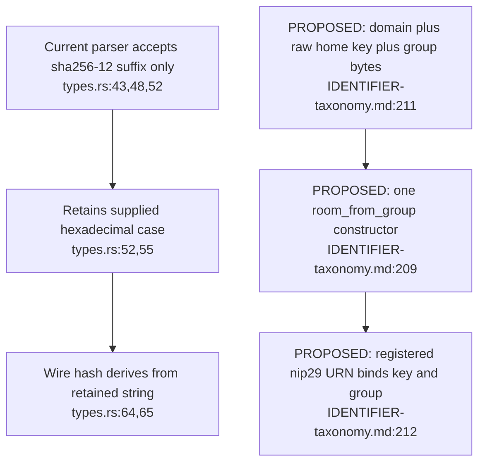
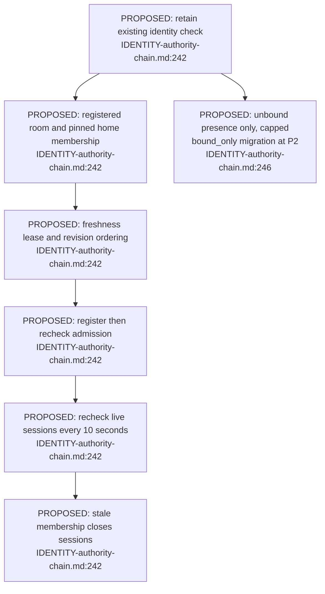

## For developers

The [audit](../../estate-review/2026-11-01-room-admission-and-voice.md) runs the real actor in isolation and checks the proposed identifier vector. Proposed nodes are requirements; no membership implementation or live admission test is claimed.

## For the business

A signed identity can currently join a legacy presence room. Restricting a space to its members requires a separate authority check, durable replay protection and removal handling.

## VC-49.1 Current identity checks lead directly to the legacy room actor

**What it shows.** The current join path has identity and duplicate checks but no membership gate or cap. **Why it is this way.** It implements the earlier legacy presence contract; the isolated actor accepted 33 distinct members and refused a duplicate.

## VC-49.2 The new room identifier has a valid vector but no current parser support

**What it shows.** The audit reproduces the proposed SHA-256 vector while the production parser rejects its result. **Why it is this way.** The new namespace is specified independently of the retained legacy form; a test-only hash calculation does not implement the constructor or registry.

## VC-49.3 Proposed admission includes freshness and a second check after registration

**What it shows.** The proposed check applies both at entry and during a session. **Why it is this way.** A successful initial identity check cannot prove continuing membership; the 90-second presence deadline still needs implementation and adversarial timing evidence.

**Tension:** The proposal lets unbound rooms keep "the member cap" (`IDENTITY-authority-chain.md:246`), but `Room::join` checks only for a duplicate DID before inserting (`room.rs:42-52`), so no cap exists to keep.
