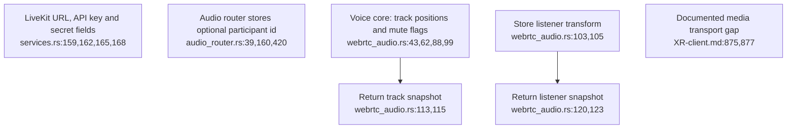
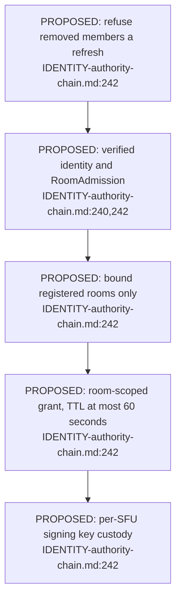
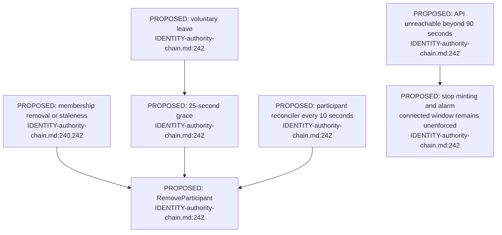

## For developers

ADR-2160 explicitly defers voice. The [audit](../../estate-review/2026-11-01-room-admission-and-voice.md) tests existing state code and identifies a missing dependency issuer in the proposed deadline argument; it does not run or activate a call.

## For the business

Voice configuration and position tracking are present. A membership-controlled spatial call still needs media integration and a revocation contract covering all reconnect credentials.

## VC-50.1 Current code stores voice state without the proposed call authority

**What it shows.** These are existing fields and state operations, not a connected media pipeline. **Why it is this way.** The native media transport remains unwired; passing state tests do not establish HRTF, microphone capture or a server token issuer.

## VC-50.2 The proposal makes room admission a prerequisite for application minting

**What it shows.** The intended application credential path is specified but absent from current source. **Why it is this way.** The authority document describes a proposal; the audit identifies an additional dependency refresh path that its system-wide argument must cover.

## VC-50.3 Proposed leave and removal paths have different deadlines

**What it shows.** The proposal distinguishes voluntary reconnect grace, removal and an API-partition exception. **Why it is this way.** Token expiry does not disconnect an active participant; the separate 150-second rejoin claim is undercut by the issuer gap documented in the audit and must not be read as a current guarantee.
