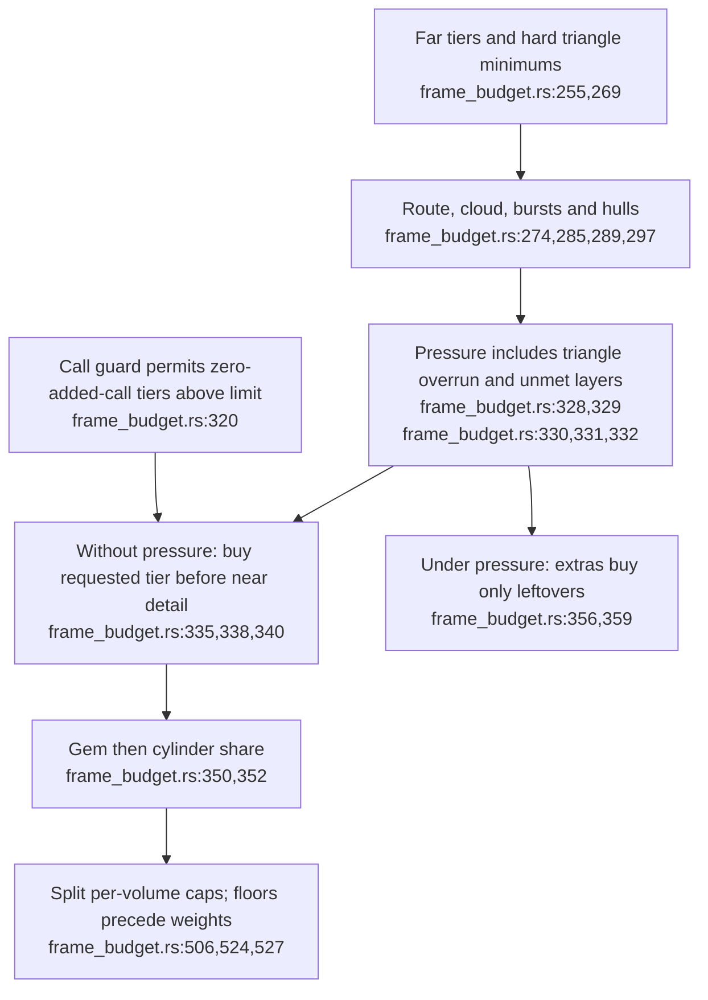
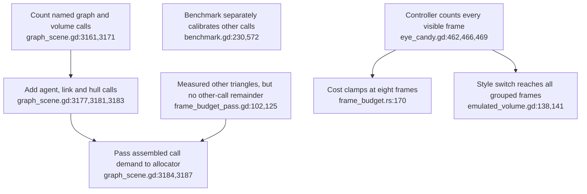
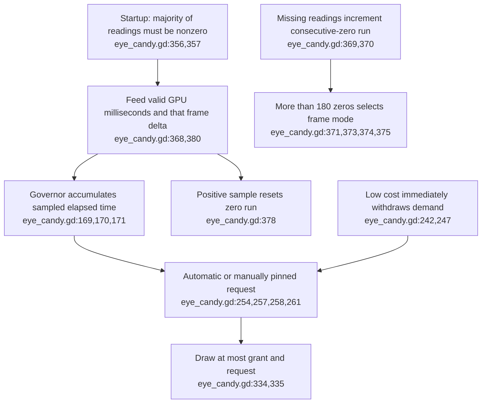
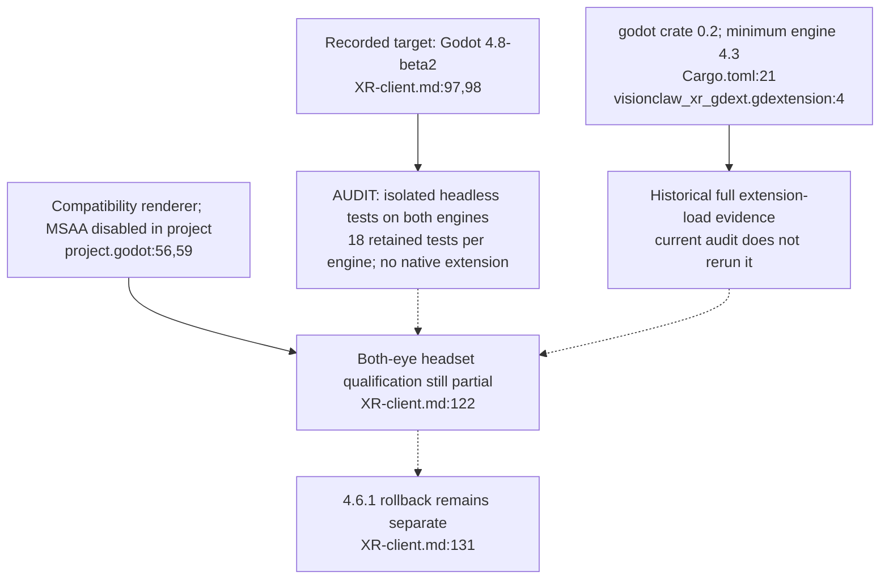
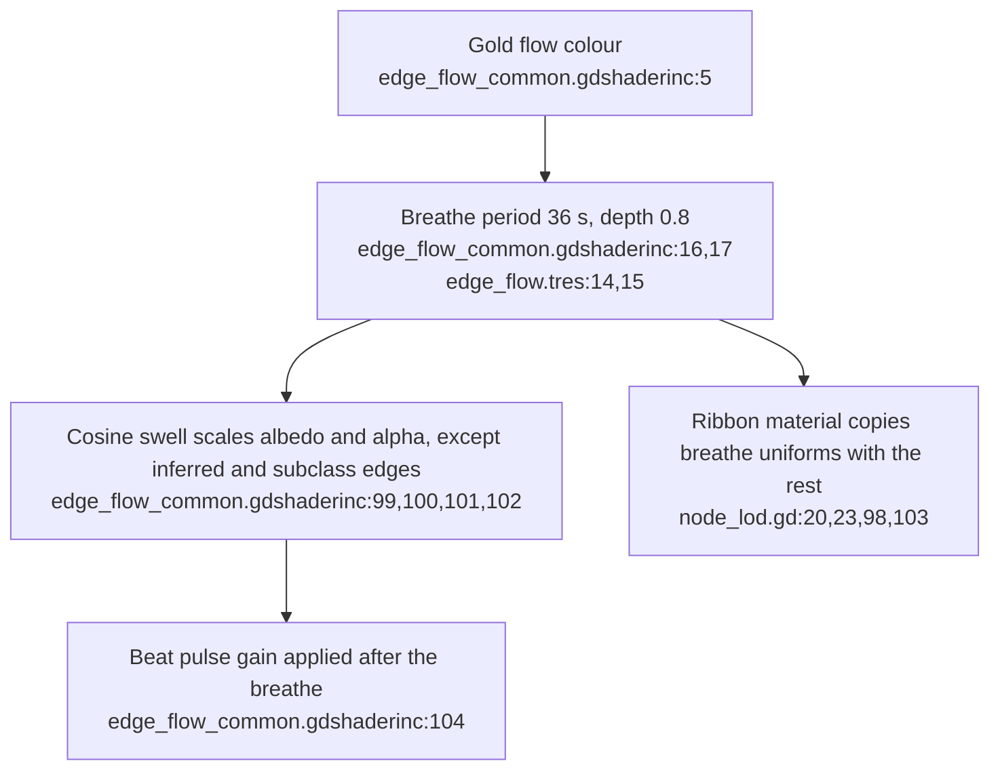

## For developers

The [XR budget audit](../../estate-review/2026-11-01-xr-budget-and-engine-qualification.md) traces ADR-2167 and ADR-2165 in full. Native arithmetic and isolated headless controller tests are separate from full-client, renderer and headset qualification.

## For the business

Visual polish trades some graph detail for frames, sky and motes. The controls need reliable timing and complete accounting to preserve a comfortable, readable workspace; a desktop or headless pass cannot establish both-eye headset behaviour.

## VC-51.1 Requested extras reserve a bounded share before near detail

**What it shows.** Extras have an approved allowance, with a last-claim fallback under triangle or layer pressure. **Why it is this way.** The owner accepted fewer near cylinders and some gems; existing call overrun is reported but does not withdraw a zero-added-call allowance.

## VC-51.2 Live demand and drawn-frame counts bound the guarantee

**What it shows.** Whole-frame call compliance depends on complete inputs; nine constructed frames also exceed the clamped price by 24 triangles. **Why it is this way.** The live scene and benchmark build demand differently, and pricing alone does not enforce a visible-frame limit.

## VC-51.3 Sparse timing can delay automatic quality reduction

**What it shows.** Forty seconds of sparse loaded samples can leave tier 4 requested while neither control window completes. **Why it is this way.** Zero samples do not advance the governor; a fresh-sample coverage rule is separate from the existing consecutive-zero fallback and manual quality pin.

## VC-51.4 Engine selection does not close the stereo gate

**What it shows.** Target engine, API compatibility, headless behaviour and both-eye rendering have different evidence. **Why it is this way.** The engine change reopens the stereo invariant; an unchanged extension or a successful desktop mirror does not prove the right eye works.

## VC-51.5 The gold edge breathe is one shader term, mirrored to the ribbons

**What it shows.** The breathe is time-driven in the shader, so reduced motion leaves it on, and the trough is 0.04 of the peak. It multiplies with the separate beat pulse. **Why it is this way.** The owner asked on 2026-11-01 for a slow visible breathe. 36 s divides Godot's 3600 s TIME rollover exactly (`edge_flow_common.gdshaderinc:10`).
