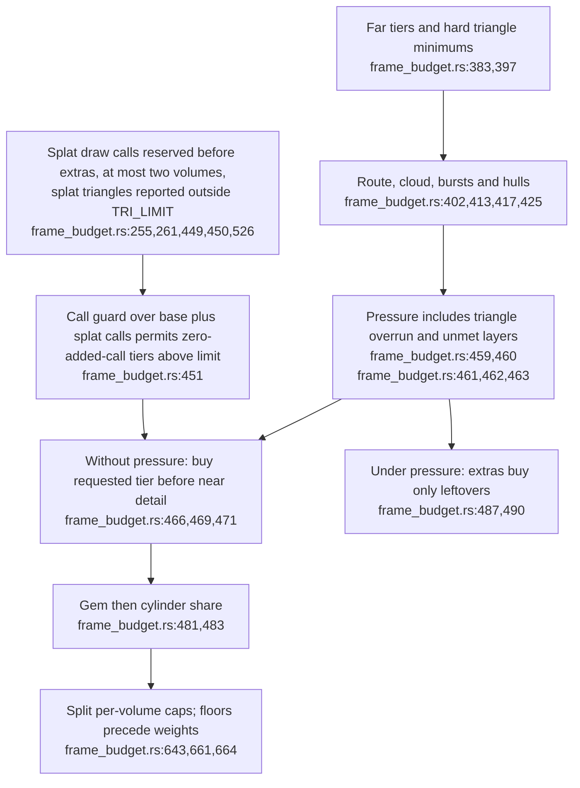
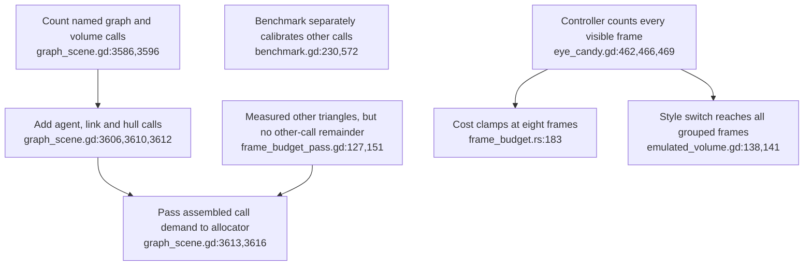
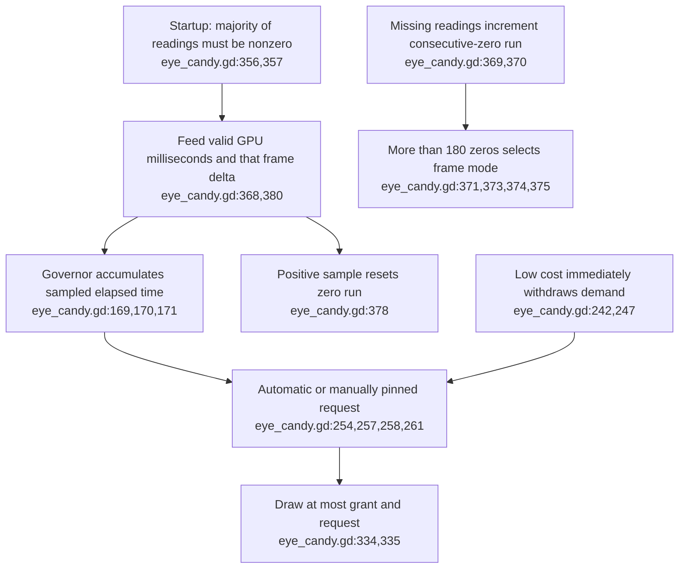
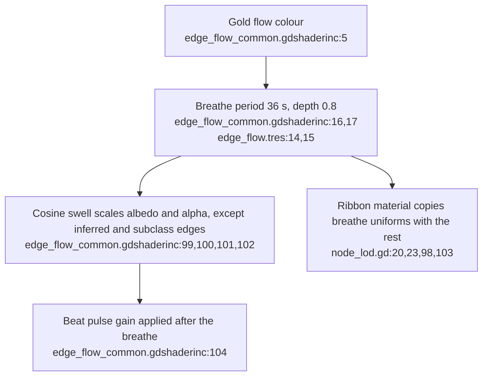
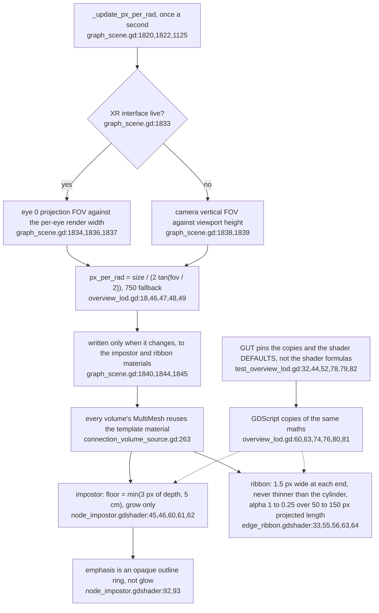
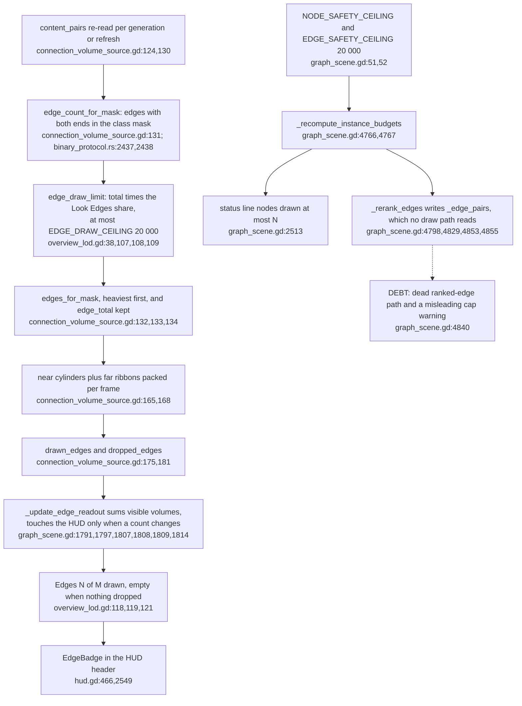
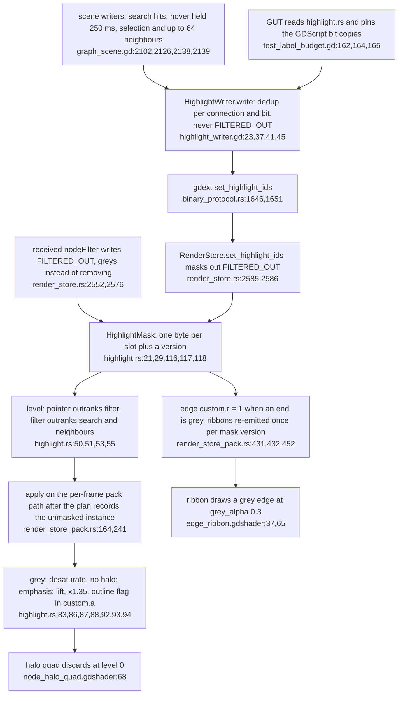

## For developers

The [XR budget audit](../../estate-review/2026-11-01-xr-budget-and-engine-qualification.md) traces ADR-2167 and ADR-2165 in full. Native arithmetic and isolated headless controller tests are separate from full-client, renderer and headset qualification. VC-51.6 to VC-51.8 add the ADR-2188 overview tier (2026-11-06): pixel-floored impostors and screen-width ribbons, the per-volume edge limit with its HUD count, and the Rust highlight mask; their evidence is headless GUT and Rust units only.

## For the business

Visual polish trades some graph detail for frames, sky and motes. The controls need reliable timing and complete accounting to preserve a comfortable, readable workspace; a desktop or headless pass cannot establish both-eye headset behaviour.

## VC-51.1 Requested extras reserve a bounded share before near detail

**What it shows.** Extras have an approved allowance, with a last-claim fallback under triangle or layer pressure; splat volumes now take their draw calls first. **Why it is this way.** The owner accepted fewer near cylinders and some gems; existing call overrun is reported but does not withdraw a zero-added-call allowance.
**Tension (ADR-2170 vs PRD-008):** splat triangles are never charged against the 100 000-triangle budget (`xr-client/rust/src/frame_budget.rs:38-42`), so an entered tier-3 splat volume adds 200 000 triangles beside it (`xr-client/rust/src/frame_budget.rs:69`, `xr-client/rust/src/frame_budget.rs:203-205`); the owner accepted this as ADR-2170 decision 7, and only a headset receipt can say whether 90 fps survives it.

## VC-51.2 Live demand and drawn-frame counts bound the guarantee

**What it shows.** Whole-frame call compliance depends on complete inputs; nine constructed frames also exceed the clamped price by 24 triangles. **Why it is this way.** The live scene and benchmark build demand differently, and pricing alone does not enforce a visible-frame limit.

## VC-51.3 Sparse timing can delay automatic quality reduction

**What it shows.** Forty seconds of sparse loaded samples can leave tier 4 requested while neither control window completes. **Why it is this way.** Zero samples do not advance the governor; a fresh-sample coverage rule is separate from the existing consecutive-zero fallback and manual quality pin.

## VC-51.4 Engine selection does not close the stereo gate

**What it shows.** Target engine, API compatibility, headless behaviour and both-eye rendering have different evidence. **Why it is this way.** The engine change reopens the stereo invariant; an unchanged extension or a successful desktop mirror does not prove the right eye works.

## VC-51.5 The gold edge breathe is one shader term, mirrored to the ribbons

**What it shows.** The breathe is time-driven in the shader, so reduced motion leaves it on, and the trough is 0.04 of the peak. It multiplies with the separate beat pulse. **Why it is this way.** The owner asked on 2026-11-01 for a slow visible breathe. 36 s divides Godot's 3600 s TIME rollover exactly (`edge_flow_common.gdshaderinc:10`).

## VC-51.6 The overview tier is pixel-floored impostors and screen-width ribbons fed one px_per_rad (ADR-2188 D1, D2)

**What it shows.** One per-second measurement drives both overview shaders through materials every volume shares, so a node never shrinks below 3 px and an edge is a 1.5 px line whose alpha falls with projected length. **Why it is this way.** ADR-2188 carries the desktop overview contract (ADR-2179, ADR-2181, ADR-2182) into the headset without bloom; headless Godot cannot compile shaders, so the maths is mirrored in GDScript for GUT (`xr-client/tests/unit/test_overview_lod.gd:79`).
**Debt (parallel):** `overview_lod.gd` re-implements the impostor floor, ribbon width and length fade the shaders compute (`xr-client/scripts/overview_lod.gd:6-8`, `xr-client/materials/node_impostor.gdshader:60-62`, `xr-client/materials/edge_ribbon.gdshader:55-65`); GUT pins the copy and the shader defaults (`xr-client/tests/unit/test_overview_lod.gd:78-91`) but a change to a shader formula would pass it.
**Open (risk):** `px_per_rad` is the centre-of-view value from eye 0's FOV (`xr-client/scripts/graph_scene.gd:1836-1837`), so on an asymmetric headset frustum the pixel floor and line width are approximate, as the doc concedes unverified (`docs/XR-client.md:825-826`).
**Tension (ADR-2188 D3 vs halo):** ADR-2188 says emphasis is "never glow" (`docs/adr/ADR-2188-the-xr-client-adopts-the-overview-first-contract-without-bloom.md:33`), yet the halo quad still draws additively (`xr-client/materials/node_halo_quad.gdshader:18`); the doc reconciles this as emissive geometry rather than post-process bloom (`docs/XR-client.md:847-849`).

## VC-51.7 Each volume sizes its edge request from its own data and the HUD counts what it dropped (ADR-2188 D2, ADR-2179 P4)

**What it shows.** The cap a viewer sees is the triangle-budget ceiling, applied per volume and reported in the header, not the old scene-wide safety constants. **Why it is this way.** ADR-2179 P4 forbids a silent cap; ribbons are 2 triangles, so 20 000 of them are 40 000 of the 100 000 budget (`xr-client/scripts/overview_lod.gd:33-38`).
**Debt (loose end):** `NODE_SAFETY_CEILING` and `EDGE_SAFETY_CEILING` (`xr-client/scripts/graph_scene.gd:51-52`) now feed only the status text (`xr-client/scripts/graph_scene.gd:2513`) and `_rerank_edges`, whose `_edge_pairs` output has no reader (`xr-client/scripts/graph_scene.gd:4853-4855`), so its "rendering N" warning (`xr-client/scripts/graph_scene.gd:4840`) describes nothing drawn.
**Drift:** the ceiling comment says it stops a payload blowing "the MultiMesh instance buffers" (`xr-client/scripts/graph_scene.gd:45-50`), while the overview rule says there is no fixed buffer capacity to clip against (`xr-client/scripts/overview_lod.gd:103-105`); `xr-client/perf/benchmark.gd:140-143` still sizes its default edge load from the scene constant.

## VC-51.8 The highlight mask is a Rust byte per slot, applied on the pack path (ADR-2188 D4, ADR-2183)

**What it shows.** Pointer and query state reach the renderer as one byte per node slot, folded to grey, normal or emphasised at pack time, so a hover never invalidates a pack plan. **Why it is this way.** ADR-2183 makes filters grey out rather than remove, and ADR-2188 D3 rules out glow, so emphasis is colour, size and an outline (`xr-client/rust/src/highlight.rs:1-18`).
**Debt (parallel):** the five bit values are copied into GDScript with a "must match" comment (`xr-client/scripts/highlight_writer.gd:8-21`, `xr-client/rust/src/highlight.rs:21-29`), held only by a source-text GUT check (`xr-client/tests/unit/test_label_budget.gd:162-170`); `HighlightWriter.neighbours_of` mirrors the Rust `neighbours_in` for clients without it (`xr-client/scripts/highlight_writer.gd:79-98`).
**Drift:** the ADR-2188 section of `docs/XR-client.md` places `_update_px_per_rad` at graph_scene line 1805 and `set_edge_readout` at hud line 2266 (`docs/XR-client.md:820-821`, `docs/XR-client.md:837-838`), but at this pin they sit at `xr-client/scripts/graph_scene.gd:1820` and `xr-client/scripts/hud.gd:2549`.
**Invariant (resolved Open):** the headset receipt is recorded. ADR-2188 notes OpenXR focused, 88-90 fps with all three volumes and zero script, shader, heartbeat or reconnect errors over 15 minutes on the HP (`docs/adr/ADR-2188-the-xr-client-adopts-the-overview-first-contract-without-bloom.md:52`), with `activation_status: live`, corrected on 2026-11-07 from `active`, which the ledger does not accept (`docs/adr/ADR-2188-the-xr-client-adopts-the-overview-first-contract-without-bloom.md:7`, `docs/adr/ADR-2188-the-xr-client-adopts-the-overview-first-contract-without-bloom.md:56`) and the XR-client 0.1.35 changelog entry (`docs/XR-client.md:8`).
**Drift:** RESOLVED at visionclaw 46edc196 — ADR-2188's Verification section now opens "All satisfied (2026-11-06)" and lists the headset receipt as satisfied (`docs/adr/ADR-2188-the-xr-client-adopts-the-overview-first-contract-without-bloom.md:44`, `docs/adr/ADR-2188-the-xr-client-adopts-the-overview-first-contract-without-bloom.md:48`), matching the status section (`docs/adr/ADR-2188-the-xr-client-adopts-the-overview-first-contract-without-bloom.md:52`).
**Open:** visual legibility of the rail and pages in the headset is still a human check (`docs/adr/ADR-2188-the-xr-client-adopts-the-overview-first-contract-without-bloom.md:52`); GL-gated GUT is not checkable from the container.
