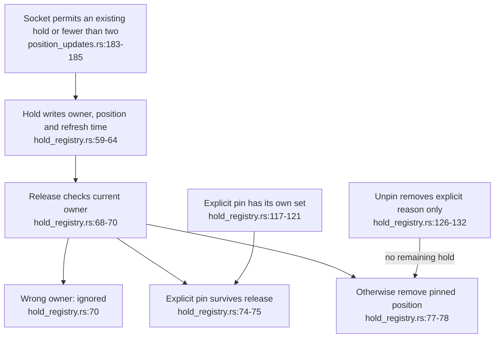
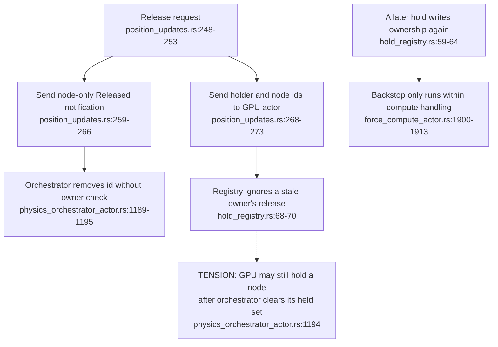
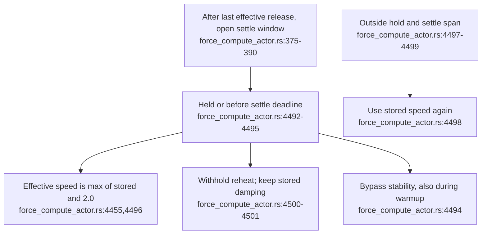
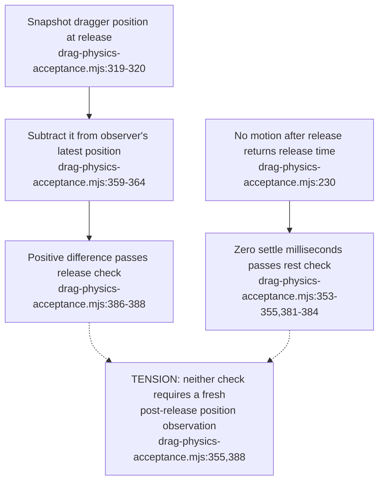
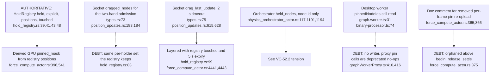

## For developers

The [contract review](../../estate-review/2026-11-01-drag-holds-and-acceptance.md) tests the real registry and runs the unchanged acceptance script against an intentionally wrong local peer. Holds, explicit pins, actor notifications and observed movement have separate lifetimes. Historical [VC-16](16-interaction-drag-pin-layout.md) describes the previous implementation.

## For the business

Letting go should return a node to the graph; pinning should keep it anchored. A second person needs to see whose hand controls the node and whether their view is current. A passing test is useful only if it can reject a peer that remains pinned or stops delivering updates.

## VC-52.1 A hold and an explicit pin are distinct reasons to anchor a node

**What it shows.** Fourteen native tests cover the registry. Three additional probes check its lifetime/capacity boundaries and model the independently maintained orchestrator set. The registry itself accepts more than two holds; admission belongs to the socket.

**Why it is this way.** A release from an old holder must not free another person's node, and a temporary hold must not erase an explicit pin.

## VC-52.2 Release notifications can disagree about ownership

**What it shows.** This known ADR gap is supported by source and an actual-registry/model probe, not a fresh actor integration run. Expiry readmits then eventually clears a late hold when called; it does not reject closed holders.

**Why it is this way.** Two independent notifications carry different information. Ownership-aware state should come from accepted transitions rather than unqualified interaction intents.

## VC-52.3 The effective interaction speed differs from stored speed by decision

**What it shows.** ADR-2169 explicitly amends ADR-2140. The accepted temporary floor does not edit the stored document. Passing the stored damping through cannot establish a two-second physical settling time.

**Why it is this way.** Interaction responsiveness and residual motion are different outcomes; both need live measurements under the actual force set.

## VC-52.4 Cross-client samples and silence can produce a false acceptance

**What it shows.** The negative control leaves the node pinned at 150 and sends zero post-release positions. All five checks pass; the reported travel comes from different clients' earlier samples.

**Why it is this way.** The script confuses observation differences with elapsed-time motion. A release receipt and one observer's ordered samples must establish when an observation was made; silence alone cannot prove rest.

## VC-52.5 Selecting a volume transform does not select its coordinate source

**What it shows.** The new focus-frame helper is source-confirmed. A marker test with distinct positions per connection is still needed; existing transform assertions do not cover that supplier boundary.

**Why it is this way.** Node ids and transforms belong to streams/volumes. Carrying the correct frame without the matching point can place an overlay incorrectly when those streams differ.

## VC-52.6 One desktop hold from press to rejoin, across socket, orchestrator, registry and GPU

**What it shows.** One gesture fans out into two independent messages, one to the GPU actor and one through the graph service to the orchestrator, and each keeps its own held set. **Why it is this way.** ADR-2169 (2026-11-01) put ownership in the GPU actor's registry. The orchestrator's intent channel predates it and was kept for the auto-pause and wake behaviour.

## VC-52.7 Where the fact "this node is held or pinned" is stored

**What it shows.** Of the server-side copies, the registry is the only one that carries ownership and the hold-versus-pin distinction. The GPU mask is derived from it, and the timeouts are deliberately layered. **Why it is this way.** ADR-2169 added the registry beside the existing socket and orchestrator state rather than replacing either.

**Debt:** the socket's `dragged_nodes` duplicates the registry's per-holder set (`types.rs:73`; `hold_registry.rs:83`), and the desktop `pinnedNodeIds` is read but never written (`graph.worker.ts:31`; `graphWorkerProxy.ts:410`).
