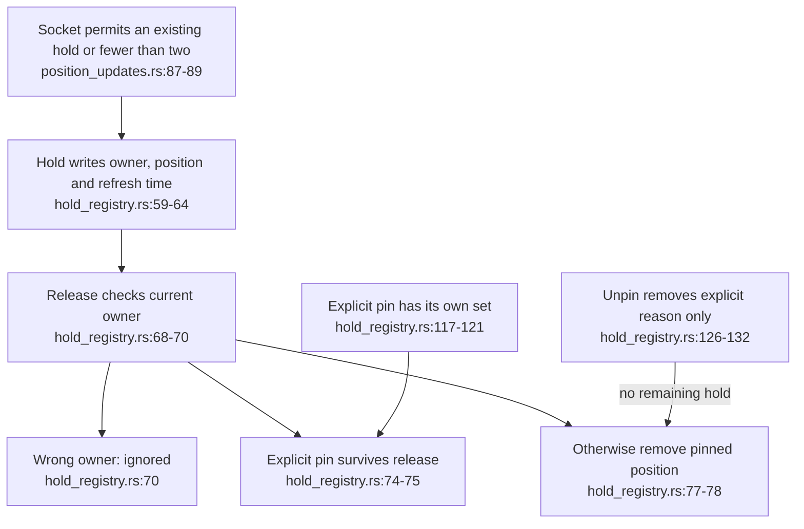
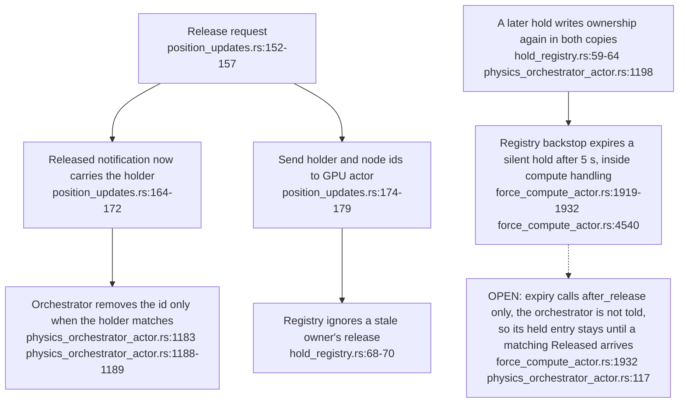
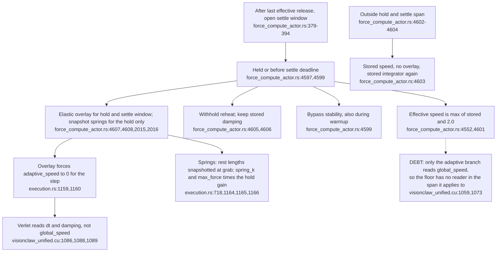
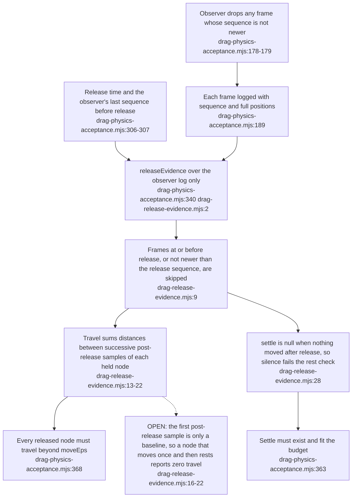
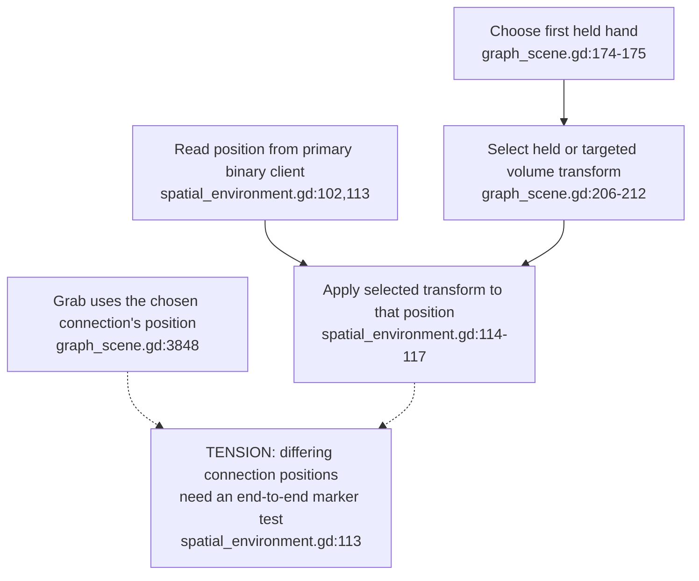
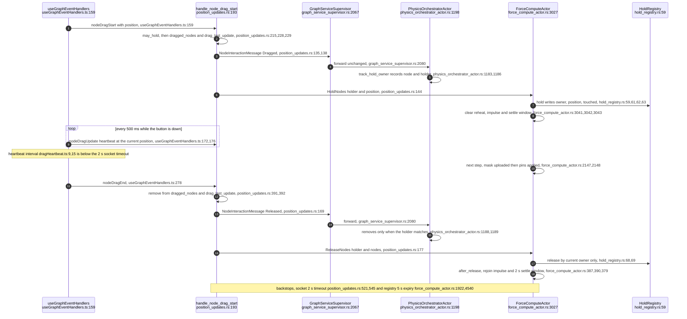
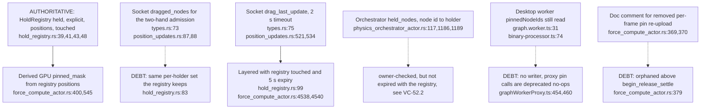

## For developers

The [contract review](../../estate-review/2026-11-01-drag-holds-and-acceptance.md) tests the real registry and runs the unchanged acceptance script against an intentionally wrong local peer. Holds, explicit pins, actor notifications and observed movement have separate lifetimes. Historical [VC-16](16-interaction-drag-pin-layout.md) describes the previous implementation.

## For the business

Letting go should return a node to the graph; pinning should keep it anchored. A second person needs to see whose hand controls the node and whether their view is current. A passing test is useful only if it can reject a peer that remains pinned or stops delivering updates.

## VC-52.1 A hold and an explicit pin are distinct reasons to anchor a node

**What it shows.** Fourteen native tests cover the registry. Three additional probes check its lifetime/capacity boundaries and model the independently maintained orchestrator set. The registry itself accepts more than two holds; admission belongs to the socket.

**Why it is this way.** A release from an old holder must not free another person's node, and a temporary hold must not erase an explicit pin.

## VC-52.2 Release notifications now agree on ownership, but expiry reaches only one of the two held sets

**What it shows.** The stale-holder tension of the 2026-11-01 review is closed in source: `NodeInteractionMessage` now carries `holder` and the orchestrator keeps a node-to-holder map. **Why it is this way.** A second owner's grab must not be ended by the first owner's late release (`physics_orchestrator_actor.rs:1183`).
**Open (risk):** A Released lost in transit is exactly the case the registry's 5 s backstop exists for (`force_compute_actor.rs:1917-1919`), yet the orchestrator has no matching expiry, so its cadence stays at zero and equilibrium auto-pause stays blocked (`physics_orchestrator_actor.rs:115-117`).

## VC-52.3 While held and settling, spring mode switches the integrator and strands the speed floor

**What it shows.** ADR-2169 explicitly amends ADR-2140. Since the 2026-11-01 review, the amendment's spring mode has merged. A hold and its settle window now turn on an elastic overlay, which sends integration down the Verlet path. Stored `dt` and damping therefore govern residual motion in the window. The `HOLD_GLOBAL_SPEED` floor is still computed, but no kernel reads it while it applies. **Why it is this way.** The floor was the first answer to a weak pull under LinLog plus adaptive speed (its doc comment still describes the FA2 integrator, `force_compute_actor.rs:4542-4551`). The spring overlay replaced that mechanism without removing the floor. Interaction response and a two-second settling time both still need live measurement under the actual force set.

**Debt:** `HOLD_GLOBAL_SPEED` and `StepOverrides::global_speed` (`force_compute_actor.rs:4552,4568`) are dead while the overlay is on; delete them or fold them into the overlay's gain, and refresh the doc comment.

## VC-52.4 Release evidence now comes from one observer's ordered post-release samples

**What it shows.** Both earlier false-acceptance routes are closed: travel no longer subtracts another client's pre-release snapshot, and an empty post-release stream yields no settle time. **Why it is this way.** The 2026-11-03 external fixes required sequence-ordered post-release observer samples (`drag-release-evidence.mjs:1`).

## VC-52.5 Selecting a volume transform does not select its coordinate source

**What it shows.** The new focus-frame helper is source-confirmed. A marker test with distinct positions per connection is still needed; existing transform assertions do not cover that supplier boundary.

**Why it is this way.** Node ids and transforms belong to streams/volumes. Carrying the correct frame without the matching point can place an overlay incorrectly when those streams differ.

## VC-52.6 One desktop hold from press to rejoin, across socket, orchestrator, registry and GPU

**What it shows.** One gesture fans out into two independent messages, one to the GPU actor and one through the graph service to the orchestrator, and each keeps its own held set. **Why it is this way.** ADR-2169 (2026-11-01) put ownership in the GPU actor's registry. The orchestrator's intent channel predates it and was kept for the auto-pause and wake behaviour.

## VC-52.7 Where the fact "this node is held or pinned" is stored

**What it shows.** Of the server-side copies, the registry is the only one that carries ownership and the hold-versus-pin distinction. The GPU mask is derived from it, and the timeouts are deliberately layered. **Why it is this way.** ADR-2169 added the registry beside the existing socket and orchestrator state rather than replacing either.

**Drift:** the desktop drag handlers cite "ADR-03 D7: pin state is server-authoritative", but no ADR-03 or ADR-003 exists in `docs/adr` or `docs/archive` (`useGraphEventHandlers.ts:151,269`).

**Debt:** the socket's `dragged_nodes` duplicates the registry's per-holder set (`types.rs:73`; `hold_registry.rs:83`), and the desktop `pinnedNodeIds` is read but never written (`graph.worker.ts:31`; `graphWorkerProxy.ts:454`).
