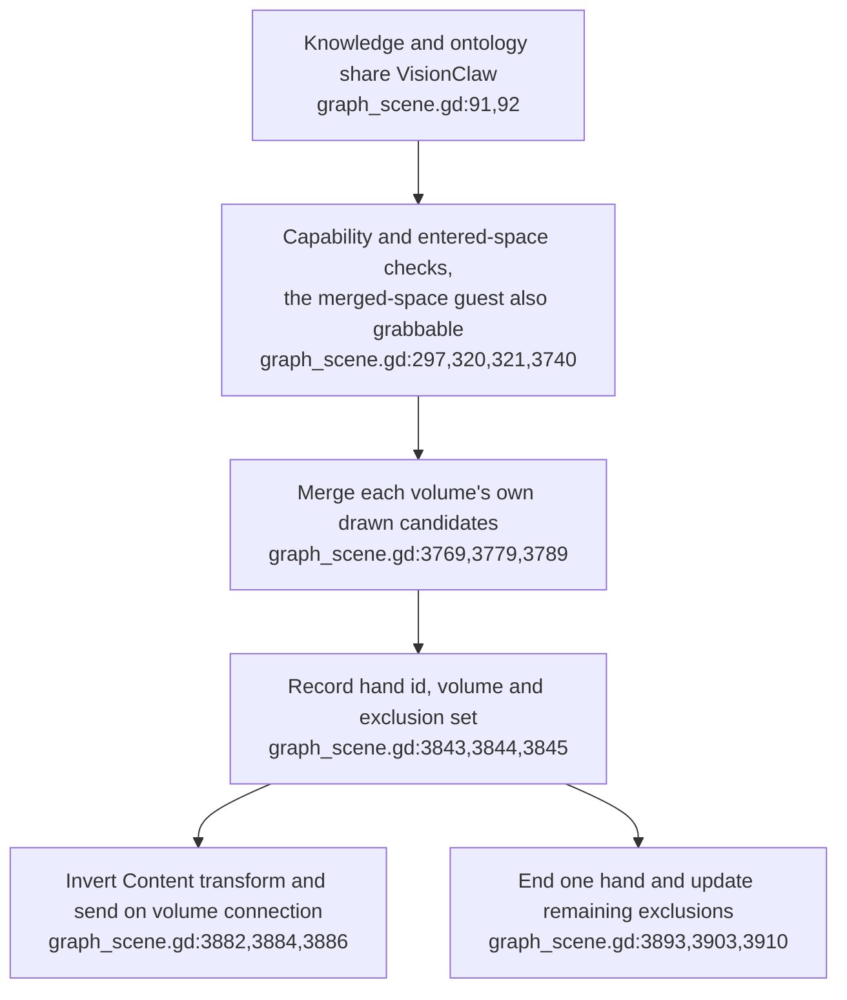
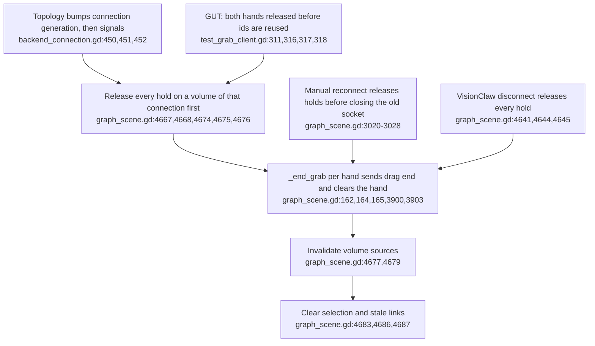
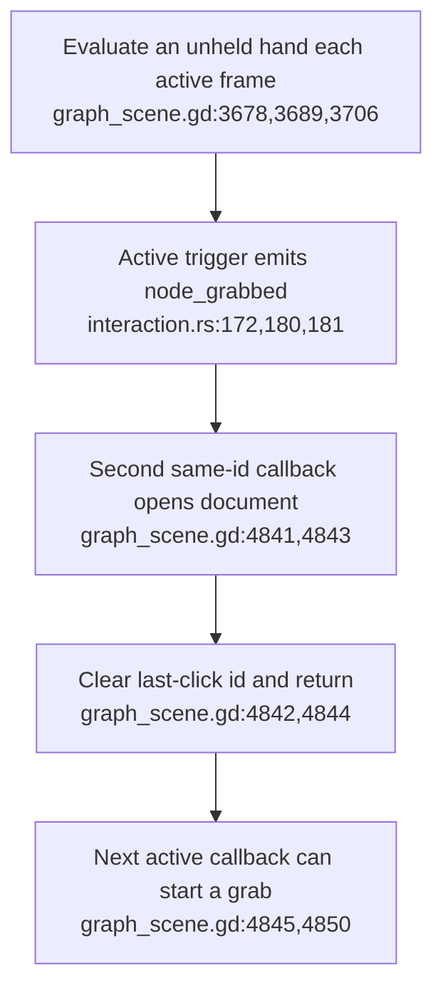
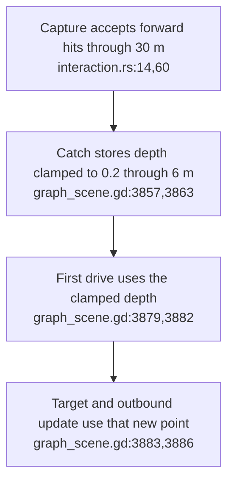
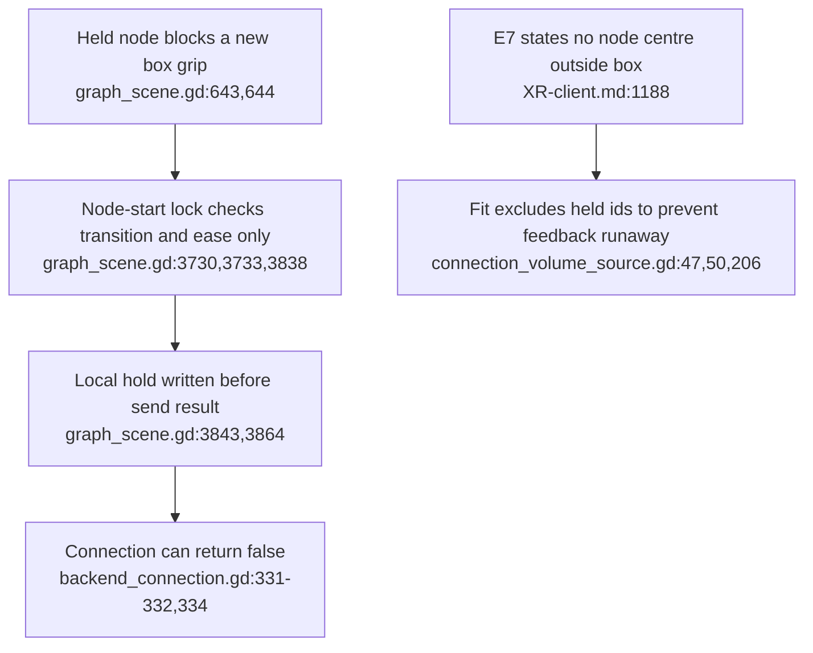
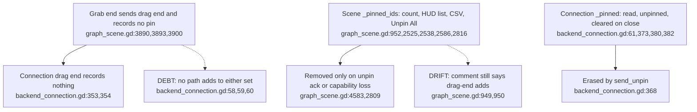

## For developers

The [assessment](../../estate-review/2026-11-01-xr-grab-boundaries.md) traces ADR-2172 and refreshes the portal amendment. Its method probes use exact production function bodies on explicit spies; they are not a full scene, controller or backend run.

## For the business

Two hands can address separate nodes, but reliable manipulation also needs a clear end to each gesture. A data refresh now ends every hold cleanly; opening a document and catching a distant node still expose gaps that ordinary single-step demonstrations miss.

## VC-53.1 Per-hand holds route through their volume and share one id domain

**What it shows.** Per-hand state and per-volume transforms coexist with a shared draggable connection. **Why it is this way.** The class-filtered views share one graph and server id domain; this is not a general multi-server identity scheme.

## VC-53.2 A topology change now releases the holds of that connection

**What it shows.** Since `6b811f7a1` the topology callback ends both hands' holds before invalidating sources and selection, and a VisionClaw disconnect does the same. The current reconnect path also releases both hands before replacing the socket; the source regression asserts that each end precedes close (`xr-client/tests/unit/test_grab_client.gd:743-755`). This review did not rerun GUT. **Why it is this way.** Hand state carries an id and a volume but no generation (`xr-client/scripts/graph_scene.gd:835-836`), so the release has to happen at the boundary rather than at each drive.
**Invariant:** no hand holds a wire id across a topology generation of its connection (`xr-client/scripts/graph_scene.gd:4674-4676`), pinned by `xr-client/tests/unit/test_grab_client.gd:311-318`.

## VC-53.3 Double-click consumes one callback rather than the held press

**What it shows.** Replaying one more callback after document opening starts a hold in the fixture. **Why it is this way.** The callback has per-hand click history but no consumed-press latch; a real HUD may intercept some subsequent rays, which the fixture does not model.

## VC-53.4 Capture reach exceeds the retained hold depth

**What it shows.** Unit observations accept a 10 m capture and convert its first hold update to 6 m, with no hand movement. **Why it is this way.** Capture reach and hand attachment have separate limits. The 1 m and 6 m controls retain their depth.

## VC-53.5 Hold admission and containment have distinct exceptions

**What it shows.** Reverse acquisition and send refusal are separate admission boundaries; fit containment is also qualified by intentional exclusions. **Why it is this way.** These guards were added at different entry points, while excluding held outliers avoids shrinking the content repeatedly beneath the hand.

**Tension:** E7's universal wording needs to account for the intentionally excluded held nodes (`XR-client.md:1188`; `connection_volume_source.gd:47,206`).

## VC-53.6 Two headset pin sets survive with readers but no writer

**What it shows.** Unpin All, the HUD count and connection teardown still iterate sets that nothing fills, so after ADR-2172 F3 they are always empty. **Why it is this way.** F3 removed the writer, and the client-side Pin sender that would fill the sets is a recorded follow-up (ADR-2172 F5).

**Drift:** the `_pinned_ids` comment says drag-end adds (`graph_scene.gd:949`), but `_end_grab` records nothing (`graph_scene.gd:3890`).
