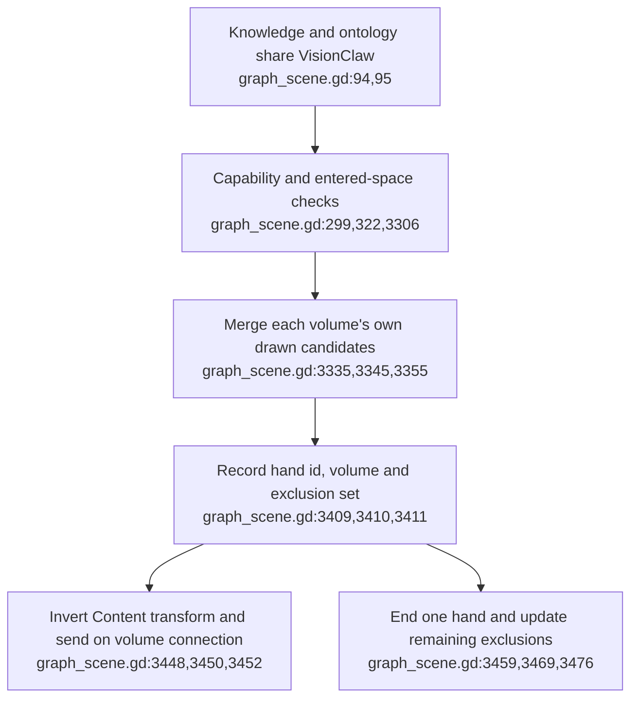
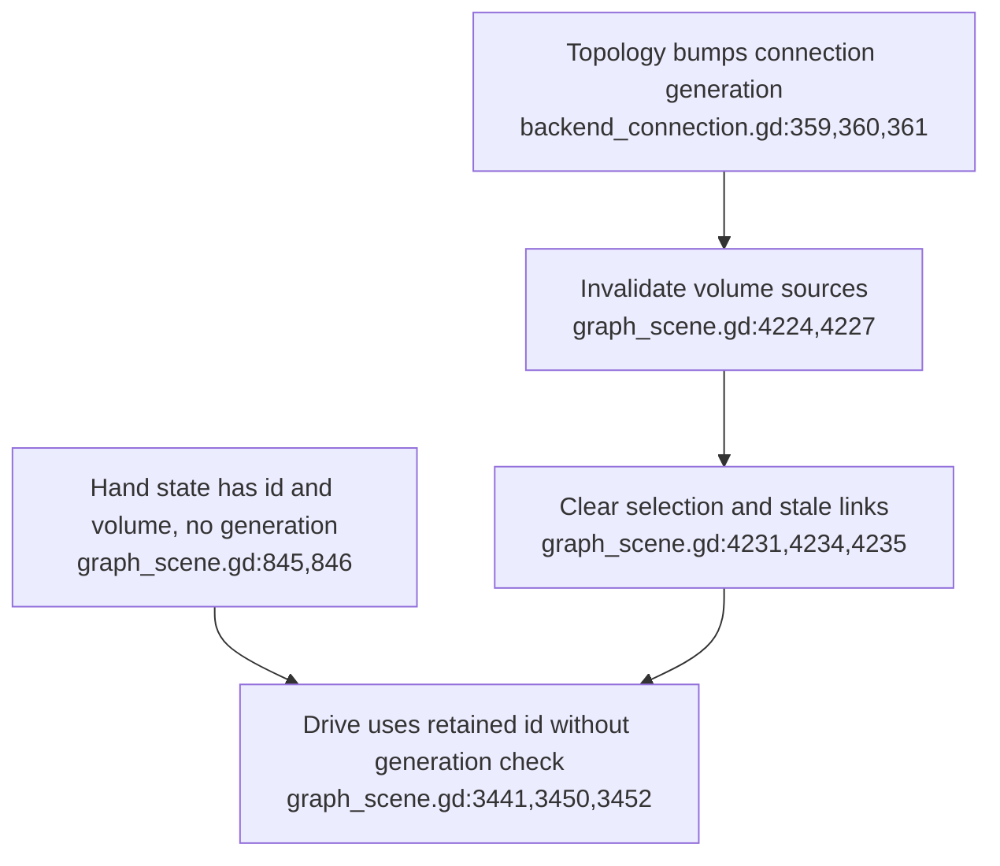
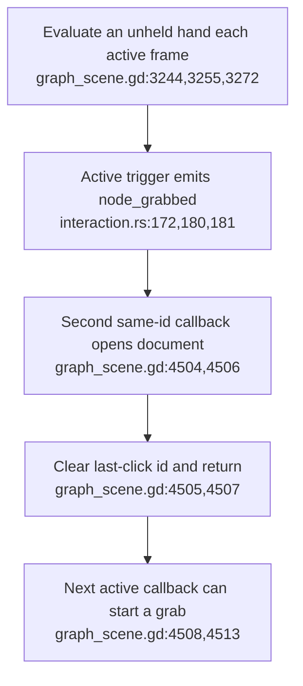
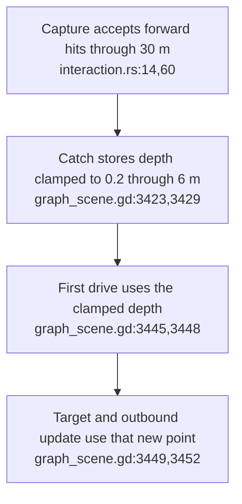
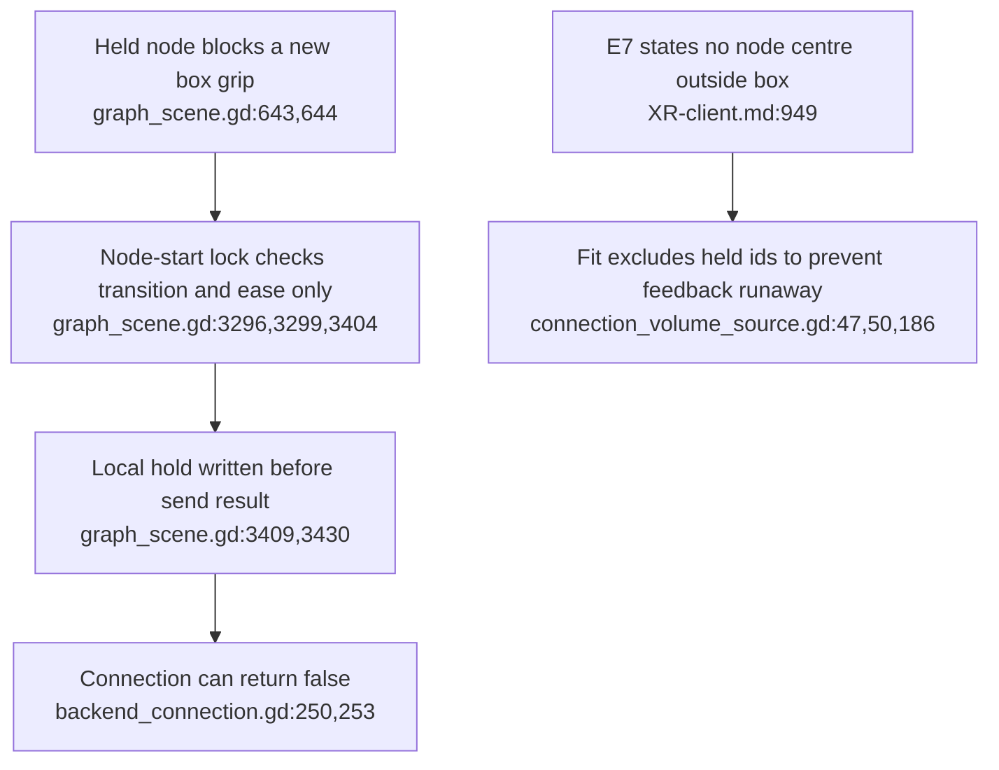
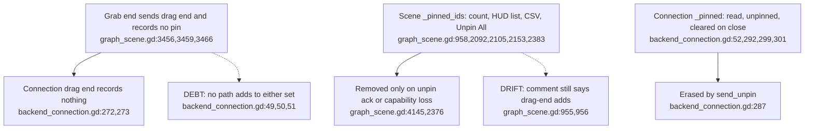

## For developers

The [assessment](../../estate-review/2026-11-01-xr-grab-boundaries.md) traces ADR-2172 and refreshes the portal amendment. Its method probes use exact production function bodies on explicit spies; they are not a full scene, controller or backend run.

## For the business

Two hands can address separate nodes, but reliable manipulation also needs a clear end to each gesture. Refreshing data, opening a document and catching a distant node expose gaps that ordinary single-step demonstrations miss.

## VC-53.1 Per-hand holds route through their volume and share one id domain

**What it shows.** Per-hand state and per-volume transforms coexist with a shared draggable connection. **Why it is this way.** The class-filtered views share one graph and server id domain; this is not a general multi-server identity scheme.

## VC-53.2 Topology invalidates selections but leaves held ids alive

**What it shows.** The extracted callback clears selection while a subsequent drive still sends the held id. **Why it is this way.** Selection lifetime is explicitly reset; grab lifetime is not part of that callback.

**Debt:** Held ids can survive the generation boundary even though the connection documents generation-scoped identity (`backend_connection.gd:18,19`; `graph_scene.gd:4224`).

## VC-53.3 Double-click consumes one callback rather than the held press

**What it shows.** Replaying one more callback after document opening starts a hold in the fixture. **Why it is this way.** The callback has per-hand click history but no consumed-press latch; a real HUD may intercept some subsequent rays, which the fixture does not model.

## VC-53.4 Capture reach exceeds the retained hold depth

**What it shows.** Unit observations accept a 10 m capture and convert its first hold update to 6 m, with no hand movement. **Why it is this way.** Capture reach and hand attachment have separate limits. The 1 m and 6 m controls retain their depth.

## VC-53.5 Hold admission and containment have distinct exceptions

**What it shows.** Reverse acquisition and send refusal are separate admission boundaries; fit containment is also qualified by intentional exclusions. **Why it is this way.** These guards were added at different entry points, while excluding held outliers avoids shrinking the content repeatedly beneath the hand.

**Tension:** E7's universal wording needs to account for the intentionally excluded held nodes (`XR-client.md:949`; `connection_volume_source.gd:47,186`).

## VC-53.6 Two headset pin sets survive with readers but no writer

**What it shows.** Unpin All, the HUD count and connection teardown still iterate sets that nothing fills, so after ADR-2172 F3 they are always empty. **Why it is this way.** F3 removed the writer, and the client-side Pin sender that would fill the sets is a recorded follow-up (ADR-2172 F5).

**Drift:** the `_pinned_ids` comment says drag-end adds (`graph_scene.gd:955`), but `_end_grab` records nothing (`graph_scene.gd:3456`).
