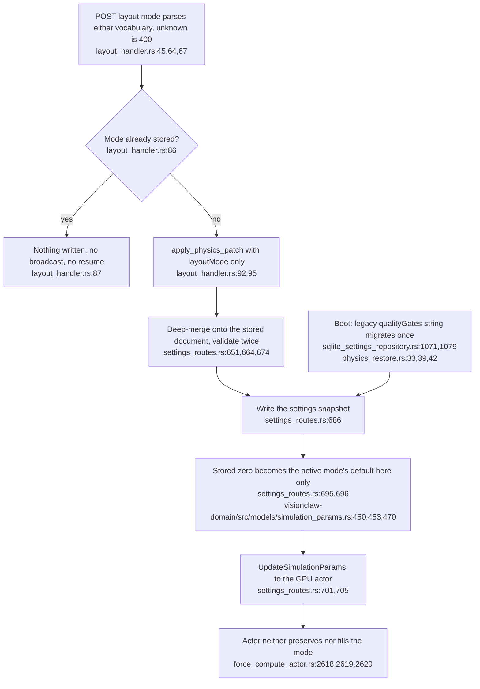
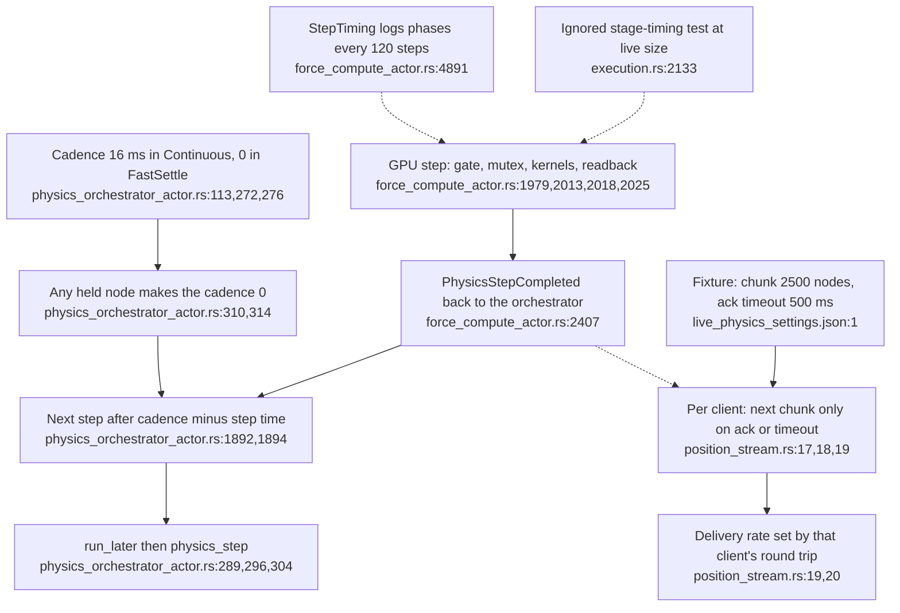
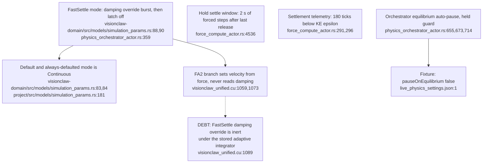
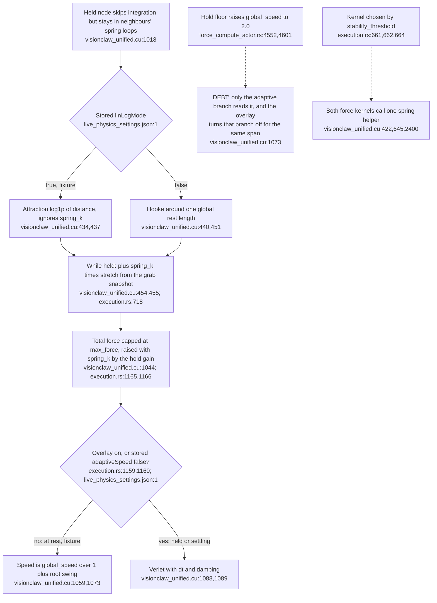
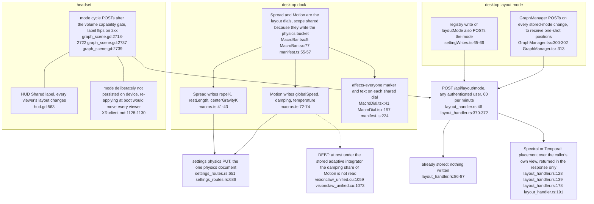

## For developers

Drawn for the [2026-11-01 duplication audit](52-drag-holds-and-observation-gates.md). It covers ADR-2140's single `physics.layoutMode` write path, what bounds the step rate as opposed to the ack-paced position stream (ADR-2141), and the three separate mechanisms called "settle". `live_physics_settings.json` is a test fixture captured from the live store, not the store itself. Restamped on 2026-11-06 at `ec785afa9`: citations moved with the hold-owner map and slot-id changes, and VC-54.5 adds the three surfaces that write the one shared layout document.

## For the business

A layout choice is now stored once and every client sees the same one. How smoothly a dragged graph appears to move depends on two different rates, the physics step and each viewer's delivery, and the stored force style decides how strongly neighbours follow a held node.

## VC-54.1 The layout mode has one stored definition and one write path

**What it shows.** One path from request to device. The legacy quality-gate string is read once, at boot. **Why it is this way.** ADR-2140 item 1 (2026-10-31) removed the actor's preserve-override, `SetLayoutMode` and the propagation overlay so that no second copy of the mode exists.

**Debt (loose end):** the 2026-11-06 rendering-row insert landed between the ADR-2140 decision-1 doc comment and the function it documents, so that comment (`src/adapters/sqlite_settings_repository.rs:1046-1054`) now attaches to `RENDERING_ROW` (`src/adapters/sqlite_settings_repository.rs:1055-1057`) and `seed_physics_from_blob` (`src/adapters/sqlite_settings_repository.rs:1071`) has none.

## VC-54.2 The step is paced by completion, the stream by each client's acknowledgement

**What it shows.** The step rate and the per-client stream rate are independent clocks. On the live graph the 16 ms cadence does nothing, because a step takes longer than that. **Why it is this way.** The sequential pipeline avoids queued steps. ADR-2141 made delivery ack-paced so that a slow client cannot stall the step.

**Open:** ADR-2169 records the step at 9–10 Hz and leaves ack-paced delivery unmeasured. A rate observed at a client is a stream rate, so the step rate and the per-client stream rate need separate measurements (`position_stream.rs:19`; `force_compute_actor.rs:4891`).

## VC-54.3 Three mechanisms are called settle

**What it shows.** A burst mode, a 2 s time box and a KE detector share one word, and a fourth judge (the auto-pause) is configured off. **Why it is this way.** Each was added for a different consumer: layout passes, ADR-2169 holds, and the REST `/api/layout/status`.

**Debt:** "settle" names three unrelated mechanisms (`physics_orchestrator_actor.rs:359`; `force_compute_actor.rs:4536,291`), and only the Verlet branch reads damping (`visionclaw_unified.cu:1089`). Since spring mode merged, that branch runs throughout every hold window (`execution.rs:1159,1160`), so damping is live there and inert only at rest under the stored adaptive integrator.

## VC-54.4 How strongly a held node's neighbours follow it: stored force style at rest, spring mode while held

**What it shows.** At rest, the fixture's LinLog plus adaptive pairing gives a weak, swing-damped pull. Turning LinLog off globally would move every edge to one rest length, and the resting layout with it. While a node is held, the merged ADR-2169 amendment adds a linear spring around each edge's length at the moment of grab. It strengthens that spring by the hold gain and integrates with Verlet, so the pull no longer depends on the stored force style or on swing. **Why it is this way.** LinLog is the modularity layout. The `HOLD_GLOBAL_SPEED` floor was the first attempt to answer the hand inside it. The spring overlay is the second attempt, and it replaced the first without removing it.

**Debt:** the speed floor is computed for exactly the span in which the overlay disables its only reader (`force_compute_actor.rs:4601`; `execution.rs:1160`; `visionclaw_unified.cu:1073`). The earlier debt that the spring force was written twice is closed: both kernels now call `edge_spring_scale` (`visionclaw_unified.cu:422`), although each kernel still has its own neighbour loop.

## VC-54.5 One shared layout document, written from three surfaces

**What it shows.** Layout mode and the two layout dials are one server-side document; the desktop marks the dials as shared and the headset refuses to persist the mode locally for the same reason. **Why it is this way.** ADR-2140 made `physics.layoutMode` the one stored definition, and ADR-2189 §2 labels every control that writes it.
**Debt (parallel):** Two desktop callers POST the mode: `settingWrites.ts:66` on a registry write and `GraphManager.tsx:313` on the resulting store change, so one edit sends two requests; the server's same-mode check (`layout_handler.rs:86`) makes the second a no-op. The shared-scope sentence is also defined twice (`MacroDial.tsx:41`, `manifest.ts:224`).
**Open (risk):** A Spectral or Temporal placement is computed over the caller's own view (`layout_handler.rs:139`) and exists only in that response (`layout_handler.rs:191`). Each desktop fetches its own on the store change (`GraphManager.tsx:315`), while the headset's completion handler leaves the body unread (`graph_scene.gd:2816`), so viewers can hold different placements under one shared mode.
