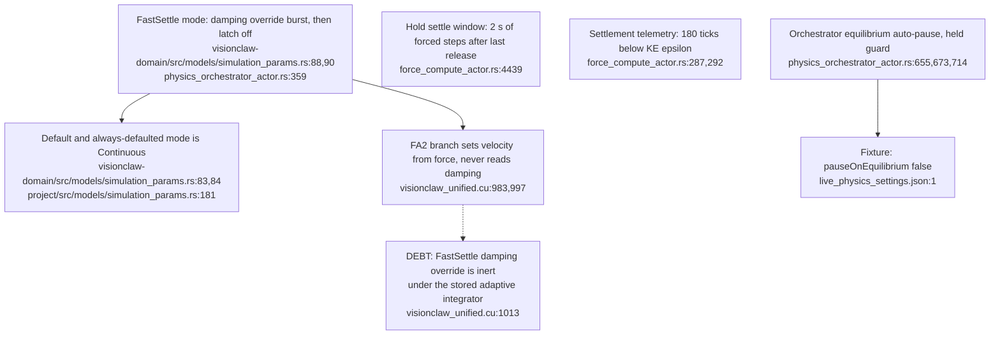
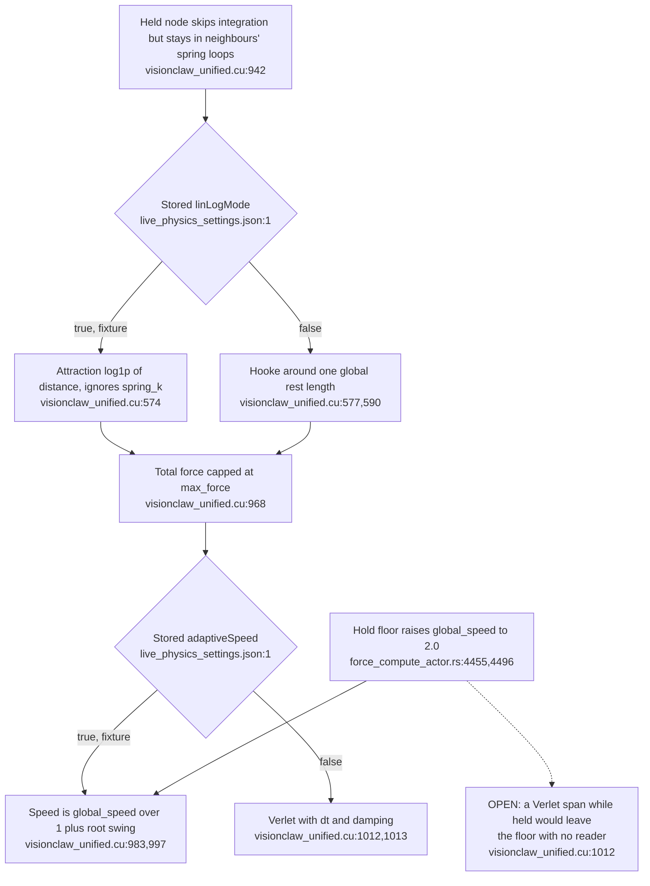

## For developers

Drawn for the [2026-11-01 duplication audit](52-drag-holds-and-observation-gates.md). It covers ADR-2140's single `physics.layoutMode` write path, what bounds the step rate as opposed to the ack-paced position stream (ADR-2141), and the three separate mechanisms called "settle". `live_physics_settings.json` is a test fixture captured from the live store, not the store itself. Code is identical at `531df5ef7`.

## For the business

A layout choice is now stored once and every client sees the same one. How smoothly a dragged graph appears to move depends on two different rates, the physics step and each viewer's delivery, and the stored force style decides how strongly neighbours follow a held node.

## VC-54.1 The layout mode has one stored definition and one write path

**What it shows.** One path from request to device. The legacy quality-gate string is read once, at boot. **Why it is this way.** ADR-2140 item 1 (2026-10-31) removed the actor's preserve-override, `SetLayoutMode` and the propagation overlay so that no second copy of the mode exists.

## VC-54.2 The step is paced by completion, the stream by each client's acknowledgement

**What it shows.** The step rate and the per-client stream rate are independent clocks. On the live graph the 16 ms cadence does nothing, because a step takes longer than that. **Why it is this way.** The sequential pipeline avoids queued steps. ADR-2141 made delivery ack-paced so that a slow client cannot stall the step.

**Open:** ADR-2169 records the step at 9–10 Hz and leaves ack-paced delivery unmeasured. A rate observed at a client is a stream rate, so the step rate and the per-client stream rate need separate measurements (`position_stream.rs:19`; `force_compute_actor.rs:4784`).

## VC-54.3 Three mechanisms are called settle

**What it shows.** A burst mode, a 2 s time box and a KE detector share one word, and a fourth judge (the auto-pause) is configured off. **Why it is this way.** Each was added for a different consumer: layout passes, ADR-2169 holds, and the REST `/api/layout/status`.

**Debt:** "settle" names three unrelated mechanisms (`physics_orchestrator_actor.rs:359`; `force_compute_actor.rs:4439,287`), and only the Verlet branch reads damping (`visionclaw_unified.cu:1013`).

## VC-54.4 How strongly a held node's neighbours follow it is set by the stored force style

**What it shows.** The fixture's LinLog plus adaptive pairing gives a weak, swing-damped pull. Turning LinLog off globally would move every edge to one rest length, and the resting layout with it. **Why it is this way.** LinLog is the modularity layout, and the ADR-2169 floor was the first attempt to answer the hand inside it.

**Open:** an in-flight change (HS, not merged) adds a snapshot rest-length overlay and runs Verlet while held. That would make the `HOLD_GLOBAL_SPEED` floor unread over the same span (`force_compute_actor.rs:4455,4496`; `visionclaw_unified.cu:1012`).
