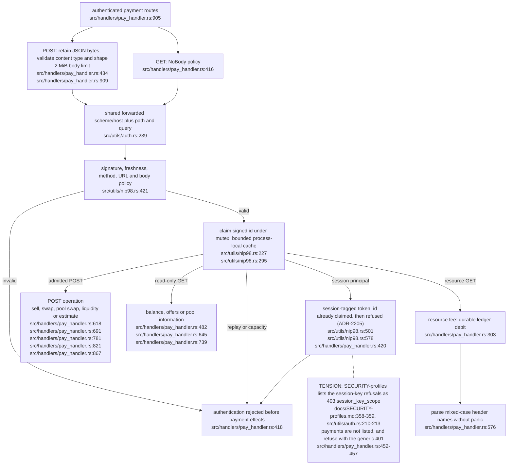
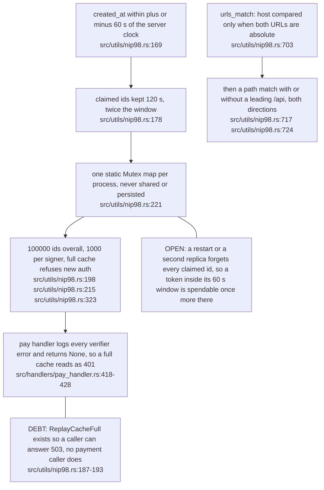

## For developers

Payment routes now share the host NIP-98 verifier and URL reconstruction. Five JSON POST handlers bind the transmitted body with Required, while GET handlers use NoBody. Query/body rejection leaves the token unspent, successful authentication spends it even if the operation fails. Since ADR-2205 a token carrying a signed `session` tag (a browser session key) is spent by the verifier and then refused by the payment boundary, so payments need the account's own signer. The tests exercise these boundaries through the actual routes; this is source verification, awaiting deployment.

## For the business

One signed request cannot charge twice within this process. A freshly signed retry can still repeat an operation, and the cache does not span restarts or replicas. The host payment store remains live source pending ADR-2111's proposed wallet migration. Funding, settlement, resource delivery and recovery are separate acceptance gates.

## VC-55.1 Authenticate the received request before payment effects

Six route regressions and 46 shared-verifier tests pass. Separate storage commits, permissive compatibility URL matching and fresh-token operation retries remain open.

## VC-55.2 The replay window is one process's memory, and URL binding is looser than the signed URL

**What it shows.** Single use holds only within one process for 120 s, and a full cache is indistinguishable from a bad signature at the payment boundary.
**Open (risk):** A relative `u` tag skips the host comparison (`src/utils/nip98.rs:703`), and the `/api` strip lets one signature match both `/api/pay/...` and `/pay/...` (`src/utils/nip98.rs:717`).
**Debt (loose end):** The capacity error is collapsed into the generic auth failure at `src/handlers/pay_handler.rs:425`, so the 503 mapping the verifier documents at `src/utils/nip98.rs:193` is unreachable for payments.
