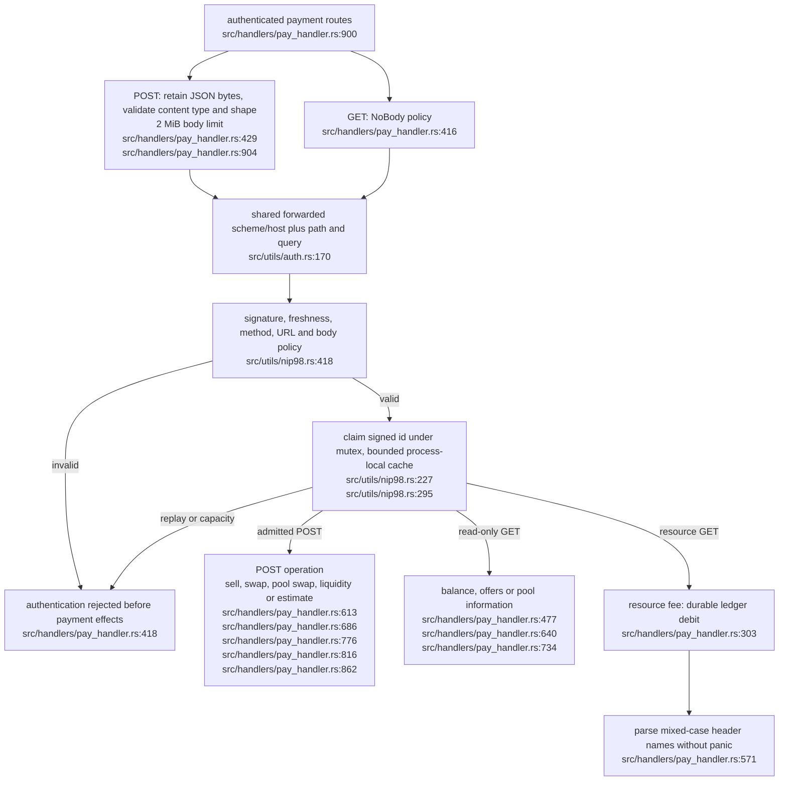

## For developers

Payment routes now share the host NIP-98 verifier and URL reconstruction. Five JSON POST handlers bind the transmitted body with Required, while GET handlers use NoBody. Query/body rejection leaves the token unspent, successful authentication spends it even if the operation fails. The tests exercise these boundaries through the actual routes; this is source verification, awaiting deployment.

## For the business

One signed request cannot charge twice within this process. A freshly signed retry can still repeat an operation, and the cache does not span restarts or replicas. The host payment store remains live source pending ADR-2111's proposed wallet migration. Funding, settlement, resource delivery and recovery are separate acceptance gates.

## VC-55.1 Authenticate the received request before payment effects

Six route regressions and 46 shared-verifier tests pass. Separate storage commits, permissive compatibility URL matching and fresh-token operation retries remain open.
