## For developers

The explore layer (ADR-2183, ADR-2184, ADR-2185, landed in the 16d3bb49e suite) is everything between the delivered graph and the two render-indexed buffers that VC-31.13 draws from: a typed-array node table built in a worker, a crossfilter over it, one highlight-mask filter source per widget (`filter:explore:<widget>`) written through `filterRegistry.ts`, and a column encoder that swaps `nodeEncoding`'s encoder for colour-by and size-by. Filters grey nodes out and never remove them; only population scope and hierarchy collapse remove (ADR-2183 D4), and the `hideFiltered` opt-in turns grey back into removal. The render side of the mask and encoding (texel `w`, sprites, gems, labels) is VC-31.13; the drawer and section that host the panel are VC-57. This topic does not cover the provenance `TimelineScrubber` (VC-30) or the server copy of the node-filter predicates (`client_filter.rs`).

The node table is the typed arrays themselves: ADR-2184 D1 was amended on 2026-11-06 to say so, and the unused Arrow conversion and the `apache-arrow` dependency were deleted (`ADR-2184-a-client-side-columnar-node-table-drives-visual-encoding.md:35`, `ADR-2184-a-client-side-columnar-node-table-drives-visual-encoding.md:61`).

## For the business

A visitor can now ask the graph questions by clicking bars: "what changed recently", "which domain", "how central". Everything outside the answer greys out but stays in place, so the shape of the whole knowledge base is never lost, and a legend says what each colour and size means. The figures the panel shows count what is lit on screen, with one known exception: nodes hidden inside a collapsed hierarchy group are still counted.

## VC-56.1 Who mounts the explore lane and what it writes

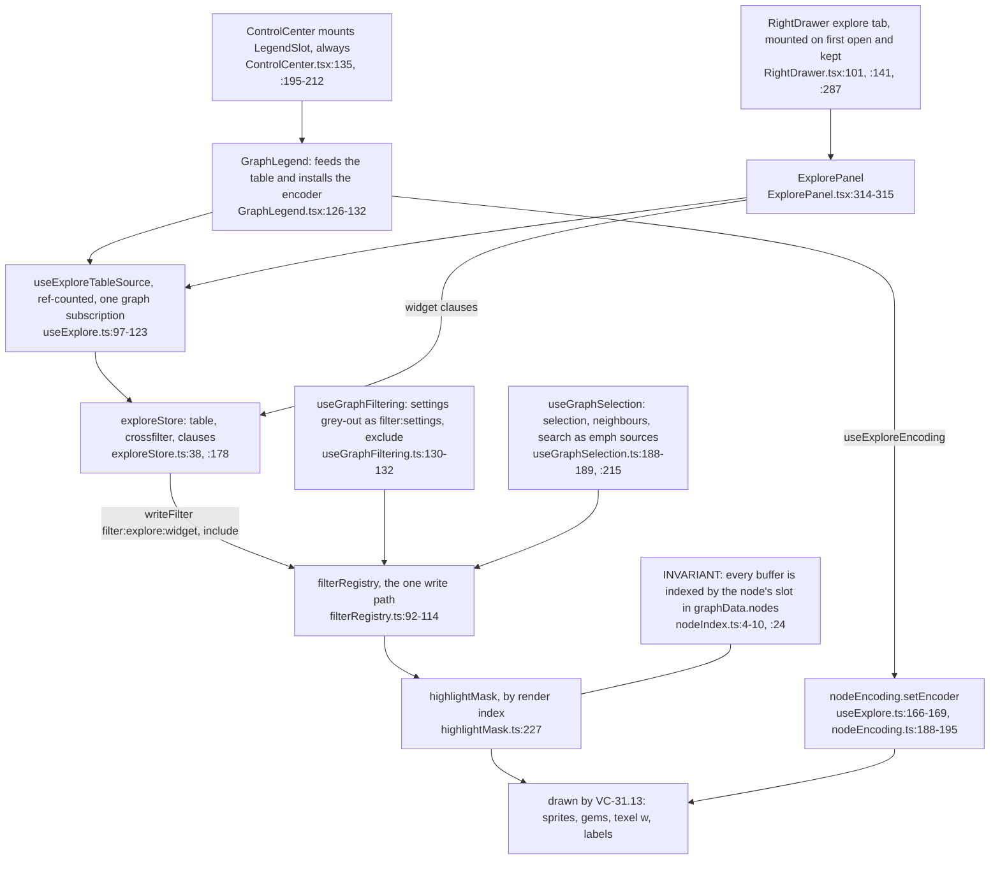

**What it shows.** Two mounts feed one shared store; only `GraphLegend`, which ControlCenter always mounts, installs the column encoder, so colour-by works with the drawer closed. **Why it is this way.** ADR-2183's implementation notes route every mask write through `filterRegistry.ts` under `filter:*` and `emph:*` names (`ADR-2183-interactive-filters-grey-out-through-a-highlight-mask.md:71`), and ADR-2189 put the panel in the drawer.

## VC-56.2 Node table build: worker, transfer, newest-wins adoption

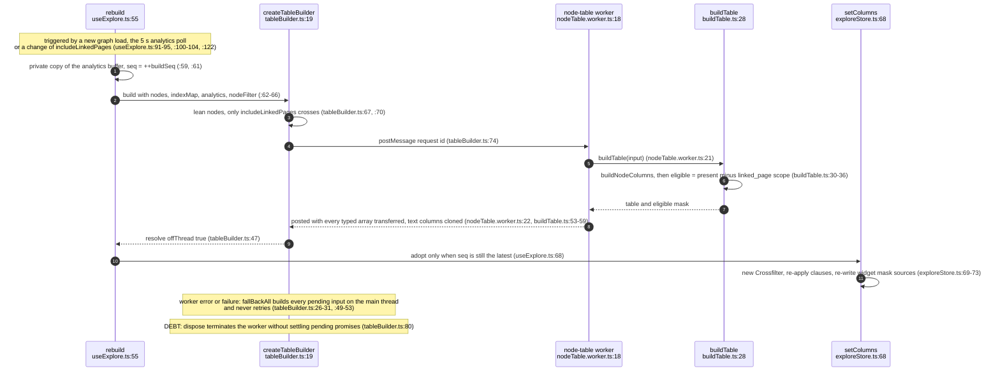

**What it shows.** How the table is rebuilt off the main thread and why an overlapping build can never overwrite a newer one. **Why it is this way.** ADR-2184 D1 builds the table on the client from data already delivered, with no new read path (`ADR-2184-a-client-side-columnar-node-table-drives-visual-encoding.md:35-38`); the worker is a same-origin module worker so COEP needs no extra headers (`nodeTable.worker.ts:1-4`).

**Open (risk):** releasing the last mount calls `builder.dispose()` (`useExplore.ts:112`), which terminates the worker without resolving the entries in `pending` (`tableBuilder.ts:24`, `tableBuilder.ts:80`), so an in-flight build's promise and its closure never settle.

## VC-56.3 Table schema: three column sources, one render-index row order

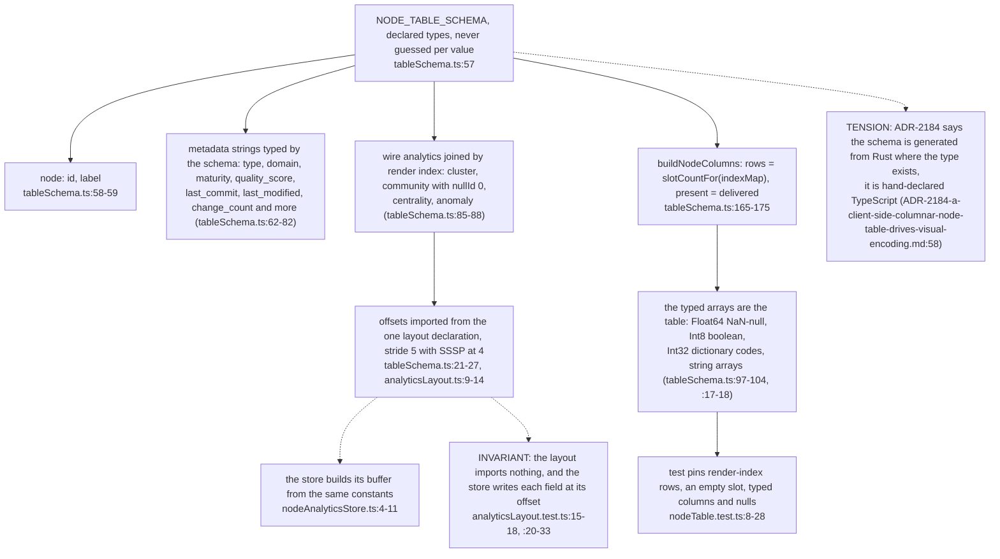

**What it shows.** Where each column comes from and why row `i` of the table is slot `i` of the mask and the encoding buffers. **Why it is this way.** ADR-2184 D2 types metadata strings by a declared schema (`ADR-2184-a-client-side-columnar-node-table-drives-visual-encoding.md:41`); the layout is declared once in an import-free module because `nodeAnalyticsStore`'s module graph creates the settings store and cannot load in a worker (`analyticsLayout.ts:5-7`).

**Debt (parallel):** the worker still keeps its own analytics buffer at its own stride constant, `WORKER_ANALYTICS_STRIDE = 5` (`binary-processor.ts:22`), filled per frame (`binary-processor.ts:80-86`, `graph.worker.ts:171`), and answers `getAnalyticsBuffer` (`graph.worker.ts:499-500`), while the proxy's `getAnalyticsBuffer` is a deprecation stub that throws (`graphWorkerProxy.ts:493-497`): a second layout nobody on the main thread can read.

**Debt (parallel):** the maturity tiers are declared twice, as `MATURITY_RANK` (`nodeFilter.ts:26-28`) and `MATURITY_ORDER` (`tableSchema.ts:55`), and the latter's comment still points at `useGraphFiltering`'s copy (`tableSchema.ts:54`), which moved to `nodeFilter.ts`.

## VC-56.4 Crossfilter: one clause per widget, counts exclude their own clause

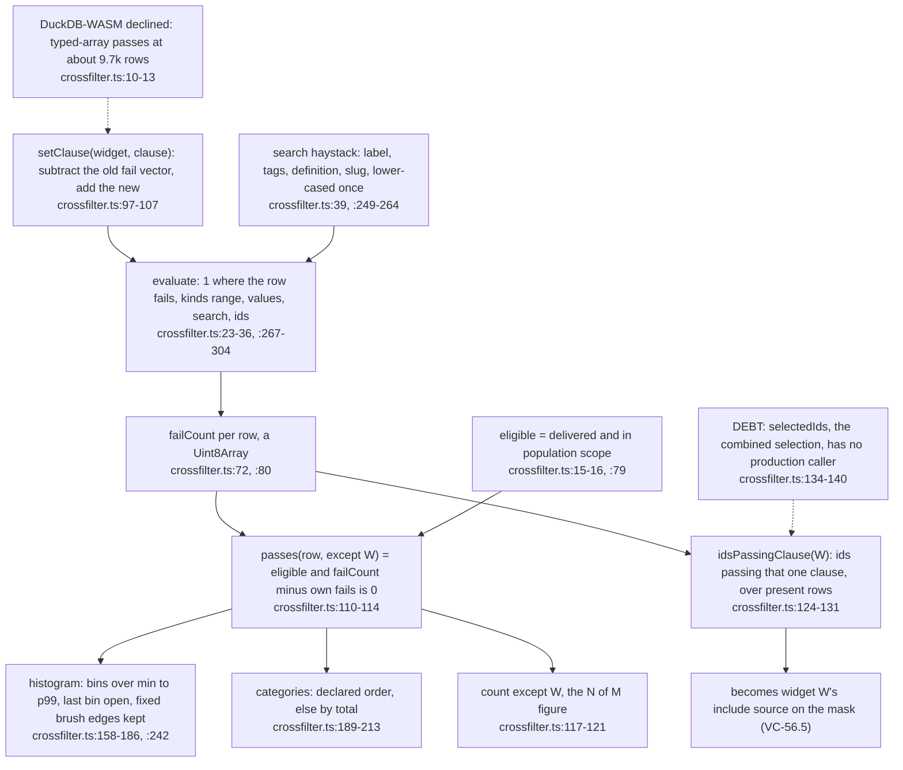

**What it shows.** The standard crossfilter rule in O(1) per row: a widget's own bars keep the full distribution while the others narrow. **Why it is this way.** ADR-2185 D2 (`ADR-2185-linked-timeline-histogram-and-search-widgets-write-the-highlight-mask.md:39`); D5 sanctions the typed-array fallback if DuckDB is not used.

**Tension (ADR-2184 D5 vs code):** the record names DuckDB-WASM with Mosaic as the widgets' query engine (`ADR-2184-a-client-side-columnar-node-table-drives-visual-encoding.md:50-51`) and is marked implementation complete, while the code declines DuckDB in a comment (`crossfilter.ts:10-13`) on the strength of ADR-2185 D5's fallback (`ADR-2185-linked-timeline-histogram-and-search-widgets-write-the-highlight-mask.md:42`).

## VC-56.5 exploreStore clauses: widget sources and context clauses

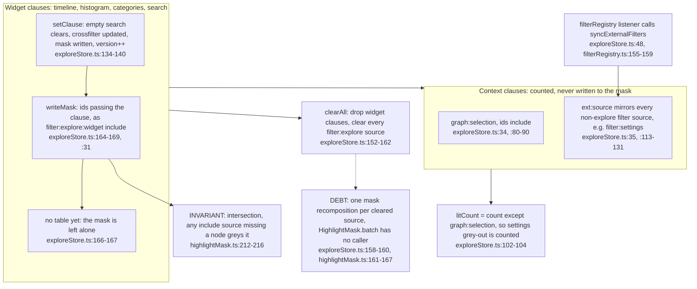

**What it shows.** Each widget is its own mask source, so the graph shows the intersection; selection and the settings grey-out enter the crossfilter only as counting context. **Why it is this way.** ADR-2185 D3 makes the graph a consumer of the combined selection (`ADR-2185-linked-timeline-histogram-and-search-widgets-write-the-highlight-mask.md:40`), realised as one source per widget so a single widget can be cleared alone.

**Debt (loose end):** `SOURCE.EXPLORE`, the single combined `filter:explore:crossfilter` source, is declared (`filterRegistry.ts:38-39`) and re-exported (`explore/index.ts:12`) but never written: widgets write per-widget sources (`exploreStore.ts:31`).

**Drift:** the explore public-API header still says mounting ExplorePanel or GraphLegend "feeds the node table" (`explore/index.ts:4`); the Arrow node table was deleted in 29cc1cd8d and nothing is fed.

**Open (risk):** on a new graph load the mask adopts the new index at once (`highlightMask.ts:183-190`), but each active widget's include set is from the previous table until the worker build lands (`useExplore.ts:62-68`, `exploreStore.ts:72`), and an include source greys every mapped node missing from its set (`highlightMask.ts:213-216`), so new nodes are greyed until then.

## VC-56.6 Selection-to-widgets clause

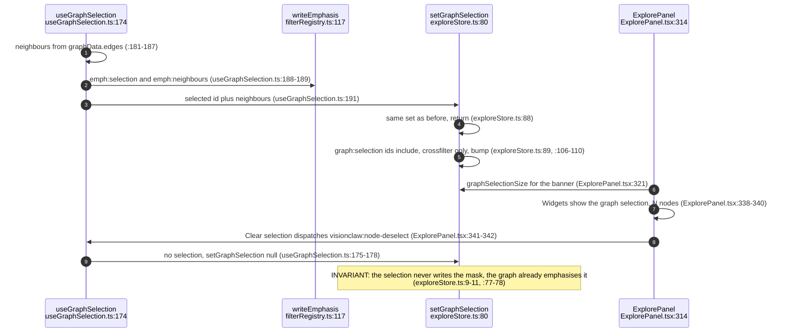

**What it shows.** Clicking a node narrows every widget to it and its neighbours, while the graph shows the same set as emphasis. **Why it is this way.** ADR-2185 D3: "selecting nodes in the graph adds a clause that the widgets reflect" (`ADR-2185-linked-timeline-histogram-and-search-widgets-write-the-highlight-mask.md:40`); the effect re-runs on every edges change, and the set comparison keeps that churn from re-aggregating (`exploreStore.ts:88`).

**Debt (parallel):** two searches with different reach: the panel's search widget is a grey-out clause over label, tags, definition and slug (`crossfilter.ts:39`, `ExplorePanel.tsx:291-299`), and the `visionclaw:search` event is a label-only emphasis (`useGraphSelection.ts:33-43`, `useGraphSelection.ts:214-215`).

## VC-56.7 filterRegistry: the write path, de-duplication and hideFiltered

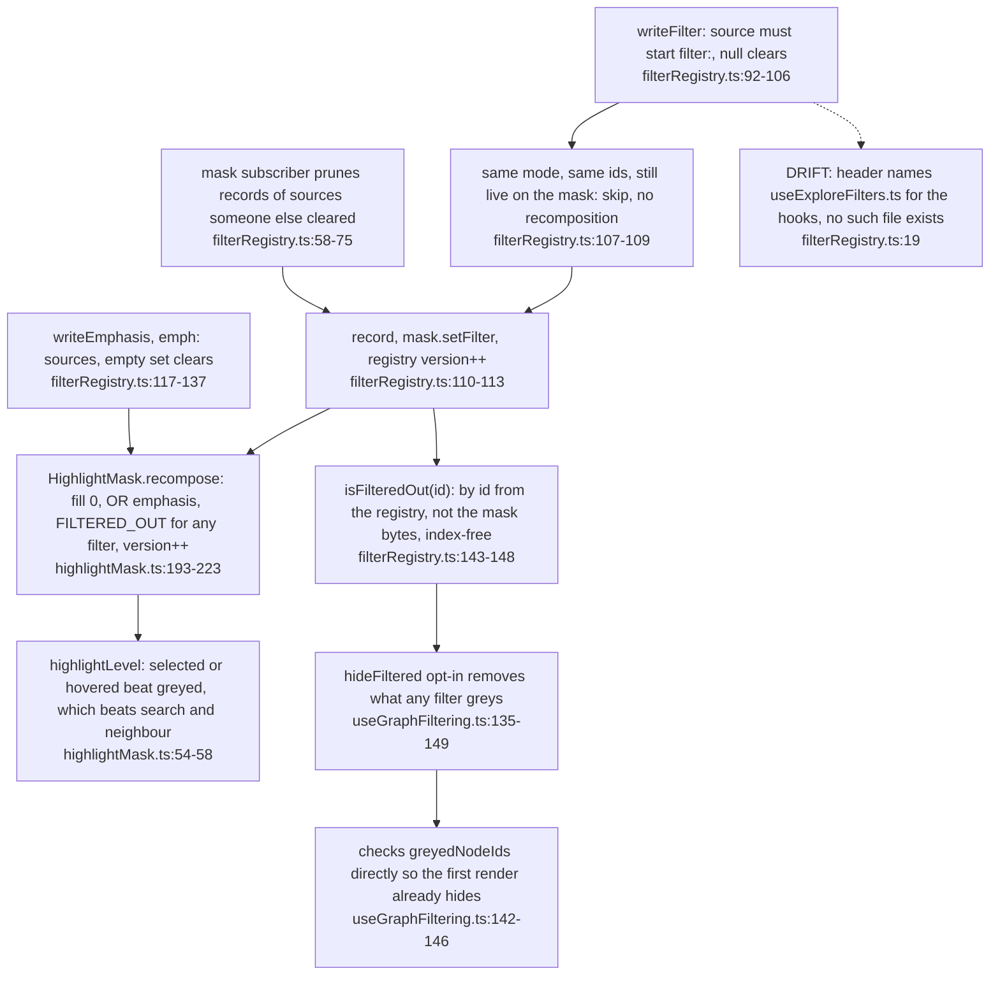

**What it shows.** Every grey and emphasis write, and why graph-data churn costs no recomposition. **Why it is this way.** Each mask write is O(n) plus a re-render of every subscriber (`filterRegistry.ts:11-13`); `hideFiltered` reads the registry because the mask bytes are indexed by a map that is one render stale on a new load (`filterRegistry.ts:14-17`), the opt-in ADR-2183 foresaw (`ADR-2183-interactive-filters-grey-out-through-a-highlight-mask.md:49`).

## VC-56.8 Node-filter settings: removal, grey-out, and hide

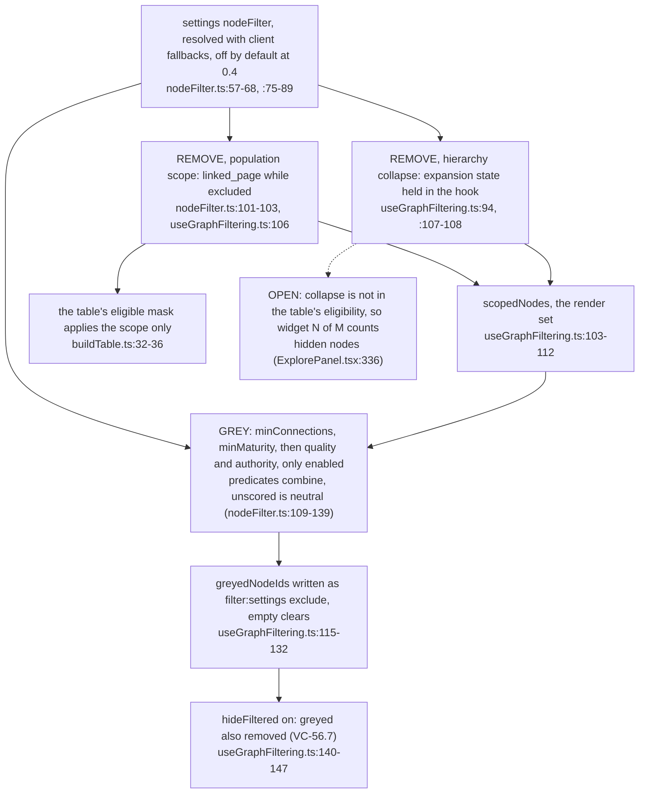

**What it shows.** The ADR-2183 D4 split: scope and collapse remove, the interactive predicates grey, and only the opt-in hides. **Why it is this way.** ADR-2183 D4 keeps hierarchy collapse a removal because it "changes what a node is" (`ADR-2183-interactive-filters-grey-out-through-a-highlight-mask.md:42`); the predicate semantics and the 0.4 default come from the 2026-11-06 implementation notes (`nodeFilter.ts:13-20`, `nodeFilter.ts:51-57`).

**Tension (crossfilter vs render set):** the crossfilter says only rows in the render set count "so counts match the screen" (`crossfilter.ts:15-16`), but hierarchy collapse lives in per-instance hook state inside GraphManager (`GraphManager.tsx:87`, `useGraphFiltering.ts:94`) that the table builder cannot see (`buildTable.ts:32-36`), so the panel has to disclaim it (`ExplorePanel.tsx:336`).

## VC-56.9 Column encoder and legend

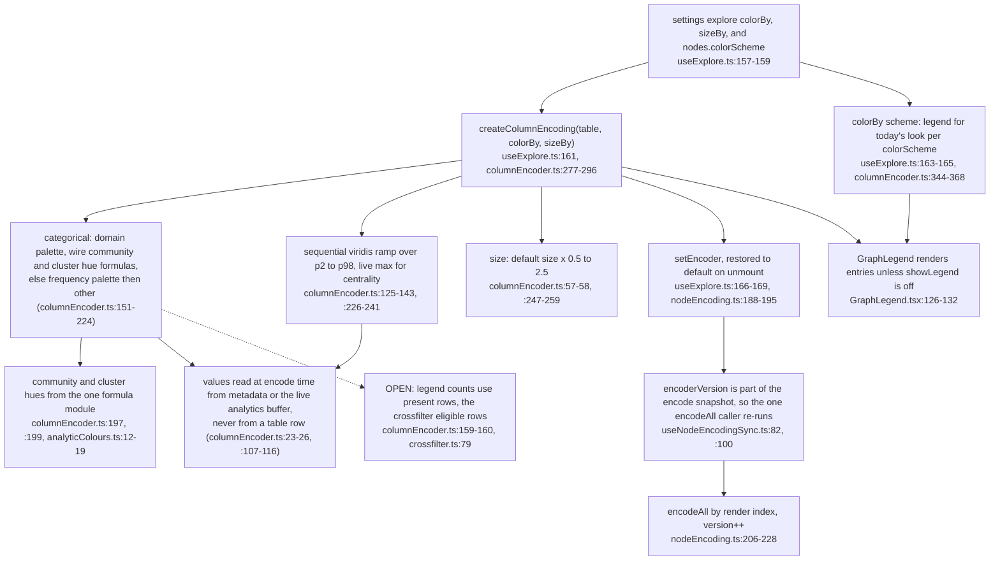

**What it shows.** How a colour-by or size-by choice becomes a new encoder and a legend, and why live wire columns recolour without a table rebuild. **Why it is this way.** ADR-2184 D4: any categorical or numeric column, a clamp on size, a legend always shown, defaults reproduce today's look (`ADR-2184-a-client-side-columnar-node-table-drives-visual-encoding.md:43-48`).

The community, cluster and centrality hues are written once, in `analyticColours.ts` (`analyticColours.ts:12-25`), and the encoder, its scheme legend and the CSS ramp call them (`columnEncoder.ts:197`, `columnEncoder.ts:199`, `columnEncoder.ts:332`, `columnEncoder.ts:355`), as does the default encoder (`nodeEncoding.ts:95`, `nodeEncoding.ts:97`, `nodeEncoding.ts:100`).

## VC-56.10 ExplorePanel widgets and brushing

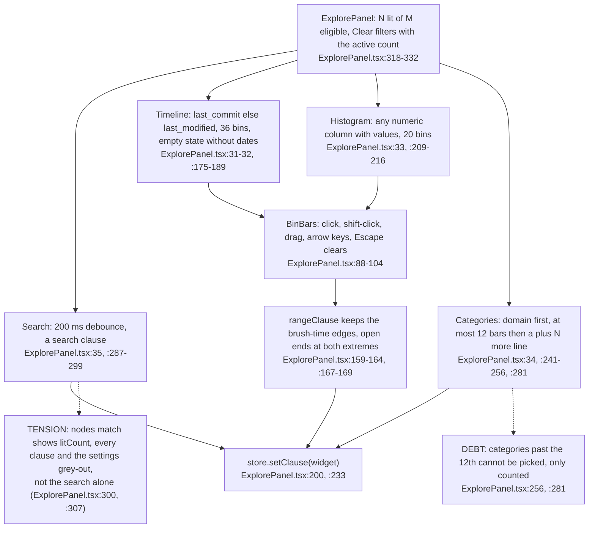

**What it shows.** The four ADR-2185 D1 widgets and how a brush becomes a clause that survives a live domain shift. **Why it is this way.** ADR-2185 D1 lists timeline, numeric histograms, category bars and search (`ADR-2185-linked-timeline-histogram-and-search-widgets-write-the-highlight-mask.md:38`); the panel is a scene occluder so the camera fit keeps the graph out from under it (`ExplorePanel.tsx:13-14`).

## VC-56.11 Refresh cadence: what a 5 s analytics change costs

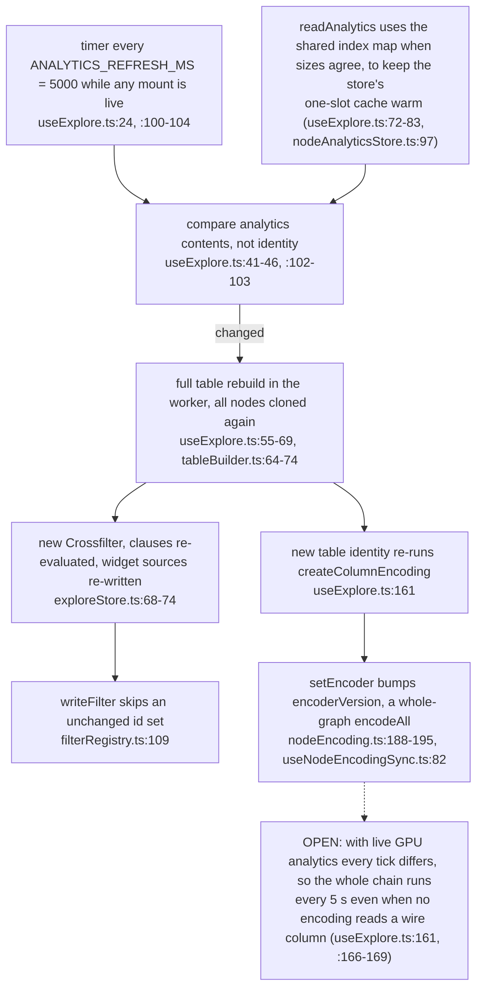

**What it shows.** The one polling loop in the lane and the work a changed analytics buffer triggers. **Why it is this way.** ADR-2184 D1 refreshes analytics "as frames arrive" (`ADR-2184-a-client-side-columnar-node-table-drives-visual-encoding.md:37`); the code polls instead, and the encoder reads wire values at encode time (`columnEncoder.ts:23-26`), so the rebuild serves the widgets' domains and counts more than the colours.
