## For developers

ADR-2189 regroups every registry field into seven sections that both clients share. Group files still declare fields; `placement.ts` decides where each is shown; `manifest.ts` derives the sections, a per-field storage scope from the server bucket a path routes to, the test manifest and the `ia.json` map the headset reads. This topic covers that spine, the dock (dials, fold, buttons), the one right-hand drawer, the rule that keeps the settings panel and the drawer from overlapping, the lane seam in `integrationSlots.ts`, and how removed paths are stripped from old data. VC-34 keeps the settings round trip; VC-31 the render tree that mounts the drawer; VC-56 the explore panel inside it; VC-36 the headset HUD.

## For the business

Every setting now sits in one of seven named places, the same on the desktop and in the headset, and each one says whether changing it affects only this browser, every viewer, or the shared layout everyone sees. On a narrow screen the dock folds its five dials into one menu instead of pushing controls off the edge, and the explore, memory and node panels share one drawer so none hides another. Settings that were removed are cleaned out of old saved data on load.

## VC-57.1 From group declaration to the seven sections and their consumers
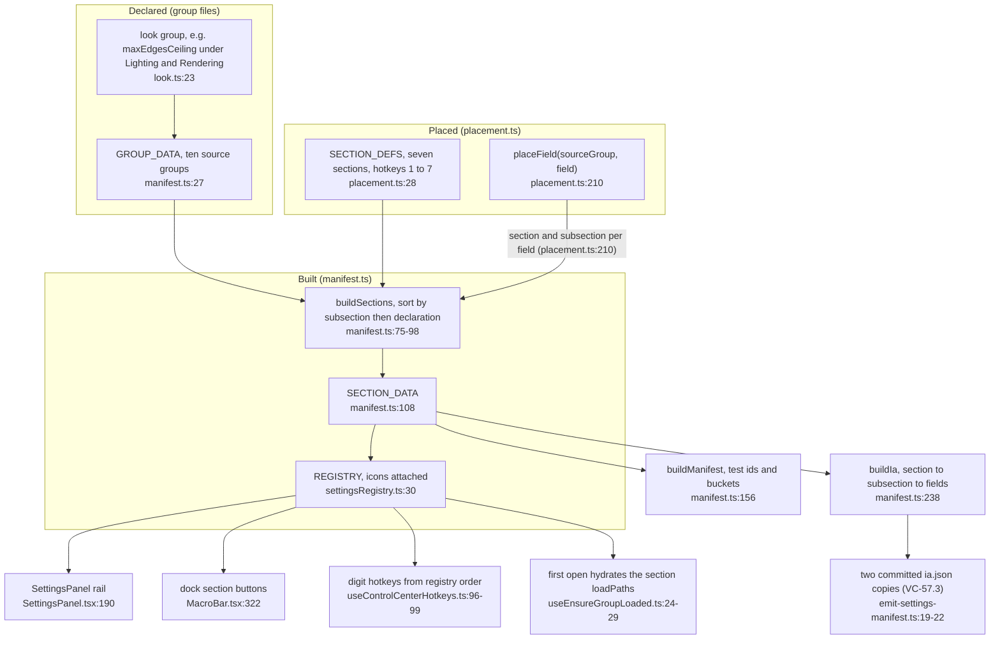

**What it shows.** The registry pipeline after ADR-2189: declaration, placement, section build, then the four consumers (rail, dock, hotkeys, emitters). **Why it is this way.** ADR-2189 §1-§2 keep group files as the place a field is declared and make placement data, so the seven-section map can be emitted for the headset without React or icons.

**Drift (control-center.md vs code):** the explanation page still describes nine groups on hotkeys 1-9 (`control-center.md:100`, `:233`); the code has seven sections (`placement.ts:28`) and generates hotkeys from them (`useControlCenterHotkeys.ts:96`).

## VC-57.2 placeField: where one field is shown
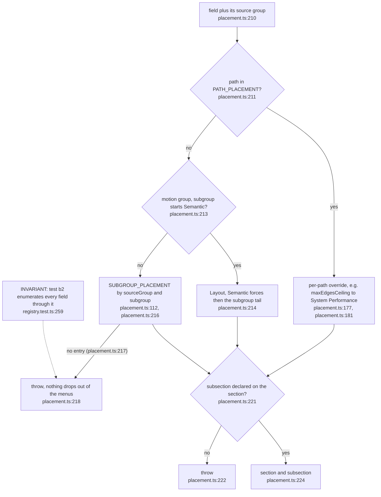

**What it shows.** The three-step resolution for one field and the two throws that make an unplaced field a test failure. **Why it is this way.** ADR-2189 §7 maps old subgroups wholesale but moves a few mixed-concern paths individually; throwing keeps the "every control in exactly one place" rule mechanical.

**Debt (loose end):** `maxEdgesCeiling` ("Edge memory budget") is still declared in the look group under "Lighting & Rendering" with a stale "Phase 6" description (`look.ts:23`), though it caps edge capacity (`GlassEdges.tsx:244`); only the per-path override shows it under System › Performance (`placement.ts:181`), as ADR-2189 §7 asks (`ADR-2189-desktop-and-xr-menus-share-one-seven-section-information-architecture.md:218`).

## VC-57.3 The emitted documents and what pins each copy
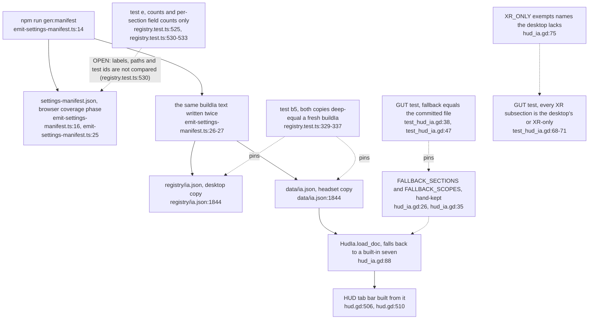

**What it shows.** One emitter, three committed outputs, and which test pins which copy. **Why it is this way.** ADR-2189 §2 follows the `semantic_fields.json` precedent: one generated document, two committed copies, a test that regenerates and compares, so desktop and headset cannot drift silently.

**Debt (parallel):** the IA exists as two committed copies, `registry/ia.json` and `xr-client/data/ia.json`, written by one emitter (`emit-settings-manifest.ts:19-22`); they are generated, never hand-edited.

**Invariant:** both copies deep-equal a fresh `buildIa()` or the Vitest suite fails (`registry.test.ts:329-337`).

**Debt (parallel):** the headset keeps a hand copy of the seven sections and the scope texts (`hud_ia.gd:26`, `:35`) beside `SCOPE_TEXT` (`manifest.ts:223`); only the GUT test ties them (`test_hud_ia.gd:38-47`).

**Tension (parallel):** the XR "Semantic forces" subsection passes the parity test only by being listed as XR-only (`hud_ia.gd:79`), though the desktop has eight "Semantic forces › …" subsections (`placement.ts:62-68`).

**Tension (ADR-2189 vs XR-client.md):** ADR-2189 still says the XR HUD reading `ia.json` and its GUT parity test are not built (`ADR-2189-desktop-and-xr-menus-share-one-seven-section-information-architecture.md:23`, `:314`); `XR-client.md:1061` records the XR side as built, and `hud.gd:510` loads it.

## VC-57.4 Scope badges from the server bucket
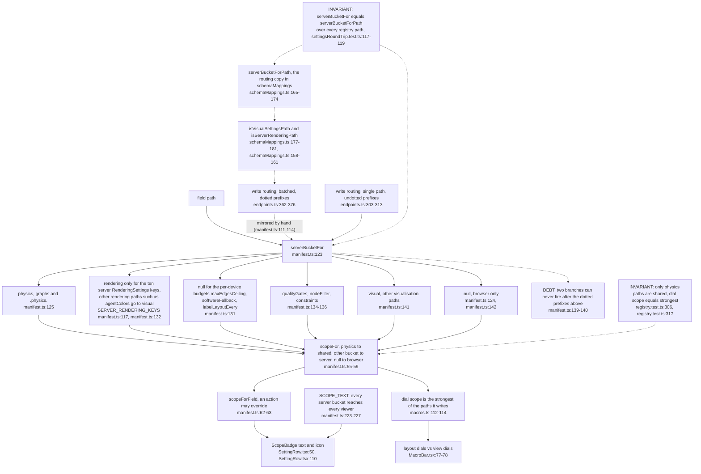

**What it shows.** How a row's badge and a dial's scope derive from the bucket a path would be PUT to. **Why it is this way.** ADR-2189 §2 wants every row to say where its value is stored; the implementation note corrected the wording because every server bucket is a single global document (`ADR-2189-desktop-and-xr-menus-share-one-seven-section-information-architecture.md:305`).

**Tension (parallel):** the badge's `serverBucketFor` copies the batched router's dotted prefixes (`manifest.ts:125`, `endpoints.ts:362`), but the single-path writer tests `.physics` and bare `qualityGates`/`nodeFilter` prefixes (`endpoints.ts:303`, `:307`, `:309`), so the two writers and the badge can disagree on a path such as `qualityGatesX.*`; no registered path hits the gap today.

**Debt (parallel):** bucket routing is written four times: the badge's `serverBucketFor` (`manifest.ts:123`), `serverBucketForPath` (`schemaMappings.ts:165`) and the two writers (`endpoints.ts:303-313`, `:362-376`); the rendering key set is copied by hand (`manifest.ts:117` beside `schemaMappings.ts:139`) and the device-local list is an inline literal (`manifest.ts:131`) beside `DEVICE_LOCAL_RENDERING_KEYS` (`schemaMappings.ts:149`), pinned to each other only over registry paths (`settingsRoundTrip.test.ts:117-119`).

**Drift (comment vs code):** `manifest.ts:127-128` says `maxEdgesCeiling`, `softwareFallback` and `labelLayoutEvery` live in `/visual`, but the next branch returns `null` for them, so they stay in the browser (`manifest.ts:131`).

**Drift (comment vs code):** the `SCOPE_TEXT` header says rendering lives in the settings actor (`manifest.ts:220-221`); the rendering handler now also stores a `rendering` row (`settings_routes.rs:1004-1007`, `sqlite_settings_repository.rs:1057`).

## VC-57.5 One write path for rows, dials and the Ask box
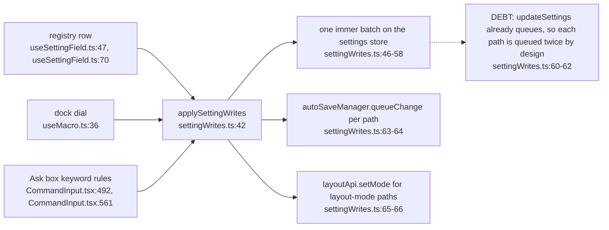

**What it shows.** The three writing surfaces converge on one function with one store batch, one autosave queue and one layout side effect. **Why it is this way.** The menus audit found up to four writers per setting and an Ask box that PUT physics directly, bypassing the store and the Sync switch (`settingWrites.ts:12-14`); ADR-2189 §6 makes one writer.

## VC-57.6 The dock: dials, buttons and the narrow-width fold
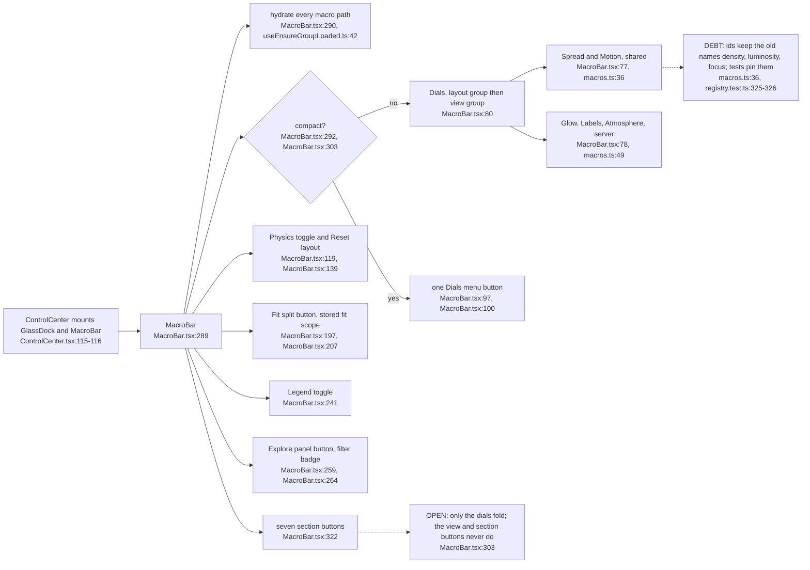

**Debt (loose end):** the Atmosphere dial still drives `sceneEffects.fogOpacity` (`macros.ts:101`) and the Fog opacity row still offers it (`atmosphere.ts:26`), but nothing in the client draws fog from it since the GLSL fog plane was deleted; the only other mentions are its default and type (`defaults.ts:140`, `settings.ts:507`).

**What it shows.** What the dock renders and the single point where it folds. **Why it is this way.** ADR-2189 §3 orders the dock as shared dials, view dials, physics and reset, then Fit, Legend, Explore and the sections; the audit found the old dock 74 px off-screen at 1024 px (`useDockCompact.ts:9-10`).

## VC-57.7 useDockCompact: overflow-triggered fold with hysteresis
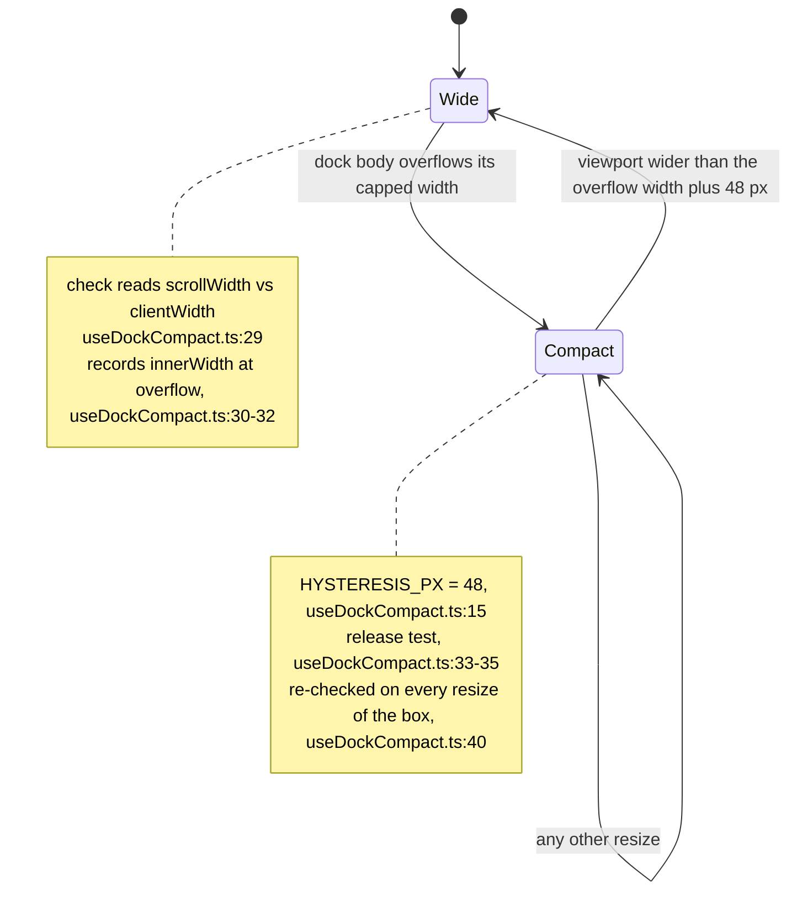

**What it shows.** The fold is driven by measured overflow, not a breakpoint, and only releases once the viewport has grown 48 px past the width where it overflowed. **Why it is this way.** Measuring makes an off-screen dock impossible at any font or content width, and the hysteresis stops flicker at the boundary (`useDockCompact.ts:6-8`).

**Drift (ADR-2189 §3 vs code):** the ADR fixes the fold "below 1180 px" (`ADR-2189-desktop-and-xr-menus-share-one-seven-section-information-architecture.md:147`); the code folds on measured overflow with no breakpoint (`useDockCompact.ts:29-33`).

## VC-57.8 The right-hand drawer's tab state
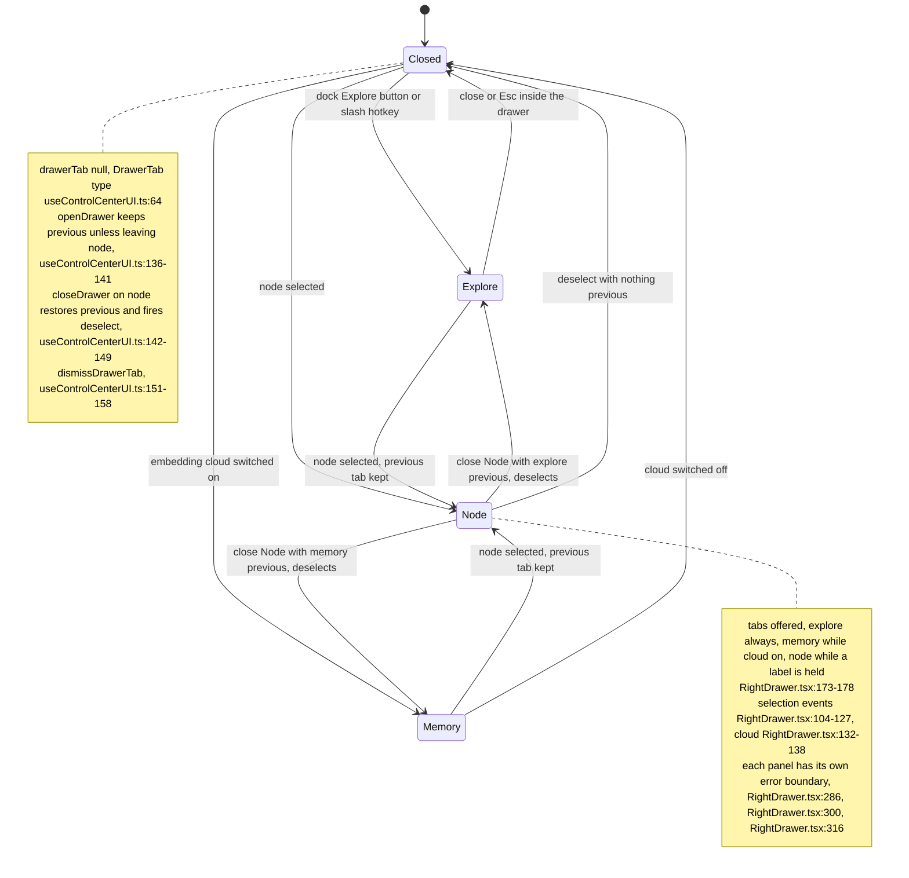

**What it shows.** The three tabs, what opens and dismisses each, and how closing the Node tab returns to the tab shown before it. **Why it is this way.** ADR-2189 §4 puts explore, memory explorer and node detail in one drawer because the memory panel and node detail used to cover the explore drawer and each other (`ADR-2189-desktop-and-xr-menus-share-one-seven-section-information-architecture.md:332`).

**Drift (comment vs code):** `useExclusiveSidePanels.ts:11-13` says the dock's Explore button brings a hidden drawer tab back, but `openDrawer('explore')` overwrites the stashed `previousDrawerTab` (`useControlCenterUI.ts:140`), so a hidden Node tab returns only when its tab button is clicked (`RightDrawer.tsx:176`) or another node is selected.

## VC-57.9 useExclusiveSidePanels: settings panel and drawer never overlap
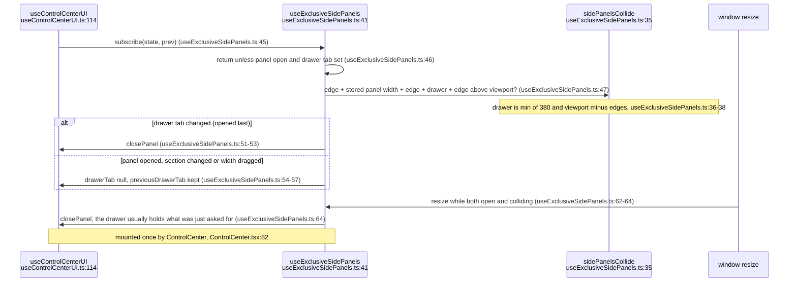

**What it shows.** The last-opened-wins rule and the resize rule that resolve a collision between the left settings panel and the right drawer. **Why it is this way.** ADR-2189 §3-§4 forbid overlapping fixed surfaces; the stored width is used because during a drag the DOM still reports the old width (`useExclusiveSidePanels.ts:25-29`).

## VC-57.10 integrationSlots: the one seam to the render and explore lanes
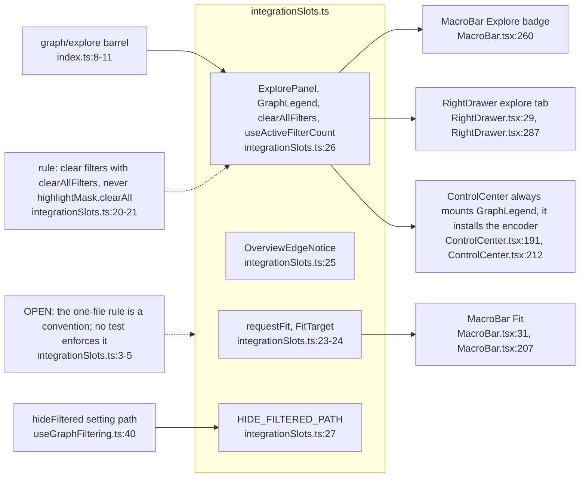

**What it shows.** Every control-centre dependency on the render (ADR-2180/2181) and explore (ADR-2183-2185) lanes comes through one re-export file. **Why it is this way.** The three lanes were built in parallel; one seam means a lane API change touches one file (`integrationSlots.ts:2-5`).

## VC-57.11 Retired paths: one client list, three strip points, separate server lists
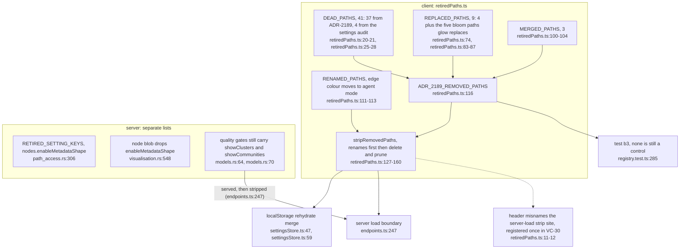

**What it shows.** How the 53 removed paths leave old data on both load paths, and the separate server-side retirements. **Why it is this way.** ADR-2189 §6 deletes paths nothing reads but promises that blobs written by older clients still load, so stripping is tolerant and happens at every boundary (`retiredPaths.ts:122-126`).

**Tension (parallel):** the client retires `qualityGates.showClusters` and `showCommunities` (`retiredPaths.ts:102-103`), but the server still models them as live quality-gate fields with no reader (`models.rs:64`, `:70`), so every load serves them and the client strips them again (`endpoints.ts:247`); the same holds for `qualityGates.ruvectorEnabled`, retired by the settings audit (`retiredPaths.ts:26`) but still a server field (`models.rs:73`).

**Debt (parallel):** retirement is three lists with no shared source: the client's `ADR_2189_REMOVED_PATHS` (`retiredPaths.ts:116`), the server's `RETIRED_SETTING_KEYS` (`path_access.rs:306`) and the domain node-blob filter (`visualisation.rs:548`).

## VC-57.12 What the settings-integrity pass changed in the menus
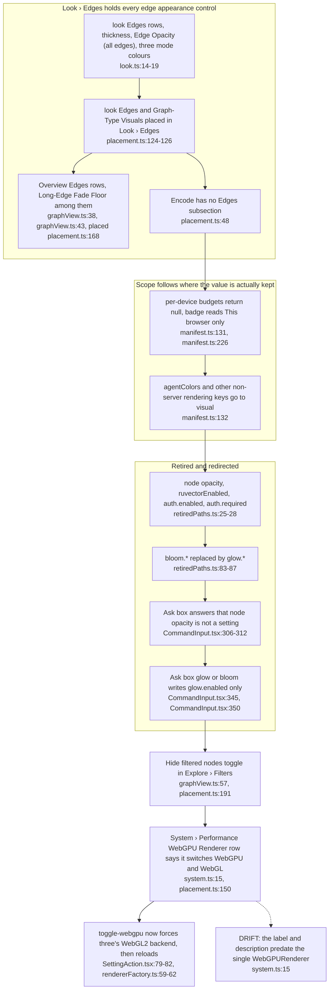

**What it shows.** The menu side of the 2026-11-06 settings audit: edge appearance gathered under Look › Edges, scopes that match where a value is kept, the retired paths and their Ask-box redirects, and the explore hide-filtered toggle. **Why it is this way.** The audit found edge opacity split from its fade floor and per-device budgets labelled as server-saved (`placement.ts:123-124`, `schemaMappings.ts:145-150`).

**Drift (registry vs renderer):** the WebGPU Renderer row still says it switches between WebGPU and WebGL renderers (`system.ts:15`); the desktop has one renderer, and the toggle forces its WebGL2 backend (`SettingAction.tsx:80-81`, `rendererFactory.ts:59-62`).

**Debt (loose end):** the renderer info row shows TSL Materials and Node Bloom badges (`RendererInfo.tsx:45-46`) from flags that are now always true (`rendererFactory.ts:196-197`, `:206-207`), and the type still contrasts node bloom with EffectComposer (`settings.ts:158`).

**Tension (ADR-2189 vs ADR-2187):** ADR-2189 places the ADR-2187 overview route flag under System › Developer (`ADR-2189-desktop-and-xr-menus-share-one-seven-section-information-architecture.md:104`, `:257`); ADR-2187 is rejected (`ADR-2187-a-cosmos-gl-2d-overview-is-built-as-a-time-boxed-reference-spike.md:5`) and only Debug Logging feeds Developer (`placement.ts:153`).
