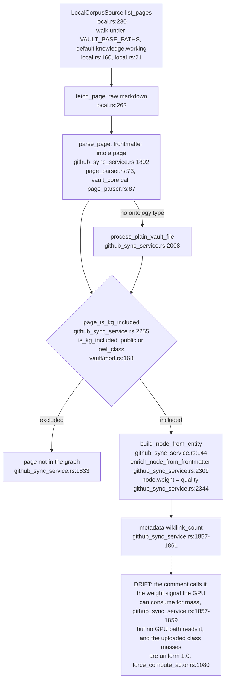
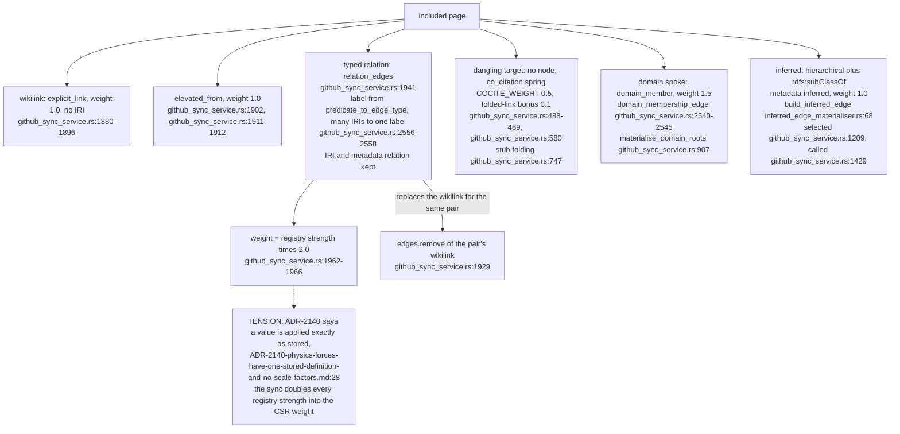
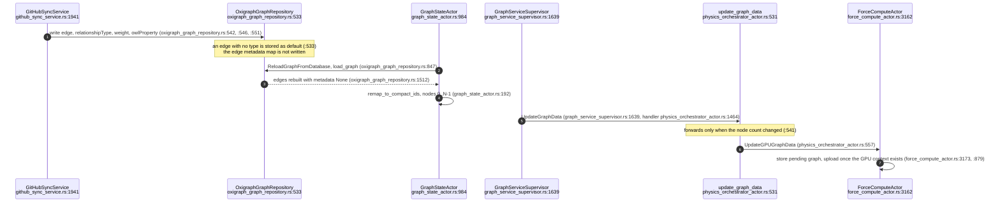
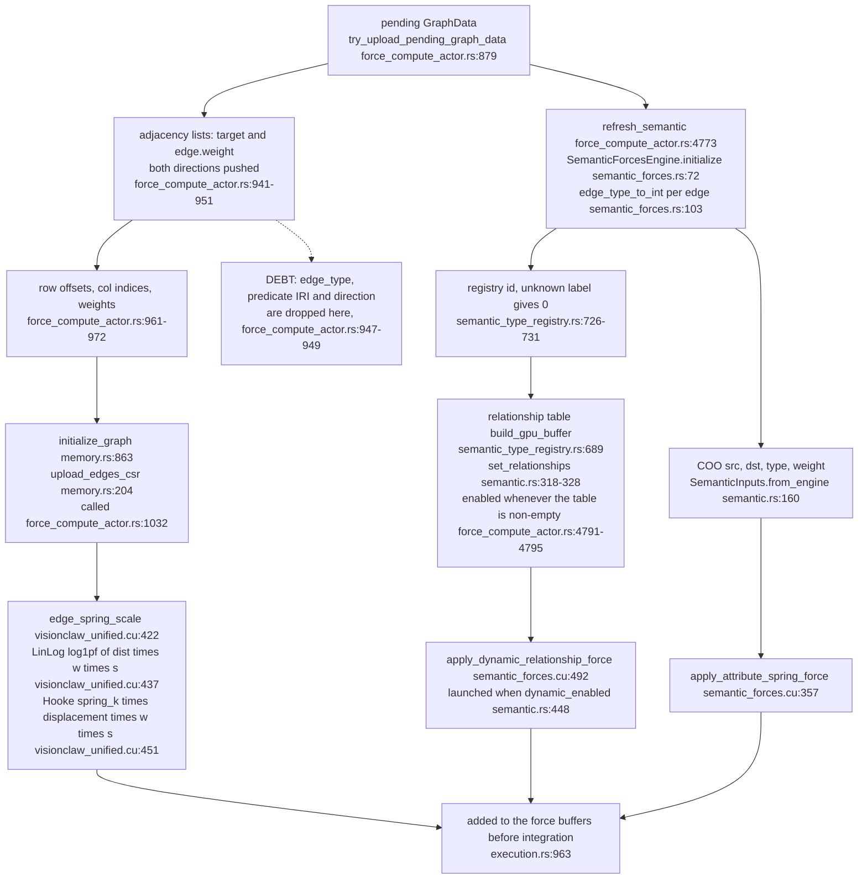
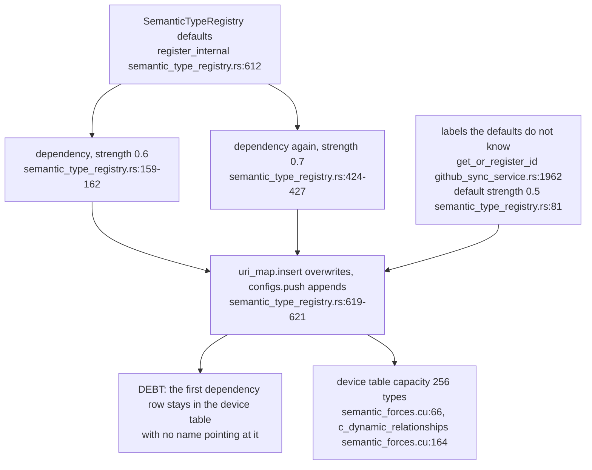

## For developers

Follows one corpus page from the vault walk to the two GPU structures that consume its edges: the CSR spring graph, which keeps only an undirected weight, and the semantic COO list, which keeps a per-edge type id. Read with VC-21 (ingest), VC-11 (the step) and VC-59 (each force term). Drawn from the code at main 46edc196b; the physics rework planned in November 2026 is not drawn here.

## For the business

A relation written in a page (`is-a`, `requires`, `has-part`) reaches the layout as a spring whose stiffness comes from a shared table. The layout engine never sees which relation it was: two pages joined by `requires` and two joined by a plain link pull together by the same law, only with different strength. A change that only adds or removes links does not reach the layout until the number of pages changes.

## VC-58.1 Page to node: list, fetch, parse, gate

**What it shows:** the corpus source lists and fetches pages, the vault parser turns frontmatter into a page, and only pages that are public or carry an `owl_class` become nodes. **Why it is this way:** ADR-2114 put every corpus behind one `CorpusSource`, and ADR-2112 made frontmatter the only ontology carrier.

**Drift:** `github_sync_service.rs:1857-1859` describes `wikilink_count` as "the weight signal the GPU can consume for connectivity-based mass", but at 46edc196b it is written (`../project/src/services/github_sync_service.rs:1861`) and never read on the GPU path; the class masses uploaded with the graph are all 1.0 (`../project/src/actors/gpu/force_compute_actor.rs:1080`), and degree enters only through the degree-weight buffer (`../project/src/actors/gpu/force_compute_actor.rs:1194-1205`).

## VC-58.2 Edge producers: seven kinds, their labels and weights

**What it shows:** every edge kind the sync writes, the label it carries and its spring weight. Only typed relations carry a predicate IRI and a `relation` name; co-citation edges stand in for links to pages that do not exist. **Why it is this way:** the factor 2.0 normalises the registry's 0–1 strength to the 0–2 spring range (comment at `github_sync_service.rs:1963`).

**Tension (ADR-2140 vs code):** ADR-2140 decision 2 says "there is no scale factor, multiplier, clamp or cap between the store and the GPU" (`../project/docs/adr/ADR-2140-physics-forces-have-one-stored-definition-and-no-scale-factors.md:28`), while every typed edge's CSR weight is the registry strength times 2.0 (`../project/src/services/github_sync_service.rs:1966`). The registry strength is a code-held default, not a stored setting, so the ADR's own drift note on scope applies (`../project/docs/adr/ADR-2140-physics-forces-have-one-stored-definition-and-no-scale-factors.md:65`).

## VC-58.3 Persist, reload and the hand-off to the GPU actors

**What it shows:** the typed edge survives Oxigraph as label, weight and predicate IRI, but its metadata does not; the orchestrator re-forwards a graph to the GPU only when the node count differs. **Why it is this way:** the count check closed the "UpdateGPUGraphData propagation gap" for a growing graph (comment at `physics_orchestrator_actor.rs:537-540`); it was not written for edge-only changes.

**Debt:** `metadata["relation"]` and `metadata["inferred"]` are set at build time (`../project/src/services/github_sync_service.rs:1975`, `../project/src/services/inferred_edge_materialiser.rs:68`) but every reloaded edge has `metadata: None` (`../project/src/adapters/oxigraph_graph_repository.rs:1512`), so after a restart-time reload an inferred edge is told apart only by its label and IRI.

**Tension:** a sync that adds or removes edges but leaves the node count unchanged is not forwarded to the GPU (`../project/src/actors/physics_orchestrator_actor.rs:541`), so the layout keeps the previous edge set until the next count change or GPU re-initialisation.

## VC-58.4 Two GPU shapes of one edge: CSR drops the type, COO keeps it

**What it shows:** the same edge reaches the device twice. The CSR keeps only an undirected weight for the spring and repulsion pass; the semantic COO list keeps a per-edge registry id that indexes the relationship table. **Why it is this way:** the CSR was built for the force pass and SSSP, which need neighbours and weights only; the semantic pass was added later with its own buffers (ADR-2140 moved its configuration into the stored document).

**Debt:** relation type, predicate IRI and direction are discarded when the CSR is built (`../project/src/actors/gpu/force_compute_actor.rs:947-949`), so the main spring cannot tell `requires` from `has-part` except through the doubled strength in the weight.

## VC-58.5 Registry ids are positions, not names

**What it shows:** type ids are allocation order: a default listed twice keeps two rows, and labels met during sync are appended after the defaults. **Why it is this way:** ids are rebuilt on every upload (VC-58.4), so nothing stores an id that would need migrating.

**Debt:** `dependency` is registered twice with different strengths (`../project/src/services/semantic_type_registry.rs:160`, `:425`); `register_internal` overwrites the name map but appends the config (`../project/src/services/semantic_type_registry.rs:619-621`), so the 0.6 row is unreachable by name while still uploaded.
