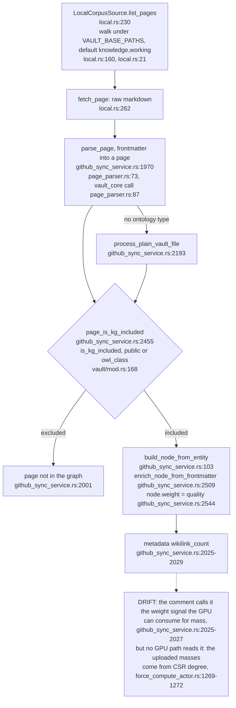
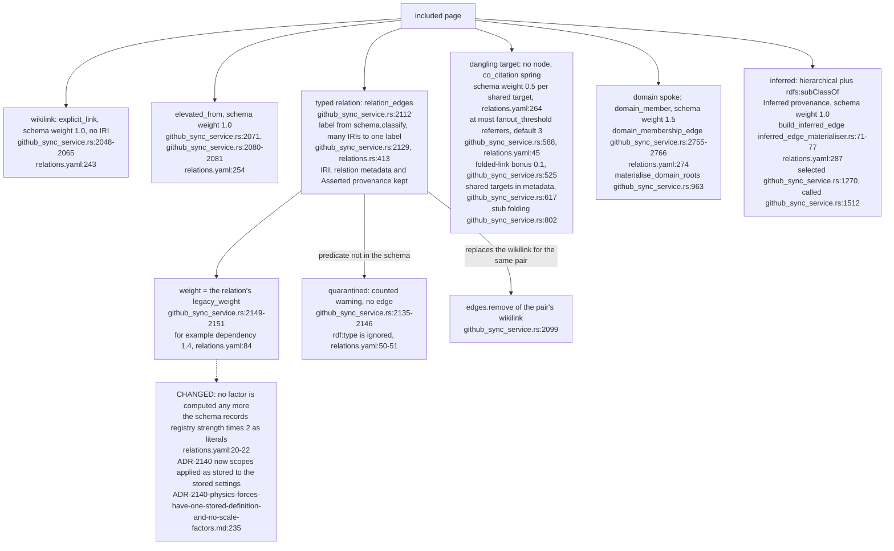
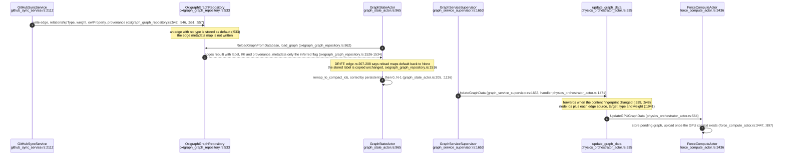
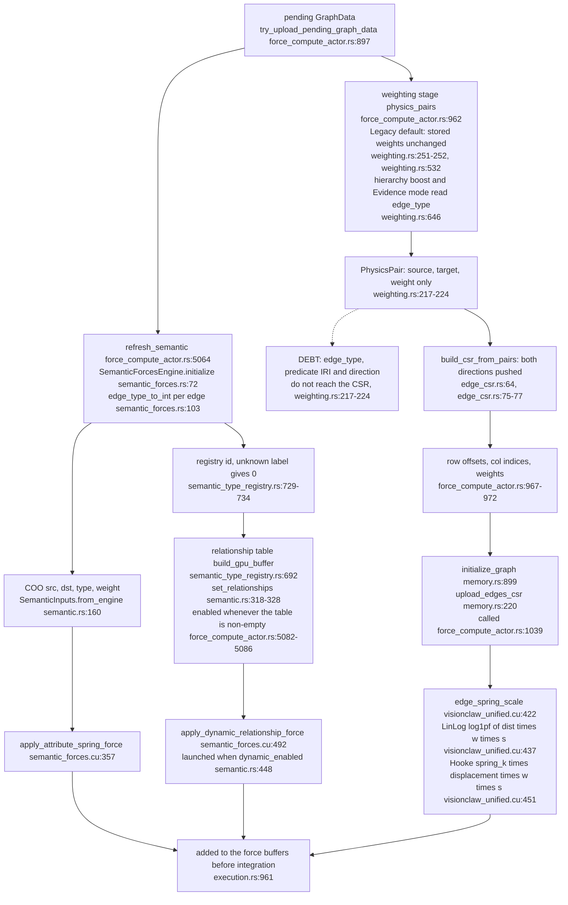
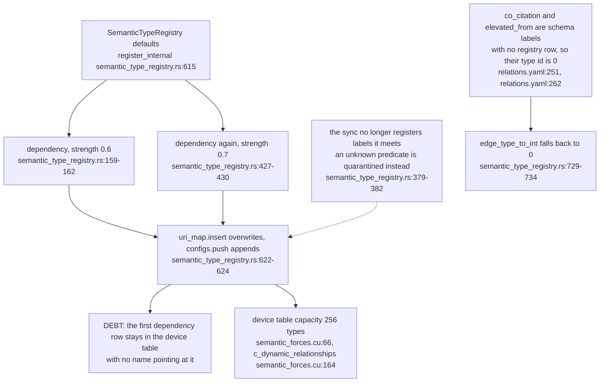

## For developers

Follows one corpus page from the vault walk to the two GPU structures that consume its edges: the CSR spring graph, which keeps only an undirected weight, and the semantic COO list, which keeps a per-edge type id. Read with VC-21 (ingest), VC-11 (the step) and VC-59 (each force term). Drawn at visionclaw 4900ec60, after ADR-2204 slices S1 to S4a: relation labels and edge weights are read from one schema (`relations.yaml`), edge provenance survives the store, and a host-side weighting stage sits between the stored edges and the CSR. In its default profile that stage passes every stored weight through unchanged.

## For the business

A relation written in a page (`is-a`, `requires`, `has-part`) reaches the layout as a spring whose stiffness comes from one declared table. The layout engine never sees which relation it was: two pages joined by `requires` and two joined by a plain link pull together by the same law, only with different strength. A relation the table does not know is now set aside with a warning instead of being given a guessed strength. Any change to the pages or their links now reaches the layout; earlier, only a change in the number of pages did.

## VC-58.1 Page to node: list, fetch, parse, gate

**What it shows:** the corpus source lists and fetches pages, the vault parser turns frontmatter into a page, and only pages that are public or carry an `owl_class` become nodes. **Why it is this way:** ADR-2114 put every corpus behind one `CorpusSource`, and ADR-2112 made frontmatter the only ontology carrier.

**Drift:** `github_sync_service.rs:2025-2027` describes `wikilink_count` as "the weight signal the GPU can consume for connectivity-based mass", but it is written (`../project/src/services/github_sync_service.rs:2029`) and never read on the GPU path. Connectivity-based mass does exist, from the CSR instead: the class masses first uploaded as 1.0 (`../project/src/actors/gpu/force_compute_actor.rs:1087`) are replaced by `0.5 + 2w`, capped at 5, where `w` is the median-normalised `ln(1 + degree)` of the uploaded CSR (`../project/src/actors/gpu/force_compute_actor.rs:1207-1212`, `../project/src/actors/gpu/force_compute_actor.rs:1269-1272`, `../project/src/actors/gpu/force_compute_actor.rs:1285`). The same degree feeds the degree-weight buffer, and under the opt-in `strength` repulsion mode the CSR weights also fill the repulsion buffer (`../project/src/actors/gpu/force_compute_actor.rs:1254`, `../project/src/utils/unified_gpu_compute/memory.rs:324`). Corrected on 23 November: the 010e1109b drawing said the masses stayed at 1.0, but the degree-based replacement was already in the code at that revision.

## VC-58.2 Edge producers: one schema for labels and weights

**What it shows:** every edge kind the sync writes, the label it carries and its spring weight, all read from `relations.yaml`. Only typed relations carry a predicate IRI and a `relation` name; co-citation edges stand in for links to pages that do not exist. **Why it is this way:** ADR-2204 S2 moved labels and weights into one schema without changing any produced weight (`relations.yaml:19-23`), and a predicate the schema does not know is quarantined instead of being auto-registered with a default (`github_sync_service.rs:2135-2146`).

**Tension (ADR-2140 vs code), changed at visionclaw 4900ec60:** the 010e1109b drawing found every typed edge weight computed as the registry strength times 2.0, against ADR-2140 decision 2 (`../project/docs/adr/ADR-2140-physics-forces-have-one-stored-definition-and-no-scale-factors.md:28`). That multiplication is gone: the typed weight is the schema's `legacy_weight` (`../project/src/services/github_sync_service.rs:2149-2151`), which records the same product as a literal (`../project/crates/visionclaw-domain/data/relations.yaml:20-22`). The values are still code-held, not stored settings, and the 2026-11-20 amendment narrows "applied exactly as stored" to the stored settings, leaving the decision to ADR-2204 (`../project/docs/adr/ADR-2140-physics-forces-have-one-stored-definition-and-no-scale-factors.md:235`).

## VC-58.3 Persist, reload and the hand-off to the GPU actors

**What it shows:** the typed edge survives Oxigraph as label, weight, predicate IRI and provenance, but its metadata map does not, and the orchestrator re-forwards a graph to the GPU whenever its content fingerprint changes. **Why it is this way:** ADR-2204 S1 made provenance survive store and reload; the fingerprint replaced a node-count check that could not see a swapped node or an edge-only change (`physics_orchestrator_actor.rs:1935-1940`).

**Debt:** `metadata["relation"]` and a co-citation edge's shared-target list are set at build time (`../project/src/services/github_sync_service.rs:2159`, `../project/src/services/github_sync_service.rs:617`), but reload restores only the inferred flag (`../project/src/adapters/oxigraph_graph_repository.rs:1631-1639`). Evidence weighting then counts each reloaded co-citation pair as one undamped item (`../project/crates/visionclaw-domain/src/weighting.rs:325-326`) instead of one damped item per shared target.

**Drift:** the comment on `UNTYPED_EDGE_LABEL` says reload maps the stored `default` back to `None` (`../project/crates/visionclaw-domain/src/models/edge.rs:207-208`), but reload copies the stored label into `edge_type` unchanged (`../project/src/adapters/oxigraph_graph_repository.rs:1516`, `../project/src/adapters/oxigraph_graph_repository.rs:1531`).

**Tension:** RESOLVED at visionclaw 4900ec60. At 010e1109b a sync that changed edges but not the node count was never forwarded to the GPU. The gate now compares a content fingerprint (`../project/src/actors/physics_orchestrator_actor.rs:538-539`, `../project/src/actors/physics_orchestrator_actor.rs:548`, `../project/src/actors/physics_orchestrator_actor.rs:1941`).

## VC-58.4 Two GPU shapes of one edge: CSR drops the type, COO keeps it

**What it shows:** the same edge reaches the device twice. The CSR keeps only an undirected weight for the spring and repulsion pass, after the host weighting stage; the semantic COO list keeps a per-edge registry id that indexes the relationship table. **Why it is this way:** the CSR was built for the force pass and SSSP, which need neighbours and weights only; ADR-2204 put one weighting function in front of it, used by the first upload and by a live re-weight alike (`force_compute_actor.rs:959-961`).

**Debt:** relation type, predicate IRI and direction do not survive into the physics pair the CSR is built from (`../project/crates/visionclaw-domain/src/weighting.rs:217-224`), so the main spring cannot tell `requires` from `has-part` except through the weight the schema gives each label. The weighting stage can read the type first (`../project/crates/visionclaw-domain/src/weighting.rs:646`), but only for the hierarchy boost and Evidence mode, both off in the default profile (`../project/crates/visionclaw-domain/src/weighting.rs:202-204`).

## VC-58.5 Registry ids are positions, not names

**What it shows:** type ids are allocation order: a default listed twice keeps two rows, and since ADR-2204 nothing is appended during sync, so a schema label without a default row is typed as the generic id 0. **Why it is this way:** ids are rebuilt on every upload (VC-58.4), so nothing stores an id that would need migrating.

**Debt:** `dependency` is registered twice with different strengths (`../project/src/services/semantic_type_registry.rs:160`, `:428`); `register_internal` overwrites the name map but appends the config (`../project/src/services/semantic_type_registry.rs:622-624`), so the 0.6 row is unreachable by name while still uploaded. The schema's own note records the shadowed row (`../project/crates/visionclaw-domain/data/relations.yaml:85`).
