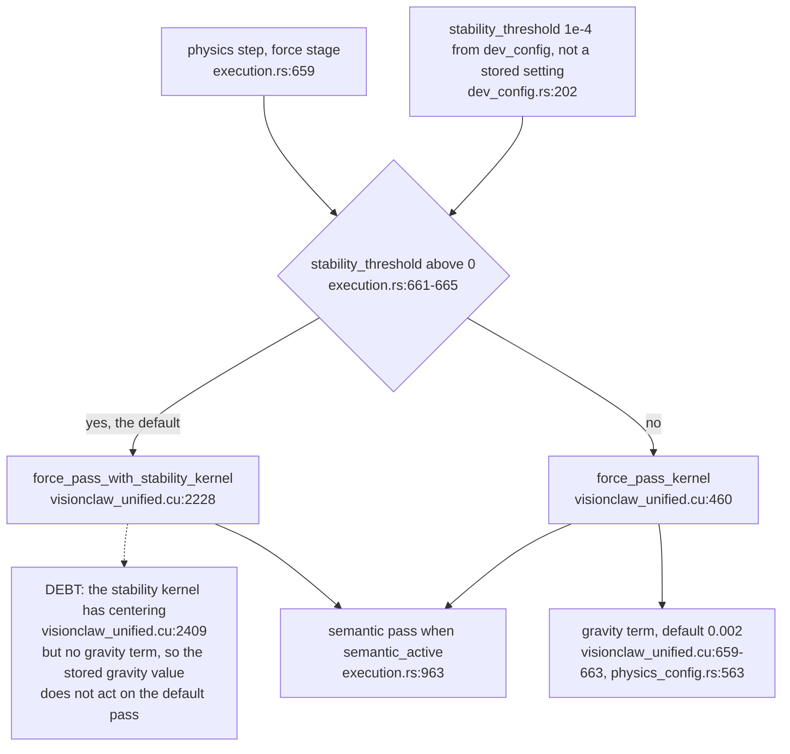
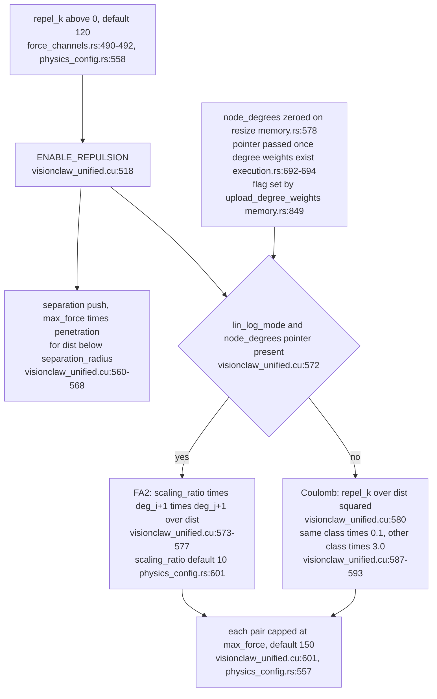
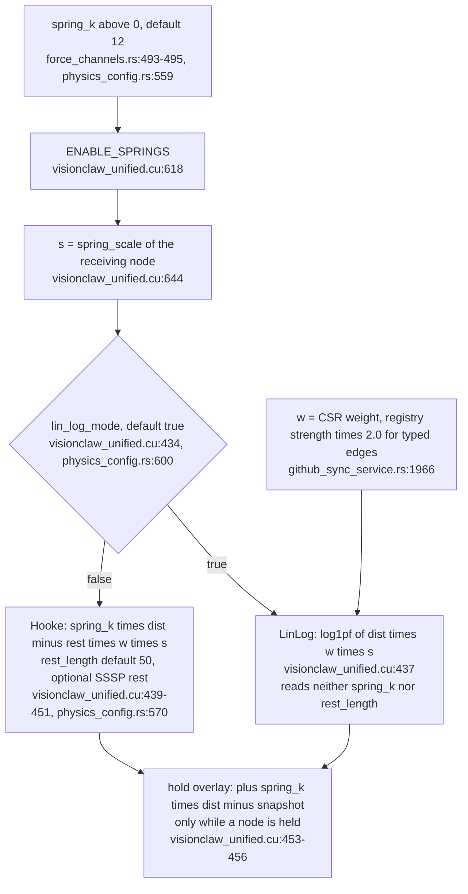
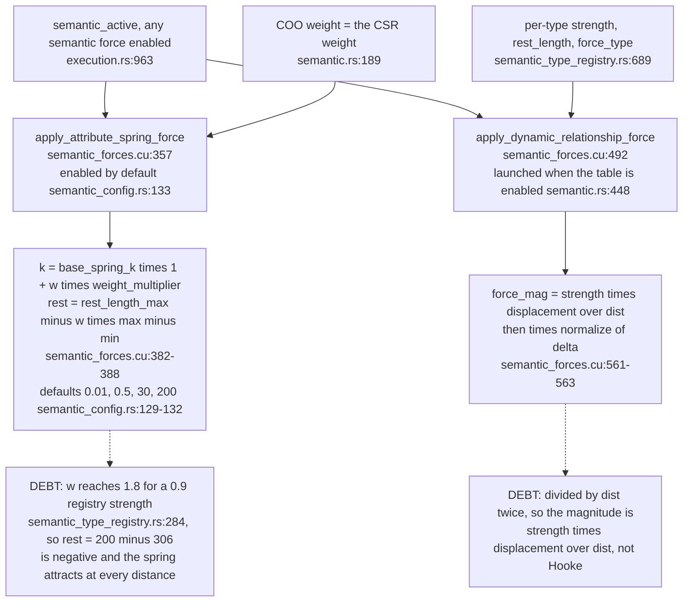
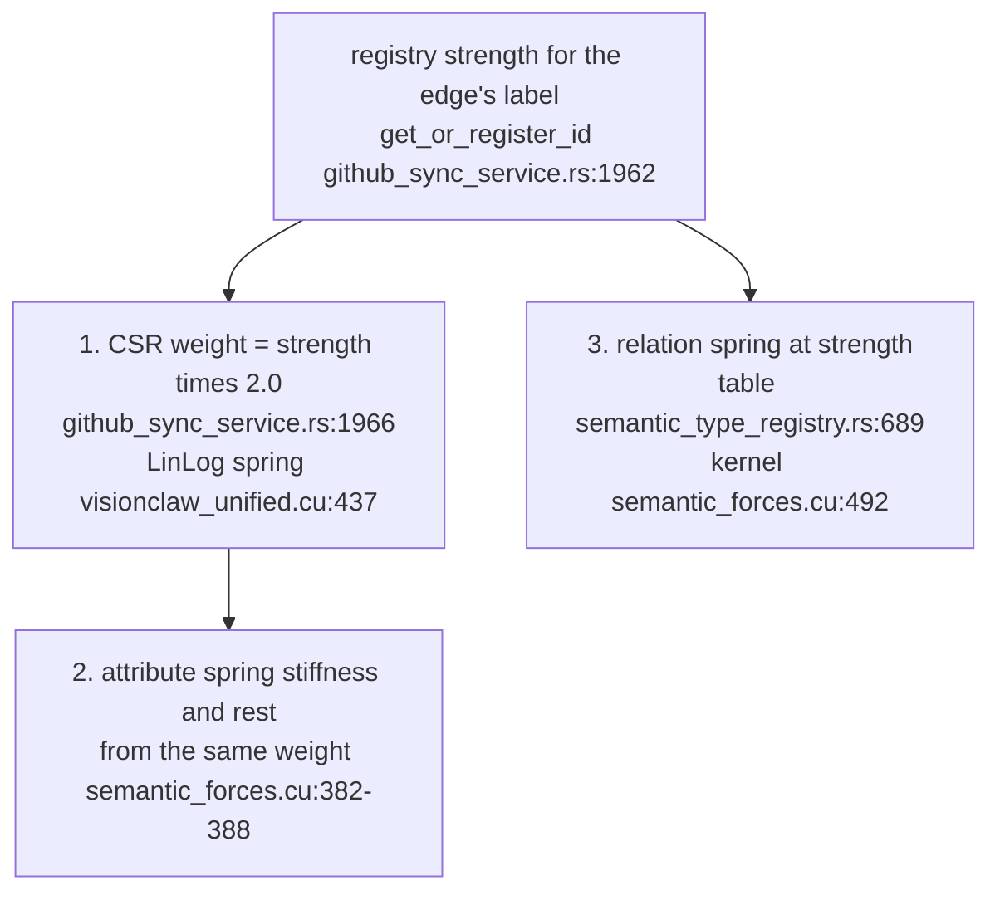

## For developers

One page per force term on the default path at main 46edc196b: the law the kernel computes, the flag or pointer that switches it on, and the stored setting or code constant it reads. VC-11 draws the step that runs them, VC-58 the edge data they consume. The physics rework planned in November 2026 appears only as register entries.

## For the business

The layout has more sliders than live forces. In the default mode several sliders do nothing except switch a force off when set to zero, and some forces are fixed in code with no slider at all. This page is the map of which control moves which force.

## VC-59.1 Which force pass runs, and what each pass lacks

**What it shows:** with the shipped `stability_threshold` the step runs the stability kernel, which carries repulsion, springs and centering but not the separate gravity term the plain kernel adds. **Why it is this way:** the stability kernel was added to skip settled frames; its force body was copied from the plain kernel without the later gravity term.

**Debt:** `gravity` (default 0.002, `../project/crates/visionclaw-domain/src/types/physics_config.rs:563`) is read only by `force_pass_kernel` (`../project/crates/visionclaw-gpu/src/cuda_sources/visionclaw_unified.cu:659-663`), and the default `stability_threshold` of 1e-4 (`../project/src/config/dev_config.rs:202`) selects the other kernel (`../project/src/utils/unified_gpu_compute/execution.rs:661-665`), so a stored gravity value has no effect on ordinary frames.

## VC-59.2 Pairwise terms: separation and repulsion

**What it shows:** in the default LinLog mode repulsion is the FA2 law, but its degree terms read `node_degrees`, a buffer that is zero until an analytics run fills it; the Coulomb branch with its fixed class multipliers runs only when the pointer is absent. **Why it is this way:** ADR-2029 derives the feature word from the Hooke and Coulomb scalars, which predate the LinLog default.

**Tension (ADR-2029 flag rule vs the LinLog default):** `repel_k > 0` switches on ENABLE_REPULSION (`../project/src/models/force_channels.rs:490-492`), and that flag gates the FA2 branch too (`../project/crates/visionclaw-gpu/src/cuda_sources/visionclaw_unified.cu:518`, `:572-577`), which reads `scaling_ratio`, never `repel_k`. Setting the Coulomb slider to zero removes the live FA2 repulsion.

**Debt:** the FA2 degree factor is `node_degrees + 1`, but `node_degrees` is zeroed whenever the buffers resize (`../project/src/utils/unified_gpu_compute/memory.rs:578`) and the pointer is passed as soon as degree *weights* exist (`../project/src/utils/unified_gpu_compute/execution.rs:692-694`, `../project/src/utils/unified_gpu_compute/memory.rs:849`), so until an analytics run writes degrees every pair repels as `scaling_ratio / dist`.

**Tension (ADR-2140 vs code):** the Coulomb branch multiplies by hard-coded 0.1 and 3.0 by class (`../project/crates/visionclaw-gpu/src/cuda_sources/visionclaw_unified.cu:587-593`), constants that ADR-2140 decision 2 rules out (`../project/docs/adr/ADR-2140-physics-forces-have-one-stored-definition-and-no-scale-factors.md:28`). The branch is dead in the default mode while degree weights exist.

## VC-59.3 Edge terms on the CSR: LinLog, Hooke and the hold overlay

**What it shows:** the default attraction is LinLog, which uses the edge weight and the population multiplier but not `spring_k` or `rest_length`; `spring_k` acts only as the on switch and inside the hold overlay. **Why it is this way:** LinLog was made the default for modularity (comment at `visionclaw_unified.cu:435-436`); ADR-2169 added the overlay so a held node drags its neighbours.

**Tension (ADR-2029 flag rule vs the LinLog default):** `spring_k > 0` sets ENABLE_SPRINGS (`../project/src/models/force_channels.rs:493-495`), the flag that gates the LinLog branch (`../project/crates/visionclaw-gpu/src/cuda_sources/visionclaw_unified.cu:618`, `:437`) although LinLog never reads `spring_k`. A user zeroing a slider that appears inert removes all edge attraction.

## VC-59.4 Semantic terms on the COO list: attribute spring and relation table

**What it shows:** every edge also feeds two semantic springs: the attribute spring, whose stiffness and rest length come from the same doubled weight, and the per-type relation spring from the registry table. **Why it is this way:** the semantic forces were moved into the stored document by ADR-2140 but kept their original kernels.

**Debt:** the relation spring computes `strength * displacement / dist` and multiplies by the normalised direction (`../project/crates/visionclaw-gpu/src/cuda_sources/semantic_forces.cu:561-563`), dividing by distance twice; its own comment says Hooke's law (`../project/crates/visionclaw-gpu/src/cuda_sources/semantic_forces.cu:560`).

**Debt:** the attribute spring's rest length assumes a weight in 0–1 (`../project/crates/visionclaw-gpu/src/cuda_sources/semantic_forces.cu:385-388`), but it is fed the CSR weight (`../project/src/utils/unified_gpu_compute/semantic.rs:189`), which is twice the registry strength (`../project/src/services/github_sync_service.rs:1966`) and reaches 1.8 for a 0.9 entry (`../project/src/services/semantic_type_registry.rs:284`); with the defaults (`../project/crates/visionclaw-domain/src/types/semantic_config.rs:129-132`) the rest length is negative above a weight of about 1.18.

## VC-59.5 One registry strength, three springs

**What it shows:** a typed edge is pulled by three laws whose coefficients all derive from one registry strength. **Why it is this way:** each path was added separately; no record decides that one relation should have one spring.

**Open:** no ADR states which of the three springs is meant to carry a relation's strength; the November 2026 rework draft proposes one per-relation path, which is not decided at 46edc196b.
