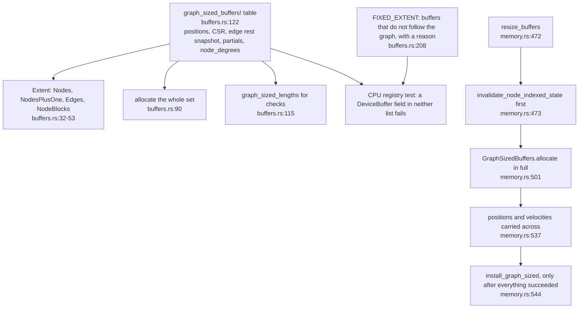
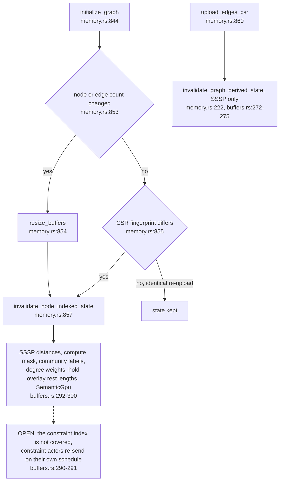
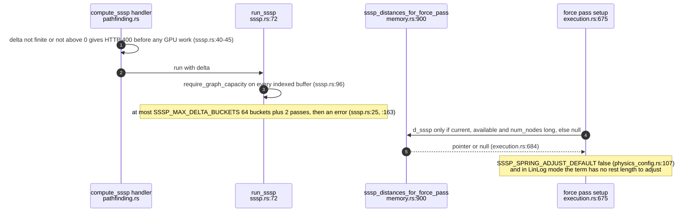
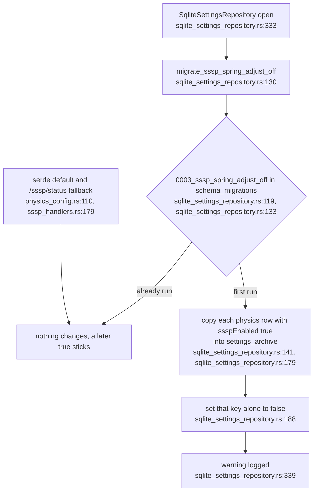
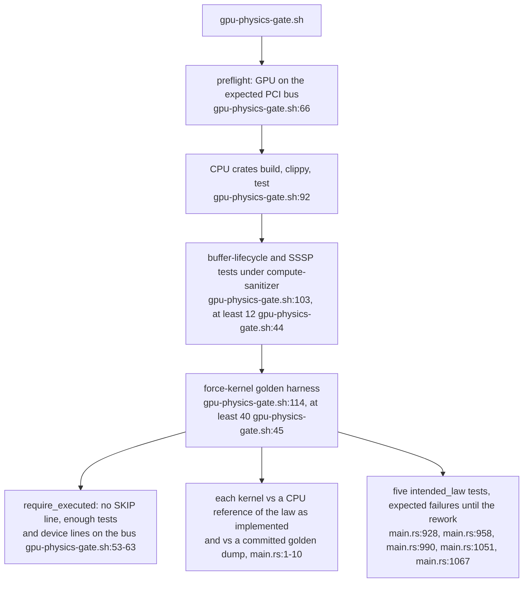

## For developers

ADR-2191 (VisionClaw PR 37, merged as bc6c16aef) puts every graph-sized device buffer in one table, clears node-indexed state on every graph change, bounds SSSP against the table, switches SSSP spring adjustment off by default with a one-time migration of stored settings, and adds a golden force-kernel harness and a GPU gate script. Read with VC-12 (SimParams and buffers), VC-15 (analytics) and VC-59 (force terms).

## For the business

The layout engine's memory now grows and shrinks as one piece, so a graph that changes size can no longer leave stale shortest-path or community data pushing the wrong nodes. Before the planned physics rework, every force was recorded as it behaves today, so the rework can prove what it changed.

## VC-60.1 One table generates allocation, resize and the length check

**What it shows:** the macro table is the single declaration of every node- or edge-sized buffer; resize allocates a complete fresh set and installs it only after the carry succeeds. **Why it is this way:** ADR-2191 decisions 1 and 8: buffers resized one by one had drifted apart, and a failed growth must leave the engine intact.

**Invariant:** a growth replaces the whole buffer set at once: allocation (`../project/src/utils/unified_gpu_compute/memory.rs:501`) and the carry (`:537`) complete before `install_graph_sized` (`:544`).

## VC-60.2 A graph change discards everything indexed by node

**What it shows:** a resize, or the same counts with a different topology, clears every piece of node-indexed host state, so a term is off until the actor re-uploads it rather than acting on whichever nodes now hold old indices. **Why it is this way:** ADR-2191 decision 9 (review round 1).

**Open:** constraints still name nodes by index and are not cleared on a graph change (`../project/src/utils/unified_gpu_compute/buffers.rs:290-291`); between a topology change and the constraint actors' next send, a resident constraint can act on the wrong node.

## VC-60.3 SSSP: bounded runs, results that die with the graph, off for springs by default

**What it shows:** SSSP checks its buffers against the table, cannot spin forever on a tiny `delta`, and the force pass reads distances only when they belong to the current graph. **Why it is this way:** ADR-2191 decisions 2–4 and 7; spring adjustment is off because SSSP reads spring stiffness as path length, so a stiffer relation got a longer rest length (decision 6).

## VC-60.4 Stored ssspEnabled is migrated off once

**What it shows:** on first open after the upgrade, every stored physics row that had SSSP spring adjustment on is archived verbatim and switched off; the migration marker makes it run once. **Why it is this way:** operator decision of 10 November 2026, recorded as ADR-2191 decision 10, which supersedes decision 6's "a stored true is honoured" for rows stored before the migration.

**Tension (ADR-2140 vs ADR-2191):** ADR-2140 says a value is applied exactly as stored (`../project/docs/adr/ADR-2140-physics-forces-have-one-stored-definition-and-no-scale-factors.md:28`); this migration rewrites a stored value once, which ADR-2191 records as an explicit exception amending ADR-2140 (`../project/docs/adr/ADR-2191-graph-sized-gpu-buffers-are-declared-once-and-sssp-spring-adjust-is-off-by-default.md:65`).

## VC-60.5 The gate: golden force dumps and lifecycle tests on a named GPU

**What it shows:** the gate refuses to pass without the GPU, pins every force kernel to today's behaviour, and keeps five tests that assert the stated law and are expected to fail. **Why it is this way:** the rework must show every force change against a recorded baseline; a skip on a host without a device would otherwise read as a pass (ADR-2191 decision 12).

**Debt:** the five expected failures are the departures VC-59 records: the relation spring is not Hookean (`../project/crates/visionclaw-gpu/tests/force_kernel_baseline/main.rs:928`), the repulsion relation type attracts (`:958`), the attribute-spring rest length leaves its bounds (`:990`), and the stability kernel applies neither gravity (`:1051`) nor class repulsion (`:1067`).
