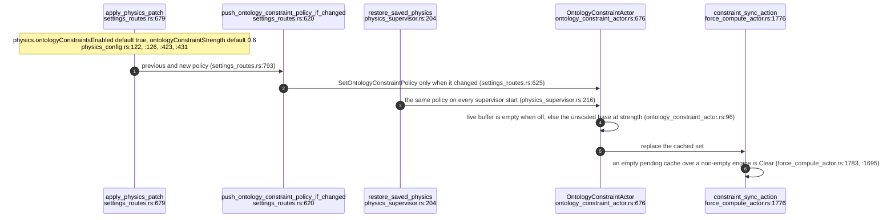
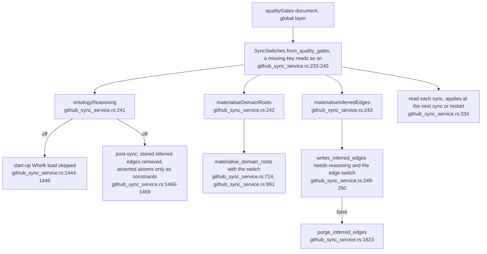
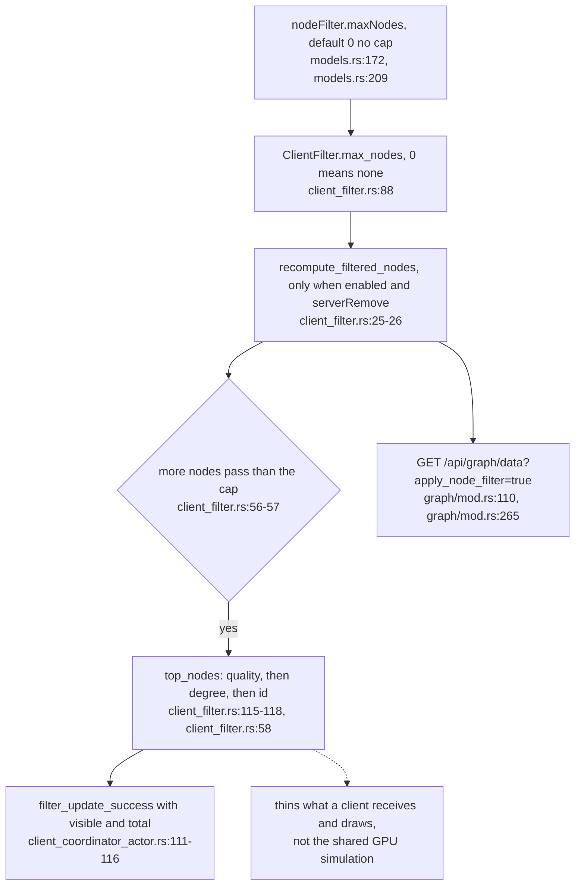

## For developers

ADR-2192 (VisionClaw PR 38) turns the reasoner's layout constraints, the sync pipeline's reasoning and materialisation, and node thinning into stored switches, retires three dead copies of the constraint switch, and deletes `OntologyPipelineService`. Read with VC-20 (ontology pipeline), VC-58 (edge producers) and VC-19 (the node filter).

## For the business

An operator can now turn off the reasoner's pull on the layout, stop the reasoner or the derived links from running at the next sync, and cap how many nodes a viewer is sent, without code changes. The cap thins what each viewer sees, not the shared simulation.

## VC-61.1 Constraint switch and strength: stored physics keys, sent as a policy

**What it shows:** the two physics keys travel as one policy message to the constraint actor, which keeps the unscaled set so switching back on needs no sync. **Why it is this way:** ADR-2140 decision 1, one stored definition per value; the earlier switch lived in a service nothing called.

## VC-61.2 Three sync-time switches read from quality gates

**What it shows:** reasoning, domain roots and inferred edges are each a stored quality gate defaulting to on, read key by key at every sync. **Why it is this way:** ADR-2192 decision 2; on the dev stack the operator could not switch off reasoning whose output buried the graph.

## VC-61.3 Node thinning: the filter's maxNodes cap and its counts

**What it shows:** the cap ranks the nodes that already pass the filter and keeps the best; the WebSocket reply now reports the counts and the REST reload applies the same removal. **Why it is this way:** ADR-2192 decision 6 reuses the ADR-2183 filter rather than a second population scope.

**Open:** the cap thins delivery only; every viewer and the headset still share one simulation over every node, so a capped viewer's layout is shaped by nodes it does not receive (`../project/docs/adr/ADR-2192-the-reasoner-the-sync-pipeline-and-node-thinning-are-stored-operator-switches.md:58`).
