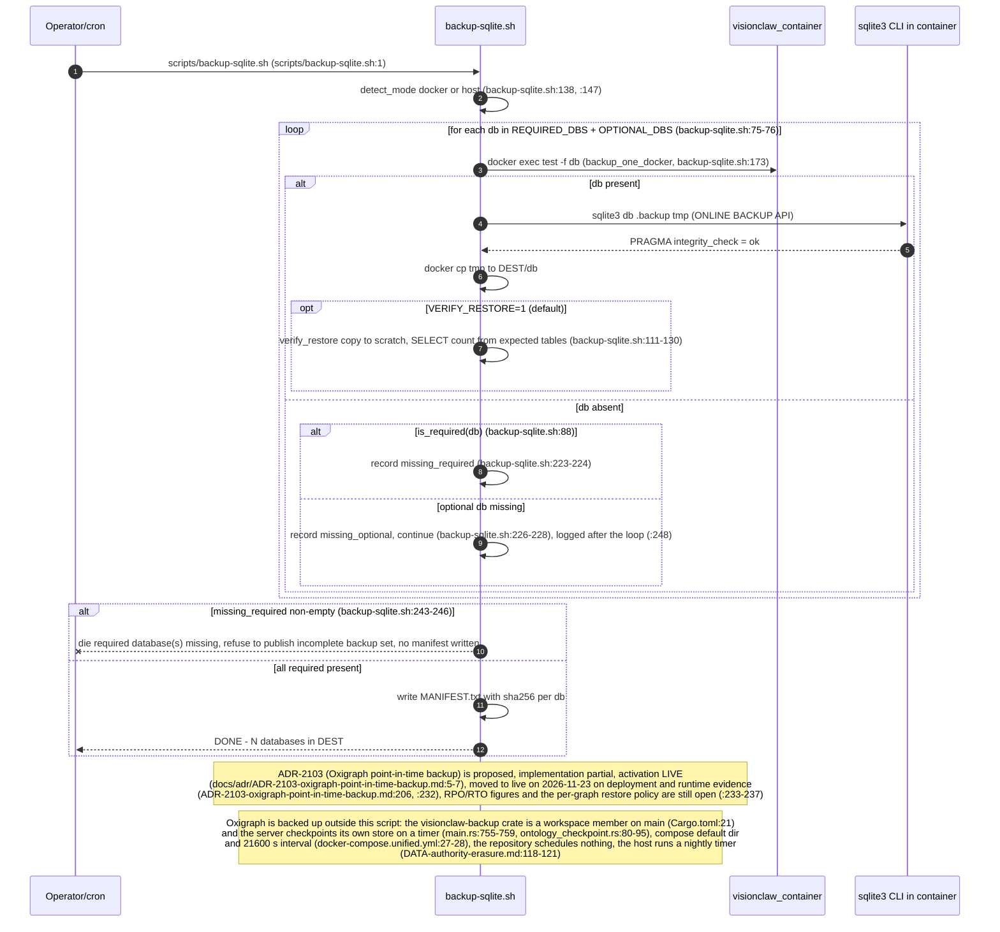
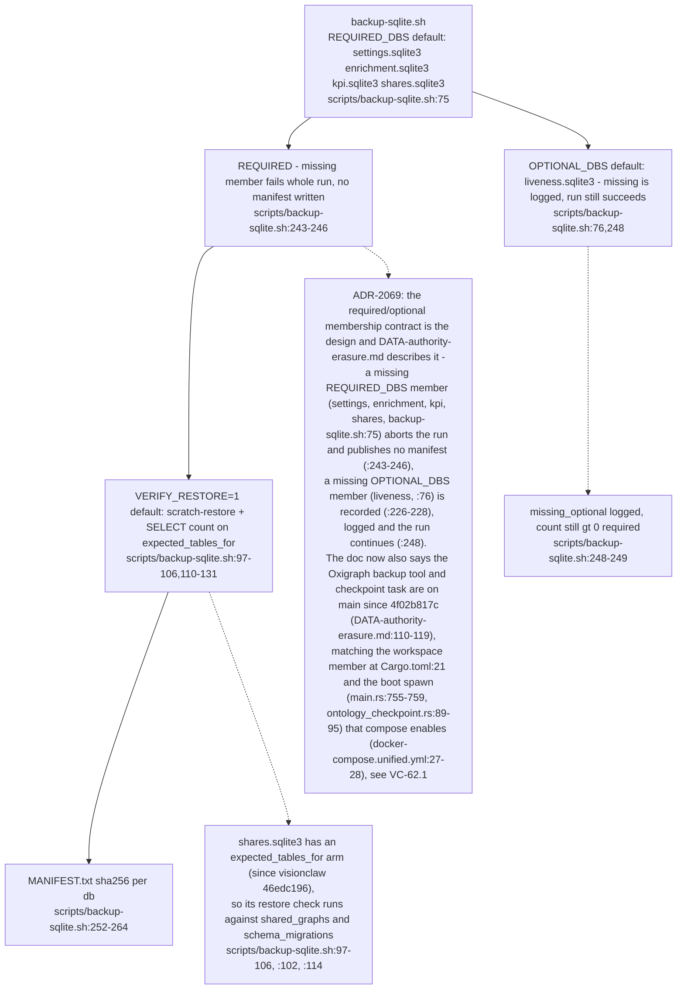

## VC-62.1 SQLite online backup (`scripts/backup-sqlite.sh`, ADR-2017) — ADR-2103 activation live

**What it shows.** Successor to the frozen VC-22.7, re-read at visionclaw bc6ac309e (VC-22 stays at 4900ec60b). The SQLite path is unchanged; ADR-2103 is no longer drawn as proposed and partial only: its activation axis moved to live on 2026-11-23, on a running six-hourly checkpoint and the host's nightly timer and timed restore (`../project/docs/adr/ADR-2103-oxigraph-point-in-time-backup.md:218-232`), while the decision stays proposed and implementation partial.

## VC-62.2 SQLite membership contract vs KPI/enrichment sole-source risk — the Oxigraph backup text now matches main

**What it shows.** Successor to the frozen VC-22.11. The DRIFT it recorded is closed: VisionClaw PR #50 corrected the governing doc, which now says the `visionclaw-backup` tool and the checkpoint task are on main since `4f02b817c`, checkpointing is on by default in compose and the host runs a nightly timer (`../project/docs/DATA-authority-erasure.md:110-128`). The doc keeps the remaining gap: no cross-store consistent restore and no ratified RPO/RTO (`../project/docs/DATA-authority-erasure.md:127-128`).
