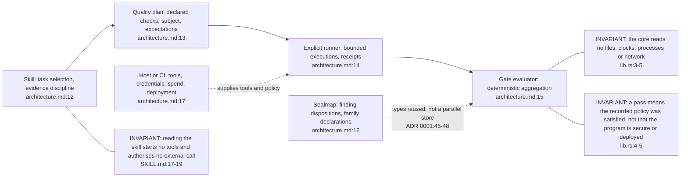
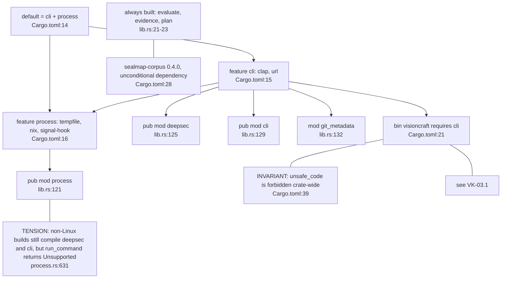
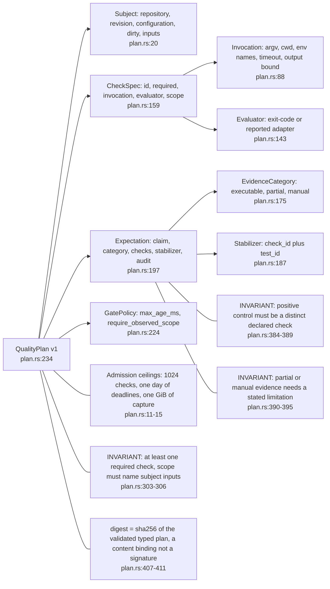
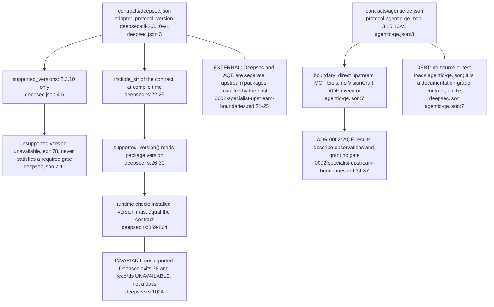
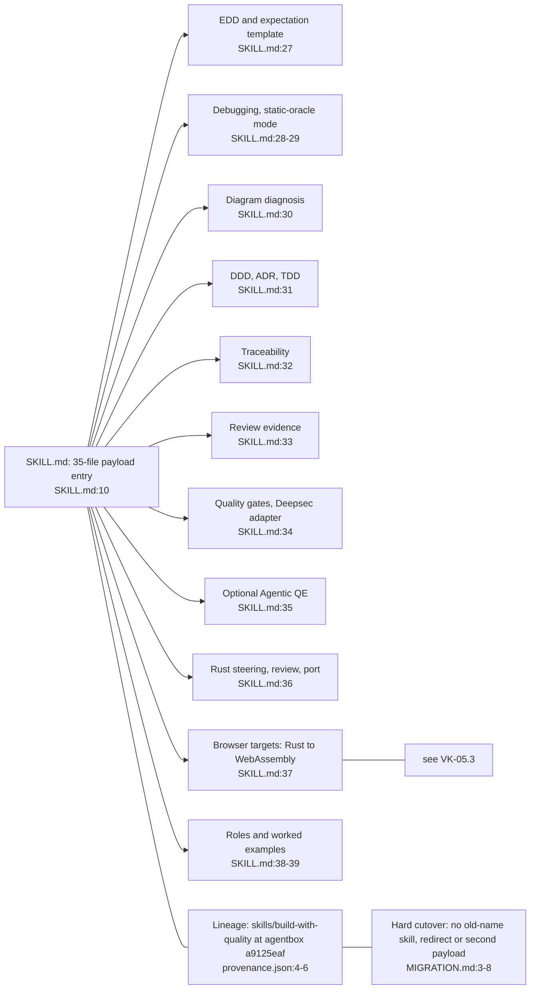

## VK-01.1 Three surfaces and who owns what

Three surfaces: guidance, versioned library and CLI, and host integration. The table of owners is the authored contract; each row says what it does not establish.

## VK-01.2 Cargo features layer the core, the runner and the CLI

The pure library is `default-features = false`; the Deepsec adapter hangs off `cli`, not `process`. Native execution is Linux only; elsewhere the adapter exits 78 with a message (deepsec.rs:662).

## VK-01.3 Typed plan: the one input every other component binds to

Parsing a plan never runs it. Every receipt and assessment later carries this digest, which is how a changed argv or policy cannot reuse an old pass (see VK-02.3).

## VK-01.4 Versioned upstream contracts for Deepsec and Agentic QE

Deepsec is bound to code by a compiled-in contract; AQE is bound only by prose and a JSON file nothing parses. The line 7 boundary text says the file carries JSON Schemas, which the reader should treat as unverified in the build.

## VK-01.5 Skill payload: SKILL.md routes to references, assets and Rust guidance

Load only the resources a task needs. The payload is lineage-tracked: the predecessor lived in agentbox, and the portable entry point requires no agentbox, model provider or fleet.
