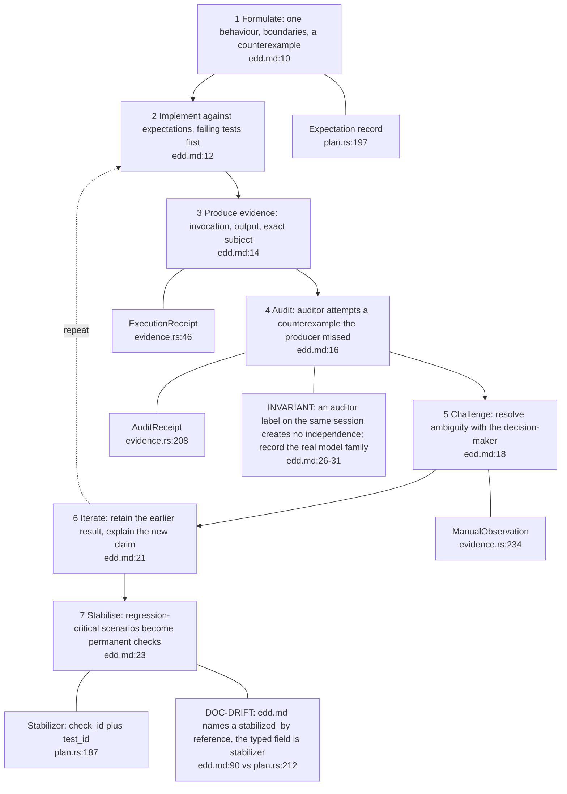
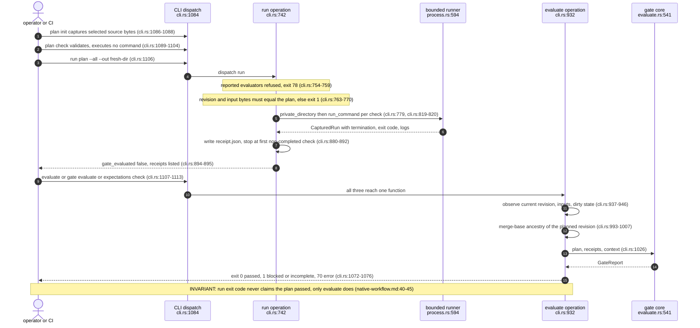
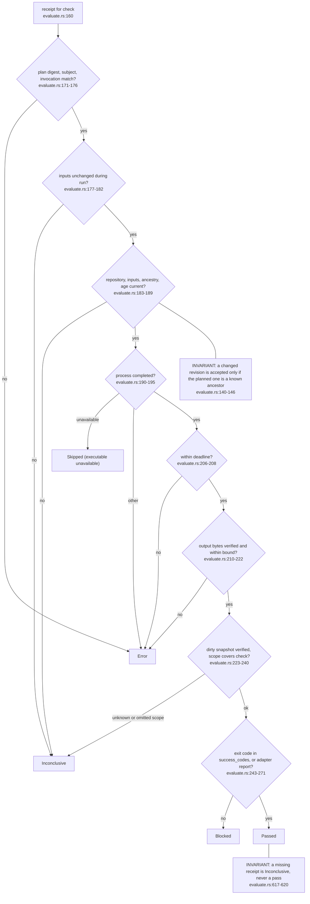
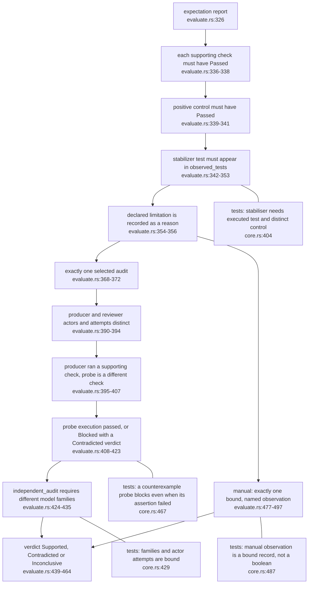
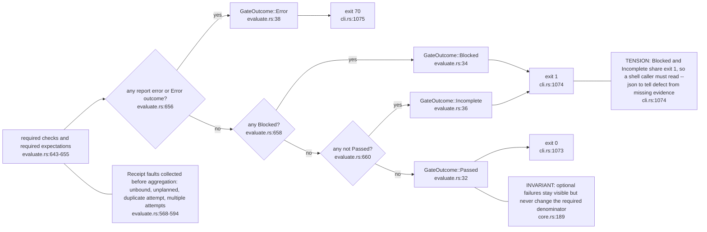
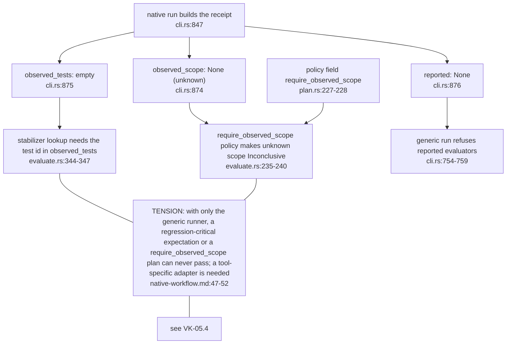

## VK-02.1 Seven EDD steps and the typed record each one leaves

The method is a loop; the crate only encodes the record each step leaves, not the loop itself. Steps 5 and 6 have no typed counterpart beyond a manual observation.

## VK-02.2 Plan, run and evaluate through the CLI

Three user-facing spellings of evaluation share one code path. Evaluation reads evidence and fixed Git metadata and never executes a command found in a plan or receipt.

## VK-02.3 One check: receipt to outcome

Policy is applied only after every evidence-integrity check has held. The same ladder of outcomes (CheckOutcome, evaluate.rs:15-26) feeds expectations.

## VK-02.4 One expectation: references, audits and observations

Audit and manual branches run only when required or when a matching record is supplied. A Contradicted verdict forces Blocked regardless of the supporting checks.

## VK-02.5 Aggregation into a gate decision

Error beats Blocked beats Incomplete. Passing requires every required check and expectation to pass; an unrelated optional failure is reported but not counted.

## VK-02.6 What the native runner can and cannot prove

This is stated honestly in the example, not hidden: selecting files or naming a test in argv does not prove what a tool inspected or ran. The gap bites the Rust and WebAssembly gates in VK-05.
