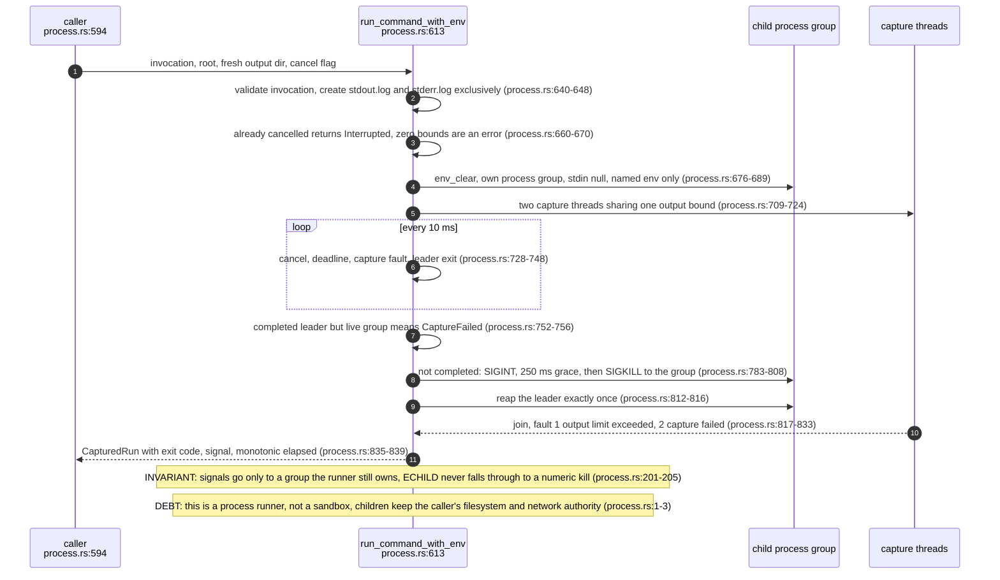
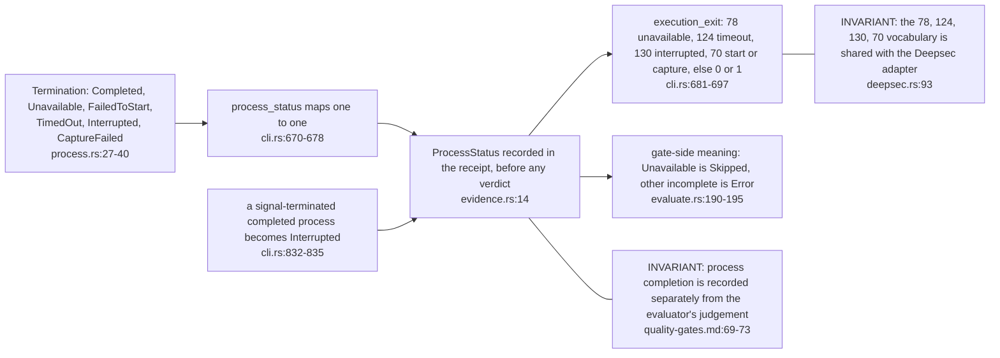
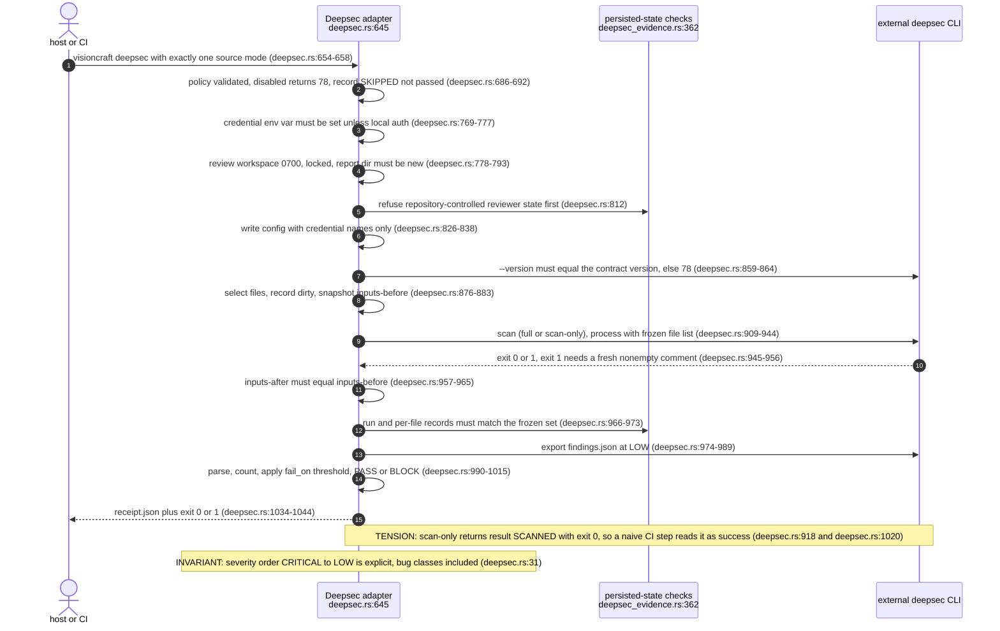
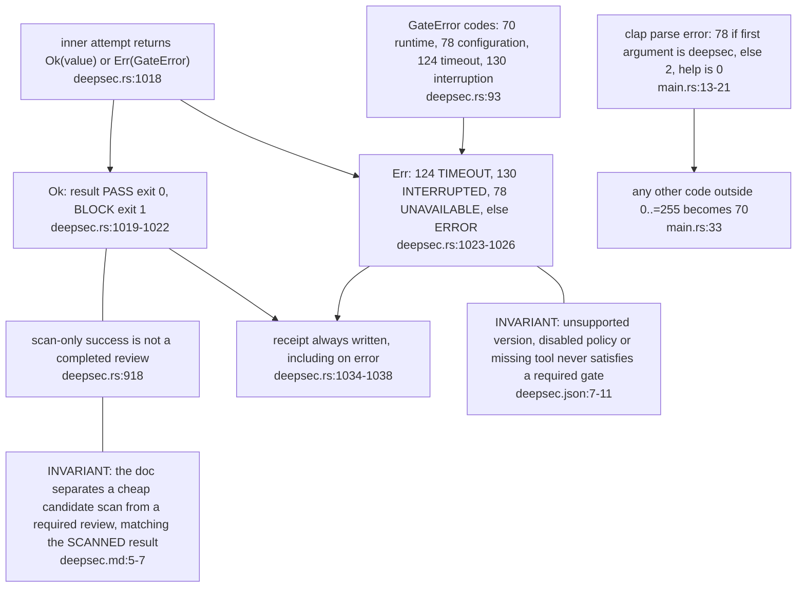
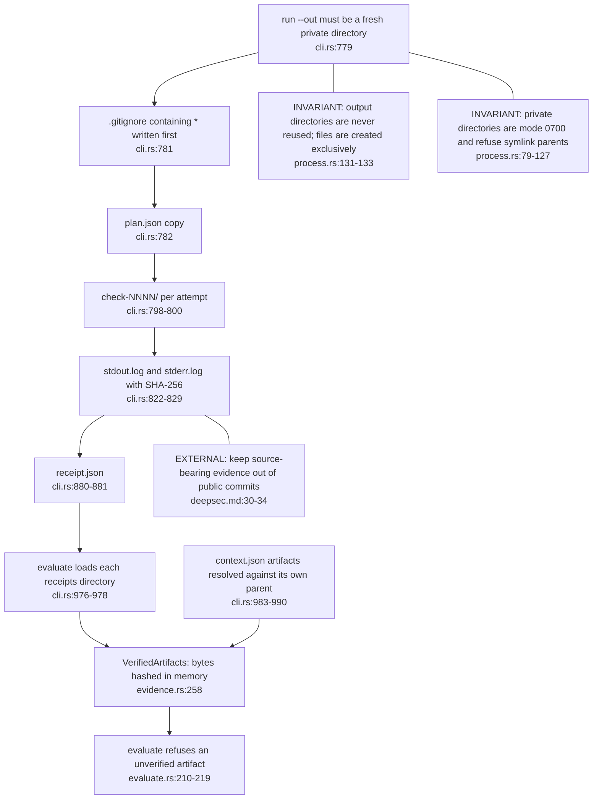

## VK-03.1 One bounded command, start to reap

A zombie in the group is not a live descendant, hence the /proc check after signal 0 (process.rs:316). Non-Linux builds return Unsupported before spawning (process.rs:631).

## VK-03.2 Termination to receipt status to exit code

The runner stops at the first incomplete check (cli.rs:890-892) and keeps earlier receipts. Exit codes are advisory; the authoritative decision is the evaluated gate (see VK-02.5).

## VK-03.3 Deepsec adapter attempt, step by step

Exit 1 from Deepsec can mean findings or failure; only a fresh completed run plus a valid export upgrades it to findings (deepsec.md:38-42). A threshold pass means no counted finding crossed it, not zero findings.

## VK-03.4 Deepsec result classes and process exit codes

The legacy exit code 78 for a malformed deepsec invocation keeps old shell callers on the configuration-error path. The receipt records mode, revision, dirty scope and the observed Deepsec version.

## VK-03.5 Evidence on disk and how evaluation re-verifies it

Evidence is content-addressed, not trusted by path: a mutated log never verifies. Older attempts live in an archive, one selected attempt per check.
