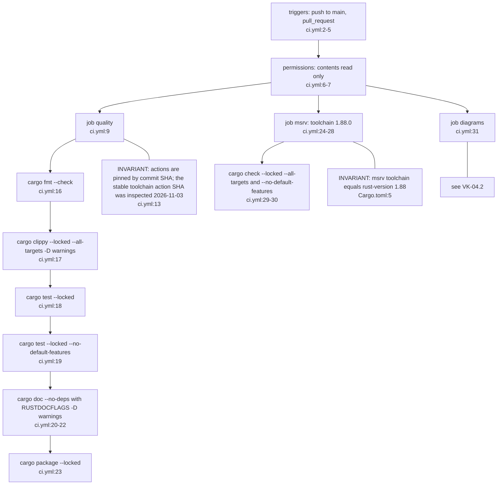
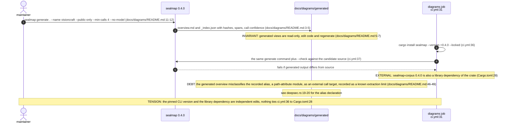
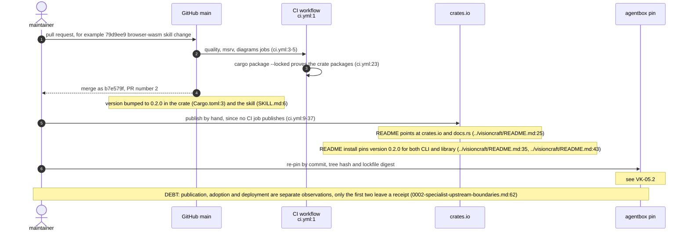
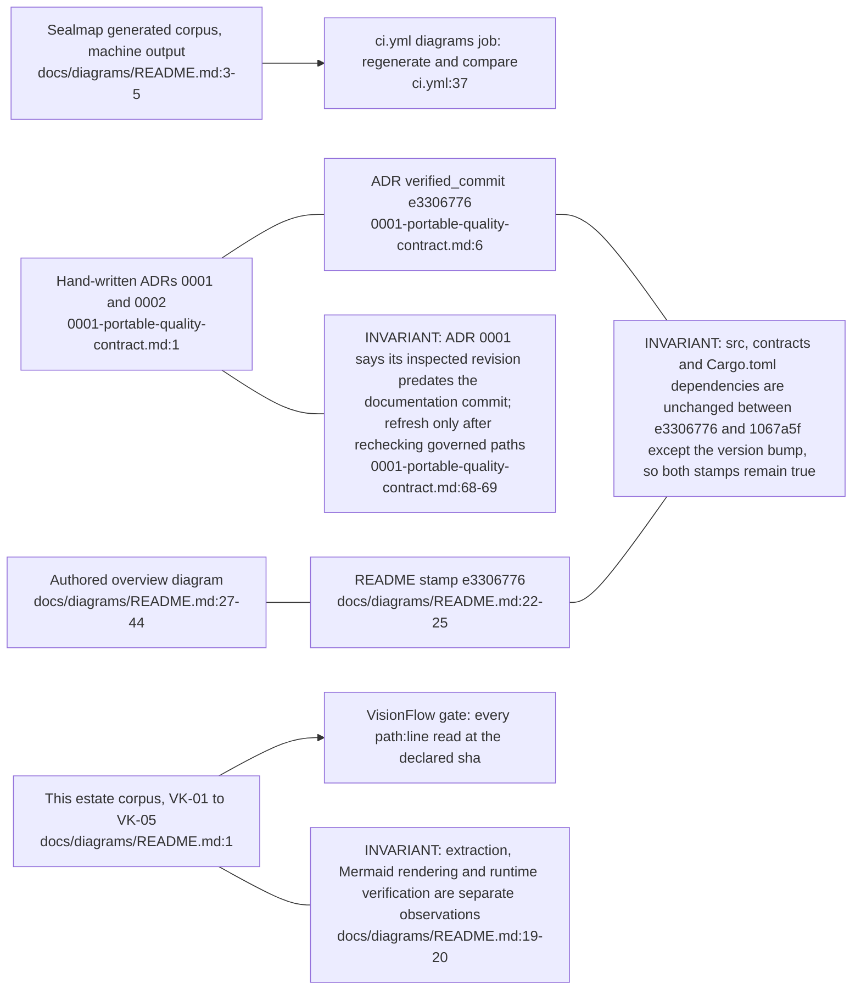

## VK-04.1 CI jobs on push to main and on every pull request

Jobs run independently, in parallel. The no-default-features test and check prove the pure library builds without the process and CLI dependencies (VK-01.2).

## VK-04.2 Sealmap generates the machine diagrams; CI only checks them

Generated output is never copied into the estate corpus. This tree is a separate, hand-authored, citation-verified view of the same repository (see VK-04.4).

## VK-04.3 From merge to a consumable release

There is no release workflow, tag job or publish step in ci.yml. The crate version, skill metadata and README install lines must be bumped together by hand, and they agree at this revision.

## VK-04.4 Four records of the architecture and who checks each

Only the generated corpus is machine-checked inside the repository. The ADRs and authored diagram rely on their stamps and on this estate gate to catch drift.
