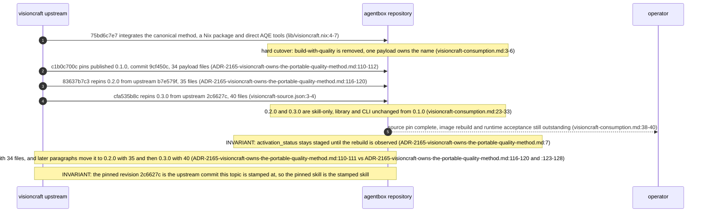
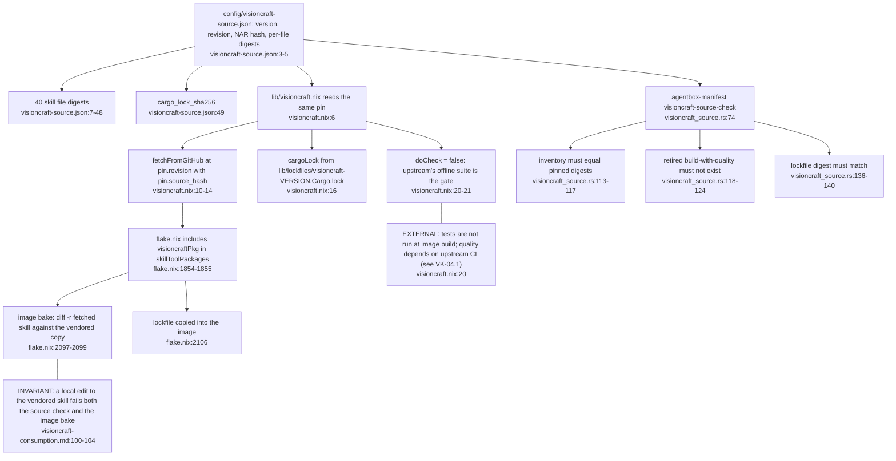
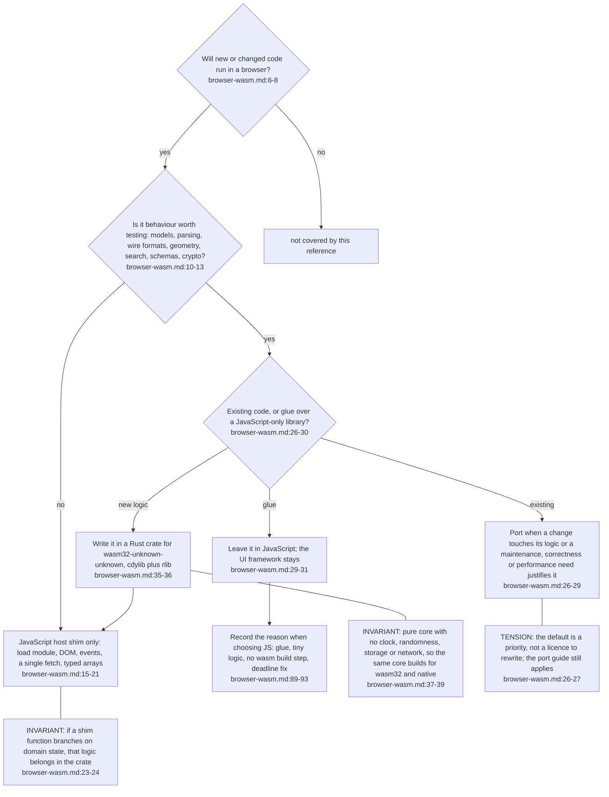
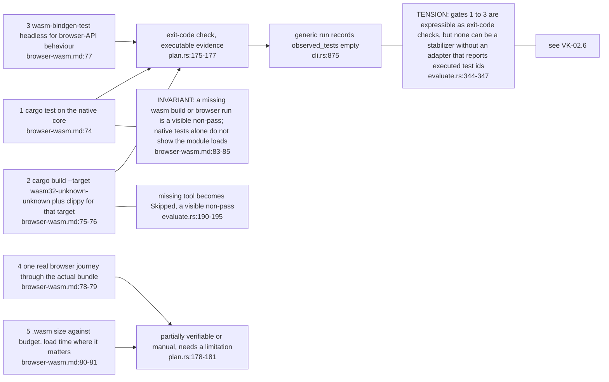
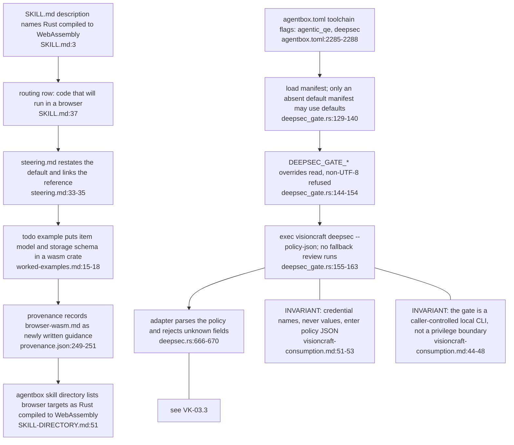

## VK-05.1 How agentbox adopted VisionCraft, in three commits

Agentbox is one consumer, not the owner: portable changes are made and released upstream, then re-vendored whole. Upstream carries tags v0.1.0, v0.2.0 and v0.3.0.

## VK-05.2 One immutable release, checked three ways

The Nix hash is computed without Nix by NAR-serialising the unpacked archive (visioncraft-consumption.md:33-35). A pin alone proves source integrity, not that a running image contains the release.

## VK-05.3 Browser targets: Rust to WebAssembly is the default

This is the PR #2 change (79d9ee9, merged as b7e579f). The decision is a skill rule, not a tool: nothing in the crate enforces it, and familiarity alone is not an accepted reason for JavaScript.

## VK-05.4 Where the wasm evidence gates meet the native runner

The skill promises a specific browser journey that the CLI cannot observe. Gate 4 therefore rests on a named human or browser-tool observation, bound to the plan digest as a ManualObservation.

## VK-05.5 Where the browser rule travels, and the Deepsec host policy path

The browser rule reaches agentbox only through the vendored skill copy, so repinning is what propagates it. The second chain shows that agentbox projects policy and then hands execution to the upstream executable; it keeps no parallel gate.
