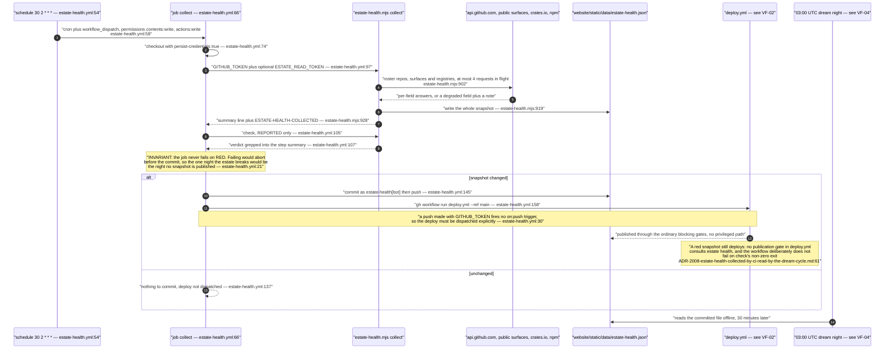
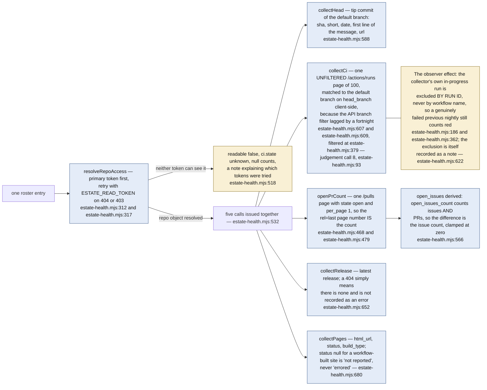
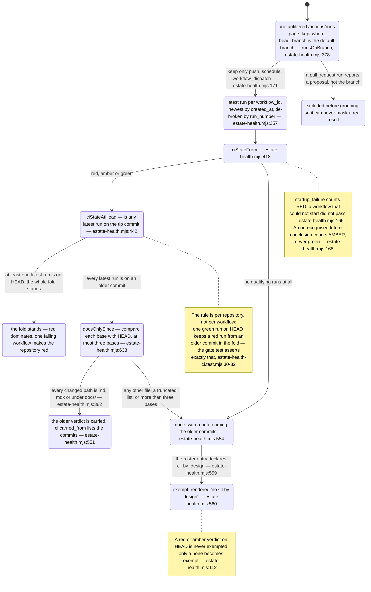
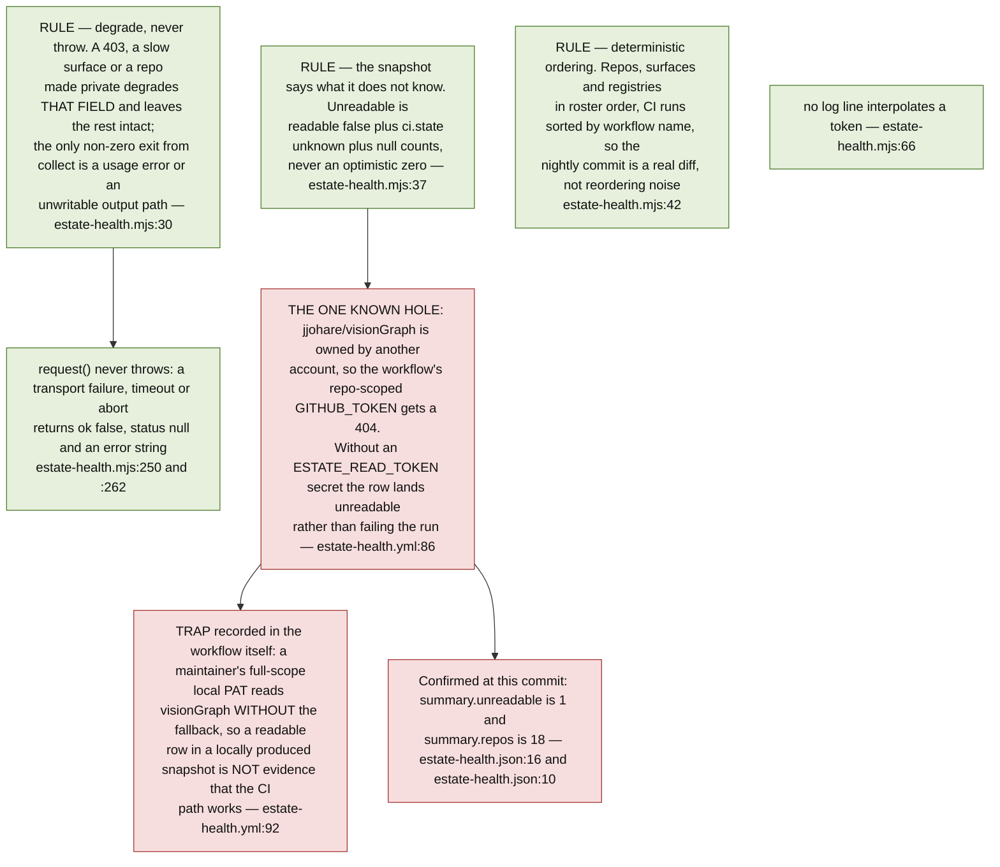
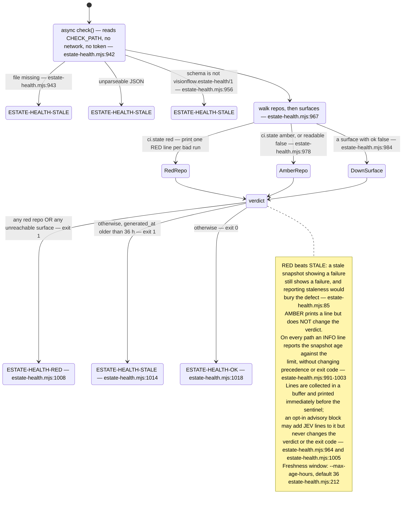
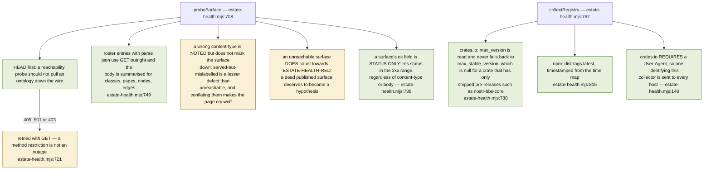
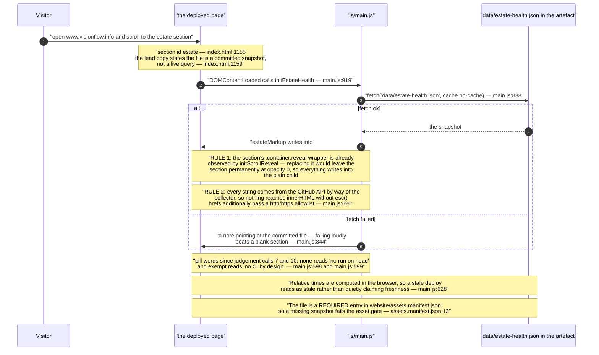
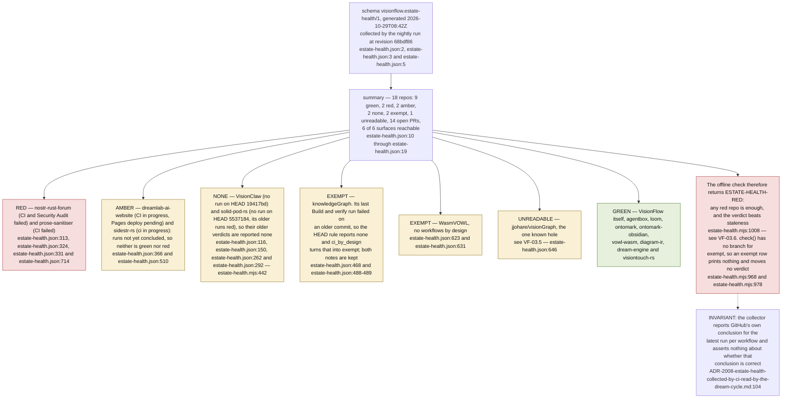

## VF-03.1 The roster — the only place the estate is enumerated

```mermaid
flowchart LR
    classDef fp fill:#e6f0dc,stroke:#4a7a2a,color:#111
    classDef imp fill:#f9f0d5,stroke:#8a7020,color:#111
    classDef priv fill:#f7dede,stroke:#a33333,color:#111

    R["scripts/estate-health/roster.json<br/>roster_version 1 — roster.json:2<br/>INVARIANT: estate-health.mjs holds NO repository names;<br/>roster order fixes the published display order — roster.json:3"]

    R --> REPOS["repos — 18 entries"]
    REPOS --> P1["DreamLab-AI/VisionFlow — canon (this area)<br/>roster.json:5"]:::fp
    REPOS --> P2["DreamLab-AI/VisionClaw — GPU engine, OWL 2 EL<br/>EXTERNAL: area visionclaw, VC-01..VC-37 — roster.json:6"]:::fp
    REPOS --> P3["DreamLab-AI/agentbox — sovereign agent runtime<br/>EXTERNAL: area agentbox, AB-01..AB-28 — roster.json:7"]:::fp
    REPOS --> P4["DreamLab-AI/solid-pod-rs — native Solid pod<br/>EXTERNAL: area solid-pod-rs, SP-nn — roster.json:8"]:::fp
    REPOS --> P5["DreamLab-AI/nostr-rust-forum — governance plane, relay<br/>EXTERNAL: area nostr-rust-forum, NF-nn — roster.json:9"]:::fp
    REPOS --> P6["DreamLab-AI/dreamlab-ai-website — commercial surface<br/>EXTERNAL: area dreamlab-ai-website, DW-nn — roster.json:10"]:::fp
    REPOS --> P7["DreamLab-AI/loom — Ontology Loom grounding facade<br/>EXTERNAL: no diagram area in this tree — roster.json:11"]:::fp
    REPOS --> P8["DreamLab-AI/knowledgeGraph — published corpus mirror<br/>ci_by_design: a publish target whose only workflow is the<br/>Pages build — EXTERNAL: area knowledgegraph, KG-nn — roster.json:12"]:::fp
    REPOS --> P15["DreamLab-AI/sidestr-rs — sidechain crates, added 2026-09-23<br/>EXTERNAL: area sidestr-rs, SR-nn — roster.json:13"]:::fp
    REPOS --> P16["DreamLab-AI/ontomark — Obsidian-vault ontology toolchain, crates<br/>EXTERNAL: no diagram area in this tree — roster.json:14"]:::fp
    REPOS --> P17["DreamLab-AI/ontomark-obsidian — Obsidian plugin for ontomark<br/>EXTERNAL: no diagram area in this tree — roster.json:15"]:::fp
    REPOS --> P9["DreamLab-AI/WasmVOWL — demo shell, default branch master<br/>ci_by_design: frozen, no workflows<br/>EXTERNAL: no diagram area; distinct from vowl-wasm — roster.json:16"]:::fp
    REPOS --> P10["jjohare/visionGraph — the vault, PRIVATE and cross-owner<br/>EXTERNAL: area visiongraph, VG-nn — roster.json:17"]:::priv
    REPOS --> P11["DreamLab-AI/vowl-wasm — published crate plus npm bundle<br/>EXTERNAL: area vowl-wasm, VW-nn — roster.json:18"]:::fp
    REPOS --> P12["DreamLab-AI/prose-sanitiser — published crate — roster.json:19"]:::fp
    REPOS --> P13["DreamLab-AI/diagram-ir — published crate — roster.json:20"]:::fp
    REPOS --> P14["DreamLab-AI/dream-engine — provenance IMPORTED,<br/>fork of ruvnet/dream-machine — roster.json:21<br/>EXTERNAL: the dream engine itself, see AB-23"]:::imp
    REPOS --> P15["DreamLab-AI/visiontouch-rs — haptic input device study,<br/>private proof of principle, admitted by ADR-2017 — roster.json:22"]:::fp

    R --> SURF["surfaces — 6 probes — roster.json:24<br/>www.visionflow.info, narrativegoldmine.com,<br/>its /ns/v2.jsonld and /data/graph/stats.json,<br/>www.dreamlab-ai.com, and the VisionClaw<br/>ontology-latest/index.jsonld release asset"]
    R --> REG["registries — 22 entries — roster.json:59<br/>crates.io: vowl-wasm, prose-sanitiser, diagram-ir,<br/>solid-pod-rs, solid-pod-rs-server, nostr-bbs-core — roster.json:60-65,<br/>the six ontomark-family crates (parse, model, reason, compile,<br/>ingest, ngg1) and whelk-el — roster.json:66-72,<br/>and all eight sidestr-rs crates: header, core, nostr, wallet,<br/>round, hitch, agent, webledgers-teller — roster.json:73-80<br/>npm: @dreamlab-ai/vowl-wasm — roster.json:81"]

    NOTE["The two enumerations of the estate are reconciled in one<br/>direction: repository-map.md:8 lists twelve repositories with local<br/>paths, sidestr-rs among them at repository-map.md:18, and<br/>repository-map.md:25 names the roster as THE authoritative list for<br/>nightly collection, scoping the other six roster repositories as<br/>supporting components — repository-map.md:29-37. The roster still<br/>does not reference the map back."]
    R -.-> NOTE
```

## VF-03.2 The nightly sequence — collect at 02:30, commit, dispatch, publish

## VF-03.3 What is collected per repository — six calls, each degrading alone

## VF-03.4 The CI colour rule — red dominates, the verdict must be HEAD's, unknown is never green

**Invariant:** the HEAD rule cannot hide a real failure — a red run on the tip commit still reads red, and that is pinned by the gate suite rather than by prose (`tests/gates/estate-health-ci.test.mjs:27-28`, wired at `tests/gates/run-all.sh:25`).

**Debt (one page of runs):** since judgement call 8 the collector reads one unfiltered page of 100 runs across every branch and filters client-side (`scripts/estate-health.mjs:609`, `scripts/estate-health.mjs:614`); a repository whose pull-request and feature-branch runs fill that page pushes its default-branch runs off it, and the row then reads none rather than its real state.

## VF-03.5 Degradation discipline — the snapshot says what it does not know

## VF-03.6 The check gate — offline verdict and its precedence

## VF-03.8 Surface and registry probes — the judgement calls

## VF-03.9 How the site consumes the snapshot — committed file, no live query

## VF-03.11 The snapshot as it stands — 9 of 18 green, 2 red, 2 amber, 2 none, 2 exempt by design

**Debt:** since the 2026-09-23 snapshot knowledgeGraph moved from red to exempt by rule rather than by a passing run; since 2026-10-06 VisionClaw moved from red to none because its failing runs are on an older commit (the HEAD rule), not because a run passed, while in this snapshot agentbox is green again, solid-pod-rs reads none because its tip commit has no run and its older runs were red, nostr-rust-forum is still red on a HEAD run and prose-sanitiser has newly turned red; no mechanism records why a row flips, so any trend is only visible by reading committed snapshots in sequence (`website/static/data/estate-health.json:11`).

**Debt (registry roster vs canon) — RESOLVED 2026-10-03, re-opened and RESOLVED again 2026-10-18:** the 10-03 dream ACCEPT (PR #13, merged as `c1e1498`) brought the roster to the seven sidestr crates canon then named; `webledgers-teller` was published later and went unprobed until `26df6c9` added it, with canon updated to eight in the same commit (`scripts/estate-health/roster.json:73-80`, estate register ER-3); the rewritten README no longer states a crate count (`./README.md:31`).

**Drift (2026-10-15, dream-engine extraction):** the roster row for `dream-engine` (`provenance: imported`, a fork of ruvnet/dream-machine) is stamped before the extraction. The slug now names the new Rust repository and the fork is renamed dream-machine and archived (checked 2026-10-16). The row has not been changed, because the release manifest and its gate assert two imported rows, see DE-01.

**Since the last stamp:** `check` now builds its output in a buffer and prints it directly before the sentinel line, so a Jev advisory block, never able to change the verdict or exit code, can add `JEV priority` and `JEV triage` lines for the failed observations (`scripts/estate-health.mjs:964`, `scripts/estate-health.mjs:1005`, `scripts/estate-health.mjs:1035`, `docs/jev-option.md:13-14`). The library default is off but agentbox now projects `VISIONFLOW_JEV=all` into its shells, while hosted CI and the dream annexe do not inherit it (`docs/jev-option.md:3` and `docs/jev-option.md:16`). `collect` never calls it.
