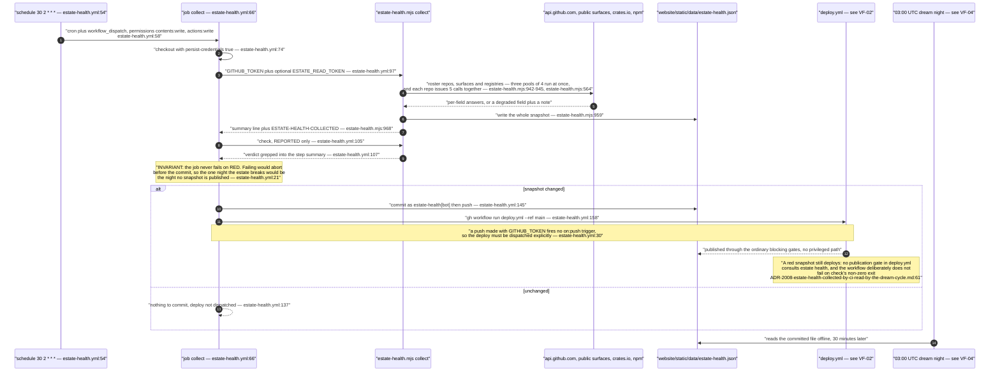
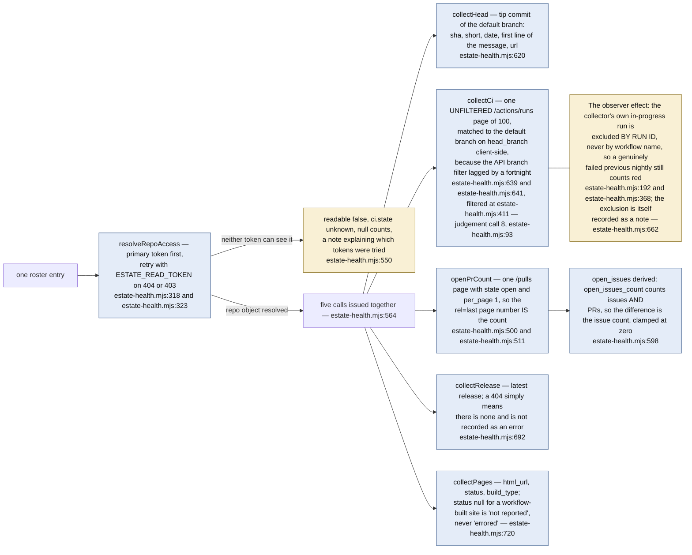
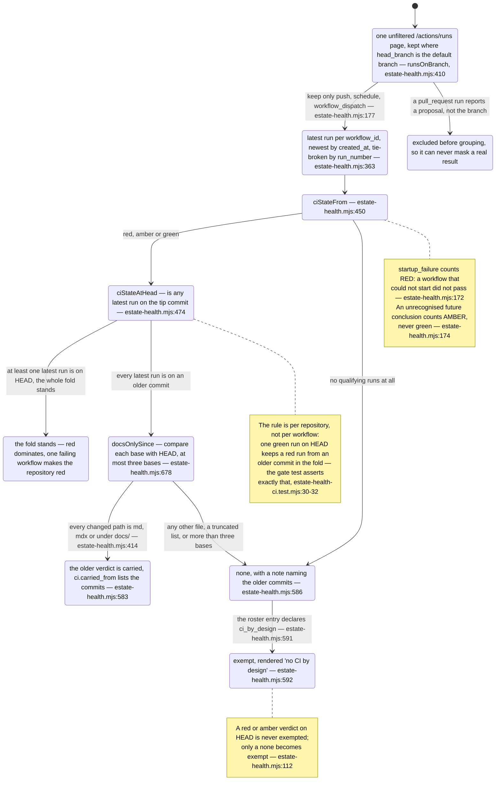
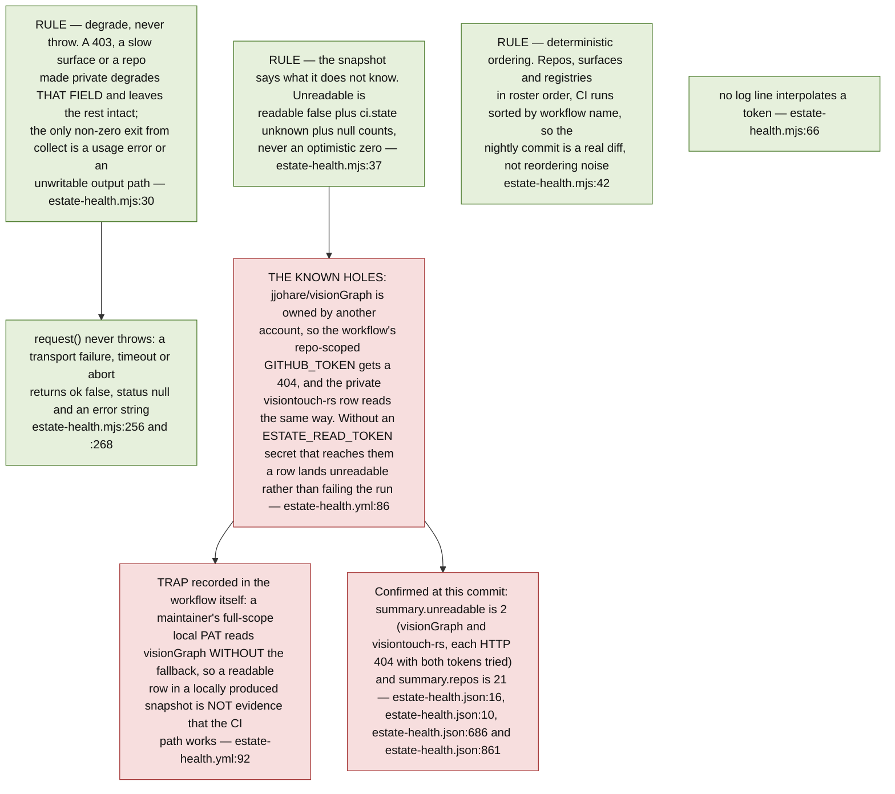
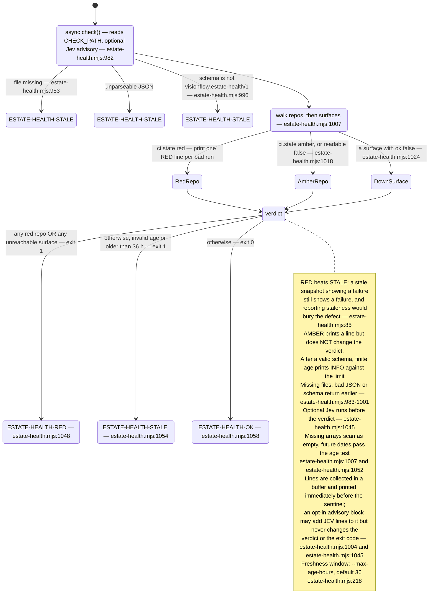
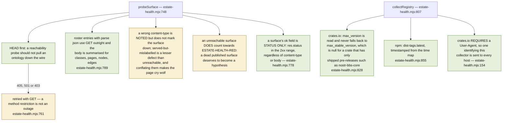
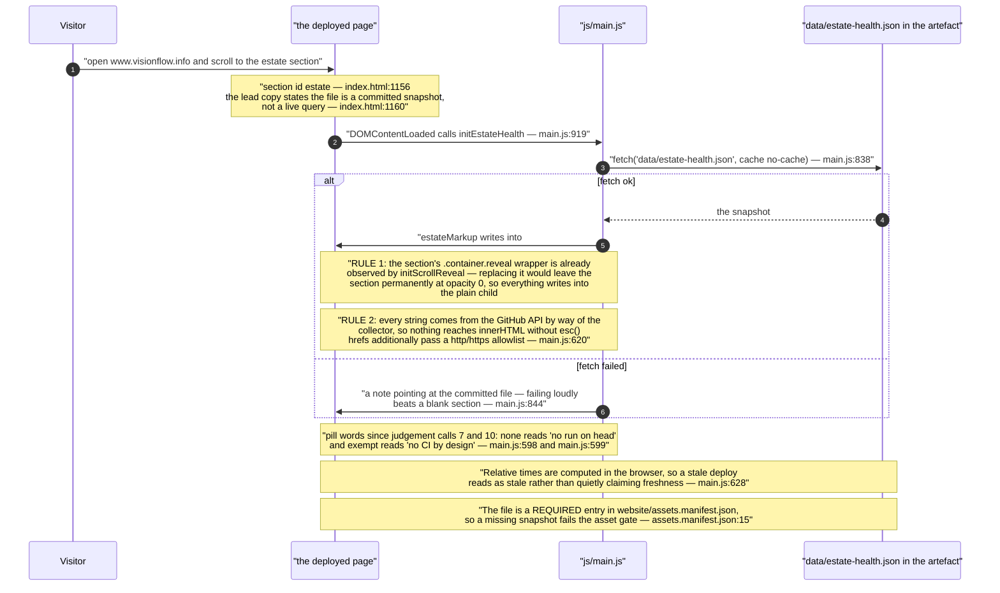
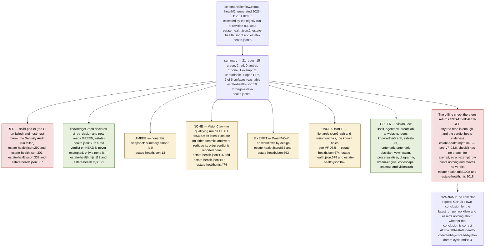

## VF-03.1 The roster — the only place the estate is enumerated

```mermaid
flowchart LR
    classDef fp fill:#e6f0dc,stroke:#4a7a2a,color:#111
    classDef imp fill:#f9f0d5,stroke:#8a7020,color:#111
    classDef priv fill:#f7dede,stroke:#a33333,color:#111

    R["scripts/estate-health/roster.json<br/>roster_version 1 — roster.json:2<br/>INVARIANT: estate-health.mjs holds NO repository names;<br/>roster order fixes the published display order — roster.json:3"]

    R --> REPOS["repos — 21 entries"]
    REPOS --> P1["DreamLab-AI/VisionFlow — canon (this area)<br/>roster.json:5"]:::fp
    REPOS --> P2["DreamLab-AI/VisionClaw — GPU engine, OWL 2 EL<br/>EXTERNAL: area visionclaw, VC-nn — roster.json:6"]:::fp
    REPOS --> P3["DreamLab-AI/agentbox — sovereign agent runtime<br/>EXTERNAL: area agentbox, AB-nn — roster.json:7"]:::fp
    REPOS --> P4["DreamLab-AI/solid-pod-rs — native Solid pod<br/>EXTERNAL: area solid-pod-rs, SP-nn — roster.json:8"]:::fp
    REPOS --> P5["DreamLab-AI/nostr-rust-forum — governance plane, relay<br/>EXTERNAL: area nostr-rust-forum, NF-nn — roster.json:9"]:::fp
    REPOS --> P6["DreamLab-AI/dreamlab-ai-website — commercial surface<br/>EXTERNAL: area dreamlab-ai-website, DW-nn — roster.json:10"]:::fp
    REPOS --> P7["DreamLab-AI/loom — Ontology Loom grounding facade<br/>EXTERNAL: no diagram area in this tree — roster.json:11"]:::fp
    REPOS --> P8["DreamLab-AI/knowledgeGraph — published corpus mirror<br/>ci_by_design: a publish target whose only workflow is the<br/>Pages build — EXTERNAL: area knowledgegraph, KG-nn — roster.json:12"]:::fp
    REPOS --> P15["DreamLab-AI/sidestr-rs — sidechain crates, added 2026-09-23<br/>EXTERNAL: area sidestr-rs, SR-nn — roster.json:13"]:::fp
    REPOS --> P16["DreamLab-AI/ontomark — Obsidian-vault ontology toolchain, crates<br/>EXTERNAL: area ontomark, OM-nn — roster.json:14"]:::fp
    REPOS --> P17["DreamLab-AI/ontomark-obsidian — Obsidian plugin for ontomark<br/>EXTERNAL: no diagram area in this tree — roster.json:15"]:::fp
    REPOS --> P9["DreamLab-AI/WasmVOWL — demo shell, default branch master<br/>ci_by_design: frozen, no workflows<br/>EXTERNAL: no diagram area; distinct from vowl-wasm — roster.json:16"]:::fp
    REPOS --> P10["jjohare/visionGraph — the vault, PRIVATE and cross-owner<br/>EXTERNAL: area visiongraph, VG-nn — roster.json:17"]:::priv
    REPOS --> P11["DreamLab-AI/vowl-wasm — published crate plus npm bundle<br/>EXTERNAL: area vowl-wasm, VW-nn — roster.json:18"]:::fp
    REPOS --> P12["DreamLab-AI/prose-sanitiser — published crate — roster.json:19"]:::fp
    REPOS --> P13["DreamLab-AI/diagram-ir — published crate — roster.json:20"]:::fp
    REPOS --> P14["DreamLab-AI/dream-engine — provenance IMPORTED,<br/>fork of ruvnet/dream-machine — roster.json:21<br/>EXTERNAL: the dream engine itself, see AB-23 and DE-nn"]:::imp
    REPOS --> P18["DreamLab-AI/visiontouch-rs — haptic input device study,<br/>private proof of principle, admitted by ADR-2017 — roster.json:22"]:::fp
    REPOS --> P19["DreamLab-AI/codescape — code-graph 3D view extracted from VisionClaw (ADR-2143)<br/>EXTERNAL: area codescape — roster.json:23"]:::fp
    REPOS --> P20["DreamLab-AI/sealmap — code maps and review evidence for diagrams-as-code corpora<br/>EXTERNAL: area sealmap — roster.json:24"]:::fp
    REPOS --> P21["DreamLab-AI/visioncraft — expectation-driven development method, pinned by agentbox<br/>EXTERNAL: area visioncraft — roster.json:25"]:::fp

    R --> SURF["surfaces — 6 probes — roster.json:27<br/>www.visionflow.info, narrativegoldmine.com,<br/>its /ns/v2.jsonld and /data/graph/stats.json,<br/>www.dreamlab-ai.com, and the VisionClaw<br/>ontology-latest/index.jsonld release asset"]
    R --> REG["registries — 26 entries — roster.json:62<br/>crates.io: vowl-wasm, prose-sanitiser, diagram-ir,<br/>solid-pod-rs, solid-pod-rs-server, nostr-bbs-core — roster.json:63-68,<br/>the six ontomark-family crates (parse, model, reason, compile,<br/>ingest, ngg1) and whelk-el — roster.json:69-75,<br/>all eight sidestr-rs crates: header, core, nostr, wallet,<br/>round, hitch, agent, webledgers-teller — roster.json:76-83,<br/>and codescape-model, codescape-collab, sealmap and visioncraft — roster.json:84-87<br/>npm: @dreamlab-ai/vowl-wasm — roster.json:88"]

    NOTE["The two enumerations of the estate are reconciled in one<br/>direction: repository-map.md:8 lists twelve repositories with local<br/>paths, sidestr-rs among them at repository-map.md:18, and<br/>repository-map.md:25 names the roster as THE authoritative list for<br/>nightly collection, scoping the other six roster repositories as<br/>supporting components — repository-map.md:29-40 — beside<br/>non-roster rows such as RuVector and Codescape. The roster still<br/>does not reference the map back."]
    R -.-> NOTE
```

## VF-03.2 The nightly sequence — collect at 02:30, commit, dispatch, publish

**Debt (concurrency is per pool, not estate-wide):** `CONCURRENCY = 4` is commented "≤ 4 in flight, estate-wide" (`scripts/estate-health.mjs:164`). But `mapPool` bounds only its own items (`scripts/estate-health.mjs:235-244`), the repo, surface and registry pools run together (`scripts/estate-health.mjs:942-945`), and each repo worker fires five calls at once (`scripts/estate-health.mjs:564`). The source therefore allows about 28 requests in flight, 20 of them to the GitHub API. This is a source reading only; no rate-limit failure has been observed.

## VF-03.3 What is collected per repository — six calls, each degrading alone

## VF-03.4 The CI colour rule — red dominates, the verdict must be HEAD's, unknown is never green

**Invariant:** the HEAD rule cannot hide a real failure — a red run on the tip commit still reads red, and that is pinned by the gate suite rather than by prose (`tests/gates/estate-health-ci.test.mjs:27-28`, wired at `tests/gates/run-all.sh:25`).

**Debt (one page of runs):** since judgement call 8 the collector reads one unfiltered page of 100 runs across every branch and filters client-side (`scripts/estate-health.mjs:641`, `scripts/estate-health.mjs:646`); a repository whose pull-request and feature-branch runs fill that page pushes its default-branch runs off it, and the row then reads none rather than its real state.

## VF-03.5 Degradation discipline — the snapshot says what it does not know

## VF-03.6 The check gate — offline verdict and its precedence

## VF-03.8 Surface and registry probes — the judgement calls

## VF-03.9 How the site consumes the snapshot — committed file, no live query

## VF-03.11 The snapshot as it stands — 15 of 21 green, 2 red, 1 none, 1 exempt by design, 2 unreadable

**Debt:** rows flip without a recorded reason. Between the 2026-11-01 snapshot this topic last drew and the 2026-11-10 one it draws now, agentbox, dreamlab-ai-website and knowledgeGraph moved from red to green, nostr-rust-forum and solid-pod-rs moved from green to red, and visiontouch-rs moved from green to unreadable. VisionClaw remains none by the HEAD rule rather than by a passing run. No mechanism records why a row flips, so any trend is only visible by reading committed snapshots in sequence (`website/static/data/estate-health.json:11`).

**Debt (registry roster vs canon) — RESOLVED 2026-10-03, re-opened and RESOLVED again 2026-10-18:** the 10-03 dream ACCEPT (PR #13, merged as `c1e1498`) brought the roster to the seven sidestr crates canon then named; `webledgers-teller` was published later and went unprobed until `26df6c9` added it, with canon updated to eight in the same commit (`scripts/estate-health/roster.json:76-83`, estate register ER-3); the rewritten README no longer states a crate count (`./README.md:31`). The repository map still describes sidestr-rs as "seven published AGPL crates" (`docs/architecture/repository-map.md:18`), one behind the roster's eight (**Drift**).

**Drift (2026-10-15, dream-engine extraction):** the roster row for `dream-engine` (`provenance: imported`, a fork of ruvnet/dream-machine) is stamped before the extraction. The slug now names the new Rust repository and the fork is renamed dream-machine and archived (checked 2026-10-16). The row has not been changed, because the release manifest and its gate assert two imported rows, see DE-01.

**Since the earlier stamps:** `check` now builds its output in a buffer and prints it directly before the sentinel line, so a Jev advisory block, never able to change the verdict or exit code, can add `JEV priority` and `JEV triage` lines for the failed observations (`scripts/estate-health.mjs:1004`, `scripts/estate-health.mjs:1045`, `scripts/estate-health.mjs:1075`, `docs/jev-option.md:13-14`). The library default is off but agentbox projects `VISIONFLOW_JEV=all` into its shells, where these two items are public data and, since the 2026-10-30 System One unification, take the shared proxy's selected backend (TypeSafe by default) once the new agentbox image is activated, while hosted CI and the dream annexe do not inherit it (`docs/jev-option.md:3`, `docs/jev-option.md:13-14` and `docs/jev-option.md:16`). `collect` never calls it.

**Debt (snapshot shape and clock bounds, reproduced 2026-10-31):** A schema tag and current timestamp without any repository/surface arrays returns `ESTATE-HEALTH-OK`; a 2099 timestamp also returns OK. A non-array `repos` object throws instead of returning a classified verdict. These follow from the optional empty-array scans and one-sided age test at `scripts/estate-health.mjs:1007`, `scripts/estate-health.mjs:1024` and `scripts/estate-health.mjs:1052`. The source is unchanged from this topic's declared revision. See the [estate-health adversarial review](../../estate-review/2026-10-31-diagram-drift-and-health.md). The literal verdict is not proof that the full roster was measured.
