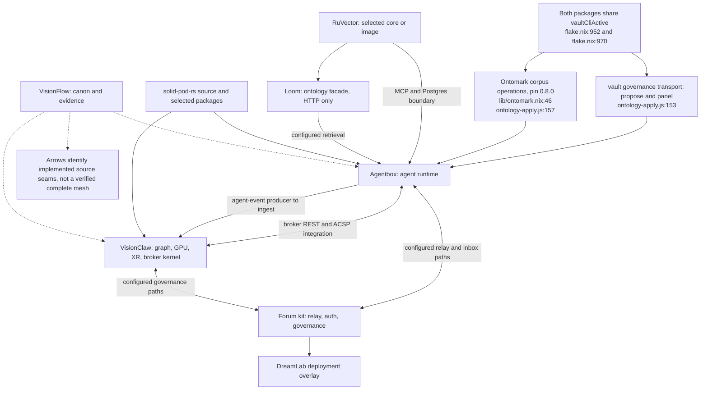
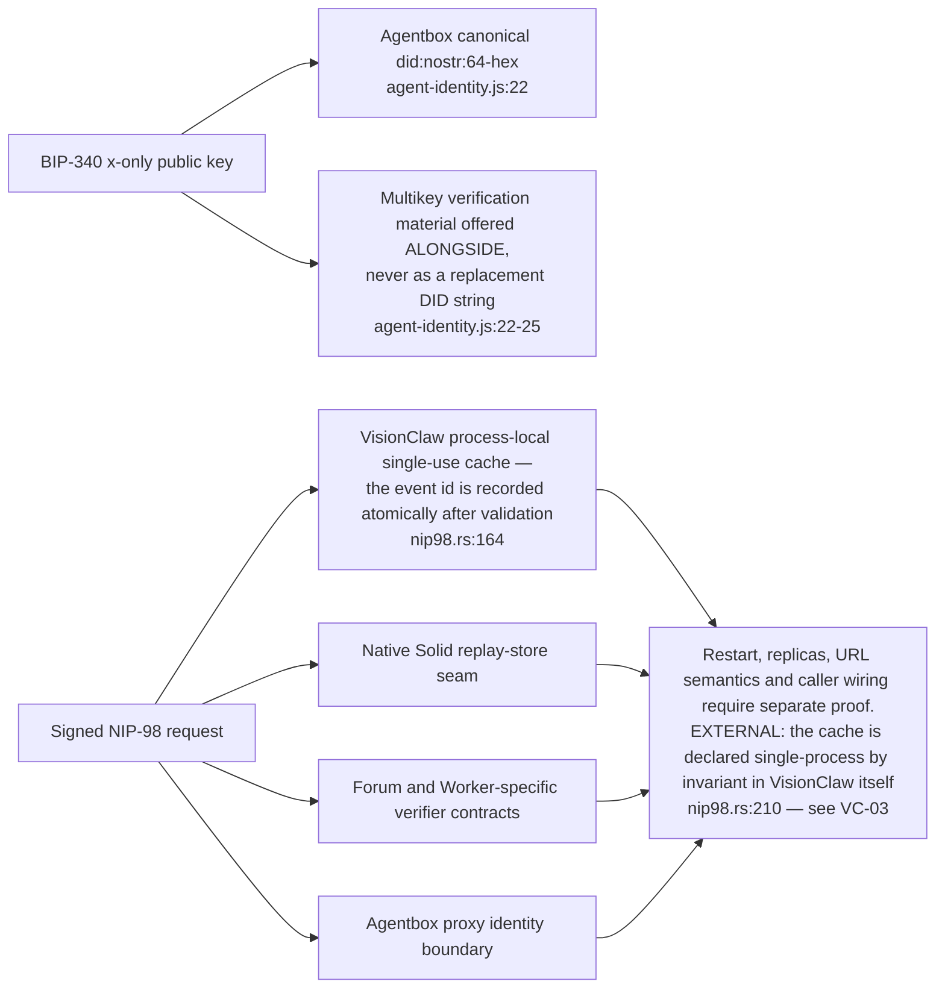
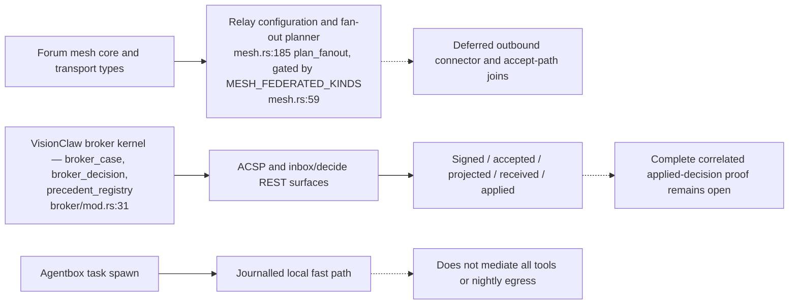
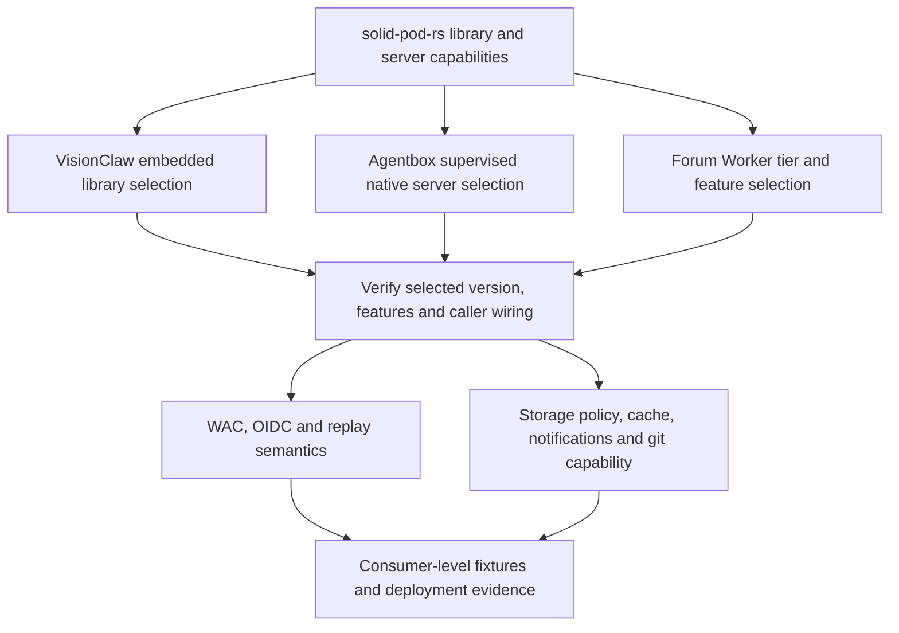
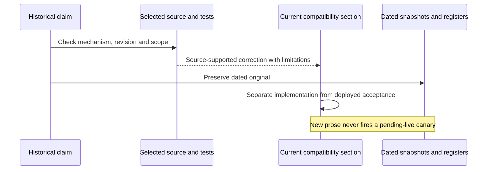
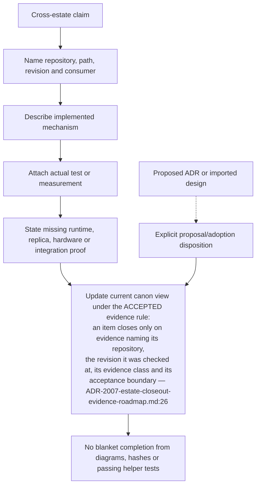
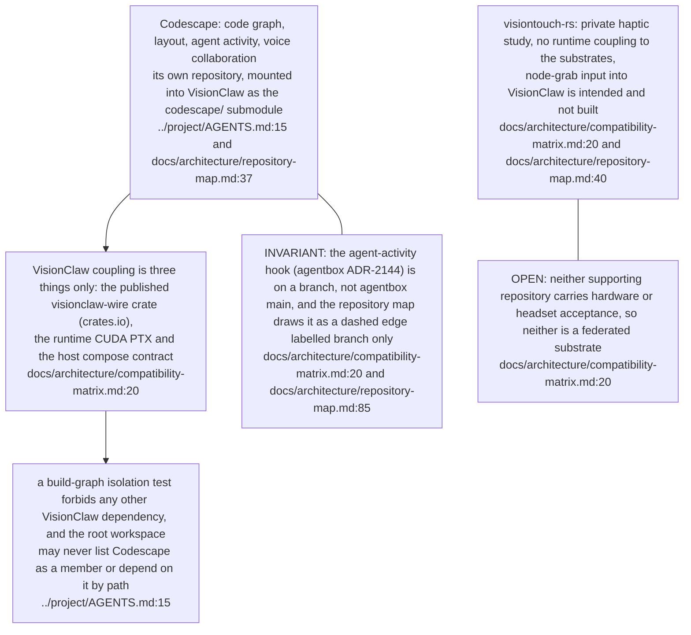

Source reconciliation: 2026-09-07. These panels follow the current sections of the compatibility matrix and status reconciliation, plus the source audits named in frontmatter. Historical metrics and register cuts remain historical. This review did not certify a live federation, image, hardware session or replica-wide authentication contract.

## VF-08.1 Dependency direction without a fictional complete mesh

**Current Agentbox corpus dispatch, 2026-10-31:** `binFor` routes `propose` and `panel` through `vault`, and other corpus verbs through `ontomark` (`../project/agentbox/management-api/lib/ontology-apply.js:153`). Both are selected under the same Nix gate (`../project/agentbox/flake.nix:952`, `../project/agentbox/flake.nix:970`). The old vault-only statement did not describe the migrated consumer. This source trace is not a universal absence claim about every estate MCP adapter.

**INVARIANT: `verified_commit` is a `{repo: sha}` map, not one sha, for any topic whose `sources:` span more than one repo (`scripts/diagram-index-gen.cjs:215-225`).** A missing repository pin can fall back to working-tree bytes, but the current checker reports that as unverified (`scripts/diagram-index-gen.cjs:579`) and strict mode rejects warnings (`scripts/diagram-index-gen.cjs:912`). Such a fallback must not be presented as revision-backed verification.

Evidence: `repository-map.md`, the Agentbox audit and imported-scope review. This interaction view is not an exhaustive repository count.

## VF-08.2 Identity representation and replay boundaries

Evidence: VisionClaw `src/utils/nip98.rs`, Agentbox `agent-identity.js`, and the federation audit. A canonical identity representation does not unify every verifier. VisionClaw NIP-26 delegation remains deferred; that is narrower than saying no upstream delegation implementation exists anywhere.

## VF-08.4 Mesh and governance are partly connected

Source: forum `mesh.rs`, VisionClaw `src/domain/broker/mod.rs`, Agentbox `action-plane.js`, and the federation audit. BrokerActor/Neo4j was deliberately left out; the current broker is not merely an unmerged branch. Relay acknowledgement does not prove external application.

## VF-08.7 Pod compatibility is a consumer contract

The federation audit qualifies native OIDC, process-local replay and Worker caching. The historical pod-tier matrix is a capability guide, not proof that every tier implements the full library surface or shares its replay store. Agentbox's supervised native server must not be relabelled as an in-process embedded library.

## VF-08.8 Reconciliation preserves evidence dates

`status-reconciliation.md` now separates September findings from the May notes. The matrix separates its current source comparison from the July compatibility and harness snapshots. Completion percentages and stale version strings in those snapshots are not live status.

## VF-08.10 Canon claims require bounded evidence

VisionFlow owns the cross-repository view and evidence vocabulary. Source audits can correct that view, while implementation changes belong to the owning repository. Source hashes bind observations; they do not turn a planned feature or a helper assertion into a running end-to-end system. ADR-2007 was accepted on 2026-10-02, narrowed to exactly this evidence rule (`docs/adr/ADR-2007-estate-closeout-evidence-roadmap.md:26`); the estate closeout roadmap it originally proposed is recorded there as overtaken, not accepted, so this panel states the accepted rule rather than the abandoned coordinating contract.

## VF-08.11 Supporting repositories sit beside the substrates, not inside the mesh

**What it shows.** Two repositories admitted since the earlier stamp are drawn at the edge of the dependency picture: Codescape reaches VisionClaw only through a published wire crate, a runtime PTX file and a compose contract, and visiontouch-rs reaches nothing.
**Why it is this way.** The matrix row says to read neither as a federated substrate; the isolation rule in VisionClaw's agent instructions makes the Codescape boundary a build-graph property rather than a convention.

**Review boundary, 2026-10-31:** the Agentbox corpus-dispatch slice and the checker-fallback wording were refreshed then. The session at that time exposed Ontomark 0.7.0 and vault 0.1.0, recorded with binary hashes in the [consumer audit](../../estate-review/2026-10-31-corpus-consumer.md). No full mesh or universal deployment claim follows from those local versions.

**Restamp, 2026-11-02:** all four repository pins moved to the audit wave 2 revisions: VisionFlow `5f8b1da`, VisionClaw `86cdd76`, Agentbox `c57d9c0` and nostr-rust-forum `c39f41f`. Every citation was re-read at those revisions. The cross-repository lines were byte-identical to the earlier pins. Two VisionFlow lines moved, and are now `ADR-2007-estate-closeout-evidence-roadmap.md:26` and the checker lines in VF-08.1. ADR-2007 is now `complete` and `live` (`docs/adr/ADR-2007-estate-closeout-evidence-roadmap.md:6-7`), with the evidence gate in all five ledgers, so the rule VF-08.10 states is also mechanically enforced at closing transitions. That is source tracing; no hosted run was checked.

**Drift (anchors, corrected 2026-11-02):**
- VF-08.1's map invariant cited a matrix sentence that says nothing about `verified_commit`. It now cites the checker that enforces the form (`scripts/diagram-index-gen.cjs:215-225`).
- VF-08.2's Multikey node cited the key-handling line. It now cites the lines that say the Multikey is offered alongside the unchanged DID (`../project/agentbox/management-api/lib/agent-identity.js:22-25`).
