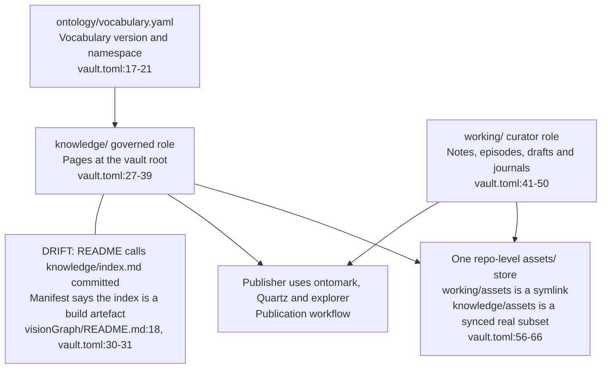
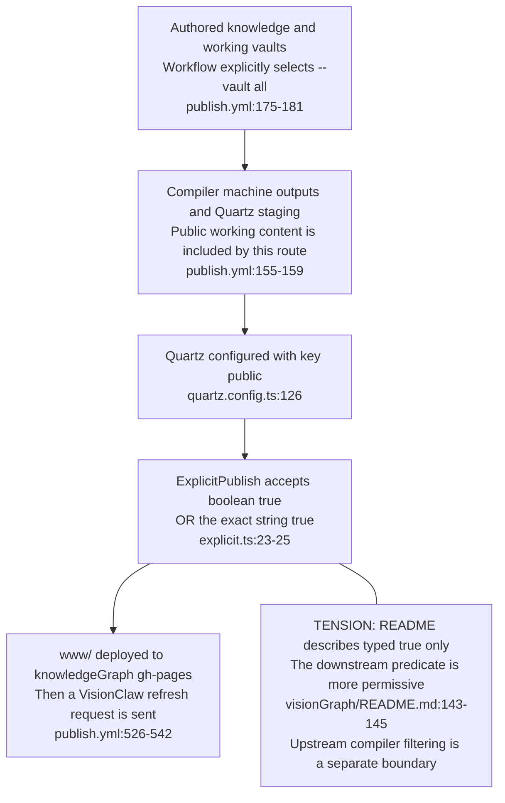
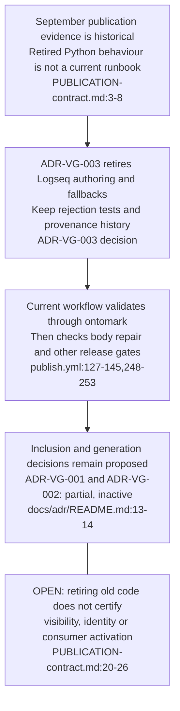
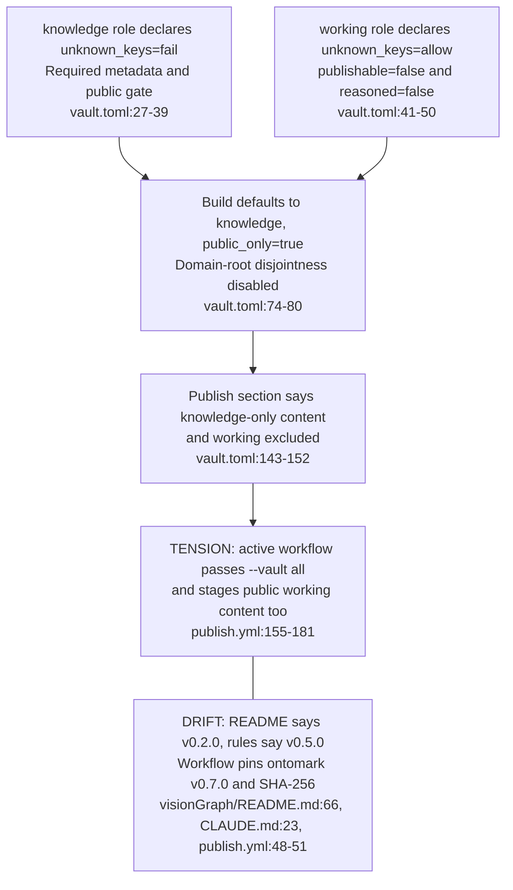
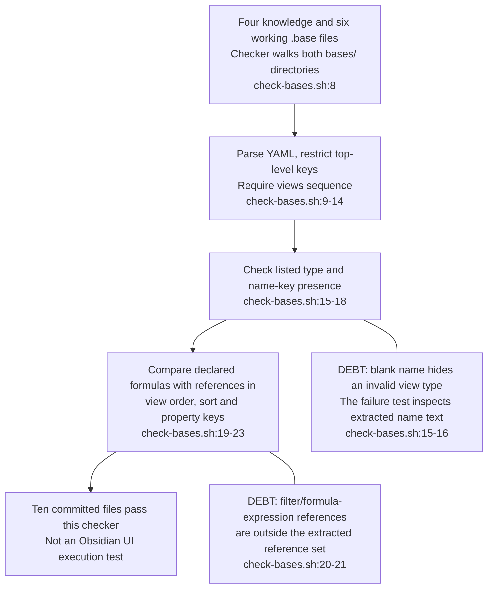
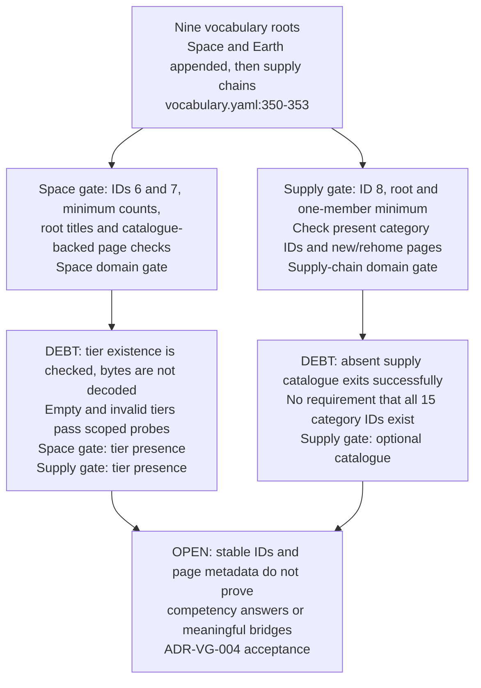

## For developers

Trace the two authoring roles, the publication override and the limits of domain and Bases checks; the [dated source review](../../estate-review/2026-11-01-visiongraph-vault-and-domain-contracts.md) assesses all six panels with thirteen scoped probes.

## For the business

The vault supports private work and public knowledge, but neither a successful view check nor a domain tile proves a complete, usable publication; curator intent, emitted identities and downstream acceptance need separate evidence.

## VG-01.1 Current repository layout and asset ownership

**What it shows:** The flattened vaults share an asset store through different mechanisms; neither the old `pages/` layout nor a knowledge-assets symlink describes the current tree.
**Why it is this way:** The asset section records the October layout change, while ADR-VG-003 retires the legacy authoring path; the report verifies tracked tree types and the missing committed index.

## VG-01.3 Publication staging and the Quartz inclusion predicate

**What it shows:** The publisher chooses both vaults and Quartz applies its own predicate to the staging tree; an exact string true passes that downstream predicate.
**Why it is this way:** Staging and rendering are distinct steps, and a broader downstream predicate does not by itself demonstrate that a malformed source flag can pass the upstream compiler.

## VG-01.4 Historical findings and current acceptance obligations

**What it shows:** The historical failure set and the current implementation have different evidence boundaries; old tests are neither current failures nor successor acceptance.
**Why it is this way:** The publication contract marks its historical scope, and the operative decision index still leaves inclusion and consumer-generation acceptance open.

## VG-01.5 Manifest declarations and workflow overrides

**What it shows:** Manifest values express defaults and policy declarations; the active workflow selects a broader publication route and a newer compiler than the accompanying prose names.
**Why it is this way:** The migration retained old manifest comments and documentation while the publisher evolved; this map records those tensions without declaring every manifest field a proven enforcement point.

## VG-01.6 Bases checks are a bounded linter

**What it shows:** The checker gives useful structural feedback but accepts two reproduced cases that its broad schema-conformance description suggests it covers.
**Why it is this way:** Shell tests use an extracted display name to detect invalid types, and formula discovery inspects selected fields instead of parsing all expressions.

## VG-01.7 Domain expansion gates and their unverified geometry

**What it shows:** Domain metadata and catalogue identities are checked, but binary tier integrity and complete category identity are outside these particular gates.
**Why it is this way:** The expansion records require useful cross-domain behaviour as well as stable identifiers; the gates only establish part of that acceptance contract, and later workflow checks must be assessed separately.
