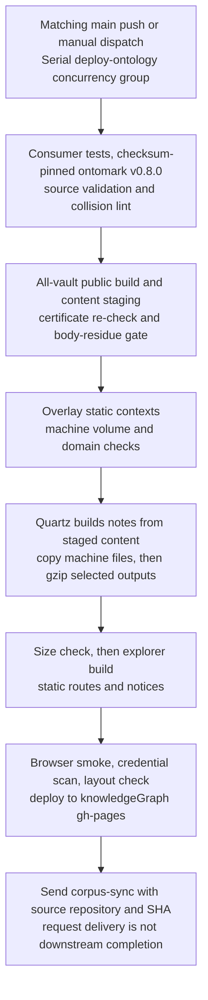
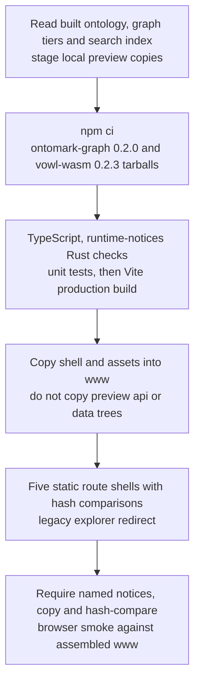
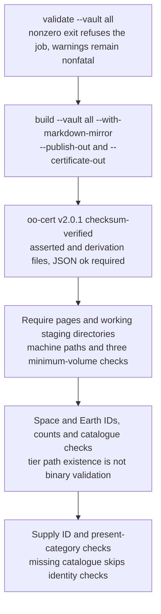
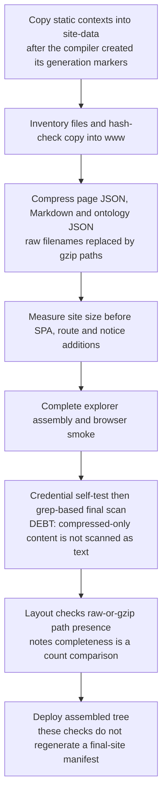

**Repair note — 2026-11-03:** selected counterexamples below have a [scoped successor verification](08-promoted-certificate-consumption.md). This historical topic retains its declared source revision; the successor states the repaired contracts and acceptance boundaries.

## For developers

Follow the configured publisher from its released compiler to the final site and downstream dispatch; the [publication and identity audit](../../estate-review/2026-11-01-visiongraph-publication-and-identity.md) separates source checks, staging receipts and consumer acceptance.

## For the business

The build combines public knowledge, notes and an interactive explorer, but a successful stage check does not prove final page completeness, privacy or that another application has loaded the new content.

## VG-03.1 One configured job assembles three outputs

**What it shows:** the actual ordering, including the source collision gate, post-build body check and post-deploy event; the event carries the source commit, not the assembled site digest (`publish.yml:144`, `publish.yml:245`, `publish.yml:545`).
**Why it is this way:** one job owns the public site while consumers refresh through separate paths; the pinned compiler has no source-build fallback (`publish.yml:42`, `publish.yml:98`).

## VG-03.3 Explorer assembly preserves the machine tree

**What it shows:** the configured integration and output-copy boundary; dependency versions are source pins, not a newly measured browser-performance result (`package.json:24`, `publish.yml:450`).
**Why it is this way:** the compiler's machine artefacts remain authoritative while the host app owns navigation, rendering and attribution (`publish.yml:450`, `publish.yml:486`).

## VG-03.5 Source, certificate and domain gates prove different things

**What it shows:** checks for source errors, derivation validity, output volume and selected domain metadata; none independently certifies scientific truth or all emitted bytes (`publish.yml:130`, `publish.yml:228`, `publish.yml:305`).
**Why it is this way:** the workflow guards distinct failure modes; the domain scripts' actual checks are narrower than their names and the earlier diagram's fifteen-category guarantee (`check-supply-chain-domain.mjs:39`).

## VG-03.6 Receipts precede transformations and final acceptance

**What it shows:** each receipt covers the bytes at its own stage; the retained KG-P probes reproduce compression, count-substitution and final-size gaps at this same source revision.
**Why it is this way:** copying, compression and app assembly are separate steps, so a successful earlier hash check does not describe every file finally deployed (`publish.yml:344`, `publish.yml:359`, `publish.yml:450`).

**Debt:** push filters omit working pages and root assets despite consuming them; matching knowledge or workflow changes and manual runs can still publish those inputs (`publish.yml:24`, `publish.yml:158`, `publish.yml:194`).
