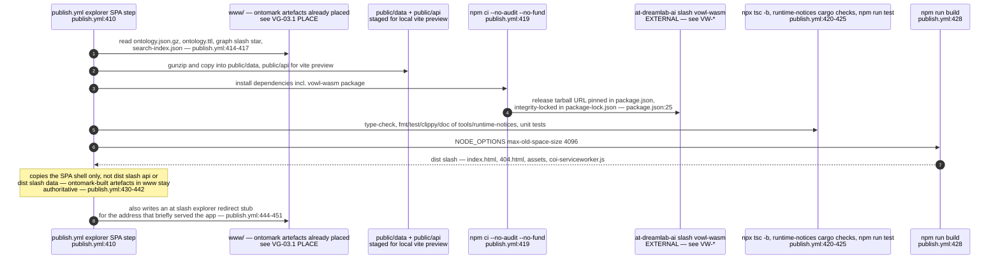
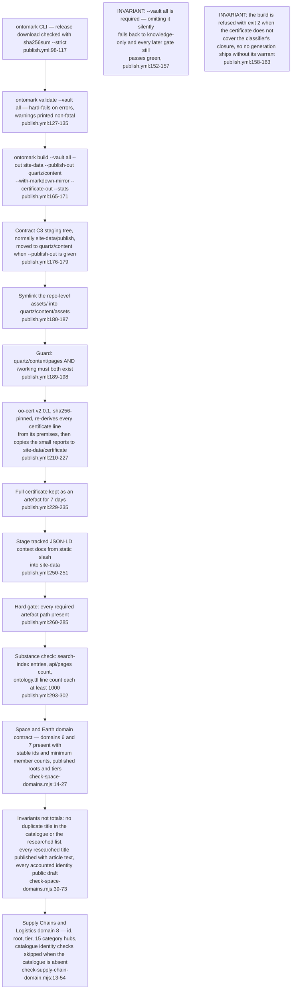
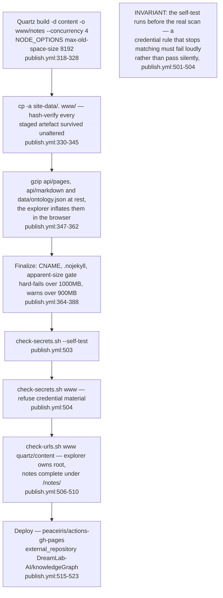

## VG-03.1 publish.yml — checkout to deploy, one job, three producers into one site

```mermaid
flowchart TD
    CO["Checkout fetch-depth:0, Node 22, Rust 1.99.0<br/>publish.yml:64-79"]
    CONTRACT["Consumer contract tests, fail if the legacy producer returns<br/>publish.yml:88-89"]
    BIN["Fetch the released ontomark CLI, pinned by tag and sha256 — see VG-03.5<br/>publish.yml:98-117"]
    VALIDATE["ontomark validate --vault all — source gate<br/>publish.yml:127-135"]
    BUILD["ontomark build — machine artefacts, content staging, certificate<br/>see VG-03.5<br/>publish.yml:137-198"]
    CERT["oo-cert re-checks the derivation certificate, digest-pinned<br/>see VG-03.5<br/>publish.yml:210-227"]
    GATE["Hard gate: artefacts present AND substantial<br/>see VG-03.5<br/>publish.yml:253-307"]
    DOMAINS["Space and Earth, then Supply Chains domain contracts over site-data<br/>see VG-03.5<br/>publish.yml:309-313"]
    QUARTZ["Quartz build -d content -o www/notes — see VG-03.6<br/>publish.yml:318-328"]
    PLACE["Place site-data at the site root, hash-verified, gzip the large artefacts<br/>publish.yml:330-362"]
    FIN["Finalize — CNAME, .nojekyll, 1GB size gate<br/>publish.yml:364-388"]
    SPA["Honesty gate, then explorer SPA build — see VG-03.3<br/>publish.yml:395-451"]
    ROUTES["Stage static routes and third-party notices, hash-compared<br/>publish.yml:453-479"]
    SMOKE["Explorer smoke — Playwright/CDP against www/<br/>publish.yml:481-485"]
    SEC["Refuse credential material — see VG-03.6<br/>publish.yml:493-504"]
    URLCHK["Site layout check — see VG-03.6<br/>publish.yml:506-510"]
    DEPLOY["Deploy — peaceiris/actions-gh-pages, SHA-pinned<br/>external_repository: DreamLab-AI/knowledgeGraph<br/>publish.yml:515-523"]
    DISPATCH["corpus-sync repository_dispatch to DreamLab-AI/VisionClaw<br/>payload source_repo + source_sha — see VG-04.1<br/>publish.yml:525-531"]
    CO --> CONTRACT --> BIN --> VALIDATE --> BUILD --> CERT --> GATE --> DOMAINS --> QUARTZ --> PLACE --> FIN --> SPA --> ROUTES --> SMOKE --> SEC --> URLCHK --> DEPLOY --> DISPATCH
    note1["INVARIANT: concurrency group deploy-ontology serialises<br/>deploys to the shared gh-pages branch — name kept for<br/>continuity with a pre-Quartz workflow, publish.yml:33-39"]
```

- **Invariant:** `ONTOMARK_RELEASE_TAG` and `ONTOMARK_SHA256` are both pinned (v0.6.0 and a digest), the step fails if either is empty, and there is no build-from-source fallback: "a run that cannot obtain the pinned release fails, because nothing else produces the site's artefacts" (`publish.yml:41-51`, `publish.yml:100-105`).
- **Drift:** the earlier topic described a `VAULT_RELEASE_TAG` left empty so every run built `vault` from VisionClaw at `VAULT_GIT_REV` (`90a7a85c`). That path no longer exists in the workflow: the `vault` fetch, VisionClaw checkout, cache and `cargo build` steps were replaced by the digest-checked ontomark download (`publish.yml:91-117`), and the Python `scripts/tests/test_publish_cli.py` consumer contract fails the build if the legacy producer is reintroduced (`publish.yml:85-89`). The source-gate comment still names VisionClaw's `docs/VAULT-corpus-format.md` and ADR-2112 as the contract (`publish.yml:119-120`).
- **Invariant:** the deploy is followed by a `corpus-sync` `repository_dispatch` carrying `source_repo` and `source_sha` (`publish.yml:525-531`), so VisionClaw's ontology release is rebuilt from the exact revision this run validated rather than from whatever `main` is when it runs; it runs only after the deploy step succeeds, so a failed deploy never refreshes the VisionClaw release.
- **Open:** the workflow header says the owner authorised estate deployment "during the ontomark resumption on 2026-10-11" (`publish.yml:17-18`) where the previous text said agents never push; the authorisation is recorded in a comment, not in a governing document this topic cites.

## VG-03.3 Explorer SPA build — vowl-wasm consumed as a pinned package, reading ontomark-built artefacts

- The explorer now consumes vowl-wasm from the 0.2.0 GitHub release tarball rather than from an npm version range (`publishing-tools/WasmVOWL/modern/package.json:25`), and the job stages five explorer routes as copies of the SPA shell, compared by hash, plus the vowl-wasm, ontomark-graph and JavaScript runtime notices (`publish.yml:453-479`).

## VG-03.5 ontomark build — the sole producer of machine artefacts and Quartz content staging

- **Invariant:** presence of an artefact path proves nothing — a producer can write every expected file empty, as the retired Python pipeline did against the migrated corpus; `SUBST` exists specifically to catch that (`publish.yml:287-302`).
- **Drift:** the earlier topic recorded a **Debt** that the space and Earth gate pinned exact totals of 934 expansion identities and 660 researched drafts, forcing every research batch to edit the gate. At this stamp the gate asserts invariants and prints the totals instead (`check-space-domains.mjs:39-74`), so that debt is cleared in the script; the ADR still describes the two roots as staged rather than live (`docs/adr/ADR-VG-004-space-and-earth-domains.md:35-36`).
- **Tension:** ADR-VG-008 establishes the Supply Chains and Logistics domain as domain 8 and is accepted and complete but its activation is `staged` (`docs/adr/ADR-VG-008-supply-chains-and-logistics-domain.md:5-7`), while `publish.yml` already runs its gate on every deploy (`publish.yml:312-313`), so the deploy enforces a domain whose activation has not been declared.
- **Open:** the certificate step re-checks a build that `ontomark build` itself refuses to finish without a certificate; the checker is a different program (a Lean 4 binary) pinned by its own tag and digest (`publish.yml:212-214`), separate from the `ontomark` pin (`publish.yml:49-51`), but both are fetched with the same `ACCESS_TOKEN` and neither pin has a recorded rotation rule in this workflow (`publish.yml:117`, `publish.yml:215`).

## VG-03.6 Quartz notes build, credential and layout gates, deploy

- **Drift:** the corpus once had a live credential leak reach a build artefact (`publish.yml:495-499`, referencing `docs/migration-2026-09-22/credential-redaction.md`); `check-secrets.sh` guards the artefact precisely because `ontomark validate` only guards the source, where the earlier text named `vault validate`.
