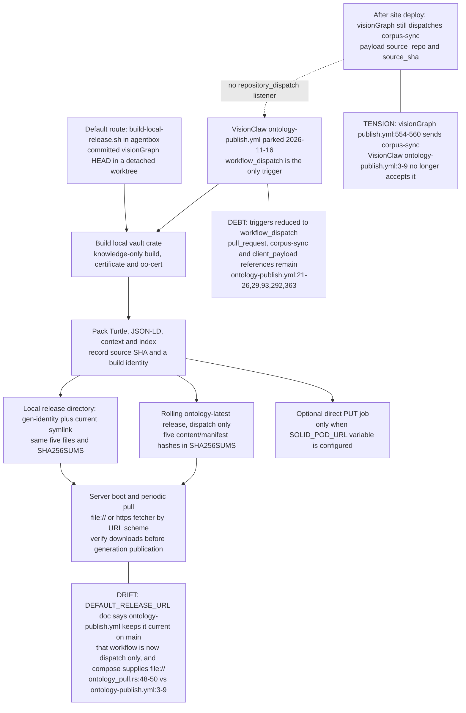
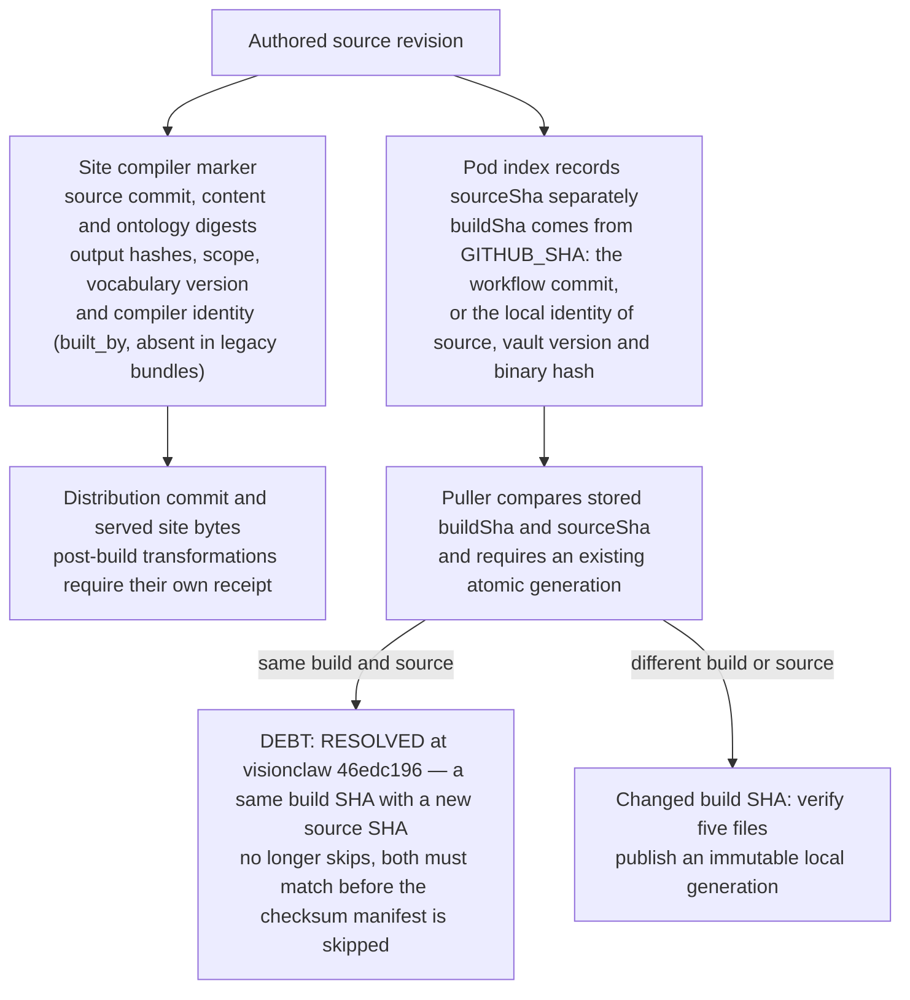

## For developers

Distinguish the configured pod-release workflow from its server-side loader and the separate Markdown/Loom consumers in KG-06; the [identity review](../../estate-review/2026-11-01-visiongraph-publication-and-identity.md) reproduces a source-refresh failure in the pod loader.

## For the business

Publishing the website and delivering a refresh request do not establish that the pod has activated the same corpus; source identity, built bytes and loaded generation need separate evidence.

## VG-04.1 Configured pod release paths and actual server pull

**What it shows:** both routes still build VisionClaw's `vault`, while the site uses the released `ontomark`; the compose default points the boot pull at the local release directory, and this source map does not prove a running deployment's configuration (`build-local-release.sh:62`, `ontology-publish.yml:165`, `publish.yml:48`, `docker-compose.unified.yml:141`, `src/main.rs:911`).
**Why it is this way:** the GitHub release route was parked as network-expensive and replaced by a local twin with the same gates; the rolling URL, the local directory and the optional push job are distinct delivery paths, and a successful dispatch is not an activation acknowledgement (`build-local-release.sh:4-9`, `ontology_pull.rs:48`, `ontology-publish.yml:363`).

## VG-04.3 Source, bundle, deployment and loaded identity differ

**What it shows:** the source and build axes are both recorded and the puller compares both; a manifest with the same build SHA but a different source SHA is not treated as current (`pack-pod-resources.py:117`, `ontology_pull.rs:368-370`, test `ontology_pull.rs:869`).
**Why it is this way:** the shortcut now skips a download only when build and source SHAs both match, so an unchanged consumer-code commit no longer hides new corpus bytes; generation publication and this freshness decision remain separate mechanisms (`ontology_pull.rs:368-370`, `ontology_pull.rs:435`).
