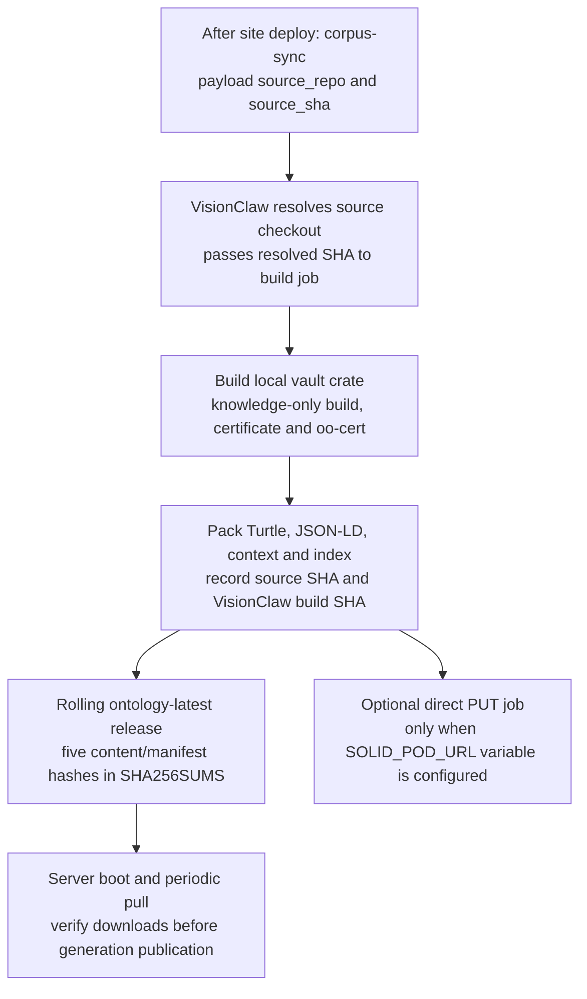
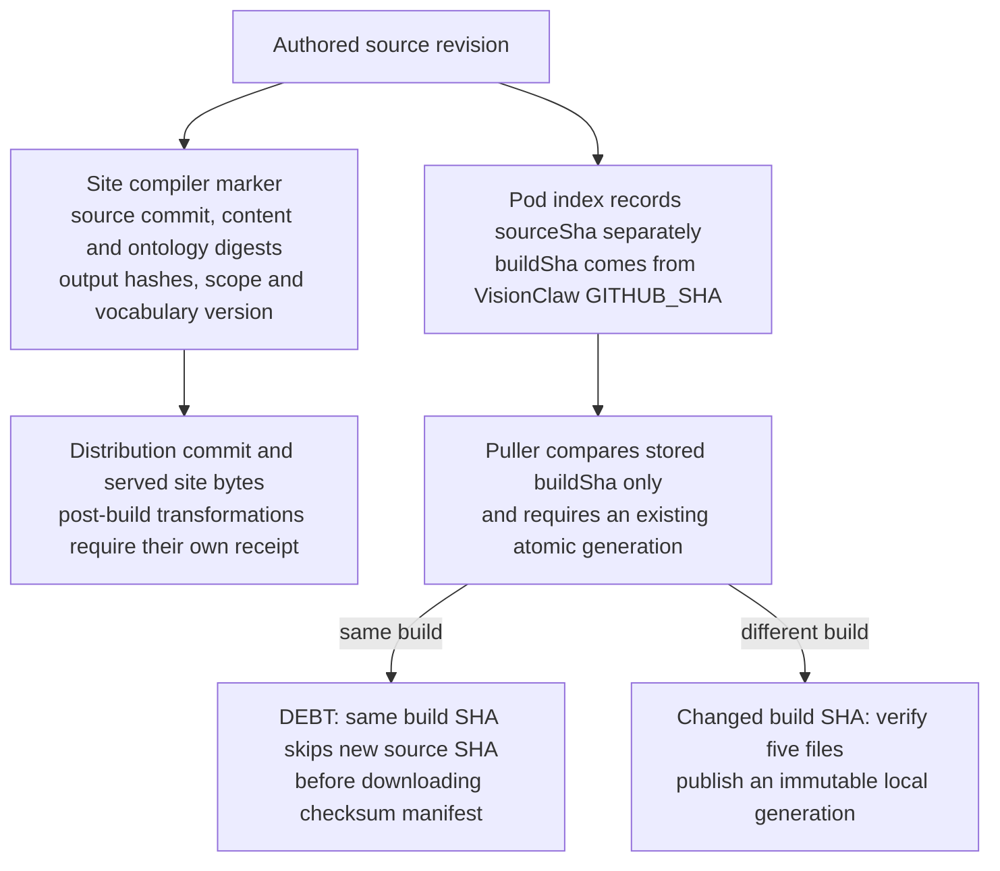

## For developers

Distinguish the configured pod-release workflow from its server-side loader and the separate Markdown/Loom consumers in KG-06; the [identity review](../../estate-review/2026-11-01-visiongraph-publication-and-identity.md) reproduces a source-refresh failure in the pod loader.

## For the business

Publishing the website and delivering a refresh request do not establish that the pod has activated the same corpus; source identity, built bytes and loaded generation need separate evidence.

## VG-04.1 Configured pod release path and actual server pull

**What it shows:** the workflow still builds VisionClaw's `vault`, while the site uses the released `ontomark`; the pod pull is wired into server startup, but this source map does not prove a running deployment's configuration (`ontology-publish.yml:164`, `publish.yml:48`, `src/main.rs:917`).
**Why it is this way:** the release route supports pull-based delivery; its default rolling URL and the optional push job are distinct delivery paths, and a successful dispatch is not an activation acknowledgement (`ontology_pull.rs:40`, `ontology-publish.yml:360`).

## VG-04.3 Source, bundle, deployment and loaded identity differ

**What it shows:** the source and build axes are both recorded but only one controls freshness; the current-source tests keep source A active when source B arrives with the same build SHA (`pack-pod-resources.py:117`, `ontology_pull.rs:312`).
**Why it is this way:** the shortcut avoids redundant downloads, but an unchanged consumer-code commit does not establish unchanged corpus bytes; generation publication and this freshness decision are separate mechanisms (`ontology_pull.rs:312`, `ontology_pull.rs:378`).
