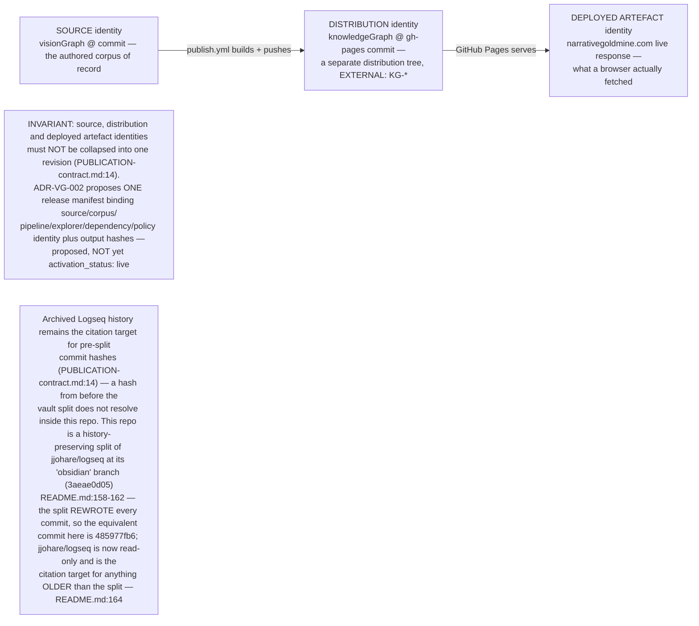

## VG-04.1 VisionClaw's ontology-publish.yml — pulls FROM visionGraph, not from knowledgeGraph

```mermaid
sequenceDiagram
    autonumber
    participant PUB as visionGraph publish.yml<br/>corpus-sync step publish.yml:525-531
    participant VC as validate-source job<br/>ontology-publish.yml:44
    participant VG as jjohare/visionGraph checkout<br/>ontology-publish.yml:148-154, ONTOLOGY_SOURCE_REPO default — line 30
    participant BUILD as vault build (Rust binary)<br/>ontology-publish.yml:167-174, ADR-2113
    participant CERT as vault certify, then oo-cert<br/>ontology-publish.yml:176-208, ADR-2147
    participant PACK as pack-pod-resources.py<br/>ontology-publish.yml:242-247
    participant POD as deploy-jss job<br/>ontology-publish.yml:356, PUT loop 401-420

    PUB->>VC: repository_dispatch corpus-sync, client_payload source_repo + source_sha<br/>after a successful deploy — trigger ontology-publish.yml:15-16
    Note over PUB,VC: source repo resolves inputs, then client_payload, then the<br/>jjohare/visionGraph default — ontology-publish.yml:30
    VC->>VG: checkout repository: env.ONTOLOGY_SOURCE_REPO at client_payload.source_sha or main<br/>ontology-publish.yml:89-95, build job pinned to the validated sha ontology-publish.yml:152<br/>#40;GITHUB_TOKEN cannot read a private cross-account repo —<br/>needs ONTOLOGY_SOURCE_TOKEN, checked lines 65-84#41;
    VG->>BUILD: ./target/release/vault --repo vault-source build --vault knowledge<br/>--out #36;GITHUB_WORKSPACE/output/vault
    BUILD->>CERT: vault certify writes the oo-cert/1 files and reports Whelk parity,<br/>the pinned Lean checker re-derives every line, reports and the full certificate are uploaded<br/>ontology-publish.yml:180-228
    CERT->>PACK: pack-pod-resources.py output/vault output/pod
    Note over CERT,PACK: 8,434 classes, 265,455 triples, substance floor 4000/100k<br/>#40;run 34046473943 — ADR-2106-ontology-pull-model-into-the-embedded-pod.md:38#41;
    PACK->>POD: curl -X PUT SOLID_POD_URL + JSS_PUBLIC_PATH/visionflow.ttl<br/>+ context.jsonld + ontology.jsonld + index.jsonld
    Note over VC,POD: history #40;ontology-publish.yml:127-132#41;: an EARLIER inline md_to_ttl.py<br/>read Logseq key:: value lines and never the json-ld fence — shipped<br/>0 owl:Class from 380 pages under example.org. First replaced by<br/>Python pipeline.build #40;ADR-2106#41;, itself since DELETED and replaced<br/>by the vault#39;s OWN Rust binary #40;ADR-2112 removed pipeline.build,<br/>ADR-2113 landed vault build, the binary visionGraph#39;s publish.yml used until it moved to the released ontomark CLI#41;
    Note over VC,BUILD: vault is built from VisionClaw's own checkout, cargo build -p vault,<br/>ontology-publish.yml:145-146,167-168 — NOT the ontomark release visionGraph's<br/>publish.yml pins by tag and digest, publish.yml:48-51
    Note over POD: pull model, not push — a GitHub-hosted runner cannot reach the<br/>LAN pod — no self-hosted runner is registered<br/>#40;ADR-2106-ontology-pull-model-into-the-embedded-pod.md:27, deploy-jss condition ontology-publish.yml:360#41;
```

**What it shows:** since 2026-10-01 the site publisher pushes a `corpus-sync` dispatch to VisionClaw after every successful deploy (`publish.yml:525-531`), and VisionClaw's ontology workflow checks out exactly the visionGraph revision named in the payload, then pins its build job to the sha the validate job resolved (`ontology-publish.yml:89-95`, `ontology-publish.yml:148-154`). Before this, a dispatch-free run built whatever `main` was at the time.
**Why it is this way:** ADR-2106's 2026-10-02 re-verification records the change as tightening "the provenance of what the pod pulls without changing who moves it": delivery stays pull-model (`ADR-2106-ontology-pull-model-into-the-embedded-pod.md:152-154`).
**Tension:** the dispatch pins the corpus revision but not the converter, and the two converters are no longer the same program. visionGraph's publisher runs the released `ontomark` CLI pinned by tag and sha256 (`publish.yml:48-51`), while VisionClaw's job still builds `vault` from its own default-branch checkout (`ontology-publish.yml:145-146`, `ontology-publish.yml:167-168`), so the site and the pod release can be produced by different producers from the same source sha. An earlier stamp recorded two `vault` revisions that might differ; a comment in visionGraph's workflow says ontomark reproduces the vault verbs, flags and outputs byte for byte against a parity corpus (`publish.yml:91-97`), which this topic cannot re-check.
**Tension:** both pipelines now certify the graph they publish and re-check it with the same pinned `oo-cert` v2.0.1 digest, but through different engines (`ontomark build --certificate-out` in visionGraph, `vault certify` in VisionClaw), and ADR-2147 is recorded `activation_status: staged` while the publish job already runs the steps (`publish.yml:158-163`, `publish.yml:210-227`, `ontology-publish.yml:176-208`, `docs/adr/ADR-2147-inferences-carry-a-re-checkable-certificate-and-proposals-carry-a-consequence-delta.md:7`).

## VG-04.3 Three distinct identities — source, distribution, deployed artefact

