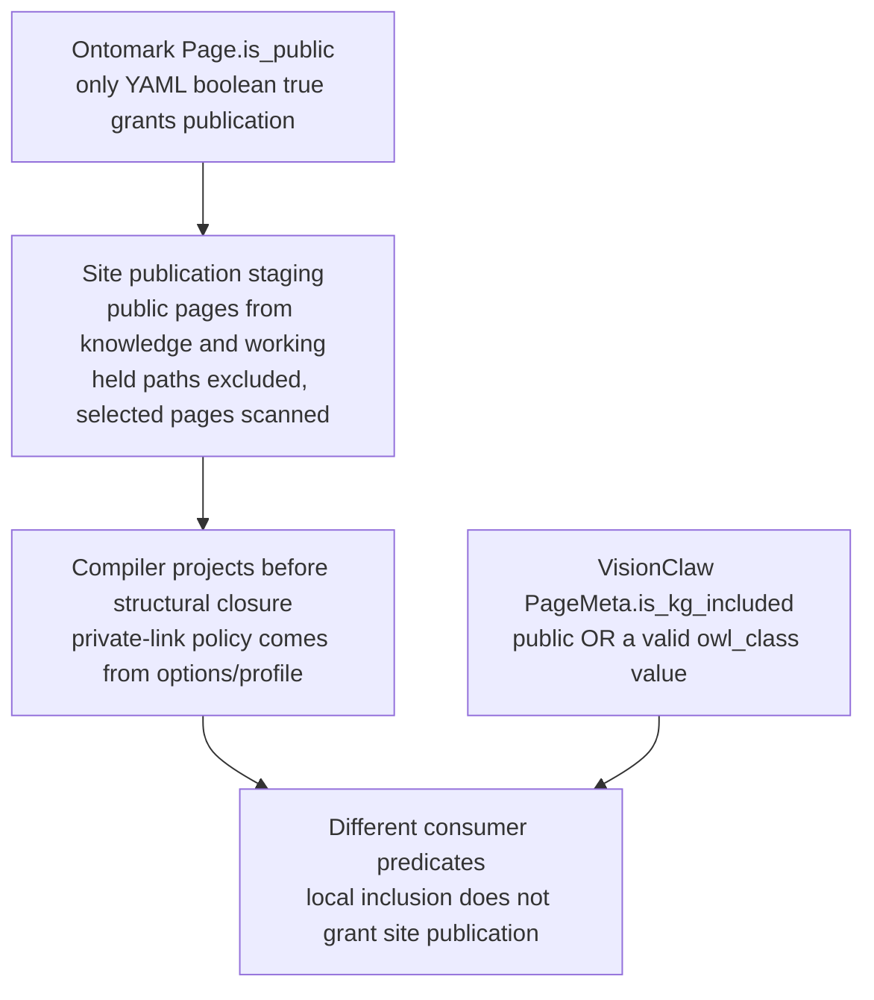
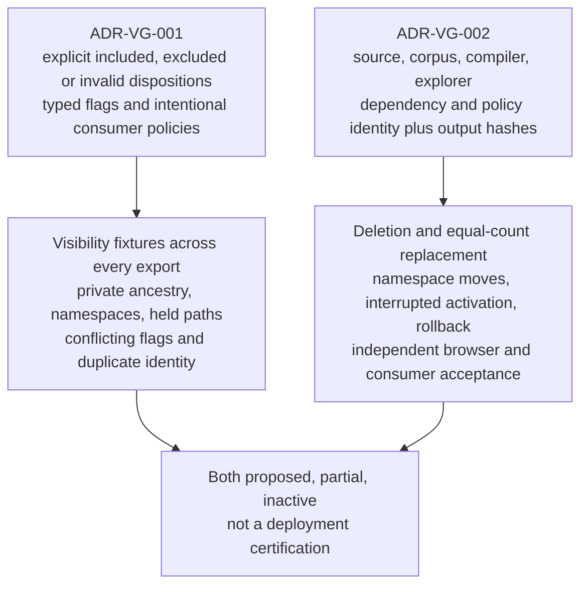
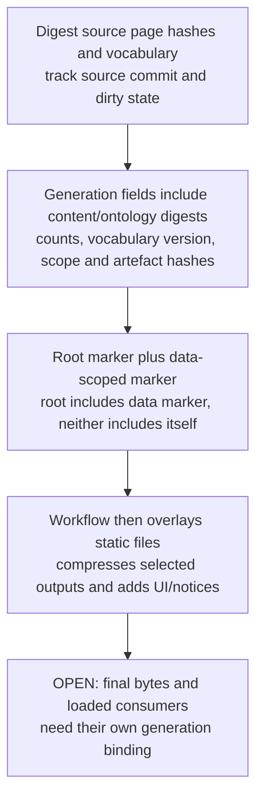
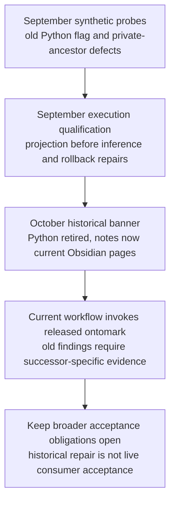

## For developers

Keep current consumer policies, compiler evidence and historical acceptance requirements distinct; the [section-by-section ADR assessment](../../estate-review/2026-11-01-visiongraph-publication-and-identity.md) records what these mechanisms do and what remains unproved.

## For the business

A public website, a local graph and a pod can intentionally contain different views, but users need clear policy and freshness information rather than one success label for all of them.

## VG-05.1 Current publication and graph-inclusion policies are distinct

**What it shows:** exact predicate differences and the compiler's projection order; these source functions replace the older blanket invariant list (`input/page.rs:269`, `vault/mod.rs:162`, `build/mod.rs:678`).
**Why it is this way:** local structural graph inclusion and public release are different policies; ADR-VG-001 requires those differences and their diagnostics to be intentional and tested (`ADR-VG-001-publication-policy-boundaries.md:32`).

## VG-05.2 Proposed acceptance requirements remain open

**What it shows:** the proposed end-to-end acceptance boundary, not the status of whether the existing site is online (`ADR-VG-001-publication-policy-boundaries.md:36`).
**Why it is this way:** the records explicitly preserve incomplete consumer acceptance despite component implementation and historical fixes (`ADR-VG-002-generation-and-consumer-identity.md:36`).

## VG-05.3 A compiler generation marker is not the final-site release manifest

**What it shows:** a real compiler manifest now exists; it lacks the complete final-site and loaded-consumer identity contract proposed by the ADR (`generation.rs:90`, `ADR-VG-002-generation-and-consumer-identity.md:32`).
**Why it is this way:** compiler emission precedes publication transformations; the earlier public-receipt audit found one static-context hash mismatch at that boundary without establishing malicious alteration (`build/mod.rs:1015`, `publish.yml:261`).

## VG-05.4 Historical failures, repairs and successor boundaries

**What it shows:** dated succession instead of presenting retired-parser counterexamples as current behaviour; the historical banner's reference to vault also lags the workflow's ontomark pin (`PUBLICATION-contract.md:3`, `publish.yml:48`).
**Why it is this way:** generation identity cannot certify privacy, and implementation changes do not automatically close the proposed acceptance contract (`ADR-VG-002-generation-and-consumer-identity.md:48`, `ADR-VG-001-publication-policy-boundaries.md:36`).
