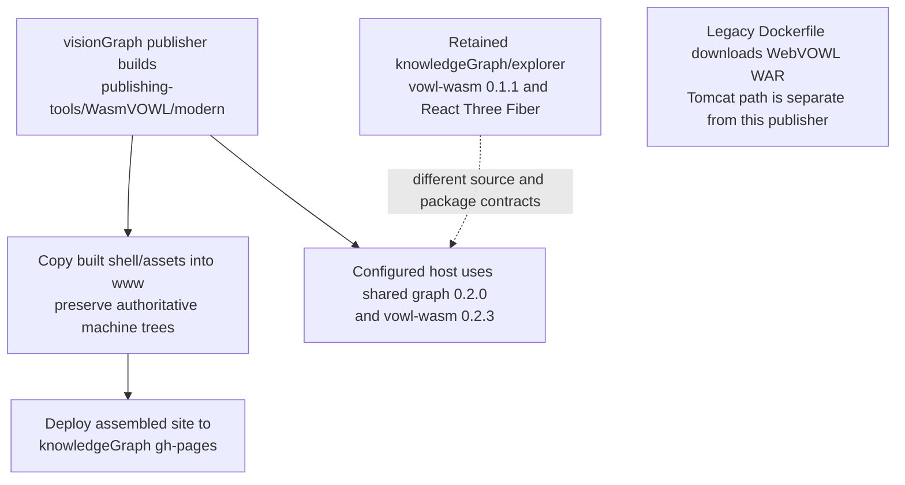
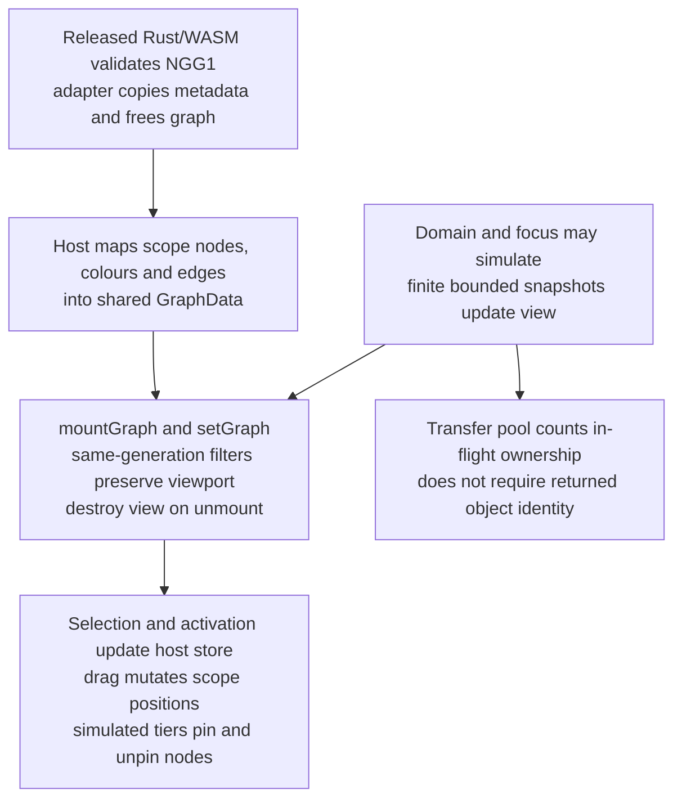
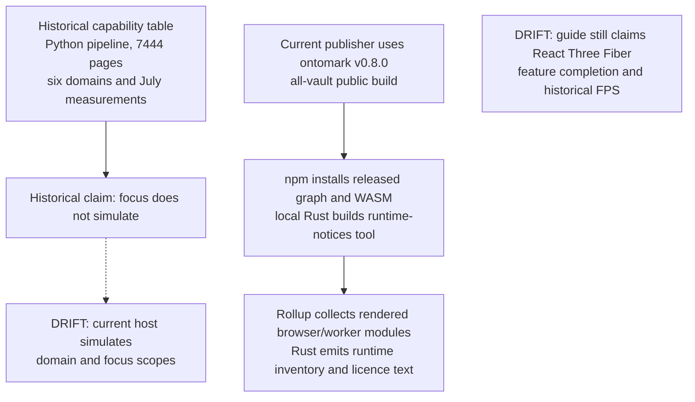
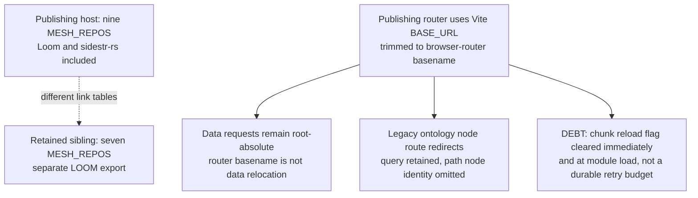
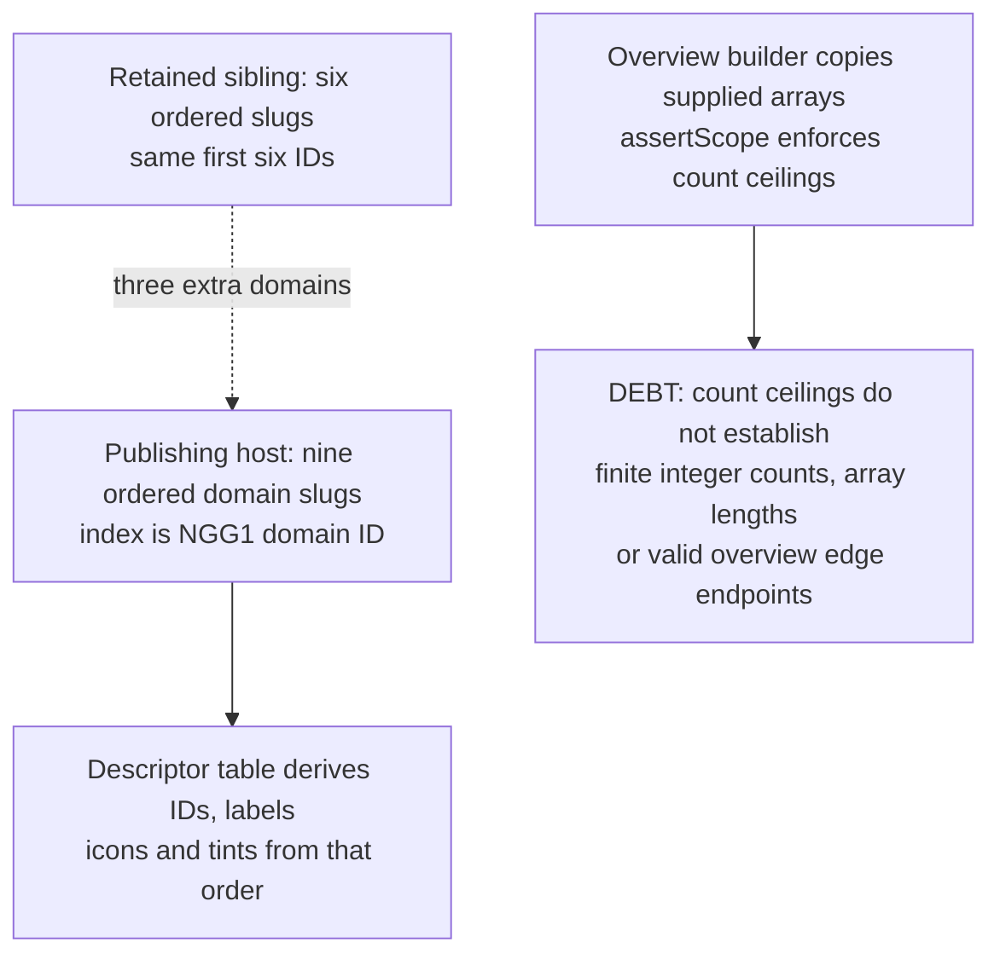
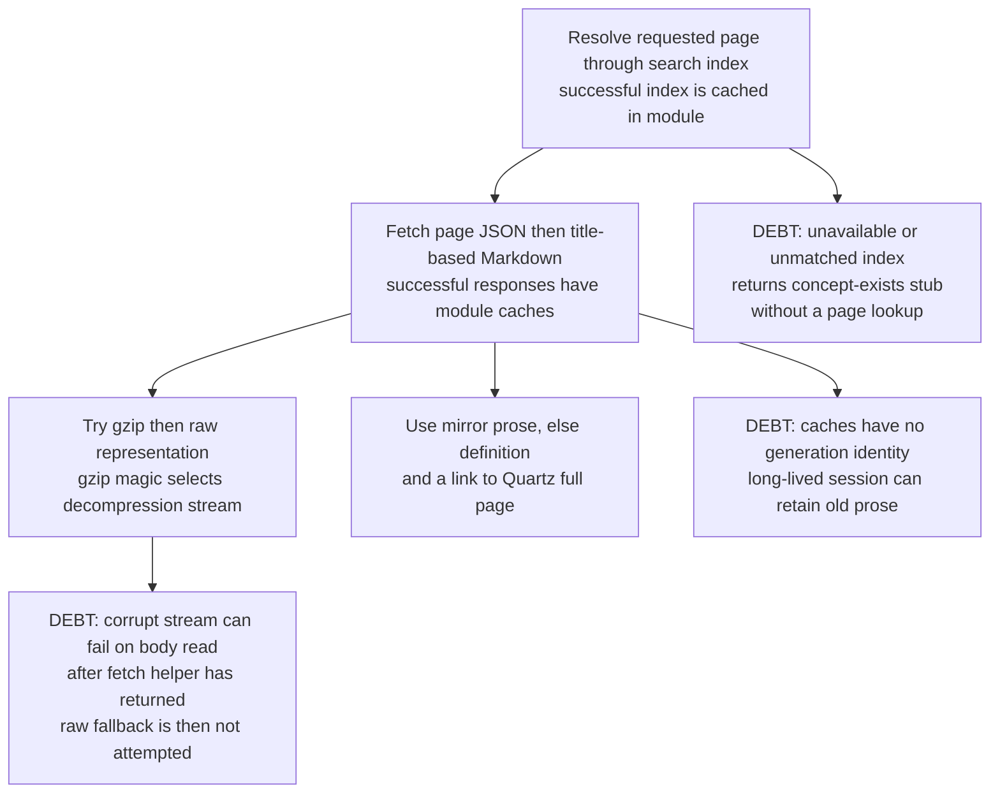

## For developers

The configured publisher builds this host, whose renderer and codec come from pinned releases. Read the adapters and content path separately from the retained knowledgeGraph copy; their dependency, domain and transport contracts differ.

## For the business

Readers can explore relationships and open corpus prose, but a successful graph build does not establish that every page is current or available. The dated audit separates passing interaction tests from unresolved content and deployment acceptance.

## VG-06.1 Configured publisher and retained sibling

**What it shows:** The workflow selects a concrete source tree and distribution repository. It does not identify the revision currently served by the public site.
**Why it is this way:** ADR-VG-007 keeps the site host and deployment here while extracting reusable graph software. The retained sibling is assessed separately in KG-04.

## VG-06.2 Shared renderer and codec, with host-owned interaction

**What it shows:** The publishing host has adopted shared drawing and Rust binary ownership. Local state, physics and content integration remain host responsibilities.
**Why it is this way:** ADR-VG-007 separates shared graph ownership from application policy. Current tests exercise real shared modules with DOM/canvas stubs, not a deployed browser.

## VG-06.3 Historical capability measurements and current build boundary

**What it shows:** The old measured capability table and broad guide claims do not describe the current producer or renderer. Local Rust still builds the notice tool, not the published engine.
**Why it is this way:** The extraction decision changes component ownership. Historical timings and vulnerability counts need dated, scope-specific evidence rather than promotion into current guarantees.

## VG-06.4 Current links and route behaviour

**What it shows:** The earlier missing-Loom statement is obsolete. Sub-path routing, root data paths and legacy identity handling are separate contracts.
**Why it is this way:** Site chrome and routes remain local under ADR-VG-007; a mesh hyperlink is not evidence of live Loom integration or consumer convergence.

## VG-06.5 Nine domain IDs and bounded scope validation

**What it shows:** Domain order remains a public identity contract. Binary codec validation and the JSON overview builder have different validation boundaries.
**Why it is this way:** The profile and consumer taxonomy must agree without renumbering existing IDs. Passing domain presence gates does not establish a structurally valid graph.

## VG-06.6 Prose lookup, compression and freshness limits

**What it shows:** The current host removes the external raw-GitHub fallback and adds gzip support, but still conflates some outages with missing content and retains successful responses indefinitely.
**Why it is this way:** These are current consumer boundaries reproduced with injected responses. They do not establish a live-site outage or override the separate publication identity findings.
