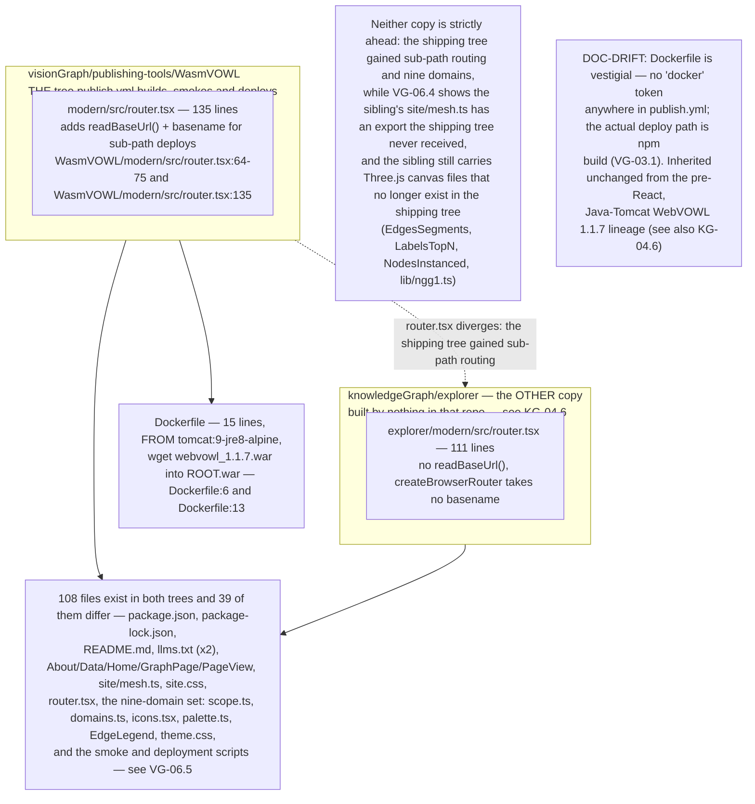
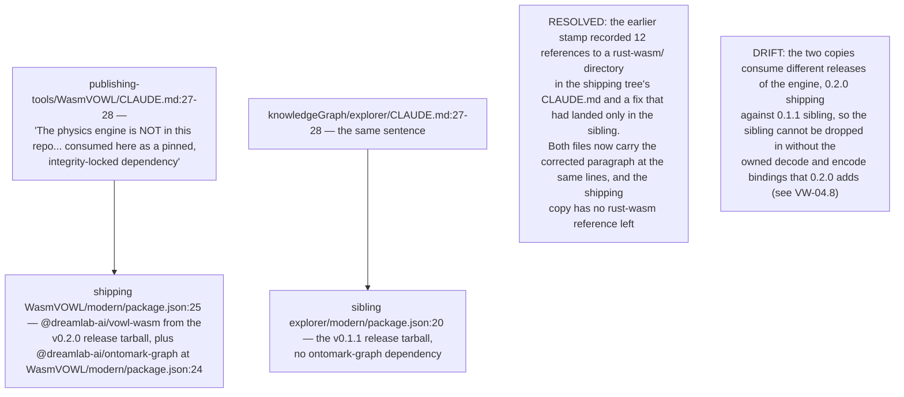
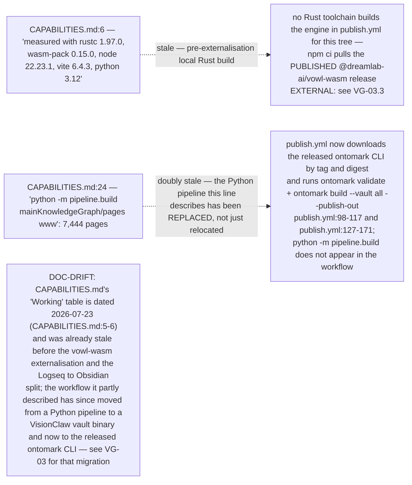
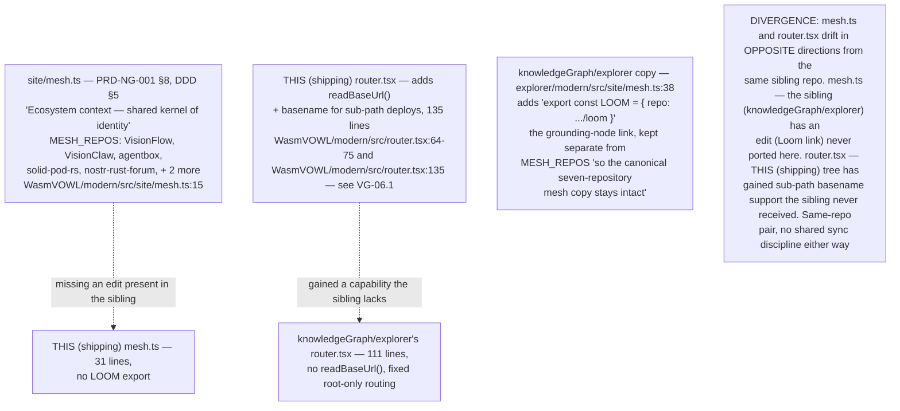
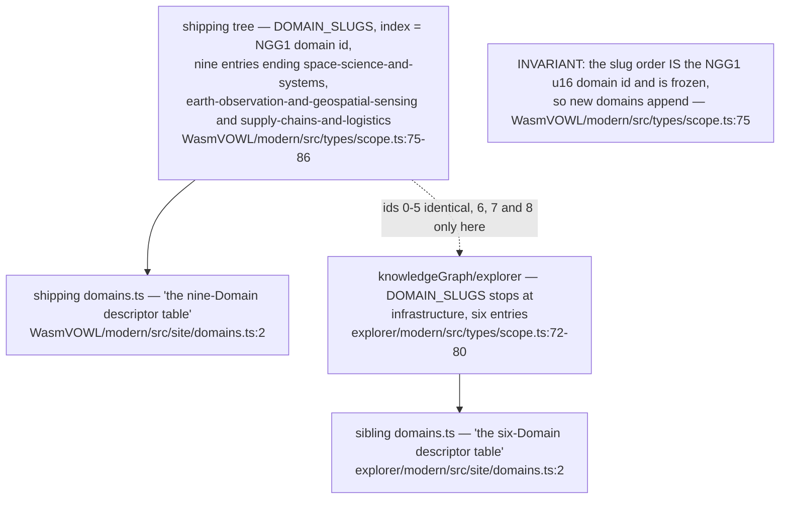

## VG-06.1 Two copies of one codebase — 39 of 108 shared files now differ

## VG-06.2 RESOLVED — this tree's CLAUDE.md no longer documents a Rust crate that is not here, but the two copies pin different vowl-wasm releases

## VG-06.3 CAPABILITIES.md — still measures a Python pipeline publish.yml no longer runs at all

## VG-06.4 site/mesh.ts and router.tsx — two files, drifting in OPPOSITE directions from the same sibling

## VG-06.5 Nine domains in the shipping tree, six in the sibling

**What it shows:** the space, Earth-observation and supply-chain domain changes landed only in the tree that ships. Its scope contract lists nine domain slugs, with the three new ones appended at ids 6, 7 and 8. The knowledgeGraph copy still lists six, and its descriptor table still calls itself "six-Domain".
**Why it is this way:** the domain work was done in visionGraph, where `publish.yml` builds the explorer, and no sync discipline carries edits to the sibling (VG-06.4). Because the sibling is built by nothing (KG-04.6), the gap does not reach the live site today. It does mean the sibling can no longer be dropped in as a replacement for the shipping tree.
**Debt:** the two explorer copies now differ in 39 of 108 shared files (counted at the two stamps by byte comparison, node_modules excluded; the earlier text counted 33 by a method this refresh did not repeat); the domain contract (`scope.ts`, `domains.ts`, icons, palette, legend) is the largest block.
