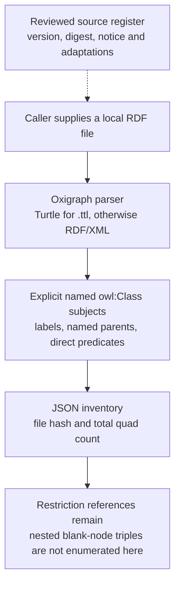
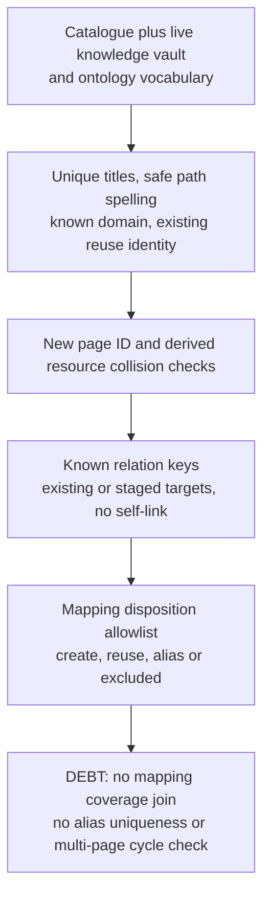
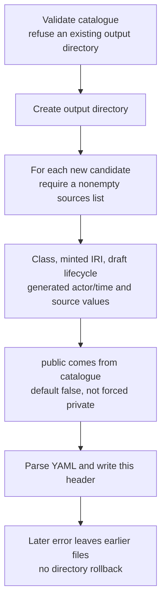
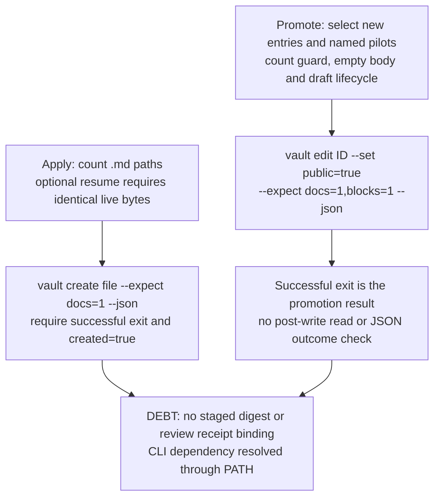
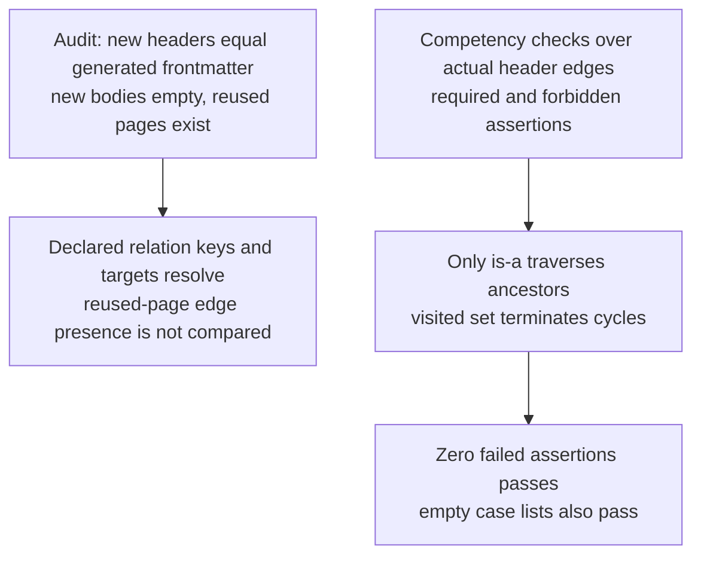

## For developers

Follow the project-specific importer from reviewed RDF snapshots to catalogue-driven headers and delegated writes; the [source-admission audit](../../estate-review/2026-11-01-visiongraph-source-admission.md) distinguishes implemented checks from manual review and later publisher gates.

## For the business

Curators can preserve source references while building editable knowledge pages, but successful staging does not establish licence admission, scientific correctness or readiness to publish; those decisions need their own evidence.

## VG-07.1 Admission policy and RDF inventory are separate steps

**What it shows:** the parser reads local bytes without following imports; inventory computes a digest but accepts no expected digest or admission register (`scripts/space-corpus/src/main.rs:311`).
**Why it is this way:** the decision admits reviewed selections rather than recursive upstream imports, with raw sources and separate construct accounting retained (`docs/adr/ADR-VG-005-licensed-source-admission.md:28`, `scripts/space-corpus/README.md:25`).

## VG-07.2 Catalogue validation checks names and targets, not complete semantics

**What it shows:** these checks reject selected structural errors but do not implement the conversion contract's complete collision, axiom and source-accounting requirements (`scripts/space-corpus/src/main.rs:404`, `planning/space-science-and-geo-sensing/conversion-and-linking.md:47`).
**Why it is this way:** the CLI consumes a reviewed catalogue; scientific review, reasoning and final-public-state checks remain separate acceptance work (`docs/adr/ADR-VG-006-ontology-to-obsidian.md:43`).

## VG-07.3 Staging writes sequential headers using the catalogue visibility flag

**What it shows:** staging skips reuse entries and writes body-free headers individually; source objects and generation time are copied without admission-register checks (`scripts/space-corpus/src/main.rs:388`, `scripts/space-corpus/src/main.rs:473`).
**Why it is this way:** the original header stage deferred article bodies and verification claims; the current function also supports the catalogue's later visibility state (`docs/adr/ADR-VG-006-ontology-to-obsidian.md:28`, `scripts/space-corpus/src/main.rs:477`).

## VG-07.4 Apply and promote delegate to a PATH-resolved vault executable

**What it shows:** the importer checks per-operation counts and selected outcomes; a downstream CLI still owns actual creation/edit enforcement (`scripts/space-corpus/src/main.rs:528`, `scripts/space-corpus/src/main.rs:210`).
**Why it is this way:** guarded creation avoids direct overwrites, but sequential or parallel per-page calls provide no batch rollback guarantee (`scripts/space-corpus/README.md:15`, `scripts/space-corpus/src/main.rs:522`).

## VG-07.5 Audit and competency checks answer bounded questions

**What it shows:** an audit result counts catalogue-declared targets; competency results instead traverse actual headers, without running the emitted OWL reasoner (`scripts/space-corpus/src/main.rs:600`, `scripts/space-corpus/src/main.rs:273`).
**Why it is this way:** association edges must not gain invented transitivity; full reasoning, attribution round trips and public-projection checks remain separate contract requirements (`scripts/space-corpus/README.md:20`, `planning/space-science-and-geo-sensing/conversion-and-linking.md:62`).

**Drift:** the README describes private staging, but the implementation consumes the catalogue visibility flag; no private-only invariant is enforced by `stage` (`scripts/space-corpus/README.md:14`, `scripts/space-corpus/src/main.rs:477`).
**Debt:** the crate depends on a relative sibling `vault-core` checkout, not a released parser pin; reproducibility requires that dependency's revision as well as this source revision (`scripts/space-corpus/Cargo.toml:18`).
