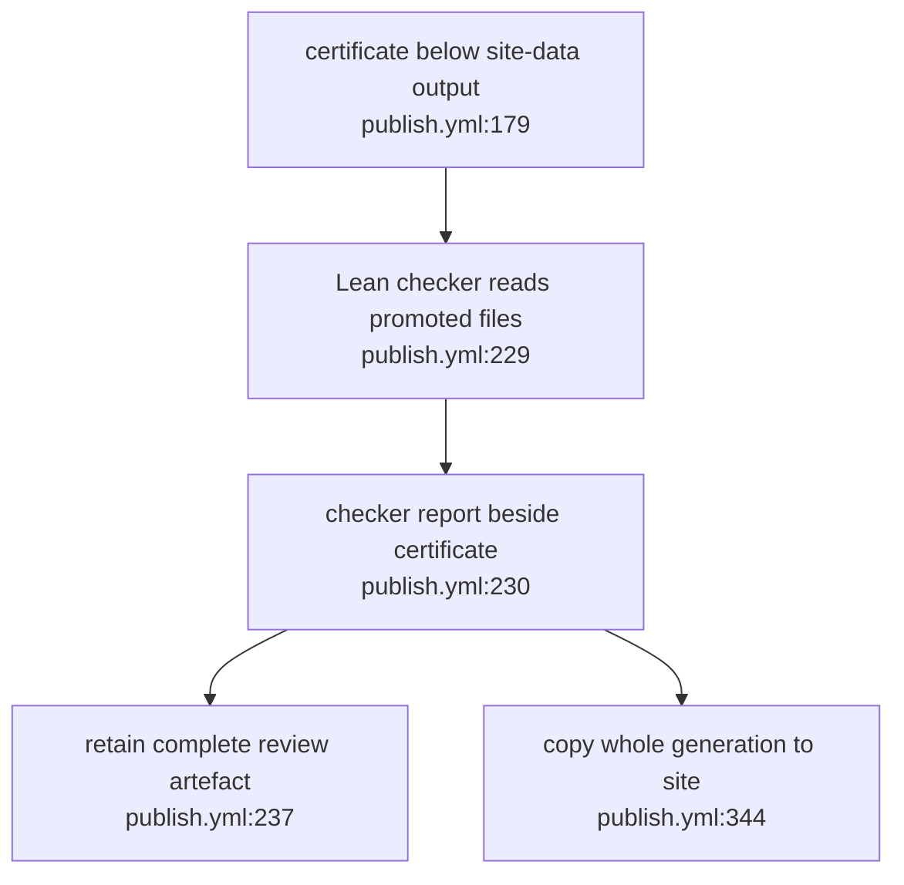

## For developers

This scoped successor covers the certificate destination in VG-03.5. The workflow pins Ontomark 0.7.3 with its released binary checksum and uses an output-child certificate path compatible with the transactional compiler. It also consumes the official VOWL 0.2.3 GitHub bundle. No workflow deployment is inferred here.

## For the business

The verifier, review artefact and published site all take the certificate from the ontology generation's own output directory. Publication includes the full certificate, subject to the existing site size gates.

## VG-08.1 Verify and publish the certificate from the promoted bundle

**What it shows:** the checker and downstream copies use one certificate location within the compiler output. **Why it is this way:** the new compiler refuses external certificate directories so its generation and warrant share one promotion point. Formal checking establishes the declared proof fragment, not the factual truth of every authored statement. **Invariant:** verification reads the certificate under the same `site-data` tree that is published (`publish.yml:229`).
