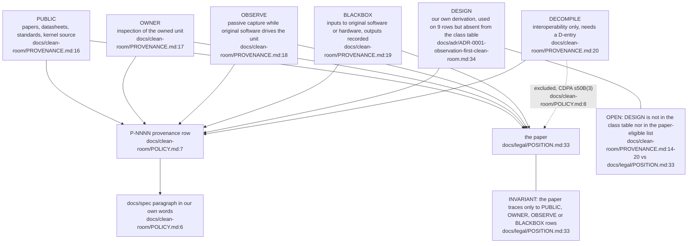
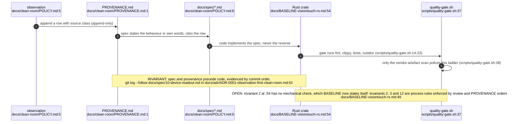
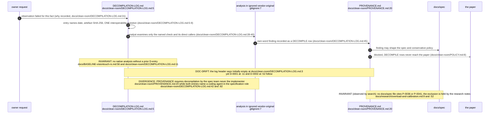
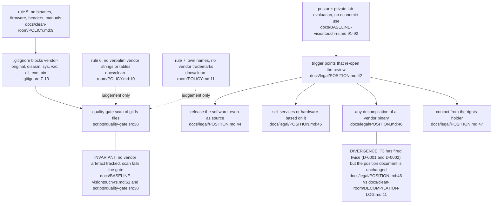

## For developers

Every protocol fact in visiontouch-rs must arrive through a ladder: an observation class, a `P-NNNN` provenance row, a spec paragraph in our own words, and only then Rust. Decompilation is the one class that needs a separate dated `D-NNNN` entry first, and whatever it yields is DECOMPILE class and never reaches the paper. The method is enforced by convention and commit order, not by CI: only the "no vendor artefact tracked" step is mechanical. This topic does not cover the legal landscape document or the paper itself.

## For the business

The lab owns one of very few surviving 1990s haptic arms and is studying how to talk to it without copying the maker's software, so the result can be written up as an academic paper and, later, used as an input device for the VisionFlow installation. The method is the product of the study: facts are watched on the wire or learned by using lawfully owned software as a black box, each one is logged with where it came from, and nothing from the maker is stored in the repository. Names such as the arm's trade name are used only to identify the hardware, with no affiliation with the rights holder. If the posture ever changes to release, sale or outside demonstration, the legal review is re-opened first.

## VT-01.1 Source classes and what may reach the paper

Six classes, one ledger. Five of them may feed the paper (DESIGN pending the open question), DECOMPILE may feed only the spec.

## VT-01.2 Spec before code, provenance before spec

The ladder is ordered by the commit history only. Nothing in the gate fails a Rust change that lacks a spec paragraph or a provenance row.

## VT-01.3 The D-NNNN decompilation gate

Two bounded entries exist, D-0001 and D-0002, both dated 2026-10-16 and both about release and safety behaviour. Their findings are deliberately not summarised here.

## VT-01.4 What stays out of the tree and what re-opens the legal review

Only rule 5 is machine-checked, and only by file extension and path. Rules 6 and 7 rely on review.
