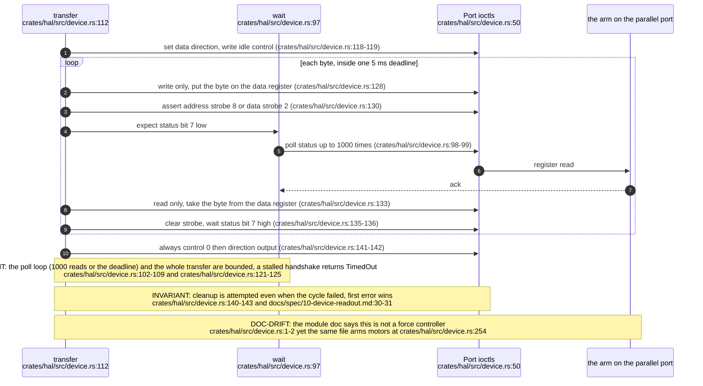
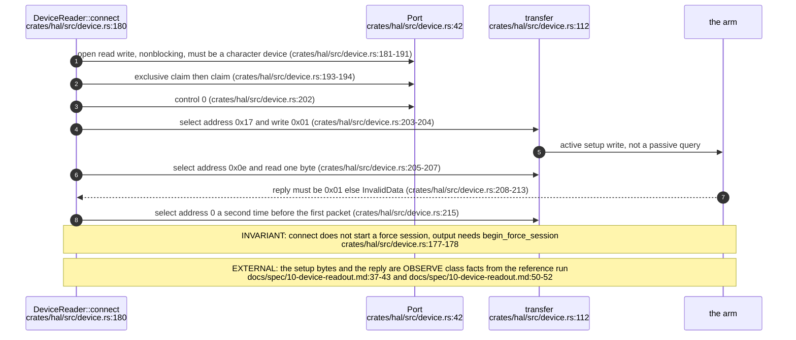
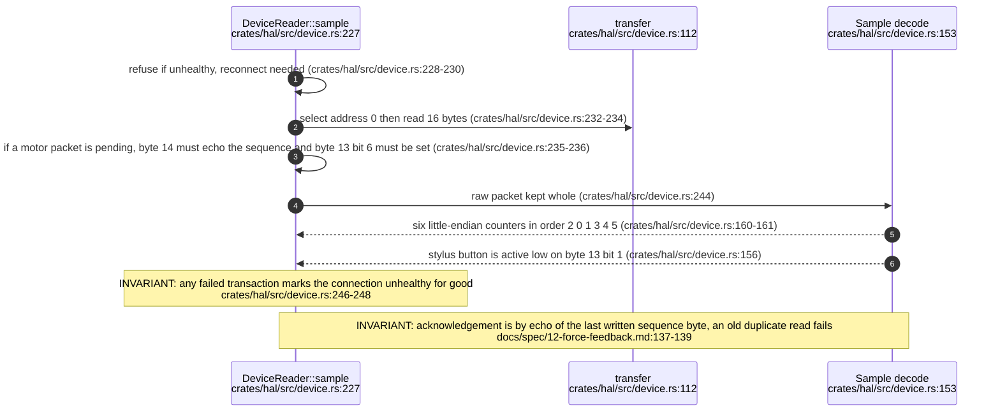
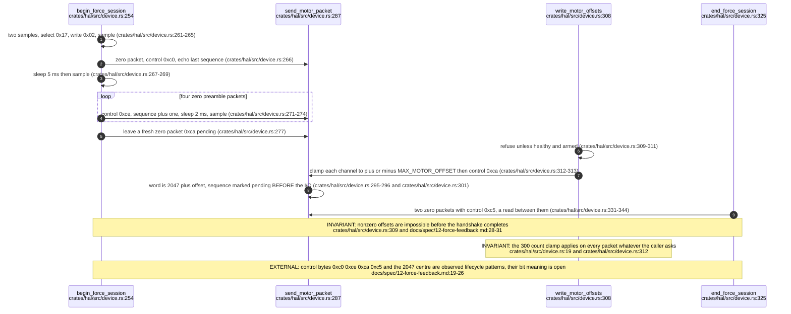
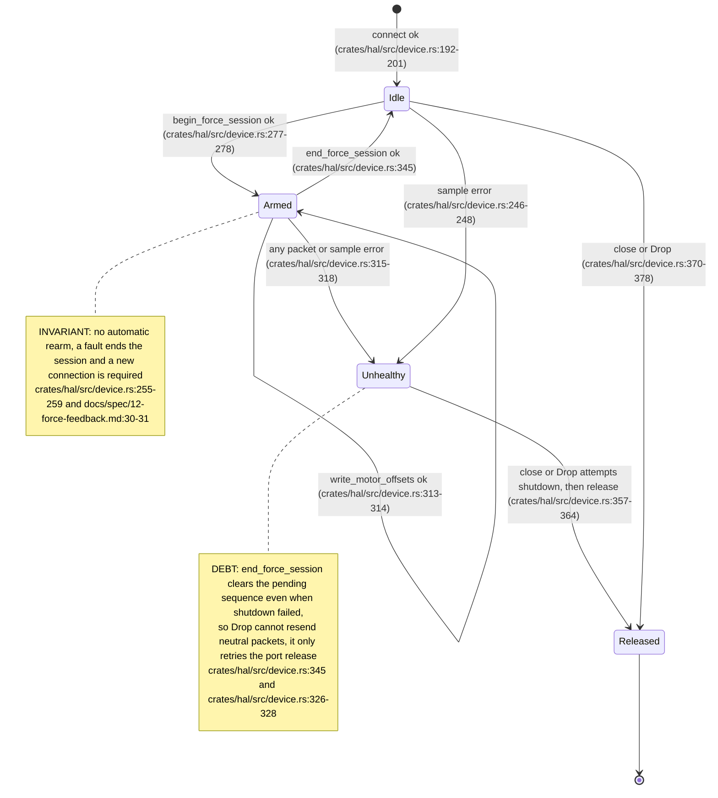

## For developers

The `hal` crate is the only code that touches the parallel port. It claims the ppdev node exclusively and performs IEEE 1284 EPP cycles in software through register ioctls, because the native EPP calls on this host overwrite the INIT bit. On top of that sit three observed protocols: the setup prefix, the 16-byte packet read, and the motor session (a zero-only handshake, 8-byte motor packets with a sequence acknowledgement, and a two-packet shutdown). One transport clamp of plus or minus 300 counts is applied to every packet. This topic stops at the transport boundary; limits, kinematics and the force guard are in VT-03.

## For the business

This is the part of the system that actually speaks to the arm. It is written to fail safe rather than to be fast: every exchange has a time limit, any half-finished exchange is treated as a fault, and the arm is only allowed to receive a push after a fixed start-up handshake that sends zeros first. If anything goes wrong the software tries to send the arm a neutral command and let go of the port. It cannot protect against the computer itself freezing or the process being killed, because no timer lives in the hardware that anyone has established. That is why the rest of the stack also keeps force requests small.

## VT-02.1 One software EPP byte cycle

The cycle is the public Linux EPP handshake reproduced with plain register reads and writes. A single 5 ms budget covers all bytes of a transfer.

## VT-02.2 Connect: claim, setup prefix, reply check

Everything here is replicated from a captured reference run. A matching reply is a communication check, not a model identification.

## VT-02.3 Sampling and the motor acknowledgement

The raw 16 bytes are never decoded as a sample unless the full transfer completed. Counter semantics beyond the first twelve bytes and the button bit are unestablished.

## VT-02.4 Force session: zero handshake, motor packets, shutdown

The 5 ms and 2 ms pauses and the trailing pending 0xca packet exist because the first native run rejected a duplicate read, so every servo read must follow a write.

## VT-02.5 Connection state and the cost of a failed shutdown

A failed shutdown cannot be recovered in place. The higher layers (VT-03) therefore make a failed shutdown outrank any other error so the operator reconnects.
