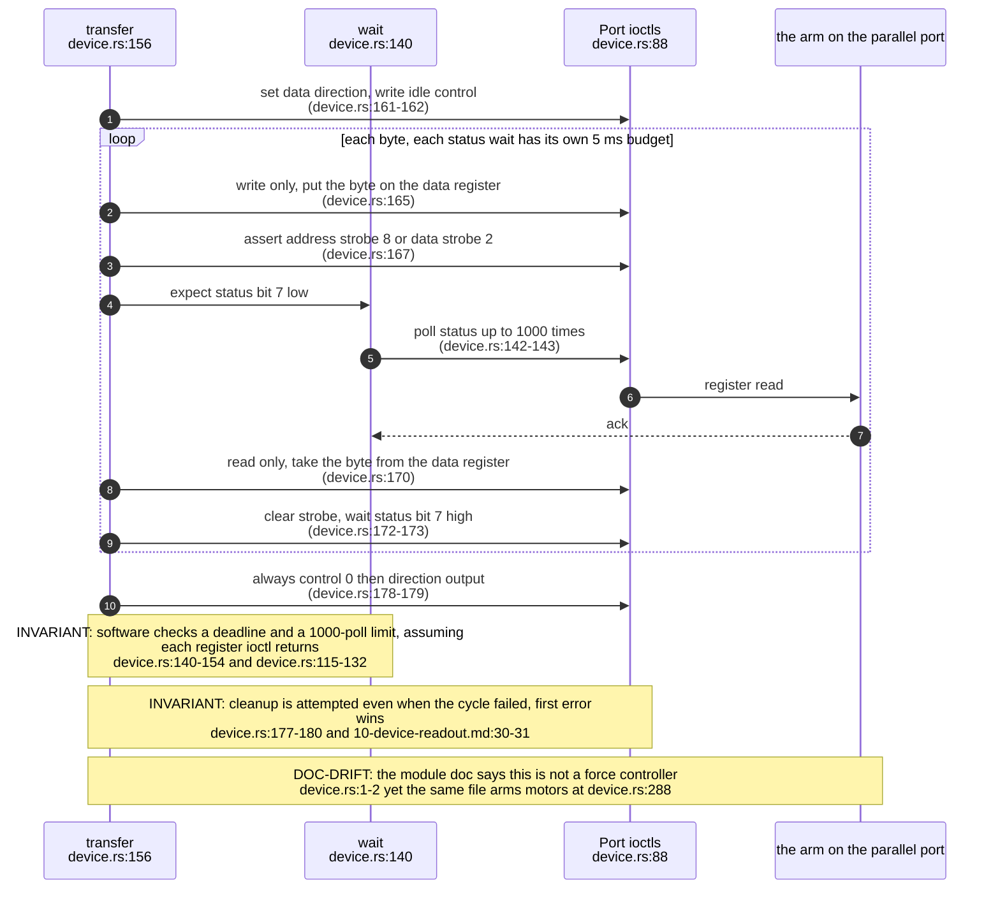
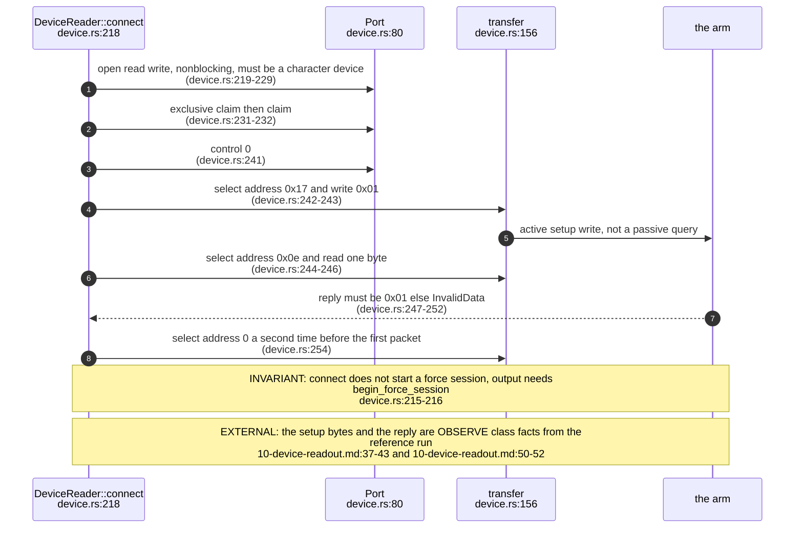
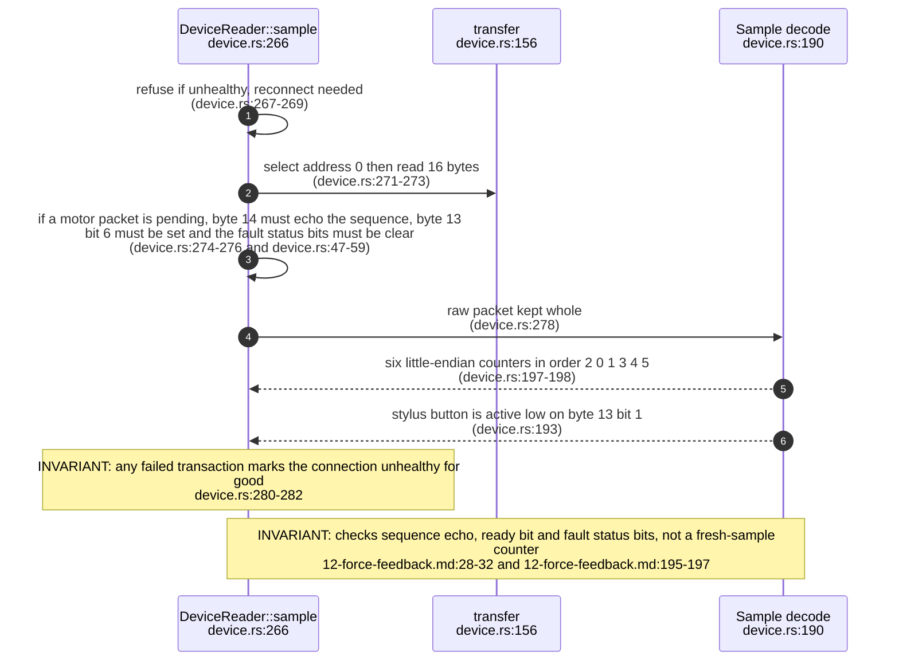
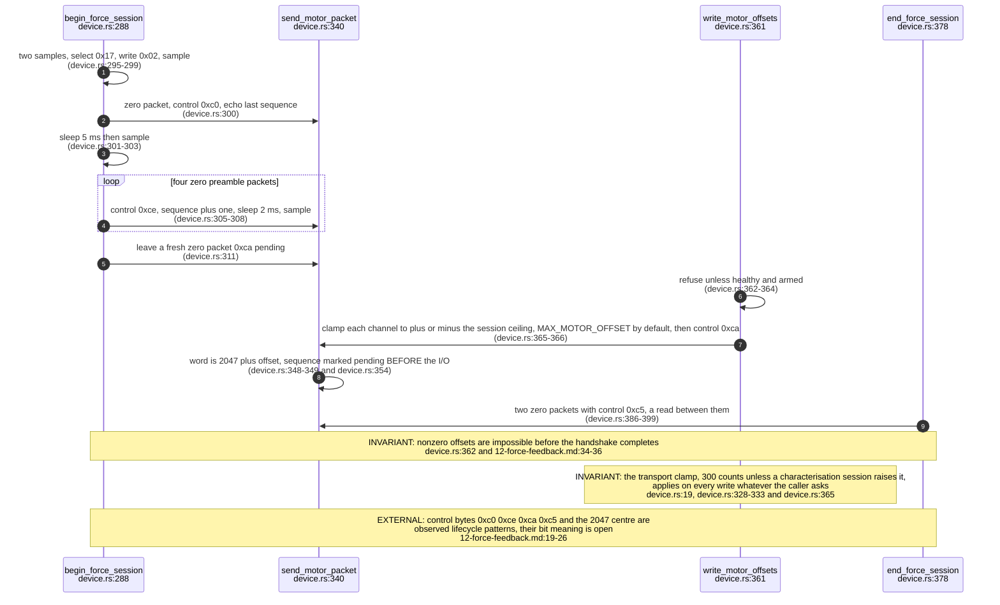
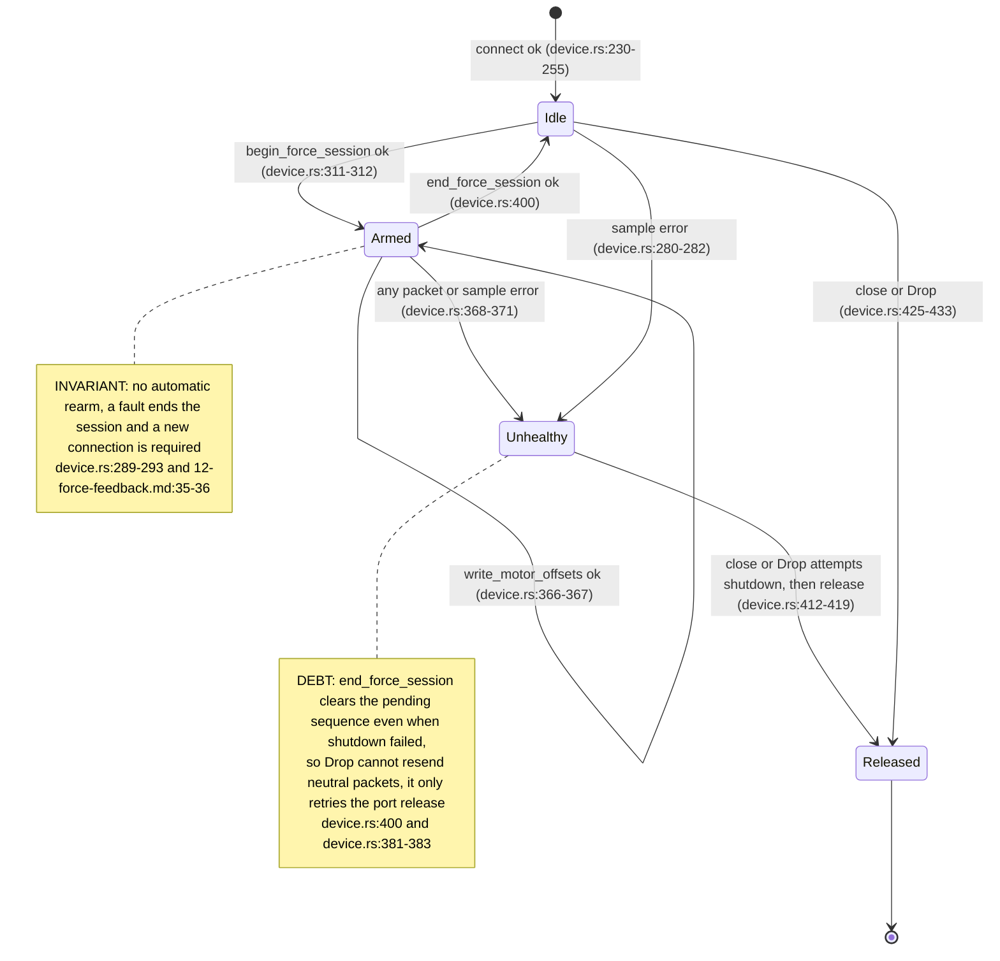

## For developers

Source review and qualifications: [1 November audit](../../estate-review/2026-11-01-visiontouch-software-boundaries.md). The source pins are retained; this review changes claims, not device behaviour.

The `hal` crate owns the native stack’s parallel-port I/O; the separate recorder can observe a reference program’s calls. It claims the ppdev node exclusively and performs IEEE 1284 EPP cycles in software through register ioctls, because the native EPP calls on this host overwrite the INIT bit. On top of that sit three observed protocols: the setup prefix, the 16-byte packet read, and the motor session (a zero-only handshake, 8-byte motor packets with a sequence acknowledgement, and a two-packet shutdown). The public nonzero motor-write method clamps each channel to plus or minus 300 counts; internal lifecycle packets carry zeros. This topic stops at the transport boundary; limits, kinematics and the force guard are in VT-03.

## For the business

This is the part of the system that actually speaks to the arm. It uses software deadlines and treats a failed exchange as a fault, and the arm is only allowed to receive a push after a fixed start-up handshake that sends zeros first. If anything goes wrong the software tries to send the arm a neutral command and let go of the port. It cannot protect against the computer itself freezing or the process being killed, because no timer lives in the hardware that anyone has established. That is why the rest of the stack also keeps force requests small.

## VT-02.1 One software EPP byte cycle

The cycle is the public Linux EPP handshake reproduced with plain register reads and writes. Each status wait has its own 5 ms budget measured from the start of that wait, and the device is polled before the deadline is checked (device.rs:135-141). It is not an independent deadline on a blocked ioctl or a guarantee about kernel scheduling.

## VT-02.2 Connect: claim, setup prefix, reply check

Everything here is replicated from a captured reference run. A matching reply is a communication check, not a model identification.

## VT-02.3 Sampling and the motor acknowledgement

The raw 16 bytes are never decoded as a sample unless the full transfer completed. The button, ready bit and sequence byte have observed meanings; the remaining status semantics are unestablished. Sampling twice without a new write can pass when the device returns the same expected echo.

## VT-02.4 Force session: zero handshake, motor packets, shutdown

The 5 ms and 2 ms pauses and the trailing pending 0xca packet exist because the first native run rejected a duplicate read, so every servo read must follow a write.

## VT-02.5 Connection state and the cost of a failed shutdown

A failed shutdown cannot be recovered in place. The higher layers (VT-03) therefore make a failed shutdown outrank any other error so the operator reconnects.
