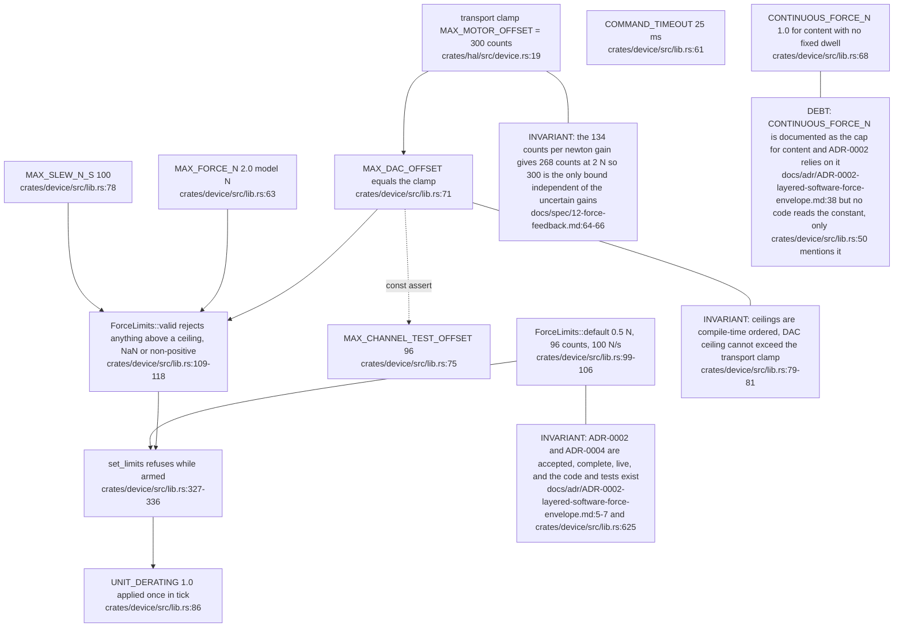
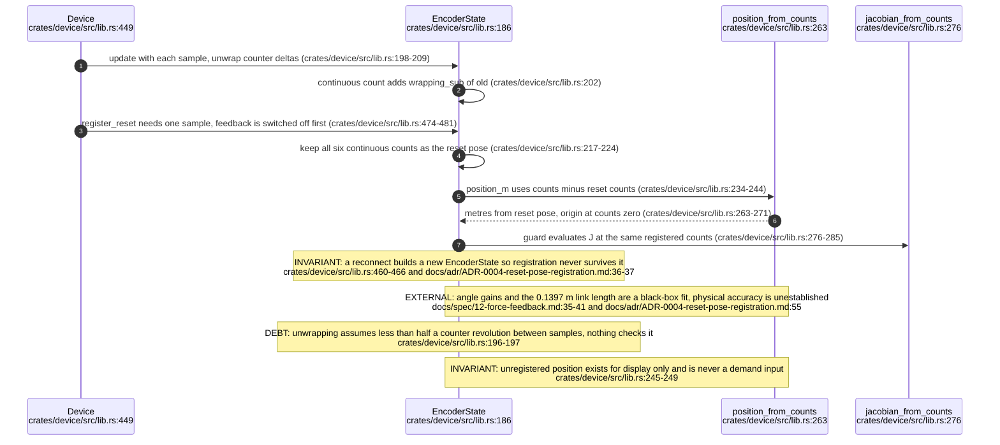
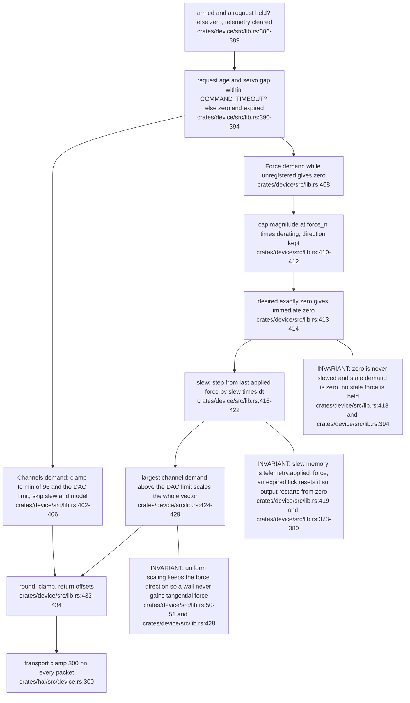
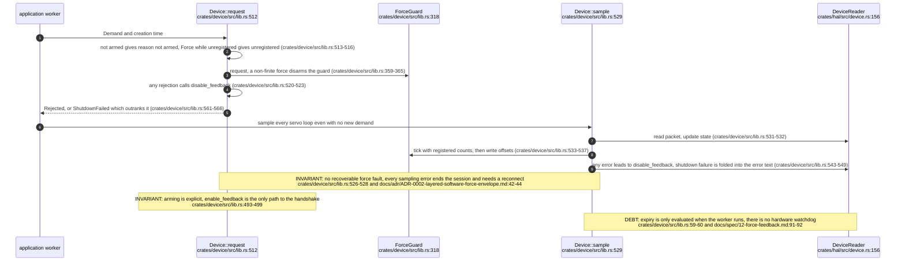
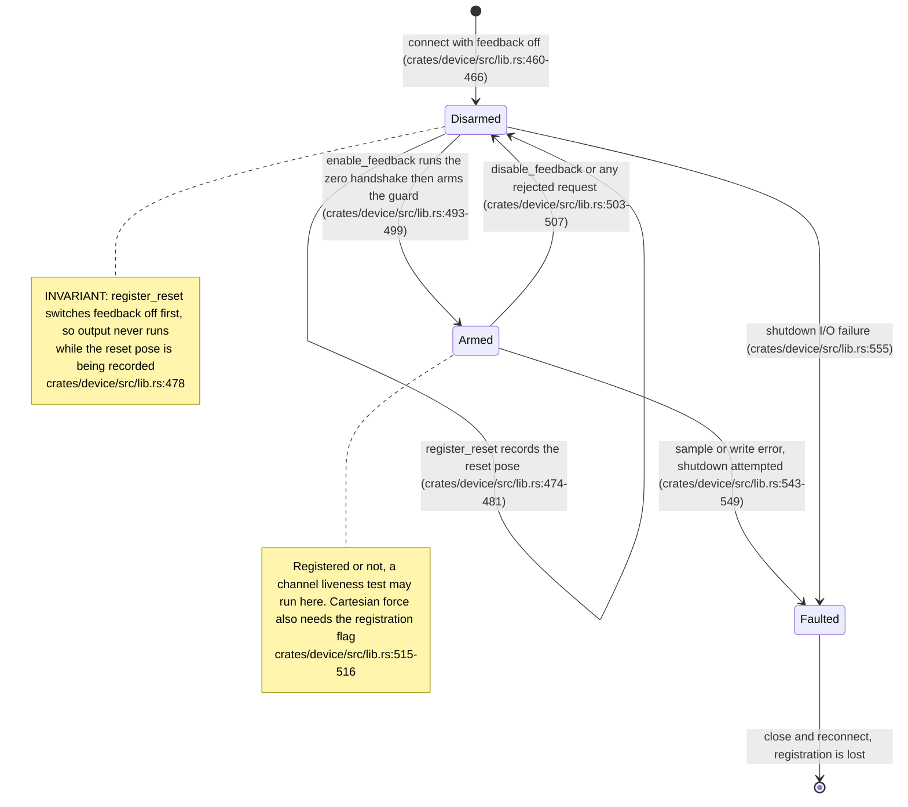

## For developers

`visiontouch-device` turns raw packets into a registered pose and turns an application force request into three bounded DAC offsets. Ceilings derive from one model-independent bound, the transport clamp of 300 counts, and applications may only lower them. Every tick runs the same ordered guard: expiry, cap, slew, uniform DAC scaling, rounding. Cartesian force is refused until the arm has been registered at the reset pose on this connection, and a failed shutdown outranks every other error. All newtons here are model commands, not measured forces. The Calibration Studio's use of the SDK (its verification ladder and higher limits) is outside this topic.

## For the business

This layer is the safety envelope between any application and the arm. Whatever a game or a graph tool asks for, the arm receives at most half a newton by default, never more than two, and only after the operator has placed it in a known reset pose and explicitly enabled force. A request that is more than a fortieth of a second old is dropped to zero, a fault ends the session rather than carrying on, and the limits can only be tightened by software, never loosened. None of these figures is a measured force on the real arm, and no measurement has yet been made.

## VT-03.1 Where each limit comes from

Application code can lower every figure here and raise none. The default is exactly the envelope that was armed live on the unit.

## VT-03.2 Registration, kinematics and the Jacobian

Registration records where the arm was when the operator said it was at the reset pose, then everything is measured from there. Expected error at the tip is centimetres, which is why the Studio adds ruler checks.

## VT-03.3 ForceGuard::tick order

The first force tick after arming applies nothing, because there is no previous tick and the slew step is zero. The documented order in the type comment matches the code.

## VT-03.4 Request, sample and the shutdown-precedes-rejection rule

Rejecting a bad request also shuts output down, so a buggy caller cannot leave the last good force running. The price is that a rejected request leaves the session disarmed and the caller must enable again.

## VT-03.5 Device lifecycle: feedback state, with registration as a separate flag

Registered and armed are independent: registration survives a disarm, and only a reconnect clears it.
