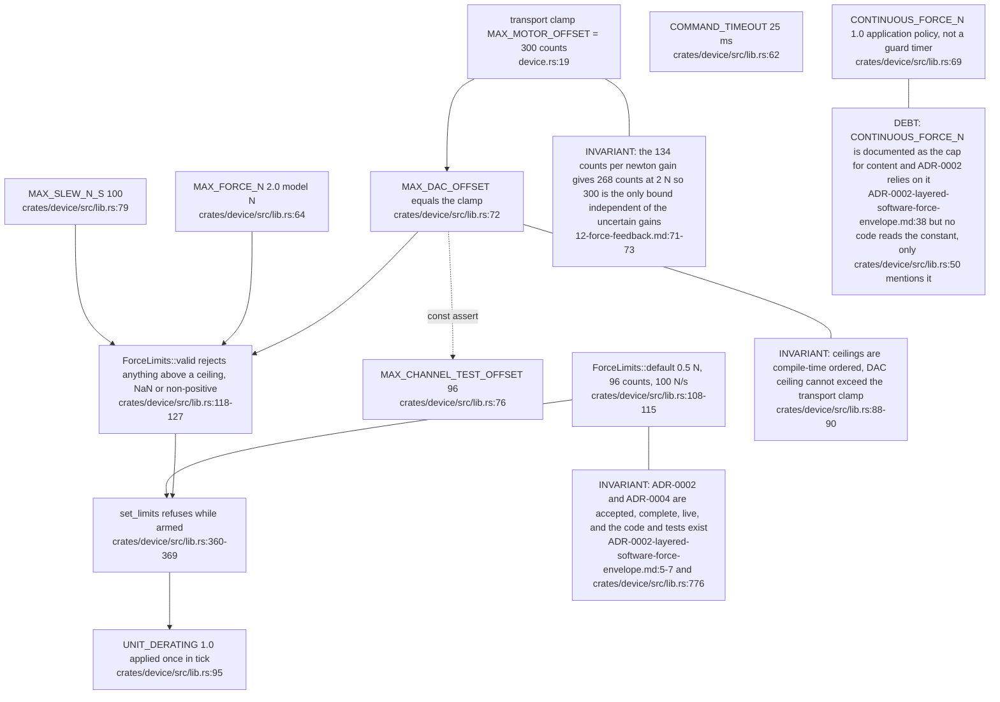
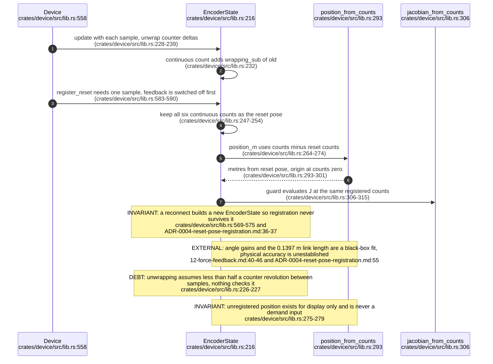
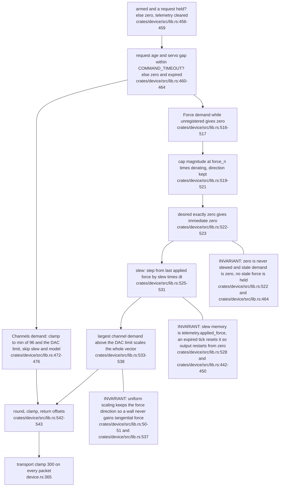
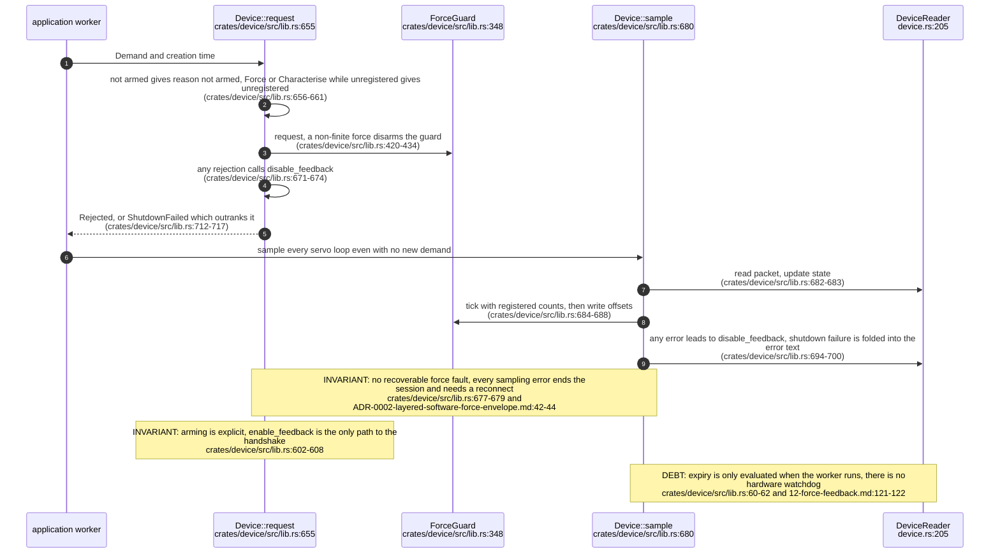
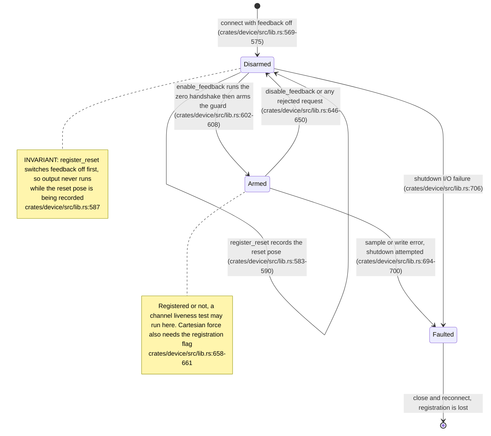

## For developers

Source review and qualifications: [1 November audit](../../estate-review/2026-11-01-visiontouch-software-boundaries.md). The source pins are retained; this review changes claims, not device behaviour.

`visiontouch-device` turns raw packets into a registered pose and turns an application force request into three bounded DAC offsets. Ceilings derive from one model-independent bound, the transport clamp of 300 counts, and applications may only lower them. Every tick runs the same ordered guard: expiry, cap, slew, uniform DAC scaling, rounding. Cartesian force is refused until the arm has been registered at the reset pose on this connection, and a failed shutdown outranks every other error. All newtons here are model commands, not measured forces. The Calibration Studio's use of the SDK (its verification ladder and higher limits) is outside this topic.

## For the business

This layer bounds model commands between an application and the transport. Cartesian commands default to a 0.5 N cap and require registration and explicit arming; raw channel diagnostics have a separate 96-count cap and can run unregistered. A disarmed caller can raise defaults up to the 2 N and 300-count SDK ceilings. When serviced, the guard zeros stale requests. The continuous-force policy and dwell budget belong to the application, and none of these command figures measures delivered force.

## VT-03.1 Where each limit comes from

Applications can raise the defaults while disarmed, up to the immutable SDK ceilings. The SDK does not verify a Studio unlock or a fixed dwell. The default is exactly the envelope that was armed live on the unit. A characterisation session armed through enable_characterisation uses its own raised ceiling and slew for Demand::Characterise only (crates/device/src/lib.rs:80-87, crates/device/src/lib.rs:616-643); the ceilings above govern every other demand.

## VT-03.2 Registration, kinematics and the Jacobian

Registration records where the arm was when the operator said it was at the reset pose, then everything is measured from there. Expected error at the tip is centimetres, which is why the Studio adds ruler checks.

## VT-03.3 ForceGuard::tick order

The first force tick after arming applies nothing, because there is no previous tick and the slew step is zero. The documented order in the type comment matches the code.

## VT-03.4 Request, sample and the shutdown-precedes-rejection rule

Rejecting a bad request also shuts output down, so a buggy caller cannot leave the last good force running. The price is that a rejected request leaves the session disarmed and the caller must enable again.

## VT-03.5 Device lifecycle: feedback state, with registration as a separate flag

Registered and armed are independent: registration survives a disarm, and only a reconnect clears it.
