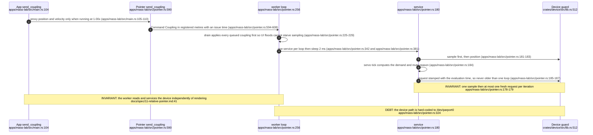
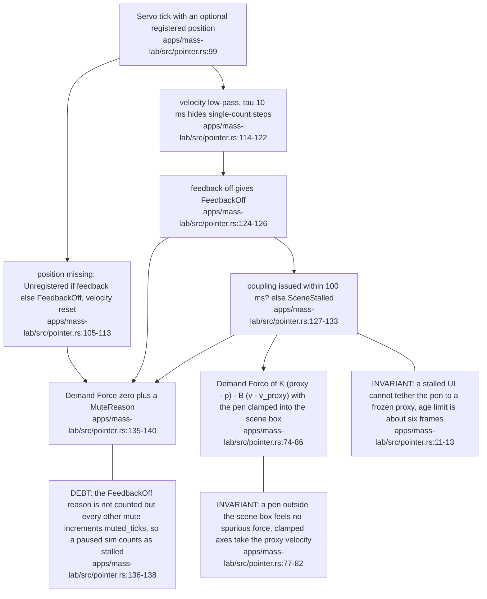
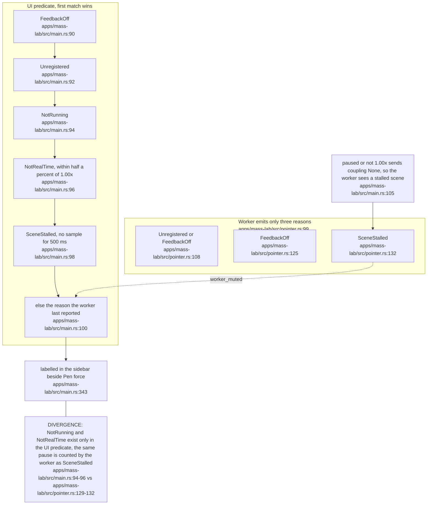
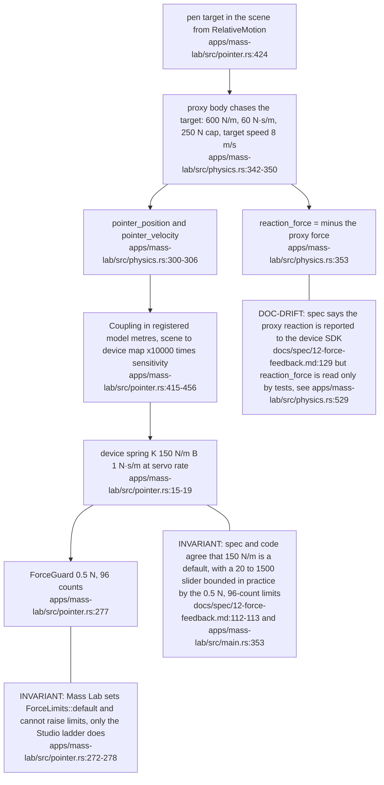
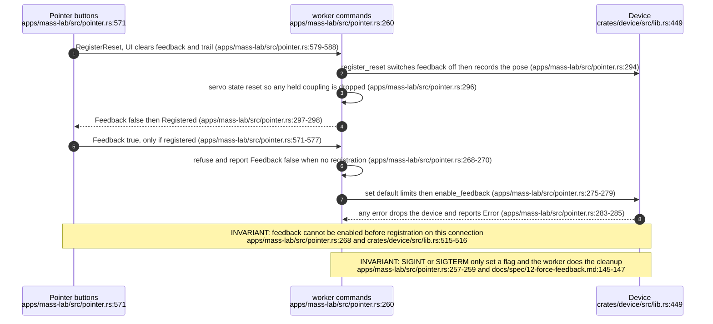

## For developers

Mass Lab is a rigid-body sandbox where the pen drags blocks. The force path is deliberately split: the UI thread only publishes a coupling descriptor (proxy position, proxy velocity, stiffness, damping, issue time) and a worker thread recomputes the force from every fresh sample at servo rate, so output no longer depends on the frame rate. A descriptor older than 100 ms, an unregistered arm, a paused or non-real-time simulation, or feedback off all produce an explicit zero with a named reason. Mass Lab always inherits `ForceLimits::default` and never raises limits. The Calibration Studio, which builds higher limits, is not covered here.

## For the business

Mass Lab is the lab's proof that a person can feel a simulated object. It is also the first thing that could later drive a graph tool, so it is built to stop pushing the moment anything looks wrong: if the screen freezes for a tenth of a second the arm goes slack rather than tugging toward a stale picture, and the screen explains in words why force is off. The strength it uses is the small, already-proven default. What it feels like is a command, not a measured force, and the on-screen label says so.

## VT-04.1 One frame and one servo tick

The UI frame rate only affects how fresh the descriptor is. The force itself is recomputed from the newest position every loop.

## VT-04.2 Servo tick: mute ladder and the spring law

Defaults are 150 N/m stiffness and 1 N·s/m damping, with a slider range of 20 to 1500 N/m.

## VT-04.3 Two places decide why the pen is muted

The operator sees one reason; the counter beside it, `muted servo ticks`, counts by the worker's coarser view.

## VT-04.4 Scene proxy and the device coupling are two springs

The device sees a tether to the proxy, and the proxy in turn is a light body dragged by the measured pen. Contact loads reach the pen only through proxy lag.

## VT-04.5 Register reset and the feedback switch

Registering always turns force off, so the operator has to enable it again deliberately after zeroing.
