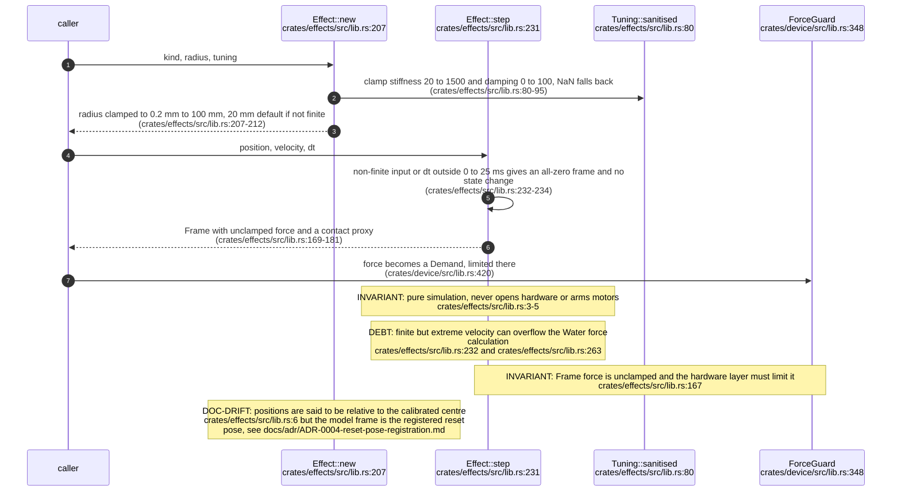
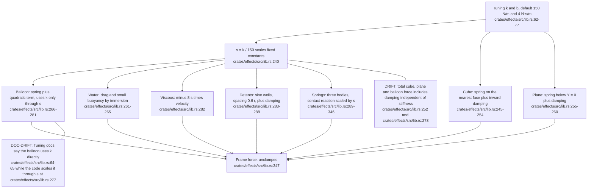
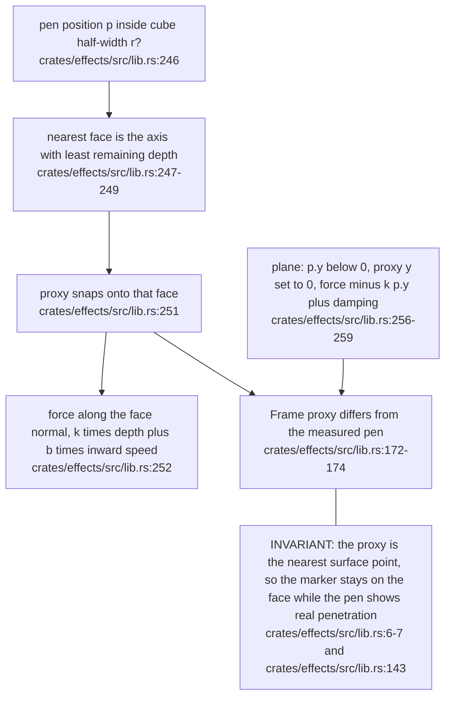
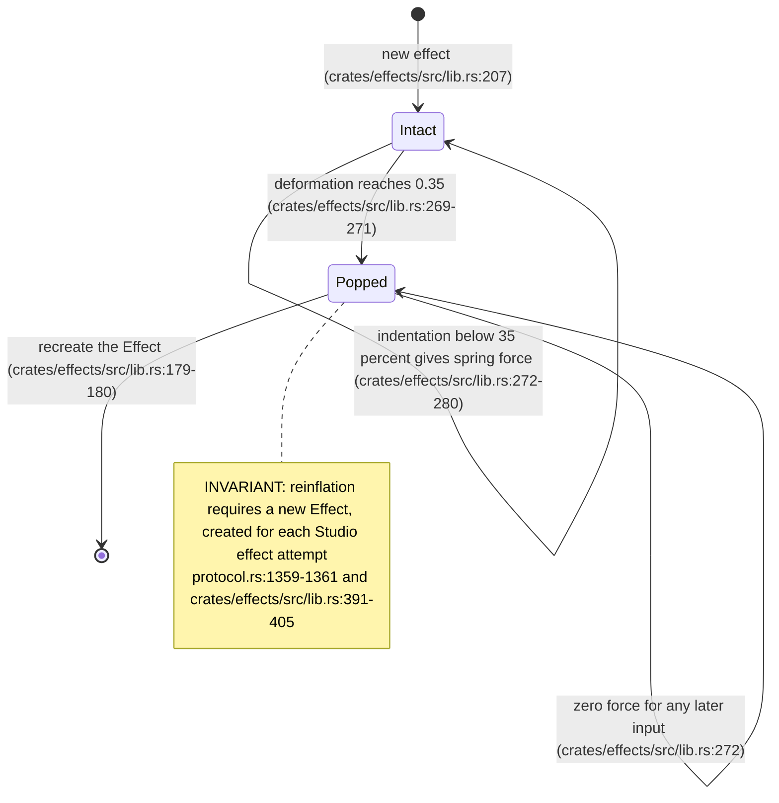
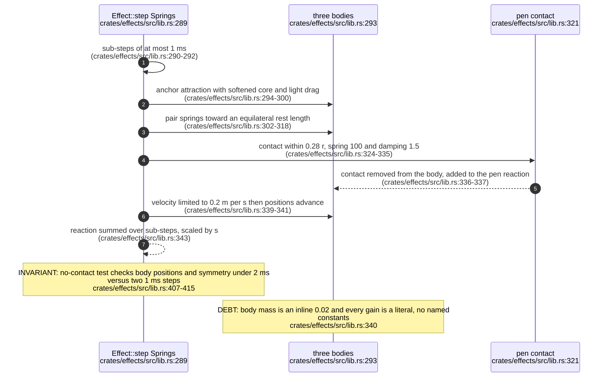

## For developers

Source review and qualifications: [1 November audit](../../estate-review/2026-11-01-visiontouch-software-boundaries.md). The source pins are retained; this review changes claims, not device behaviour.

`visiontouch-effects` is a hardware-free library of seven force models in model metres, seconds and newtons. A caller owns an `Effect`, feeds it the pen position, velocity and an interval, and gets back an unclamped `Frame` (force, contact proxy, spring-demo bodies, balloon state). Stiffness and damping come from one sanitised `Tuning`, with 150 N/m as the reference for several gains. Cube, plane and balloon also contain a damping term independent of stiffness, so their total force is not generally proportional to stiffness. The crate never limits force: the guard in VT-03 does. The Studio constructs a fresh effect for each effect attempt (apps/calibration/src/protocol.rs:1359-1361).

## For the business

These are the test objects the owner uses to judge whether the arm feels right: a hard cube, a flat plane, a water ball, a balloon that pops, three bobbing springs, a thick treacle field and a lattice of soft clicks. They are simulated entirely in software so they can be tuned and replayed without touching the arm. The numbers are commanded strengths from a model, not a promise of what the arm delivers, and the library cannot cause any push by itself.

## VT-05.1 What an effect call returns, and what it refuses

An invalid step returns a zero frame the caller should treat as a fault, not a quiet success.

## VT-05.2 Seven models and how stiffness reaches each

Cube and plane use stiffness and damping directly. Water, viscosity, detents and the spring-demo pen reaction scale by the ratio. Balloon scales its spring term but keeps a separate damping term. The balloon and the doc comment disagree on which group it belongs to, though the result is the same at the default.

## VT-05.3 Contact proxy for the cube and the plane

Damping acts only while the pen moves deeper, so it never pulls the pen back in on exit.

## VT-05.4 The balloon latch

A new Studio effect attempt recreates the effect. Releasing ends the current held attempt; a fresh attempt starts with an intact balloon.

## VT-05.5 Springs demo: sub-stepped three-body integration

Contact is subtracted from the body, then the pen reaction is averaged over substeps and multiplied by stiffness / 150. Changing stiffness scales the returned pen force without changing body motion; equal returned and body-contact magnitudes therefore hold only at the reference scale, before device limiting.
