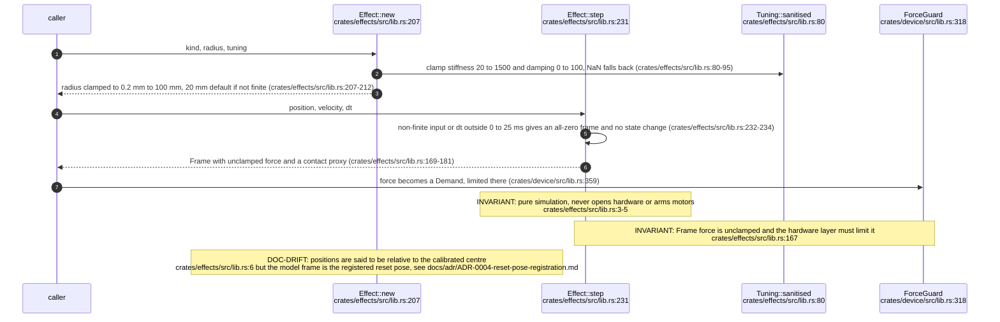
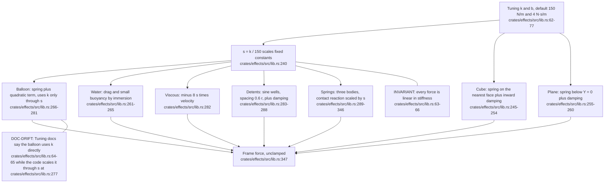
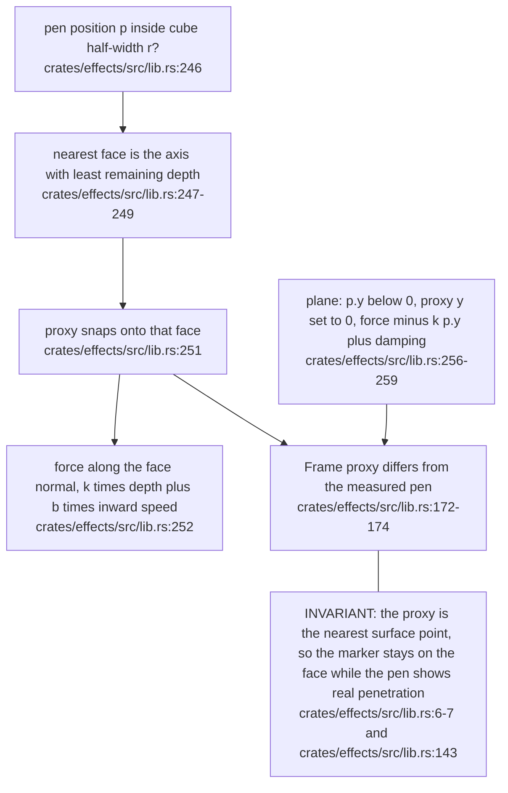
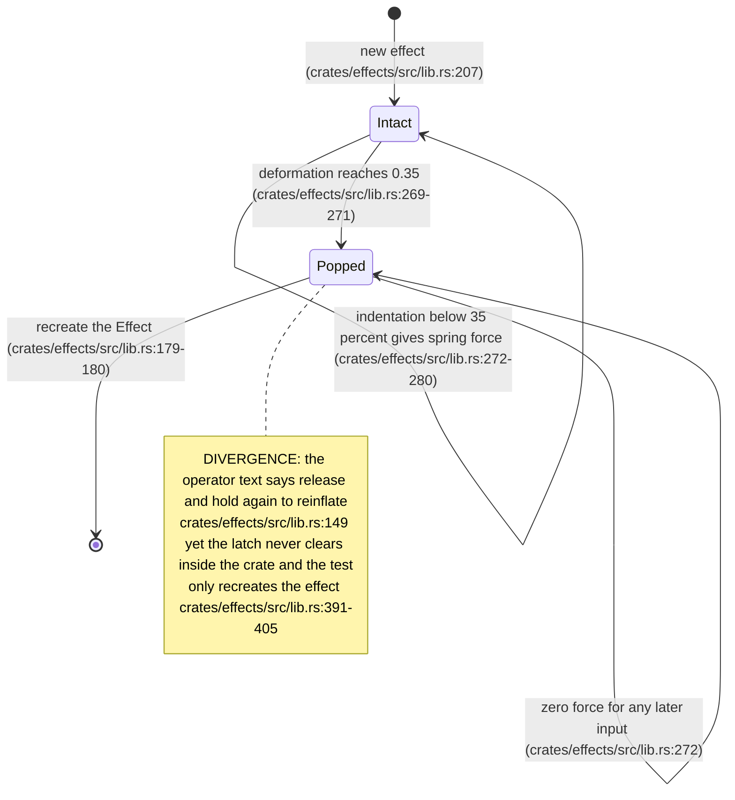
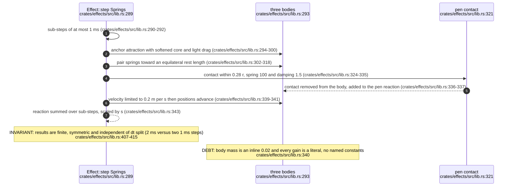

## For developers

`visiontouch-effects` is a hardware-free library of seven force models in model metres, seconds and newtons. A caller owns an `Effect`, feeds it the pen position, velocity and an interval, and gets back an unclamped `Frame` (force, contact proxy, spring-demo bodies, balloon state). Stiffness and damping come from one sanitised `Tuning`, and every fixed constant was written for 150 N/m, so forces scale linearly with stiffness. The crate never limits force: the guard in VT-03 does. Which app drives which effect is not covered here, because the Calibration Studio is being rewritten.

## For the business

These are the test objects the owner uses to judge whether the arm feels right: a hard cube, a flat plane, a water ball, a balloon that pops, three bobbing springs, a thick treacle field and a lattice of soft clicks. They are simulated entirely in software so they can be tuned and replayed without touching the arm. The numbers are commanded strengths from a model, not a promise of what the arm delivers, and the library cannot cause any push by itself.

## VT-05.1 What an effect call returns, and what it refuses

An invalid step returns a zero frame the caller should treat as a fault, not a quiet success.

## VT-05.2 Seven models and how stiffness reaches each

Cube and plane use stiffness and damping directly. The other five were tuned at 150 N/m and are scaled by the ratio. The balloon and the doc comment disagree on which group it belongs to, though the result is the same at the default.

## VT-05.3 Contact proxy for the cube and the plane

Damping acts only while the pen moves deeper, so it never pulls the pen back in on exit.

## VT-05.4 The balloon latch

Whether the app recreates the effect on release decides if the operator text is true. That sits with the app, so it is an open question for the Studio rewrite.

## VT-05.5 Springs demo: sub-stepped three-body integration

The pen feels momentum exchange with a body, and the body is pushed back by exactly the contact force the pen receives.
